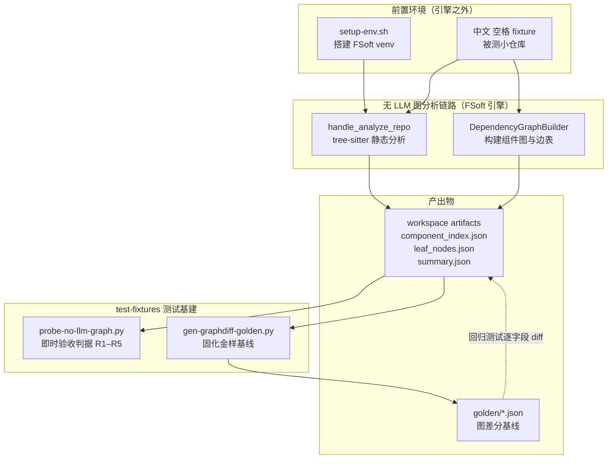
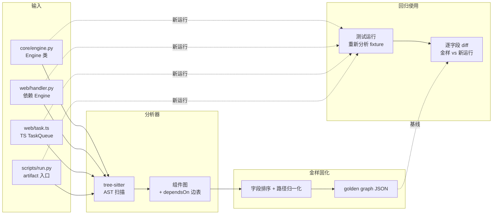
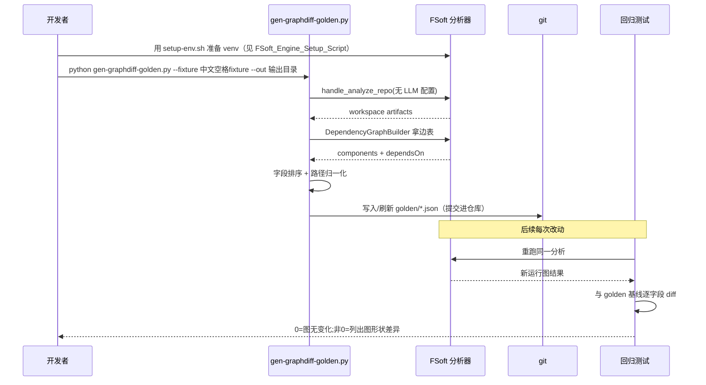

# Graphdiff_Golden_Generator（图差分金样生成器）

!!! info "Generated documentation"
    This page was written by CodeWiki from the source code at commit [`4240a3bb`](https://github.com/ikliml666/dsh-codewiki/commit/4240a3bb975281e7d3d47e6cc77f5b2a8276d57b) on 2026-11-08 with `deepseek-v4.1-flash`. Check the code before relying on details.

## 简介

`Graphdiff_Golden_Generator` 是插件测试基建中的**金样（golden）生成工具**，由单一脚本
`test-fixtures/gen-graphdiff-golden.py`（入口函数 `main`）构成。它的职责是：在受控的 fixture
小仓库上跑一遍**无 LLM 的原生依赖图分析链路**，把产出的依赖图（组件、边、叶子节点、artifact
节点）序列化为一份**已知正确的基线文件**，提交进仓库，供后续测试做「图差分（graph diff）」回归比对——
任何对图构建逻辑的改动是否改变了图的形状，都能通过与这份金样的逐字段 diff 被精确捕获。

它与 [No-LLM_Graph_Probe（无 LLM 依赖图验收探针）](No-LLM_Graph_Probe.md) 是一对孪生工具：探针（probe）负责「跑一遍并
即时判定 5 条验收判据是否通过」，金样生成器（golden generator）负责「把同一跑法的结果固化成
可持久、可 diff 的基线」。两者都建立在同一条完全无模型依赖的链路上——FSoft 引擎的
`handle_analyze_repo` 走 tree-sitter 静态分析，因此整条链路**不需要任何 API key、不碰 DSH
插件本体**，是原生引擎迁移（阶段 1A）里最先跑通、也最适合钉金样的一环。

## 在系统中的位置



## 核心组件

| 组件 | 文件 | 职责 |
| --- | --- | --- |
| `main` | `test-fixtures/gen-graphdiff-golden.py` | 脚本入口：解析参数、运行图分析、把结果落盘为金样文件，并以退出码表达生成是否成功 |

### `main` 的典型行为

参照同目录探针的参数化约定（`--fixture` / `--out` / FSoft 源码根），金样生成器的 `main` 完成：

1. **定位输入**：被测 fixture 目录（默认使用仓库内的「中文 空格 fixture」）与 FSoft 源码根；
2. **运行分析**：以完全无模型的配置调用 `handle_analyze_repo`，并直接调用
   `DependencyGraphBuilder.build_dependency_graph()` 拿到带 `dependsOn` 边表的组件图；
3. **序列化金样**：把组件集合、依赖边、叶子节点、artifact 节点、语言统计等**可确定性重现**的字段
   整理为稳定 JSON（字段键排序、路径归一化），写入金样文件；
4. **退出码约定**：0 = 金样生成成功且与既有基线一致；2 = 分析本身产出与预期不符（图形状变了）；
   3 = 环境或输入异常。

> 与探针的分工：探针每次运行只在 stdout 打印一次验收报告；金样生成器则把「这次运行的图」固化为
> 文件。当分析逻辑发生预期内的演进时，开发者重跑本脚本即可刷新金样，并通过 git diff 审查图的变化。

## 数据流



## 生成与回归流程



## 为什么金样必须钉在这个无 LLM 链路上

- **确定性**：tree-sitter 静态分析不调用模型，同一份 fixture 跑 N 次产出同一份图，金样不会因为
  模型版本漂移而产生噪声 diff。
- **最小攻击面**：fixture 是一个中文+空格路径的极小仓库（Python + TypeScript 双语言、一条
  `web.handler -> core.engine` 依赖边、一个 artifact 节点 `scripts/run.py`），任何字段变化都能
  被快速定位。
- **与插件运行时解耦**：金样验证的是上游 FSoft 引擎的图构建行为本身；DSH 插件通道（见
  [Job Orchestration（编译任务编排服务）](Job_Orchestration.md)）只是引擎的消费者，引擎图回归不应依赖插件或模型凭证。

## 与其他模块的关系

| 关联模块 | 关系说明 |
| --- | --- |
| [No-LLM_Graph_Probe（无 LLM 依赖图验收探针）](No-LLM_Graph_Probe.md) | 孪生工具：同一分析链路的「即时判据版」；金样生成器固化的正是探针所判定的那组图结构 |
| [FSoft 引擎环境搭建脚本（FSoft_Engine_Setup_Script）](FSoft_Engine_Setup_Script.md) | 前置依赖：必须先用 `setup-env.sh` 搭好闭合 venv，分析器才可 import |
| [Job_Logs](Job_Logs.md) | 其 fixture 小节即被测「中文 空格 fixture」（`core/engine.py`、`web/handler.py`、`web/task.ts`、`scripts/run.py`）的来源文档 |
| [Engine_Python_Entry](Engine_Python_Entry.md) | 引擎入口 `lib/engine/python/entry.py`；金样针对的是同一套原生引擎的图分析阶段 |
| [Engine_FSoft_Runtime：增量 Step 5 的受控并行与断点运行时](Engine_FSoft_Runtime.md) / [全量并行运行时（Engine_Full_Parallel_Runtime）](Engine_Full_Parallel_Runtime.md) | 引擎运行时如何驱动 leaf agent 与图 IO；金样验证的是其上游静态图产物 |
| [工作区快照（Engine_Workspace_Snapshot）](Engine_Workspace_Snapshot.md) | 金样所快照的 workspace artifacts（`component_index.json` 等）的语义来源 |

## 运行方式（约定）

```bash
# 前置：先按 FSoft_Engine_Setup_Script 建好 venv
# 生成/刷新金样（参数约定与 No-LLM_Graph_Probe 一致）
python test-fixtures/gen-graphdiff-golden.py \
  --fsoft-src <FSoft 源码根> \
  --fixture test-fixtures/中文 空格 fixture \
  --out <金样输出目录>
```

退出码语义与探针对齐：`0` 成功（金样已生成或与基线一致），`2` 图形状与预期不符，`3` 环境/输入
异常。CI 中通过 git diff 审查金样变化，把「引擎图演进」变成一次显式、可评审的提交。

??? abstract "Documented components (1)"
    - [`main`](https://github.com/ikliml666/dsh-codewiki/blob/4240a3bb975281e7d3d47e6cc77f5b2a8276d57b/test-fixtures%5Cgen-graphdiff-golden.py) — `test-fixtures\gen-graphdiff-golden.py`

