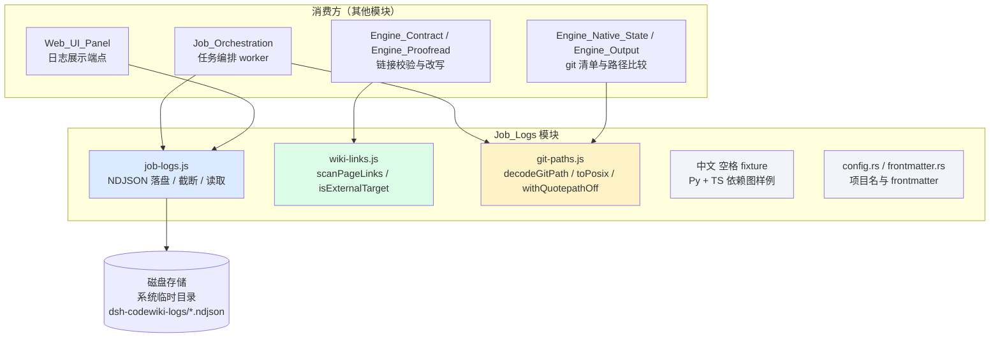
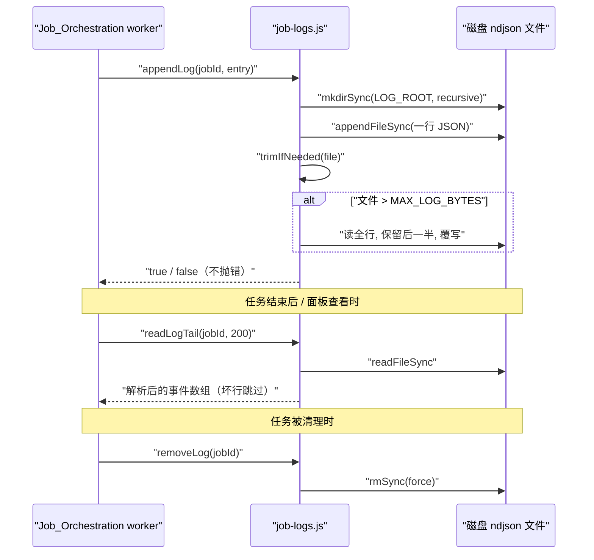
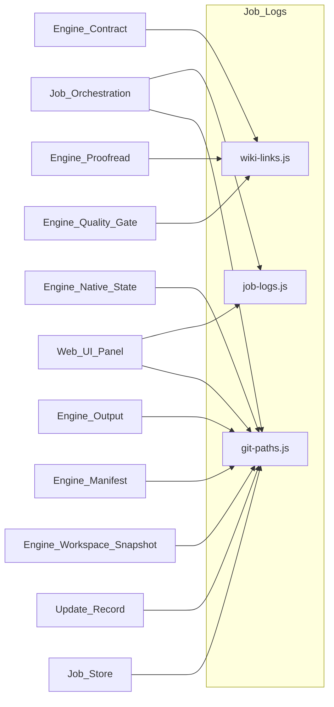

# Job_Logs

!!! info "Generated documentation"
    This page was written by CodeWiki from the source code at commit [`cb632cb2`](https://github.com/ikliml666/dsh-codewiki/commit/cb632cb24604c377177c2d46a74e217c30704263) on 2026-11-07 with `doubao-seed-2.1-lite`. Check the code before relying on details.

## 简介

`Job_Logs` 模块是引擎运行时的**持久化事件日志层**：它把每个编译任务（job）在生命周期中产生的事件（阶段切换、LLM 桥请求、引擎 stderr、错误等）以 NDJSON 格式逐行落盘，保证日志在进程退出、宿主重启或任务被截断（`MAX_JOBS_KEPT`）之后仍然可以被事后追查。

模块由四个相对独立的子单元组成：

| 子单元 | 位置 | 职责 |
| --- | --- | --- |
| 任务日志存储 | `lib/job-logs.js` | NDJSON 追加写、滚动截断、尾部读取、删除 |
| Wiki 链接扫描 | `lib/engine/wiki-links.js` | 正文 `.md` 跨页链接的统一扫描规则与外链判定 |
| Git 路径归一 | `lib/git-paths.js` | `core.quotepath` 转义解码与 POSIX 分隔符归一 |
| 测试夹具 | `tools/fsoft-engine/fixtures/中文 空格 fixture/` | 中文 + 空格目录名下的 Python/TS 依赖图 fixture |
| Wiki 元数据底座 | `vendor/codewiki/src/config.rs`、`frontmatter.rs` | 项目名推导与文章 frontmatter 解析 |

---

## 模块架构

### 1. 任务日志存储（`lib/job-logs.js`）

这是本模块的核心。历史上引擎日志只留在内存里（`job.nativeLogs` 最近 20 条），99 分钟的编译结束后能查到的只有最后 3 分钟。落盘日志是事后解释「为什么慢、为什么 partial」的唯一依据。

**关键设计决策：**

- **仓库外存储**：默认落在 `os.tmpdir()/dsh-codewiki-logs/`，可用环境变量 `DSH_CODEWIKI_LOG_DIR` 覆盖。理由与原生更新记录同源——若写进 `.codewiki/` 会变成「提交后产生的未跟踪文件」，每轮脏工作区。
- **一任务一文件**：`logFileOf(jobId)` 把 jobId 清洗成安全文件名（`[^\w.-]` → `_`），后缀 `.ndjson`。
- **定形行序列化**：`serialize()` 保证每行 JSON 固定含 `at`、`jobId`、`phase`、`kind` 四个字段，避免同一文件里出现多种形状后无人能解析。
- **失败不抛**：`appendLog()` 写失败返回 `false`——日志是观测渠道，不能因为它把编译打断；但调用方（`job.logError`）必须把失败如实报出去，不许静默。
- **半文件滚动**：`trimIfNeeded()` 在文件超过 `MAX_LOG_BYTES`（默认 2MB，下限 64KB，可用 `DSH_CODEWIKI_LOG_MAX_BYTES` 覆盖）时丢掉前一半行、保留最近现场。一次 28 篇文章的编译约产生数百到数千条事件，2MB 足够覆盖且不让临时目录失控。
- **宽容读取**：`readLogTail(jobId, limit)` 限幅在 1–5000 条，坏行跳过——文件被外部改动或不完整写入时，「能读多少给多少」比抛错更有用。

**导出 API 一览：**

| 函数 | 用途 |
| --- | --- |
| `logFileOf(jobId)` | 推导某任务的日志文件绝对路径 |
| `appendLog(jobId, entry)` | 追加一条事件，超限时自动截断前半 |
| `readLogTail(jobId, limit=200)` | 读取最近 N 条（限幅 1–5000） |
| `logStats(jobId)` | 返回 `{ path, bytes, updatedAt }`，供面板展示 |
| `removeLog(jobId)` | 删除任务日志文件（`force`，失败静默） |

### 2. Wiki 链接扫描（`lib/engine/wiki-links.js`）

提供一份**三处消费方共用**的跨页链接扫描规则。此前同一正则在 [Engine_Contract 引擎契约](Engine_Contract.md)（只捕获目标）、[Engine_Proofread：原生引擎产物的死链语义校对](Engine_Proofread.md)（捕获目标）、[Engine_Quality_Gate（原生引擎产物采用门）](Engine_Quality_Gate.md)（还要捕获链接文字与锚点以便原位替换）里各写一份并发生分叉：贪婪版 `[^)\s]+\.md` 会把 `x.md.y.md` 整段当目标，惰性版 `[^)\s]+?\.md` 取第一个 `.md`。判据不一致意味着「质量门判它是死链、改写器却认不出这条链接」，两边结论对不上。

统一约定：

- 目标是**第一个** `.md` 结尾的那一段（惰性匹配）；
- 锚点 `#...` 单独捕获；
- `scanPageLinks(text)` 返回 `{ index, whole, label, target, anchor }[]`，`index`/`whole` 用于在原文里原位替换（调用方需自行先剥代码块，本函数只管语法不管语境）；
- `isExternalTarget(target)` 判定外部协议（`https:`、`mailto:` 等），这类不参与页面内解析。

### 3. Git 路径归一（`lib/git-paths.js`）

负责铲平 git 路径输出的两层落差，供 [Job Orchestration（编译任务编排服务）](Job_Orchestration.md)、[Engine_Native_State（原生引擎跨轮受管状态）](Engine_Native_State.md)、[Engine_Output 模块文档](Engine_Output.md)、[引擎清单（Engine_Manifest）](Engine_Manifest.md) 等所有比较路径的模块复用：

- **落差一：`core.quotepath`（默认 true）**——非 ASCII 路径在 `--name-only` / `--name-status` 输出里被写成 `"a/\344\270\255.md"`（八进制字节转义 + 双引号包裹），按字面量比较路径的代码（白名单、`startsWith('.codewiki/')`）当场失配。
- **落差二：转义按字节做**——「解开转义」必须把字节重新拼成 Buffer 再按 UTF-8 解码（一个中文是三个 `\NNN`），不能逐字符还原。

两个出口独立成立：

- `GIT_QUOTEPATH_OFF = ['-c', 'core.quotepath=false']` 与 `withQuotepathOff(args)` 让**新发起**的 git 调用不再转义（首选，省一次解码）；
- `decodeGitPath(p)` / `decodeGitPaths(list)` 兜住**已被转义**的输入（旧记录、外部清单、调用方自己的 git 调用没带参数），幂等——非转义串原样返回，解不开的保守原样返回；
- `toPosix(p)` 是路径分隔符归一的**唯一实现**（`\` → `/`），收口在此防止六个模块各抄一份后「同一条路径在两份报告里判不等」。只换分隔符，不 trim、不去 `./`、不做 `path.posix.normalize`（上跳语义由调用方显式判定）。

### 4. 测试夹具（中文 空格 fixture）

位于 `tools/fsoft-engine/fixtures/中文 空格 fixture/`，是一组刻意放在「中文 + 空格」目录名下的最小样例，用来验证引擎的依赖图采集与路径处理在非 ASCII、含空格路径下不出错：

- `scripts/run.py::main`：Python 入口脚本（artifact 类），验证 artifact 节点是否被采集；
- `src/core/engine.py::Engine`：被 web 层依赖的 Python 核心模块（阶段 1A 依赖图 fixture）；
- `src/web/handler.py::Handler`：依赖 `core.engine` 的薄壳 Web 层，用于验证依赖边是否被建出；
- `src/web/task.ts`：TypeScript fixture（`TaskQueue` / `TaskQueue.push`），验证 TS/JS 分析器在中文空格路径下也能出节点。

它与本模块的关系：fixture 正是 `git-paths.js` 解码与 `job-logs.js` 落盘两条管线需要兼容的现实边界——非 ASCII、空格、跨语言源文件混合。

### 5. Wiki 元数据底座（vendor/codewiki）

`vendor/codewiki/` 是随仓库一起维护的 Rust 端 CodeWiki 底座（参见 [CodeWiki 主入口（cw CLI）](CodeWiki_Main.md) 与 [CodeWiki 安装配置（CodeWiki_Setup）](CodeWiki_Setup.md)）：

- `config.rs::project_name(repo_path)`：从 `git remote get-url origin` 推导项目名（取 URL 末段、去掉 `.git`），失败时回退到目录名；同文件的 `wiki_home()` / `wiki_path()` 决定 wiki 落在仓库内 `.codewiki/`（本 fork 改动，与上游放在 `~/.codewiki/<project>` 不同）。
- `frontmatter.rs::ArticleFrontmatter`：文章 frontmatter 的 YAML 结构（`title`、`type`、`source_files`、`tags`），`parse(content)` 从 markdown 正文解析，无 frontmatter 时返回 `None`。

---

## 依赖关系

上游写入方主要是任务编排（[Job Orchestration（编译任务编排服务）](Job_Orchestration.md) 的 `worker` / `runPool`）在阶段切换、LLM 桥回调、stderr 转发时调用 `appendLog`；消费方是 [Web_UI_Panel](Web_UI_Panel.md) 的日志查看端点调用 `readLogTail` / `logStats`；任务生命周期收尾时由编排层调用 `removeLog`。

---

## 环境变量与配置

| 变量 | 默认值 | 作用 |
| --- | --- | --- |
| `DSH_CODEWIKI_LOG_DIR` | `os.tmpdir()/dsh-codewiki-logs` | 任务日志根目录 |
| `DSH_CODEWIKI_LOG_MAX_BYTES` | `2 * 1024 * 1024`（下限 64KB） | 单任务日志滚动阈值 |

打包与运行环境见 [Package_Manifest 包清单](Package_Manifest.md)（`package.json` 中 `engines.node >= 24.9.0`）与 [FSoft 引擎环境搭建脚本（FSoft_Engine_Setup_Script）](FSoft_Engine_Setup_Script.md)（`tools/fsoft-engine/setup-env.sh`）。

---

## 设计要点小结

1. **观测优先于计算**：日志写失败绝不打断编译，但失败必须上报——「日志是观测，不是业务」。
2. **仓库外落盘**：避免 `.codewiki/` 被未跟踪文件污染，与 [Update_Record（编译更新记录）](Update_Record.md) 的存储理由同源。
3. **定形 NDJSON + 半文件滚动**：固定字段保证可解析，容量上限保证临时目录不失控。
4. **规则收口**：链接扫描与 git 路径归一各只有一处实现，防止多模块分叉导致「两份报告判不等」。
5. **幂等与宽容**：`decodeGitPath` 非转义串原样返回；`readLogTail` 坏行跳过；`removeLog` 删不掉就留着，不影响任何判定。

??? abstract "Documented components (10)"
    - [`isExternalTarget`](https://github.com/ikliml666/dsh-codewiki/blob/cb632cb24604c377177c2d46a74e217c30704263/lib%5Cengine%5Cwiki-links.js) — `lib\engine\wiki-links.js`
    - [`decodeGitPath`](https://github.com/ikliml666/dsh-codewiki/blob/cb632cb24604c377177c2d46a74e217c30704263/lib%5Cgit-paths.js) — `lib\git-paths.js`
    - [`removeLog`](https://github.com/ikliml666/dsh-codewiki/blob/cb632cb24604c377177c2d46a74e217c30704263/lib%5Cjob-logs.js) — `lib\job-logs.js`
    - [`main`](https://github.com/ikliml666/dsh-codewiki/blob/cb632cb24604c377177c2d46a74e217c30704263/tools%5Cfsoft-engine%5Cfixtures%5C%E4%B8%AD%E6%96%87%20%E7%A9%BA%E6%A0%BC%20fixture%5Cscripts%5Crun.py) — `tools\fsoft-engine\fixtures\中文 空格 fixture\scripts\run.py`
    - [`Engine`](https://github.com/ikliml666/dsh-codewiki/blob/cb632cb24604c377177c2d46a74e217c30704263/tools%5Cfsoft-engine%5Cfixtures%5C%E4%B8%AD%E6%96%87%20%E7%A9%BA%E6%A0%BC%20fixture%5Csrc%5Ccore%5Cengine.py) — `tools\fsoft-engine\fixtures\中文 空格 fixture\src\core\engine.py`
    - [`Handler`](https://github.com/ikliml666/dsh-codewiki/blob/cb632cb24604c377177c2d46a74e217c30704263/tools%5Cfsoft-engine%5Cfixtures%5C%E4%B8%AD%E6%96%87%20%E7%A9%BA%E6%A0%BC%20fixture%5Csrc%5Cweb%5Chandler.py) — `tools\fsoft-engine\fixtures\中文 空格 fixture\src\web\handler.py`
    - [`TaskQueue`](https://github.com/ikliml666/dsh-codewiki/blob/cb632cb24604c377177c2d46a74e217c30704263/tools%5Cfsoft-engine%5Cfixtures%5C%E4%B8%AD%E6%96%87%20%E7%A9%BA%E6%A0%BC%20fixture%5Csrc%5Cweb%5Ctask.ts) — `tools\fsoft-engine\fixtures\中文 空格 fixture\src\web\task.ts`
    - [`TaskQueue.push`](https://github.com/ikliml666/dsh-codewiki/blob/cb632cb24604c377177c2d46a74e217c30704263/tools%5Cfsoft-engine%5Cfixtures%5C%E4%B8%AD%E6%96%87%20%E7%A9%BA%E6%A0%BC%20fixture%5Csrc%5Cweb%5Ctask.ts) — `tools\fsoft-engine\fixtures\中文 空格 fixture\src\web\task.ts`
    - [`project_name`](https://github.com/ikliml666/dsh-codewiki/blob/cb632cb24604c377177c2d46a74e217c30704263/vendor%5Ccodewiki%5Csrc%5Cconfig.rs) — `vendor\codewiki\src\config.rs`
    - [`ArticleFrontmatter`](https://github.com/ikliml666/dsh-codewiki/blob/cb632cb24604c377177c2d46a74e217c30704263/vendor%5Ccodewiki%5Csrc%5Cfrontmatter.rs) — `vendor\codewiki\src\frontmatter.rs`

