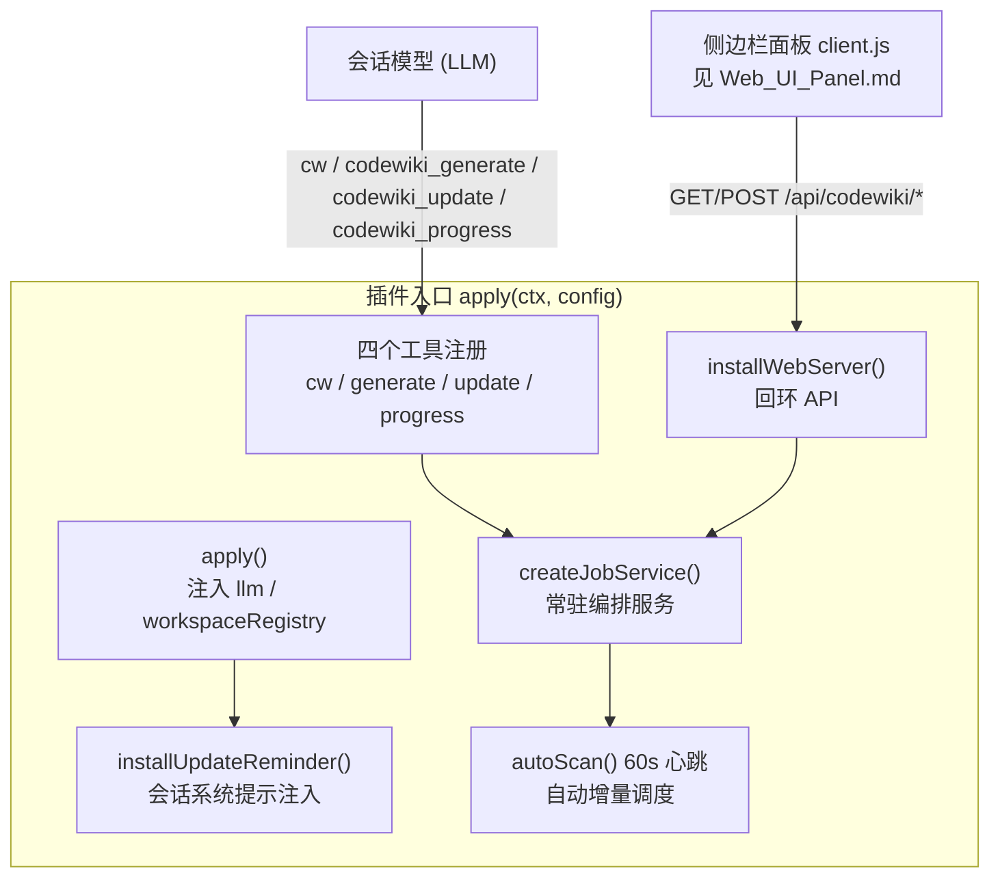
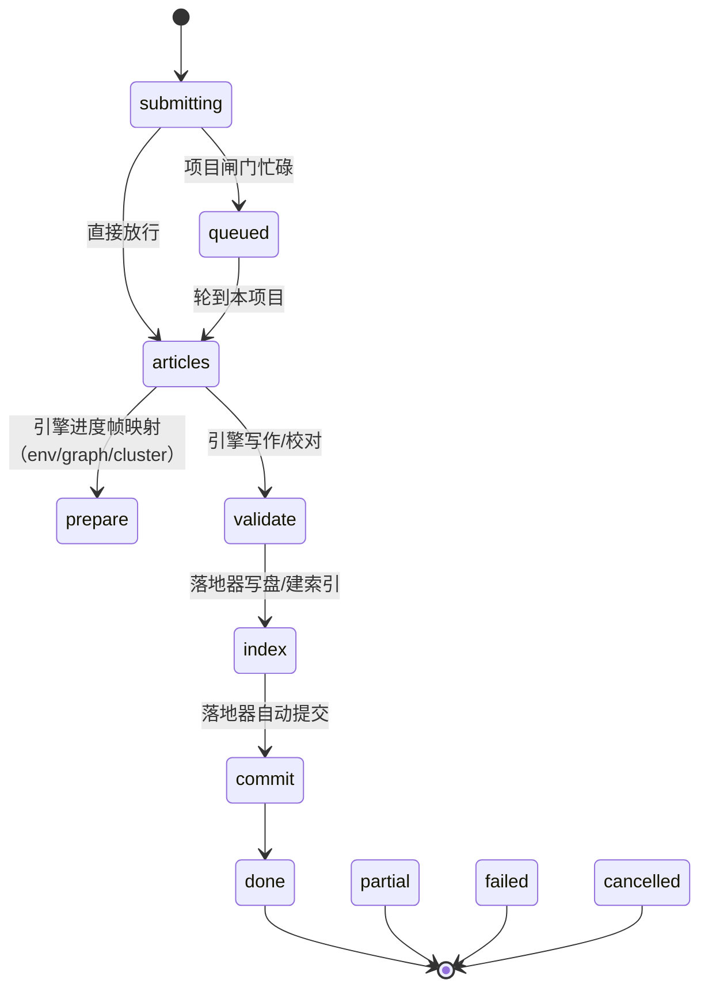
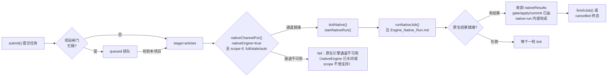
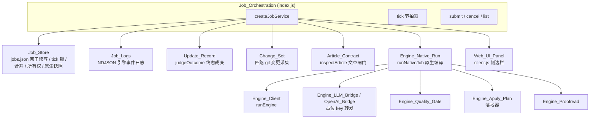
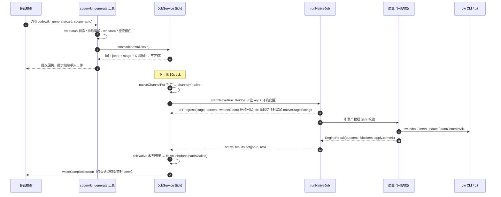
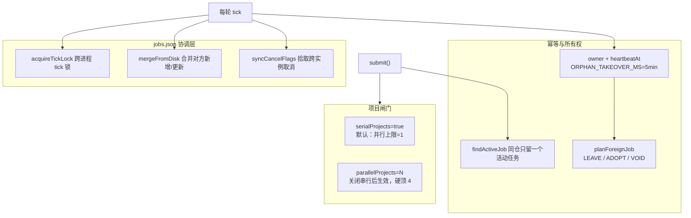

# Job Orchestration（编译任务编排服务）

!!! info "Generated documentation"
    This page was written by CodeWiki from the source code at commit [`695bf7d0`](https://github.com/ikliml666/dsh-codewiki/commit/695bf7d0681fd06c15e63a731761d443a069a9e3) on 2026-11-07 with `doubao-seed-2.1-lite`. Check the code before relying on details.

## 概述

`Job_Orchestration` 是 dsh-codewiki 插件的中枢编排模块，全部实现于插件入口 `index.js`。它把「向仓库提交一次 CodeWiki 编译」这件事从**同步阻塞动作**改造成了**服务化后台流水线**：

- 对会话模型暴露三个工具：`cw`（薄封装 Rust CLI）、`codewiki_generate` / `codewiki_update`（提交制编译入口）、`codewiki_progress`（只读查进度）；
- 对宿主侧边栏暴露一组回环 HTTP API（`/api/codewiki/jobs`、`/api/codewiki/repos`、`/api/codewiki/sessions`、`/api/codewiki/logs`、`/api/codewiki/control`、`/api/codewiki/models` 等）；
- 用一个常驻 `createJobService` 实例以 10s 节拍（`TICK_MS`）驱动一个有限阶段机：排队 → articles（引擎写作）→ prepare/articles/validate/index/commit（面板六步映射）→ 终态（done / partial / failed / cancelled）；
- 只有一条编译通道：**原生引擎通道**（`nativeEngine=true`，调用上游 FSoft Python 引擎子进程，见 [Engine_Native_Run（原生编译裁决编排层）](Engine_Native_Run.md)）。`job.channel` 只是「谁在跑」的记账，stage 是引擎走到第几步的展示。

配置 schema 由 `Config`（schemastery 对象）定义并通过 [Cordis_Patch_Config（插件装配配置）](Cordis_Patch_Config.md) 的 `cordis.patch.yml` 装配；包身份与依赖见 [Package_Manifest 包清单](Package_Manifest.md)（`package.json`，`@local/dsh-codewiki`，Node ≥ 24.9）。

## 核心数据结构与状态机

### Job（一条编译任务）

Job 是一个纯普通对象，落盘到 `JOBS_FILE`（默认 `%TMP%/dsh-codewiki-jobs.json`，可用 `DSH_CODEWIKI_JOBS_FILE` 隔离）。关键字段：

| 字段 | 含义 |
| --- | --- |
| `id` / `cwd` / `wikiPath` / `kind` / `scope` | 任务标识与编译范围（`kind`=full/stale；`scope`=auto/full/stale） |
| `owner` / `heartbeatAt` / `sessionId` | 实例所有权、心跳、发起会话（终态唤醒目标） |
| `stage` | 当前阶段：`queued` → `articles`（引擎启动点），随后由引擎进度帧映射为 `prepare` / `articles` / `validate` / `index` / `commit`，或终态 `done` / `partial` / `failed` / `cancelled` |
| `channel` | 恒为 `'native'`（原生引擎通道），作为「谁在跑」的记账 |
| `nativeChannel` | 原生通道快照（入口、解释器、超时），宿主重启后据此重放 |
| `batchRef` / `batchProgress` / `tasks` / `articles` / `writtenCount` / `failedCount` | 执行器在途标记、逐篇结果与计数（原生通道以引擎自报计数为准） |
| `outcome` / `blockers` / `canAdvanceBaseline` | 完整性终态与基线推进判据（由 `judgeOutcome` 裁决） |
| `nativeStage` / `nativePercent` / `nativeStageTimings` / `nativeLogs` / `nativeResult` | 原生引擎自报阶段、百分比、引擎各阶段真实耗时（ms）、事件日志与落地结果。`nativeResult` 在进 jobSummary 时经 `nativeResultBrief` 瘦身，只留 `outcome` / `stage` / `gate.outcome` / `apply.outcome` 四个短字段（原结构里的 `gate.articles`、`incremental.hydrated/stateCaptured` 占 payload 大半而面板从不读） |
| `autoCommit` / `usage` / `notes` | 自动提交结果、token 用量、运行注释（最近 50 条） |

### 阶段机（原生引擎通道）

tick 在 `stage === 'articles'` 且尚无 `channel` 时经 `nativeChannelFor` 锁定原生通道并 `startNativeRun`；此后每轮 tick 只看 `nativeResults` 是否就绪——收割后由落地器（内含 gate/apply/commit）的真实结果经 `finishJob` 落终态。

### 阶段处理器

旧 Node 兼容通道的 `STAGE_HANDLER`（`tickArticles` / `tickCrosscut` / `tickReview` / `tickIndex` / `tickCommit`）已整体删除——编译只有原生引擎一条通道，`job.stage` 只是引擎走到第几步的展示，不再有插件自跑的写作/横切/校对/索引/提交阶段。原生任务一律只走 `tickNative`：起一次（`stage=articles` 且没有在跑的），后续 tick 等待收割。

## 编译通道

**原生引擎通道是唯一通道**（生产默认）的关键适配：

- `nativeChannelFor(cfg, {kind, scope})` 决定本次任务走哪条通道；不可用时直接 fail——编译只走原生通道，没有备用路径。
- `resolveNativePython(cfg)` 按 `配置 → 环境变量 DSH_CODEWIKI_PYTHON → PATH` 顺序找解释器，不做启发式探测。
- `nativeEnginePlan(channel, {bridge, model})` 拼装子进程环境变量（`PYTHONIOENCODING`、`CODEWIKI_BASE_URL`、`CODEWIKI_API_KEY`=占位 key、`CODEWIKI_MAIN_MODEL` 等），真实凭证从不进子进程环境、也从不进日志。
- 进度帧记账：每帧 `onProgress(p)` 除回写 `nativeStage` / `nativePercent` 外，还在引擎阶段切换时把上一段的墙钟耗时（`Date.now() - nativeStageAt`）累加进 `job.nativeStageTimings`；job 初始化为 `nativeStageTimings: {}` / `nativeStageAt: null`。面板粗粒度 `stageTimings` 的 `prepare` 一格吞了 `env`/`graph`/`cluster` 三段，`nativeStageTimings` 单独按引擎九段记账（`env`/`graph`/`cluster`/`articles`/`proofread`/`validate`/`index`/`baseline`/`commit`），供终态分段带与 `codewiki_progress` 工具拆分「时间花在哪一段」。
- 环境不闭合时原生通道以 `engine-deps` 明确失败，不存在回退路径。

## 关键组件详解

### `apply(ctx, config)` — 插件入口

注入 `llm` / `workspaceRegistry` 两个宿主服务（cordis 严格语义下必须经 `ctx.inject`，直接访问属性会抛错），创建并启动 `createJobService`，注册四个工具与回环 API，安装会话提醒与自动调度心跳。返回的清理函数由 `ctx.effect` 收集。

### `submit({kind, cwd, wikiPath, scope, language, prebuiltTasks, auto, sessionId, changeSet})`

新建一条 job 并立刻推进。提交闸门链：

1. 排除清单（`excludePaths`）命中 → 抛错（auto 调度静默跳过）；

> **工具层排除清单口径（`codewiki_generate` / `codewiki_update`）**：命中排除清单时工具不抛错，而返回不带原因的中性终态（`state='excluded'`、`submitted=false`、`notes=[]`），`render` 只回一句「codewiki：本仓库无需处理，继续手头工作。」——排除是用户在面板上的表态，模型若读到「被排除」就会追问原因、建议改设置；因此原因不进会话、`state` 仅供内部判定，模型照常收尾即可。
2. linked git worktree（`detectLinkedWorktree`，60s 缓存）→ 拒绝编译；
3. 无可编译源码（`hasCompilableSources`，10min/60s 差异化 TTL 缓存）→ 拒绝；
4. `rememberRepo(cwd)` 登记已知仓库（写入 `REPOS_FILE`，与 [Job Store（作业持久化与跨实例协调层）](Job_Store.md) 同源目录生命周期）；
5. 同仓幂等（`findActiveJob`）→ 返回已有活动任务并 `reassignSession`；
6. 占位先落一条 `submitting` job → 校验编译模型通道（`batchProvider` / `batchModel` / `llm.stream`）→ 校验思考档位（`effortError`）→ 校验增量档位（`updateOptionsOf`）；
7. 项目闸门（`serialProjects` / `parallelLimit`）：忙碌则进 `queued` 排队，否则直接进 `articles`。

### `list()` / `jobSummary(job)` / `progressView(job)`

- `list()`：先 `mergeFromDisk()` 再把全部 job 映射成 `jobSummary`；
- `jobSummary` 是面板与 `codewiki_progress` 的唯一数据源，含 `stage` / `outcome` / `blockers` / `usage` / `nativeStage` / `nativeStageTimings`（引擎各阶段墙钟耗时 ms，键为 `env`/`graph`/`cluster`/`articles`/`proofread`/`validate`/`index`/`baseline`/`commit`）/ `nativeLogs`（最近 40 条）/ `autoCommit` / `tps` 等；其中 `nativeResult` 刻意经 `nativeResultBrief` 裁剪成 `{outcome, stage, gate.outcome, apply.outcome}`——完整引擎结果里的逐篇门检与增量水合明细只在引擎侧落盘，不进 2s 轮询的接口 payload；
- `progressView` 在 `jobSummary` 之上按 `taskList` 算完成百分比。

### `cancel(jobId)` / `onAbort` 语义

`cancel` 只置 `cancelRequested=true`，由下一轮 tick 实际中断：

- 原生通道：abort 终止引擎进程树；但若取消到达时结果已落地，**按真实结果收尾而不丢弃产物**（落地器事务不可中断，故意不传 `ac.signal`）。

### `wakeCompileSession(job, outcome)`

终态回调。只有两种情形打扰发起会话：

1. 编译失败（`outcome === 'failed'`）；
2. 自动提交未成功（`autoCommitState(job) === 'pending'`）。

成功且已提交（`committed` / `no-changes`）一律静默。无 agent 上下文（面板/自动调度提交）或冷会话时静默跳过。

### 会话记录（`beginSessionRecord` / `listSessionRecords` / `listAllSessionRecords` / `activeSessionJobs` / `pruneSessionRecords`）

每个并发池请求的 prompt 与流式输出落到 `<tmp>/dsh-codewiki-sessions/<jobId>/nnn.{meta,full}.json`，TTL 24h。面板「会话」Tab 据此实时展示「codewiki 现在在跟模型说什么」。仅本地临时目录、仅回环可读，不进 git、不随 job 持久化。

**记录内容**：

- 每条记录带 `stage` 字段标注请求发生在哪个引擎阶段：原生通道请求的 `stage` 取自任务本身（桥在 `onRequestStart` 入参里带上 `stage: currentStage || null`），缺失时兜底到 `job.nativeStage`——阶段刚切换、桥还没收到 `setStage` 时 `task.stage` 为 `null`（falsy），而 `job.nativeStage` 由同一份进度帧直接赋值，是当时唯一可靠的阶段事实。
- 流式增量由 `sessionDeltaOf` 统一抽取（替代旧的 `textDeltaOf`）：正文（`text`）、思考（`reasoning`）与工具调用（`tool`）三类分片分开累积；tool-call-delta 按分片的 `id` 合并成整条调用（`name` + 逐片拼接的 `arguments`），否则一次调用会被记成几十条半截 JSON。
- meta 上三个计数分开记：`outputChars`（正文字符数）、`reasoningChars`（思考字符数）、`toolCalls`（合并后的工具调用数）。思考档打开时正文可能为空，光看 `outputChars` 会把「想了 1000 段」的请求显示成空，面板需要三个计数才能如实说明「这条请求的内容在思考里」。
- `full` 文件按 `SESSION_FLUSH_MS` 节流落盘正文，并另存 `reasoning` 与 `tools` 快照；`onDone` 时以完成全文为权威值（流式没抽到正文、只吐了思考时保留思考，不把它当空），并补记 `outputTokens`；`onError` 时同样刷出三类计数与截断 300 字符的 `error`。

读取侧的四个工程口径：

- meta 读取走 `readSessionMetaCached`（同一 meta 文件进程内缓存，翻页与计数共用），TTL 淘汰（`pruneSessionRecords`）删掉文件时同步从缓存剔除，不留下指向已删文件的陈旧条目；
- 单条详情走 `readSessionRecordDetail`：full 全文与 meta 合并返回。生成中的 full 还没按节流落思考/工具快照时，计数以 meta 上内存里的最新值为准（`outputChars` / `reasoningChars` / `toolCalls` / `status` 缺省回落到 full 快照），`stage` 同样以 full 优先、meta 兜底；
- 活跃任务的请求计数走 `countSessionRecords` / `countAllSessionRecords`——只数 `*.meta.json` 文件名、不读内容，不再为「数一下有多少请求」把全部 meta 整包读一遍；
- 列表端点按 `limit` 分页（见下节「观测与 API」），不再一次把单任务几百条记录全量铺满。

### 自动提交 `autoCommitWiki(cwd, {jobId, writtenCount})`

安全边界：只 `git add -- .codewiki CodeWiki.md` 两个 pathspec；merge/rebase 进行中、有冲突、无 HEAD、未配置 git user、被 .gitignore 忽略 → 一律降级为「提醒会话模型提交」。正常路径在主题分支 `codewiki/wiki-<jobId>` 提交后 ff/merge 回原分支并删除主题分支；失败一律 abort、保留主题分支，绝不强合、绝不丢产物。

## 依赖与协作模块

- 持久化与跨实例协调：[Job Store（作业持久化与跨实例协调层）](Job_Store.md)（`createJobsStore` / `mergeJobLists` / `findActiveJob` / `heartbeat` / `adoptOrphan` / `planForeignJob` / `snapshotNativeRun` / `planNativeReplay`）。原子写、损坏隔离（corrupt marker）、fail-closed 幂等、跨进程 tick 锁、函数值/凭证字段拒序列化。
- 引擎事件日志：[Job_Logs](Job_Logs.md)（`appendLog` / `readLogTail` / `logStats` / `logFileOf`）。
- 终态与更新记录：[Update_Record（编译更新记录）](Update_Record.md)（`judgeOutcome` / `buildUpdateRecord` / `saveUpdateRecord` / `TERMINAL` / `UPDATE_RECORD_REL`）。
- 增量变更采集：[Change_Set 变更集采集模块](Change_Set.md)（`collectChangeSet`）。
- 文章结构闸门：[Article_Contract（文章契约闸门）](Article_Contract.md)（`inspectArticle` / `hasBlockingIssue` / `issueSummary`）。
- 原生引擎通道全套：从 [Engine_Native_Run（原生编译裁决编排层）](Engine_Native_Run.md) 开始，向下串 [Engine_Client（引擎进程客户端）](Engine_Client.md)、[Engine_Contract 引擎契约](Engine_Contract.md)、[引擎 LLM 桥（Engine_LLM_Bridge）](Engine_LLM_Bridge.md)、[引擎清单（Engine_Manifest）](Engine_Manifest.md)、[Engine_Quality_Gate（原生引擎产物采用门）](Engine_Quality_Gate.md)、[Engine_Apply_Plan（原生产物落地器）](Engine_Apply_Plan.md) 等。
- 配置装配：[Cordis_Patch_Config（插件装配配置）](Cordis_Patch_Config.md)；包与运行时要求：[Package_Manifest 包清单](Package_Manifest.md)。
- 面板前端：[Web_UI_Panel](Web_UI_Panel.md)（`client.js` 消费 `/api/codewiki/*`）。

## 数据流：一次典型的全量编译（原生通道）

## 并发、排队与跨实例协调

要点：

- 同一仓库同时只推进一个任务；超出闸门的新提交进 `queued`，前面的到终态后由 tick 自动唤醒。
- 宿主重启/多实例并存：job 带 `owner` 与 `heartbeatAt`，停更超 `ORPHAN_TAKEOVER_MS`（5 分钟）被判孤儿；排队/提交阶段的孤儿按 `planForeignJob` 直接作废或接管，活动阶段的由 `adoptOrphan` 接管推进（原生任务按 `snapshotNativeRun` / `planNativeReplay` 决定重跑或失败，已落盘叶子断点保留）。
- `dirty` / `dirtyIds` 机制：只有本实例改过的 job 才允许在 flush 时覆盖磁盘，慢 tick 不会用过期快照洗掉对方的新 note/batchRef。

## 观测与 API

`installWebServer(ctx, service, {config, schedState, compile})` 注册的回环端点（仅 `127.0.0.1` / `::1`）：

| 端点 | 用途 |
| --- | --- |
| `GET /api/codewiki/jobs` | 任务列表（工作区过滤、dead-target 过滤、queued 标注「在等谁」） |
| `GET /api/codewiki/repos` | 仓库总览（cw status 现算 + 30s 缓存 + 自动调度心跳状态） |
| `GET /api/codewiki/sessions[?jobId=&limit=]` | 会话记录列表（单任务或全局聚合），分页返回：单任务默认 80 条（硬顶 2000）、全局默认 200 条（硬顶 500），响应里带 `total`（全部记录数）与 `limit`，前端可按需抬高 `limit` |
| `GET /api/codewiki/sessions/item?jobId=&n=` | 单条请求详情：经 `readSessionRecordDetail` 合并返回 prompt / output 全文与 `reasoning` / `tools` 快照，计数与状态以 meta 为准、full 快照兜底 |
| `GET /api/codewiki/logs?jobId=&limit=` | 引擎 NDJSON 事件日志翻页 |
| `GET /api/codewiki/models` / `/api/codewiki/model-efforts` | 模型目录与思考档位（设置页级联下拉数据源） |
| `POST /api/codewiki/control` | `cancel` / `refresh` / `compile` / `confirm` 动作 |

这些端点的消费侧见 [Web_UI_Panel](Web_UI_Panel.md)。

## 配置要点（节选）

完整 schema 在 `index.js` 的 `Config` 对象；装配方式见 [Cordis_Patch_Config（插件装配配置）](Cordis_Patch_Config.md)。与编排行为最相关的几项：

| 配置 | 默认 | 影响 |
| --- | --- | --- |
| `nativeEngine` | `true` | 编译通道开关；关闭时任务直接 fail（编译只走原生通道） |
| `batchProvider` / `batchModel` | 空 | 编译模型（必须已在宿主模型设置注册）；留空提交时显式报错 |
| `maxConcurrency` | 2 | 默认档 LLM 请求并发（硬顶 8） |
| `moduleConcurrency` | 0（跟随默认档） | 原生引擎同层模块并行度 |
| `serialProjects` / `parallelProjects` | `true` / 2 | 项目闸门 |
| `autoCommit` | `true` | 编译产物分支合并式自动提交 |
| `autoUpdate` / `autoUpdateMin` | `false` / 30 | 定时增量调度（60s 心跳判态） |
| `updateRung` / `updateTau*` | 空（上游默认） | 原生引擎增量档位与阈值 |

## 关键不变量（设计约束）

1. **终态不被后续步骤洗白**：`done` / `partial` / `failed` / `cancelled` 一旦落定，迟到的取消或结果都不能改写已落盘产物（原生通道尤其如此）。
2. **基线只代表「所有变化已被消化」**：任何 blocker（缺页、逐篇失败、未归属变更、质量门、索引失败）都禁止 `cw meta update`；partial 可以入库文章但不推进基线。
3. **凭证不入盘**：job 持久化遇函数值或疑似凭证字段直接抛错；原生桥只用占位 key。
4. **通道不悄悄回退**：原生环境不闭合以 `engine-deps` 明确失败；编译只有原生引擎一条通道，不存在备用路径。
5. **提交制**：`codewiki_generate` / `codewiki_update` 调用即返回，不等待、不轮询；进度只能由 `codewiki_progress` 或面板读取。

??? abstract "Documented components (19)"
    - [`allowedLinkTargets`](https://github.com/ikliml666/dsh-codewiki/blob/695bf7d0681fd06c15e63a731761d443a069a9e3/index.js) — `index.js`
    - [`apply`](https://github.com/ikliml666/dsh-codewiki/blob/695bf7d0681fd06c15e63a731761d443a069a9e3/index.js) — `index.js`
    - [`cancel`](https://github.com/ikliml666/dsh-codewiki/blob/695bf7d0681fd06c15e63a731761d443a069a9e3/index.js) — `index.js`
    - [`currentCommit`](https://github.com/ikliml666/dsh-codewiki/blob/695bf7d0681fd06c15e63a731761d443a069a9e3/index.js) — `index.js`
    - [`jobSummary`](https://github.com/ikliml666/dsh-codewiki/blob/695bf7d0681fd06c15e63a731761d443a069a9e3/index.js) — `index.js`
    - [`list`](https://github.com/ikliml666/dsh-codewiki/blob/695bf7d0681fd06c15e63a731761d443a069a9e3/index.js) — `index.js`
    - [`makeLinkExists`](https://github.com/ikliml666/dsh-codewiki/blob/695bf7d0681fd06c15e63a731761d443a069a9e3/index.js) — `index.js`
    - [`onAbort`](https://github.com/ikliml666/dsh-codewiki/blob/695bf7d0681fd06c15e63a731761d443a069a9e3/index.js) — `index.js`
    - [`progressView`](https://github.com/ikliml666/dsh-codewiki/blob/695bf7d0681fd06c15e63a731761d443a069a9e3/index.js) — `index.js`
    - [`reposFileFor`](https://github.com/ikliml666/dsh-codewiki/blob/695bf7d0681fd06c15e63a731761d443a069a9e3/index.js) — `index.js`
    - [`runPool`](https://github.com/ikliml666/dsh-codewiki/blob/695bf7d0681fd06c15e63a731761d443a069a9e3/index.js) — `index.js`
    - [`symbolsOnLine`](https://github.com/ikliml666/dsh-codewiki/blob/695bf7d0681fd06c15e63a731761d443a069a9e3/index.js) — `index.js`
    - [`tickArticles`](https://github.com/ikliml666/dsh-codewiki/blob/695bf7d0681fd06c15e63a731761d443a069a9e3/index.js) — `index.js`
    - [`tickCommit`](https://github.com/ikliml666/dsh-codewiki/blob/695bf7d0681fd06c15e63a731761d443a069a9e3/index.js) — `index.js`
    - [`tickCrosscut`](https://github.com/ikliml666/dsh-codewiki/blob/695bf7d0681fd06c15e63a731761d443a069a9e3/index.js) — `index.js`
    - [`tickIndex`](https://github.com/ikliml666/dsh-codewiki/blob/695bf7d0681fd06c15e63a731761d443a069a9e3/index.js) — `index.js`
    - [`tickReview`](https://github.com/ikliml666/dsh-codewiki/blob/695bf7d0681fd06c15e63a731761d443a069a9e3/index.js) — `index.js`
    - [`wakeCompileSession`](https://github.com/ikliml666/dsh-codewiki/blob/695bf7d0681fd06c15e63a731761d443a069a9e3/index.js) — `index.js`
    - [`worker`](https://github.com/ikliml666/dsh-codewiki/blob/695bf7d0681fd06c15e63a731761d443a069a9e3/index.js) — `index.js`

