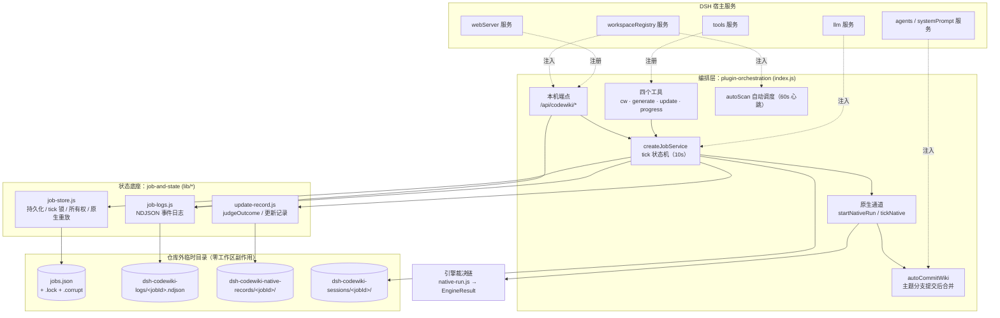
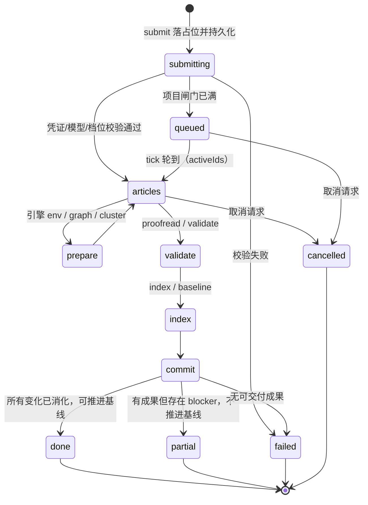

# 作业编排与状态管理（Job Orchestration & State Management）

!!! info "Generated documentation"
    This page was written by CodeWiki from the source code at commit [`cc1116c4`](https://github.com/ikliml666/dsh-codewiki/commit/cc1116c4ad9e359fc739203aed18b8ba6fd73e7a) on 2026-11-08 with `deepseek-v4.1-flash`. Check the code before relying on details.

`Job_Orchestration___State_Management` 是 `dsh-codewiki` 插件的**控制面**：它把「一个仓库的整轮 wiki 编译」从一次同步工具调用，变成一条**可观测、可恢复、可取消的后台任务**。模块自身**不做编译裁决**——真正的编译判断（增量决议、质量门、落地）在引擎侧完成；本模块只负责「起进程 / 收进度 / 按结果判终态 / 安全落盘」，并把现场持久化到仓库之外，保证多宿主实例共享、崩溃后可重放。

模块分为两层，边界清晰：

| 层 | 载体 | 职责 |
| --- | --- | --- |
| **编排层** | `index.js`（[插件编排层（plugin-orchestration）](Job_Orchestration___State_Management/plugin-orchestration.md)） | 注册四个工具、10 秒节拍的任务状态机、会话内容记录、仅回环可访问的 HTTP 端点、编译产物自动提交、自动调度与系统提示注入 |
| **状态底座** | `lib/job-store.js`、`lib/job-logs.js`、`lib/update-record.js`（[作业状态与持久化层（job-and-state）](Job_Orchestration___State_Management/job-and-state.md)） | 任务现场原子落盘与跨实例合并、引擎事件黑匣子日志、终态裁决与可复盘的更新记录 |

## 架构

依赖方向单向：`index.js` 依赖 `lib/*`，而 `lib/job-store.js` 刻意**不反向依赖** `index.js`（它自己复制了一份路径归一化函数 `normKey`），因此状态底座可以脱离庞大的编排代码独立单测。

## 任务生命周期

## 核心设计取向

- **提交制**：`codewiki_generate` / `codewiki_update` 调用即返回 `jobId`，编译由 tick 推进，模型无需等待或轮询。
- **裁决单一来源**：终态只由 `runNativeJob` 的 `EngineResult` 决定，tick 绝不重写裁决。
- **失败不掩盖**：`jobs.json` 读不出来时 fail-closed 拒绝推进，绝不当成「没有活动任务」（否则同仓重复提交、两个引擎同时写同一仓库）。
- **取消是终态**：`canAdvanceBaseline` 恒为 `false`，不复活、不覆盖已落地结果；执行器仍在跑时终态交给真实结果。
- **基线只代表「全部变化已消化」**：`partial` / `failed` / `cancelled` 一律不推进编译基线，避免 wiki 静默落后于代码。
- **凭证不进子进程、不进任务文件**：引擎子进程只拿随机占位 key，`serializeJobs` 拦截疑似凭证键名与函数值。
- **仓库外记账**：日志、更新记录、原始树留档、会话记录全部落在系统临时目录，只把路径写进 `job`，工作区零副作用。
- **多实例协调**：原子写 + 损坏隔离 + 带 `instanceTag` 的 tick 锁 + 心跳与孤儿接管 + 原生通道可重放快照，四层机制保证不重复执行、不丢现场。

## 核心组件文档

| 组件 | 文档 | 内容 |
| --- | --- | --- |
| 插件入口与编排层 | [插件编排层（plugin-orchestration）](Job_Orchestration___State_Management/plugin-orchestration.md) | 四个工具的语义分工、判态流程与首次编译闸门、tick 状态机、原生通道依赖注入与取消语义、状态持久化布局、多实例协调、闸门与安全边界、自动提交与系统提示注入、配置归一化、会话记录与 `/api/codewiki/*` 端点、自动调度器、关键不变量清单 |
| 状态与持久化层 | [作业状态与持久化层（job-and-state）](Job_Orchestration___State_Management/job-and-state.md) | `job-store.js` 的四条硬不变量（原子写 / fail-closed / 凭证拦截 / 取消优先）、读取状态机与损坏隔离、跨进程 tick 锁、现场合并与脏标记、所有权与孤儿接管、同仓幂等与原生重放裁决；`job-logs.js` 的黑匣子日志格式与失败语义；`update-record.js` 的终态语义、六类 blocker 与 `canAdvanceBaseline`、记录结构与两条落盘通道 |

## 相关模块

| 主题 | 页面 |
| --- | --- |
| 引擎一次编译的裁决链（env → 增量决议 → 引擎 → gate → apply） | [engine-runner：原生引擎执行与裁决编排](Documentation_Generation_Engine/engine-core/engine-orchestration/engine-runner.md) |
| 落地器（写盘 → index → 基线 → 提交） | [apply-plan 落地器](Documentation_Generation_Engine/engine-core/engine-orchestration/apply-plan.md) |
| 引擎结果契约、质量门、语义校对 | [engine-contract-quality：引擎契约与质量裁决层](Documentation_Generation_Engine/engine-core/engine-contract-quality.md) |
| 引擎清单/锁、受管状态、工作区快照 | [engine-state-manifest：引擎清单与跨轮受管状态](Documentation_Generation_Engine/engine-core/engine-state-manifest.md) |
| 文章契约与修复流水线 | [文章流水线（article-pipeline）](Documentation_Generation_Engine/article-pipeline.md) |
| Python 引擎入口与运行时 | [engine-python-runtime：FSoft 原生引擎的 Python 侧运行时](Execution_Runtime___Vendored_Engine/engine-python-runtime.md) |
| 侧边栏面板（消费本模块的 `/api/codewiki/*`） | [ui-client（浏览器半侧客户端）](ui-client.md) |

??? abstract "Documented components (12)"
    - [`addUsage`](https://github.com/ikliml666/dsh-codewiki/blob/cc1116c4ad9e359fc739203aed18b8ba6fd73e7a/index.js) — `index.js`
    - [`apply`](https://github.com/ikliml666/dsh-codewiki/blob/cc1116c4ad9e359fc739203aed18b8ba6fd73e7a/index.js) — `index.js`
    - [`cancel`](https://github.com/ikliml666/dsh-codewiki/blob/cc1116c4ad9e359fc739203aed18b8ba6fd73e7a/index.js) — `index.js`
    - [`jobSummary`](https://github.com/ikliml666/dsh-codewiki/blob/cc1116c4ad9e359fc739203aed18b8ba6fd73e7a/index.js) — `index.js`
    - [`list`](https://github.com/ikliml666/dsh-codewiki/blob/cc1116c4ad9e359fc739203aed18b8ba6fd73e7a/index.js) — `index.js`
    - [`onAbort`](https://github.com/ikliml666/dsh-codewiki/blob/cc1116c4ad9e359fc739203aed18b8ba6fd73e7a/index.js) — `index.js`
    - [`progressView`](https://github.com/ikliml666/dsh-codewiki/blob/cc1116c4ad9e359fc739203aed18b8ba6fd73e7a/index.js) — `index.js`
    - [`reposFileFor`](https://github.com/ikliml666/dsh-codewiki/blob/cc1116c4ad9e359fc739203aed18b8ba6fd73e7a/index.js) — `index.js`
    - [`removeLog`](https://github.com/ikliml666/dsh-codewiki/blob/cc1116c4ad9e359fc739203aed18b8ba6fd73e7a/lib%5Cjob-logs.js) — `lib\job-logs.js`
    - [`normKey`](https://github.com/ikliml666/dsh-codewiki/blob/cc1116c4ad9e359fc739203aed18b8ba6fd73e7a/lib%5Cjob-store.js) — `lib\job-store.js`
    - [`isTerminalStage`](https://github.com/ikliml666/dsh-codewiki/blob/cc1116c4ad9e359fc739203aed18b8ba6fd73e7a/lib%5Cupdate-record.js) — `lib\update-record.js`
    - [`loadUpdateRecord`](https://github.com/ikliml666/dsh-codewiki/blob/cc1116c4ad9e359fc739203aed18b8ba6fd73e7a/lib%5Cupdate-record.js) — `lib\update-record.js`

