# 作业状态与持久化层（job-and-state）

!!! info "Generated documentation"
    This page was written by CodeWiki from the source code at commit [`cc1116c4`](https://github.com/ikliml666/dsh-codewiki/commit/cc1116c4ad9e359fc739203aed18b8ba6fd73e7a) on 2026-11-08 with `deepseek-v4.1-flash`. Check the code before relying on details.

`job-and-state` 是 `Job_Orchestration___State_Management` 的**状态底座**：它不推进编译流程、不驱动引擎，只回答三个问题——**任务现场怎么安全地落盘并被多个宿主实例共享**、**引擎到底发生了什么（黑匣子日志）**、**这一轮编译算不算完成（更新记录与终态裁决）**。

三个文件各管一件事，边界清晰、全部是纯函数或小型类，因此可以脱离 `index.js` 那套体量庞大的编排代码单独测试：

| 文件 | 职责 | 对外核心导出 |
| --- | --- | --- |
| `lib/job-store.js` | `jobs.json` 的跨进程持久化 / 现场合并 / 所有权判定 / 原生通道可重放快照 | `createJobsStore`、`normKey`、`isTerminalStage`、`mergeJobLists`、`findActiveJob`、`classifyOwnership`、`planForeignJob`、`heartbeat`、`adoptOrphan`、`reassignSession`、`snapshotNativeRun`、`planNativeReplay`、`serializeJobs` |
| `lib/job-logs.js` | 引擎事件日志（NDJSON，一个任务一个文件，落在仓库外） | `appendLog`、`readLogTail`、`logStats`、`logFileOf`、`removeLog` |
| `lib/update-record.js` | 一次编译「做了什么、为什么、够不够完整」的版本化记录与终态裁决 | `judgeOutcome`、`buildUpdateRecord`、`saveUpdateRecord`、`loadUpdateRecord`、`isTerminalStage`、`describeOutcome` |

上层调用者只有一个：`index.js` 里的 `createJobService`（见 [作业编排与状态管理（Job Orchestration & State Management）](../Job_Orchestration___State_Management.md) 与 [插件编排层（plugin-orchestration）](plugin-orchestration.md)）。它把这些能力组装成 10 秒节拍的阶段机。

---

## 1. 模块在系统中的位置

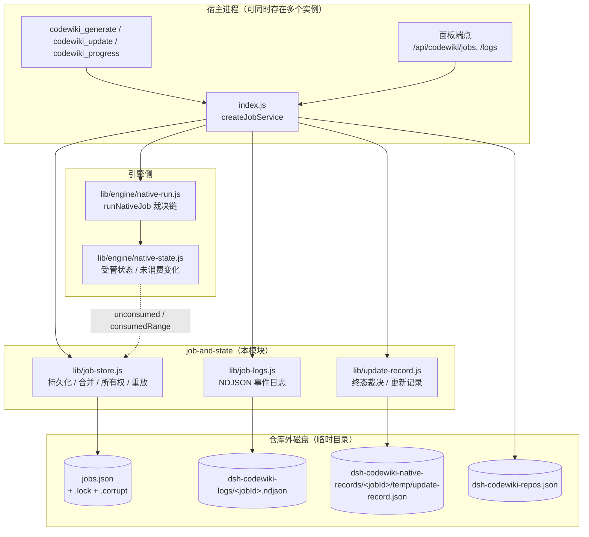

关键点：本模块**只碰磁盘与纯数据**，不 import `index.js`，因此不会与编排层形成循环依赖（`normKey` 在 `job-store.js` 里独立复制了一份路径归一化，就是为了这个）。

---

## 2. 磁盘布局与读写方向

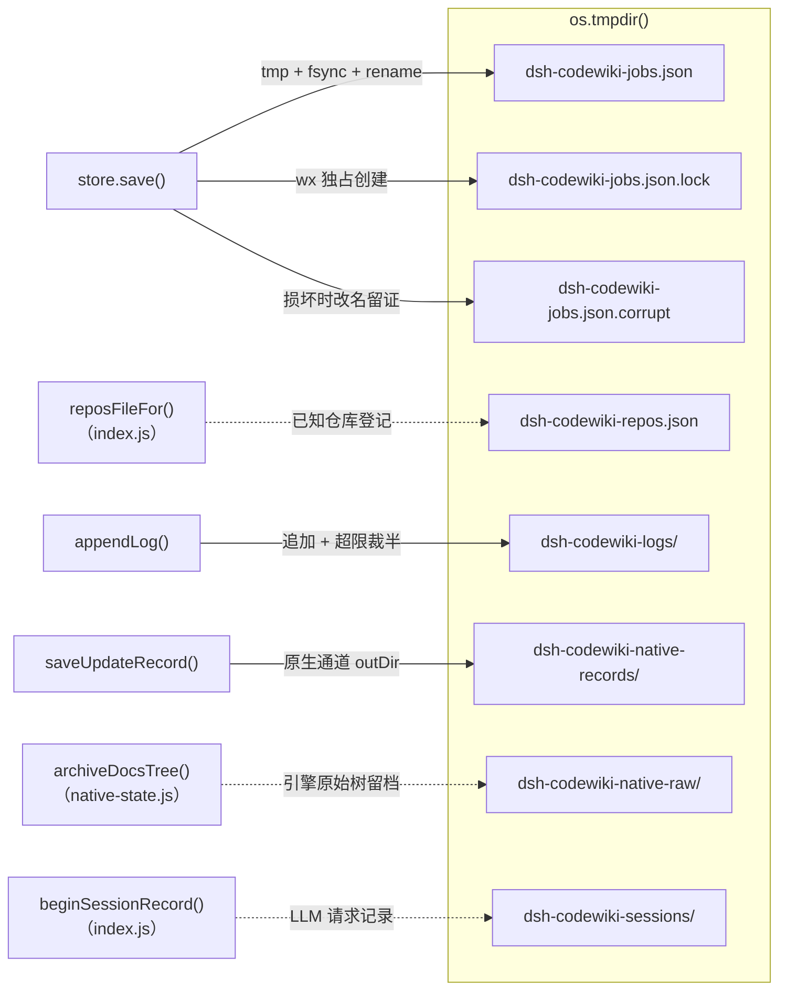

为什么**全部放在仓库外**：`.codewiki/` 内任何非 `_` 开头的新文件都会变成「提交之后产生的未跟踪文件」，每轮编译都把工作区弄脏；日志与更新记录都必须在提交之后才写得成，所以只能在临时目录记账。原始产物树的留档同理（`archiveDocsTree` 的注释明确要求目标目录不得在仓库内）。

---

## 3. `lib/job-store.js`：作业现场的唯一权威

### 3.1 四条硬不变量

模块头注释里写死的 A/B/C/D 四条不变量，是所有设计的出发点：

| 编号 | 不变量 | 落地手段 |
| --- | --- | --- |
| A | `jobs.json` 永远只由「写临时文件 + `fsync` + `rename`」整体替换，不存在半写状态 | `writeAtomic()`，临时文件与目标同目录（同卷），`RENAME_RETRY_MS = [10,30,60,100]` 退避重试，`sleepSync()` 用 `Atomics.wait` 精确睡眠 |
| B | 读不出来时**不允许**当成「没有活动任务」 | `load()` 返回 `state ∈ ok/missing/unreadable/corrupt`，`loadForIdempotency().safe` 只在 `ok` 与 `missing` 时为真（fail-closed） |
| C | 敏感凭证与函数值不得进 `jobs.json` | `serializeJobs()` 的 replacer：函数值直接抛 `job-serialize-function`，键名命中 `SECRET_KEY_RE` 抛 `job-secret-field` |
| D | 取消是终态，任何重放裁决都先看 `cancelRequested` | `planNativeReplay()` 第一段判 `cancelRequested`，`isTerminalStage()` 优先 |

**关于 C 的细节**：`SECRET_KEY_RE = /api[-_]?key|secret|passw|authorization|private[-_]?key|(^|[-_])token$/i`，放宽到「键名包含」是因为真实事故里的键名是 `CODEWIKI_API_KEY` 这类环境变量名，而不是干净的 `apiKey`；但刻意**不收** `maxTokens` / `outputTokens` 这类计数键（它们不含凭证，且面板要用）。

函数值之所以必须显式抛错：`JSON.stringify` 对函数值**静默丢弃**，于是 `llm` 这类执行期依赖会悄悄消失，新宿主读到一个「看起来正常」但缺字段的快照——这比直接报错更难查。

`save(jobs)` 在序列化前先 `slice(-maxKept)`（上层传 `MAX_JOBS_KEPT = 30`），因此 `jobs.json` 只保留最近 30 条任务；超出部分被截断，这也是 `lib/job-logs.js` 必须把日志单独落盘的直接原因——任务记录会被截断，日志不能。

### 3.2 读取状态机与损坏隔离

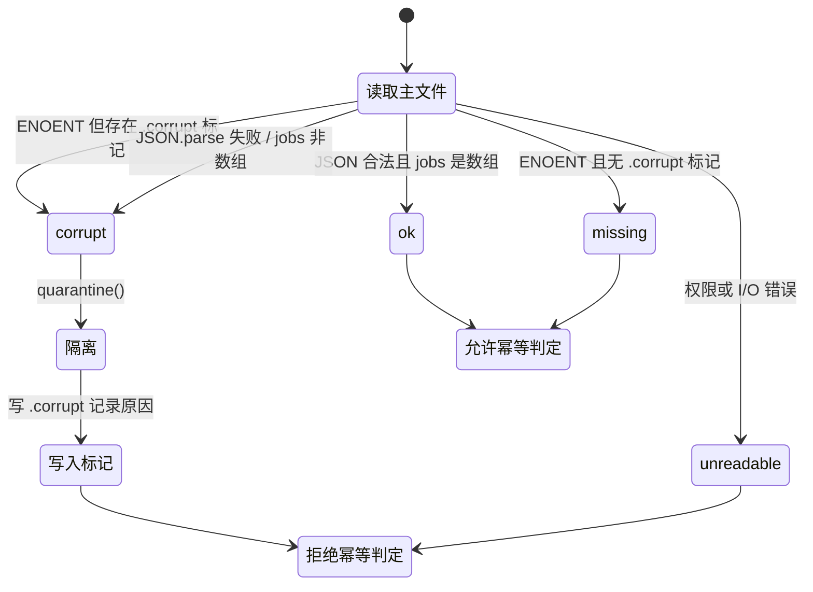

- `quarantine(detail)` 把坏文件**改名**为 `jobs.json.corrupt-<ts>` 而不是删除（保留「上一版到底坏在哪」的证据），并写一个 `jobs.json.corrupt` 标记文件。
- 标记文件的存在意义：损坏文件被改名后原路径就空了，后来者只会看到 `ENOENT`。若把 `ENOENT` 一律当 `missing`，从隔离那一刻起幂等判定就 fail-open，同一仓库会被重复执行。**只有一次成功写入（`writeAtomic` 末尾的 `clearCorruptMarker()`）才清除这条事实。**
- 上层 `loadJobs()`（`index.js`）在 `unreadable`/`corrupt` 时直接抛错，`mergeFromDisk()` 用 `loadForIdempotency()` 并在 `!safe` 时抛错停止推进——「报什么错」属于 `JobService`，本模块只提供判据。

### 3.3 跨进程 tick 锁

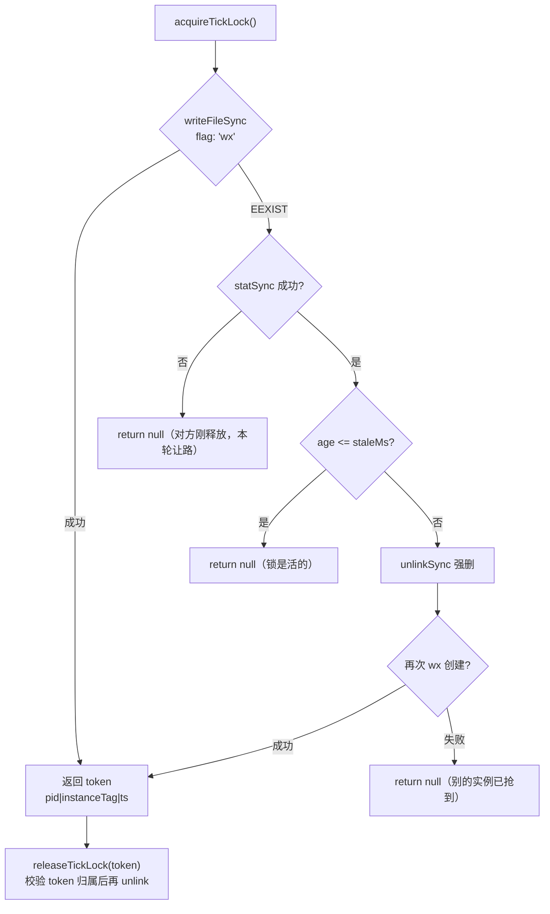

- 锁内容带 `instanceTag`：释放时校验归属，**绝不会删掉「已经超时被别的实例接管」的锁**。旧实现无条件 `unlink`，两个实例交错时会把对方的锁删掉，于是两边同时推进同一 job（双提交批量）。
- 存活判定只用真实时钟（文件系统 `mtimeMs`）。拿调用方合成的 `now` 去减它等于两个时钟混用，负年龄会被读成「活的」，崩溃锁永远等不到接管。
- 默认 `staleMs = 60000`。

### 3.4 现场合并与脏标记

`mergeJobLists({ mine, disk, dirtyIds })`：磁盘版本覆盖内存版本只有两个条件同时成立——**本实例没改过它**（`dirtyIds` 里没有），**且磁盘 `updatedAt` 更新**。否则一个慢 tick 会用过期快照把对方刚写入的 `note` / `batchRef` 洗掉。

调用方（`index.js` 的 `flush()`）的顺序是「先 `mergeFromDisk()` 吸收 → 再把本实例的 dirty job 覆盖回去 → 最后 `store.save()`」，这样既不丢对方的现场，也不让对方的旧快照覆盖自己的新现场。

### 3.5 所有权、心跳与孤儿接管

| 枚举 | 含义 | 判据 |
| --- | --- | --- |
| `OWNERSHIP.MINE` | 本实例拥有 | `job.owner === instanceId` |
| `OWNERSHIP.LEGACY` | 0.4.2 之前的残留或时间戳损坏 | `owner` 为空 / `lastSeenAt()` 非有限数 |
| `OWNERSHIP.LIVE_OTHER` | 别的实例还活着 | `now - lastSeenAt(job) <= orphanTakeoverMs` |
| `OWNERSHIP.IDLE_NO_EXECUTOR` | 别的实例停更，且阶段是 `queued` / `submitting` | 停更 + `NO_EXECUTOR_STAGES` |
| `OWNERSHIP.ORPHAN` | 别的实例停更，且有执行器可丢 | 停更 + 其它非终态阶段 |

`lastSeenAt(job)` 取 `heartbeatAt` / `updatedAt` / `createdAt` 三者的**最大值**（不是「第一个存在的」），因为 `mergeJobLists` 会用磁盘版本整体替换内存版本，两组时间戳可能不同步。

`heartbeat(job, { instanceId, everyMs = HEARTBEAT_MS })` 默认 30 秒节流：`jobs.json` 是整文件重写，每 tick 都写一遍没有意义；节流后长批次（等引擎）也不会被别的实例判成孤儿。

`planForeignJob(job, { instanceId, now, orphanTakeoverMs })` 把「所有权 + 阶段」翻成三种处置：

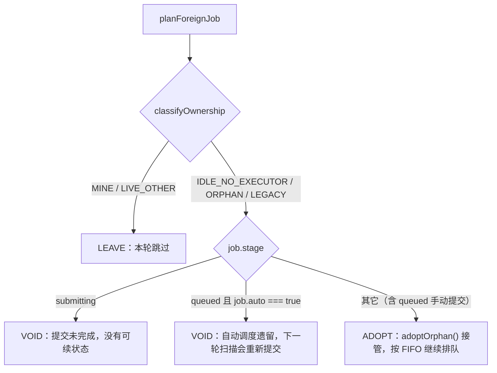

为什么要区分 `queued` 的两种结局：旧实现遇到别人的非终态任务一律 `continue`，于是宿主重启前提交的排队项**永久卡在 `queued`**——既占着闸门窗口，又让同仓幂等一直返回它，用户连重新提交都做不到。

### 3.6 同仓幂等与会话归属

- `findActiveJob(jobs, cwd, { keyOf = normKey })`：跳过终态、按归一化路径比较、返回 **`createdAt` 最新**的那条。取最新而非最早，是因为历史遗留可能让同一仓库挂着多条活动记录（旧版幂等只看内存），该恢复的是最近那次提交。
- `normKey(p)`：`path.normalize` + 去尾分隔符，**只在 `win32` 折叠大小写**。旧实现无条件 `toLowerCase`，在 Linux/macOS 上会把 `/home/u/Foo` 与 `/home/u/foo` 认成同一个仓库，幂等判定会把其中一条任务的提交吞掉。
- `reassignSession(job, sessionId)`：同仓被另一个会话再次提交时，把记账指向新会话，并把 `{from,to,at}` 追加进 `sessionOwnerHistory`（保留最近 10 条），面板据此解释「最近关心该仓库的会话换成了谁」。

### 3.7 原生通道：可重放快照与重放裁决

`snapshotNativeRun(job, { channel, attempt, docsDir, moduleConcurrency, rawTreeRoot })` 只收「下次还能原样再下发的执行配置」：`channel.python` / `channel.entry` / `timeoutMs` / `scope`、`kind`、`language`、`moduleConcurrency`、`rawTreeRoot`、`docsDir`、`attempt`、`capturedAt`。

**明确不收**：`llm` 服务、`bridge`（随机端口 + 占位 key）、`onProgress` / `onLog` 回调、任何 provider 凭证——它们属于「当前宿主」，重启后必须由新宿主重建，持久化只会留下过期指针（桥端口已死）或泄密面。这也是 `serializeJobs` 要对函数值抛错的直接原因。

`planNativeReplay(job, { maxAttempts = 3, exists })` 回答「宿主重启后该重跑还是该失败」：

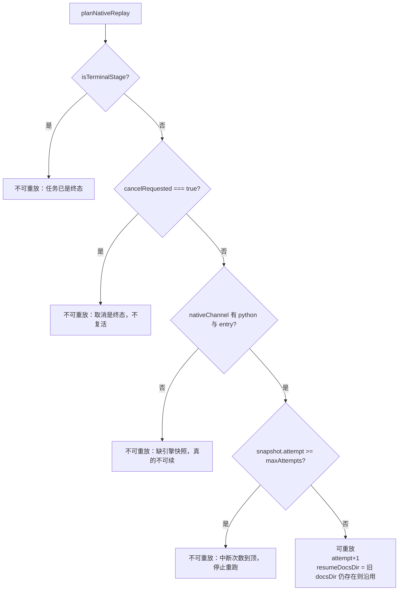

设计取舍写在注释里：旧行为（`nativeStarted === true` 且内存里没有执行器 → 直接 `failed`）把「执行器丢了」误当成「这轮编译不可续」。原生通道的全部输入本来就在 job 上，重启后完全可重放——代价是重跑一次编译，收益是用户不必手工重新提交；而 `failed` 是纯损失（一个已经跑了一半的仓库被标成没有成果）。三条刹车（取消 / 尝试次数上限 / 终态）防止宿主崩溃循环时无限烧全量编译。

`resumeDocsDir` 的意义：宿主强杀不会执行 `startNativeRun` 的 `finally`，临时目录里保留的是引擎已提交的叶子终态；重放时只补水缺失状态、不覆盖它（`runNativeJob` 的 `resume` 参数）。

---

## 4. `lib/job-logs.js`：引擎黑匣子

### 4.1 为什么必须落盘

引擎日志此前只留在 `job.nativeLogs` 的最近 20 条里——纯内存、不序列化、不进 `jobSummary`。真机上一次 99 分钟的编译结束后，能查到的只有最后 3 分钟（20 条桥请求），前面 96 分钟引擎在干什么完全无从追查；宿主重启或任务被 `MAX_JOBS_KEPT` 截断时更是全部消失。**日志是事后解释「为什么慢、为什么 partial」的唯一依据，它必须在进程死掉之后还活着。**

### 4.2 格式与容量

- 一个任务一个文件：`<LOG_ROOT>/<jobId>.ndjson`，`jobId` 里非 `[\w.-]` 的字符替换成 `_`。
- 一条事件一行，字段固定：`at`（ISO 时间）、`jobId`、`phase`、`kind`，其余由调用方扩展。固定字段形状是为了避免同一文件里出现多种结构后无人能解析。
- `LOG_ROOT = process.env.DSH_CODEWIKI_LOG_DIR || path.join(os.tmpdir(), 'dsh-codewiki-logs')`。
- `MAX_LOG_BYTES = max(64KB, DSH_CODEWIKI_LOG_MAX_BYTES || 2MB)`。一次 28 篇文章的编译大约产生数百到数千条（桥请求 + stderr + 阶段切换），2MB 足够覆盖，同时不会让临时目录失控。
- 超限策略：`trimIfNeeded()` 读全部行、**丢掉前一半**、写回——保留最近的现场，而不是丢最新的。

### 4.3 API 与失败语义

| 函数 | 行为 |
| --- | --- |
| `appendLog(jobId, entry)` | 追加一行；写失败返回 `false` 而**不抛** |
| `readLogTail(jobId, limit = 200)` | 读最近 N 条，`limit` 夹在 1..5000；**坏行跳过**（文件被外部改动或写入不完整时，能读多少给多少比抛错更有用） |
| `logStats(jobId)` | `{ path, bytes, updatedAt }`，文件不存在时 `bytes: 0, updatedAt: null` |
| `removeLog(jobId)` | `rmSync(..., { force: true })`，删不掉就留着，不影响任何判定 |

`appendLog` 不抛错的理由：日志是**观测**，不能因为它把编译打断。但调用方必须把失败如实报出去——`index.js` 的 `recordNativeLog()` 在 `appendLog` 返回 `false` 时写 `job.logError` 并 `note()`，绝不静默。

### 4.4 消费路径

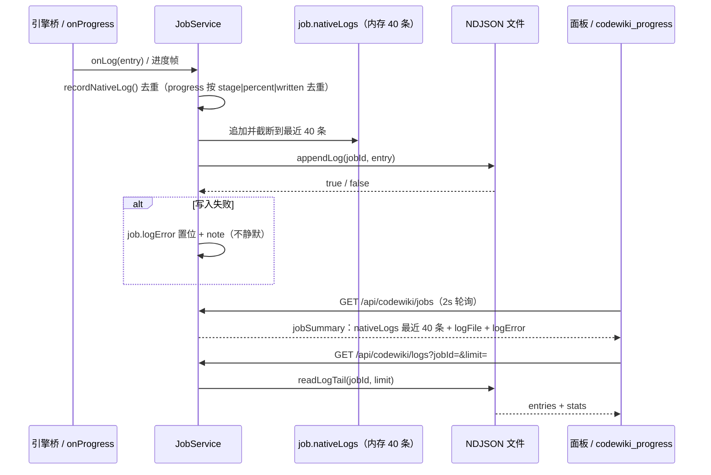

内存那份与落盘那份**两条路都必须有**：内存那份给面板即时看（2 秒轮询下不必读盘），落盘那份才能回答「99 分钟里到底发生了什么」。`jobSummary` 里的 `logFile` 只在 `job.channel === 'native'` 时给出。

---

## 5. `lib/update-record.js`：终态裁决与可复盘记录

### 5.1 为什么需要它

背景缺陷（审计确认）：编译结束只留 `writtenCount` / `failedCount` 两个数字，job 文件里塞的是整张图与任务快照。于是「为什么这篇没重写」「哪几个变更没人管」事后无法复盘，面板也只能显示一句「完成」——而实际上可能 1 篇成功、19 篇失败。

本模块负责三件事：把 `ChangeSet + UpdatePlan + 逐篇结果` 收成版本化记录；判定终态并把「完整性不成立」的每种情形写进 `blockers`；明确回答「能不能推进编译基线」。

### 5.2 终态语义

| 终态 | 含义 | 基线 |
| --- | --- | --- |
| `done` | 完整成功：计划内必需文章全部写好、变更全部有归属、质量闸门全过 | 可推进 |
| `partial` | 部分完成：已成功的文章可以入库，但「全部已消化」不成立 | **不得推进** |
| `failed` | 失败：没有可交付的成果（0 篇成功，或硬性前置条件缺失） | 不得推进 |
| `cancelled` | 已取消（`options.cancelled` 短路，优先于一切判定） | 不得推进 |

`isTerminalStage(stage)` 与 `TERMINAL` 集合在这里独立定义一份，与 `job-store.js` 的同名导出**刻意重复**：两个模块都不允许反向依赖对方，而集合本身（`done/partial/failed/cancelled`）是稳定契约。

### 5.3 `judgeOutcome()` 的六类 blocker

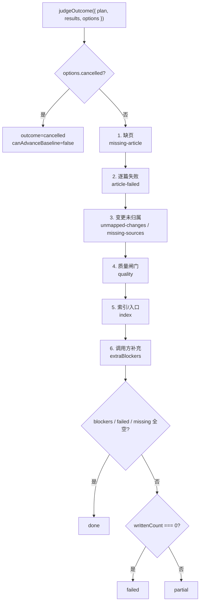

几个容易踩的细节：

- **缺页与失败分开记**：`missing-article`（计划要求写但没写、也没失败记录）与 `article-failed`（写了但失败）处置不同，不能合并成一条。
- **无 `plan` 的通道（full 编译）**：用 `options.expectedNames`（任务清单本身）判缺页。
- **`unmapped-changes` 只算源码变更**：`plan.unmappedSourceChanges` 优先，否则从 `unmappedChanges` 里滤掉 `.md`。非源码文件（README / CodeWiki.md / CHANGELOG）没有被任何文章引用是常态，混进来会让正常增量永远落 `partial`，等于把「诚实终态」退化成「永远不完整」。
- **`nothingDelivered`**：`writtenCount === 0` 且存在失败/缺页/blocker 才是 `failed`；只要写成了一部分就是 `partial`——「部分完成」不等于失败，但也不等于 `done`。

### 5.4 `canAdvanceBaseline` 的显式写法

```js
canAdvanceBaseline: outcome === 'done' || (outcome === 'partial' && writtenCount > 0 && blockers.length === 0)
```

按当前 blocker 规则，`partial` 必然至少带一条 blocker（6 类降级来源每一个都会 `push`），所以 `partial` 分支**当前不可达**——这行与旧的 `outcome === 'done'` 行为完全一致，不是 bug 修复。

那为什么还要写全？因为旧写法把两条**不同**的语义压成了一句话，读者无法区分「done-only」与「有成果且无硬缺陷」；而 `native-run.js` / `quality-gate.js` 用的恰恰是后者。三处看起来矛盾、实际只是通道不同：本函数服务的 blocker 含「未归属变更」「缺页」这类「没消化完」语义，一旦放宽就会把未消化的变化记成已消化——下一轮这些变化不再触发文章更新，wiki 就会静默落后于代码。写成显式形式后，将来若有人放宽 blocker 规则，`partial` 分支会自动按「有成果且无缺陷才推进」生效，而不是靠 `done` 这个别名悄悄失效。

### 5.5 记录结构与 IO

`buildUpdateRecord({ jobId, scope, changeSet, plan, results, outcome, wikiPath, qualityIssues, notes, startedAt, finishedAt })` 产出 `UPDATE_RECORD_VERSION = 1` 的可序列化对象，字段分组：

| 分组 | 内容 | 裁剪策略 |
| --- | --- | --- |
| 元信息 | `version`、`jobId`、`scope`、`startedAt`、`finishedAt`、`baseCommit`、`headCommit` | — |
| `changeSet` | `state`、`ok`、`fallback`、`reason`、七类计数、`sourceChanges`、`ignored` | 只留计数与路径 |
| `plan` | `fileLevel`、`needsFull`、`fullReason`、`summary`、`counts`、组件分类、`actions`、`unmappedChanges`、`routedTo`、`missingSources`、`warnings` | 每个 `action` 必须带 `reason`（可复盘的最低要求） |
| `results` | `{ name, ok, stopReason, error }` | `error` 截断到 300 字符 |
| `qualityIssues` | `{ name, issue }` | 截断到 300 字符 |
| 裁决 | `outcome`、`blockers`、`canAdvanceBaseline`、`writtenCount`、`failedCount` | — |
| 其它 | `notes`（最近 20 条）、`wikiPath` | — |

IO 助手：

- `recordPath(wikiPath)` → `<wikiPath>/temp/update-record.json`（`UPDATE_RECORD_REL`）。
- `saveUpdateRecord(wikiPath, record, fsImpl = fs)` → `{ ok, path }` 或 `{ ok: false, reason }`，**从不抛**（记录失败只记 note）。
- `loadUpdateRecord(wikiPath, fsImpl = fs)` → 版本不符返回 `null`，读不到/坏 JSON 也返回 `null`。
- `describeOutcome(outcome, blockers)` → 面板/工具文案：`完成（所有变化已消化）` / `部分完成（N 项未满足：…）` / `已取消` / `失败（…）`。

### 5.6 两条落盘通道

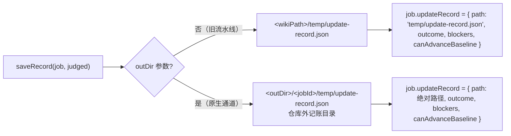

原生通道必须走 `outDir`：提交发生在落地器内部，而记录要等落地结果出来才写得成——写到 `.codewiki/` 就必然晚于提交，于是每轮编译之后工作区都留一个未跟踪的 `?? .codewiki/temp/update-record.json`，无变化轮「零副作用」也就无从谈起。**job 里只存路径与摘要，不塞整图**（整张图进 `jobs.json` 会让临时目录里的任务文件无限膨胀）。

### 5.7 版本与兼容

`UPDATE_RECORD_VERSION = 1`，`loadUpdateRecord()` 遇到版本不符**直接返回 `null`** 而不是尝试兼容迁移：记录是「事后复盘证据」，读到一个半懂不懂的旧结构比读不到更危险。升级记录结构时只需把版本号 +1，旧文件自然失效（`job.updateRecord` 里的摘要仍在 `jobs.json` 里可查）。

`notes` 只保留最近 20 条、`error`/`issue` 截断到 300 字符，这是为了让记录本身保持「可提交、可 diff、可机读」的体量；完整细节留在 job 的 `notes`（最多 50 条）与引擎 NDJSON 日志里。

---

## 6. 一次 tick 如何串起这三个文件

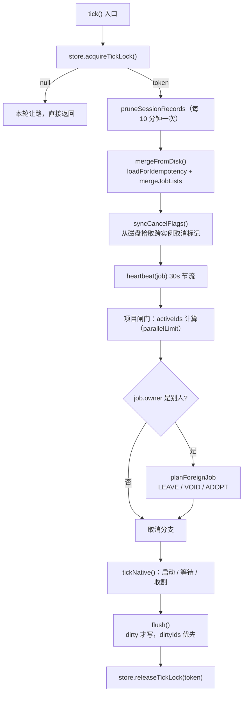

`flush()` 的语义值得单独记住：`dirty` 标记「有变更需要落盘」，`dirtyIds` 标记「哪些 job 的内存对象是唯一现场」。`touch(job)` 是状态变更的唯一入口，它同时更新 `updatedAt`、置 `dirty`、把 id 加入 `dirtyIds`——漏掉它，纯内存变更（取消、`continue` 之前的状态调整）就永远进不了 `jobs.json`。

### 6.1 任务全生命周期中的三个模块

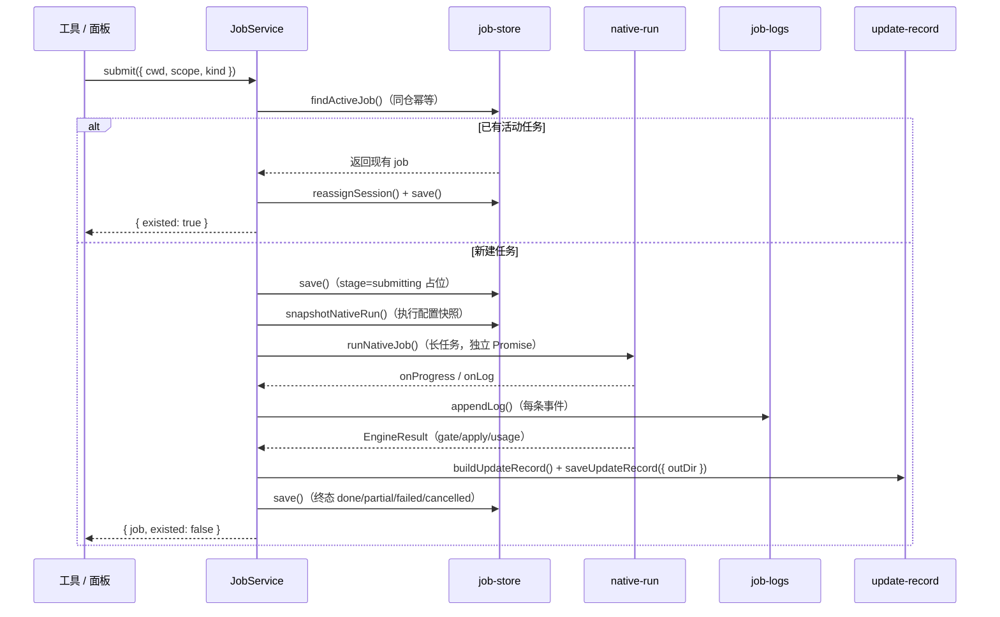

注意 `saveUpdateRecord` 排在 `save()` 之前：终态记录必须先写成功，`job.updateRecord` 摘要才有内容可进 `jobs.json`；记录写失败时只 `note()`，不影响终态本身。

---

## 7. 任务阶段与终态

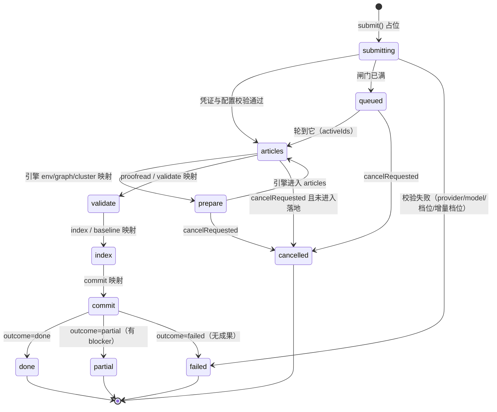

两条必须记住的规则：

1. **取消是终态，但不是成功**：`outcome = 'cancelled'`、`canAdvanceBaseline = false`。原生执行器还在跑时 `abort` 会终止引擎进程树，但落地器不接 `signal`——`apply` 一旦开始就会跑完，此刻直接判 `cancelled` 会把「已落盘、已提交、基线已推进」的事实改写成「产物未落地」，下一轮再从旧基线重复消费一批变化。所以取消的终态交给执行器的真实结果。
2. **`partial` 也入库但不推基线**：写成的文章保留，未消化的变化留到下一轮（`native-state.js` 的 `unconsumed` 携带机制，见 [engine-core/engine-state-manifest.md](../Documentation_Generation_Engine/engine-core/engine-state-manifest.md)）。

图中的阶段名是**面板粗粒度阶段**。原生引擎的九段（`env` / `graph` / `cluster` / `articles` / `proofread` / `validate` / `index` / `baseline` / `commit`）由 `NATIVE_STAGE_TO_PANEL` 压缩映射：`env`/`graph`/`cluster` → `prepare`，`proofread`/`validate` → `validate`，`index`/`baseline` → `index`。真实阶段另存 `job.nativeStage`，八段耗时另存 `job.nativeStageTimings`——`stageTimings` 里 `prepare` 一格吞了三段，拆不开就看不到「时间花在哪」。历史遗留的 `crosscut` / `review` 阶段名只可能出现在旧任务记录里。

阶段集合与 `TERMINAL` 判定的关系：`isTerminalStage()` 为真的四个阶段（`done` / `partial` / `failed` / `cancelled`）是**唯一**允许停止推进的终态，其余一律继续被 tick 调度。终态写入后 `finishedAt` 落地，`jobSummary` 与 `codewiki_progress` 都按它排序。

---

## 8. 配置与环境变量

| 变量 | 作用 | 默认 / 约束 |
| --- | --- | --- |
| `DSH_CODEWIKI_JOBS_FILE` | `jobs.json` 路径 | `os.tmpdir()/dsh-codewiki-jobs.json`；测试必须隔离到独立路径，否则会与真实宿主互相洗掉内存字段 |
| `DSH_CODEWIKI_REPOS_FILE` | 已知仓库清单 | 由 `reposFileFor()` 从 `JOBS_FILE` 基名派生（`-jobs` → `-repos`） |
| `DSH_CODEWIKI_LOG_DIR` | 引擎日志根目录 | `os.tmpdir()/dsh-codewiki-logs` |
| `DSH_CODEWIKI_LOG_MAX_BYTES` | 单任务日志上限 | 2MB，下限 64KB |
| `DSH_CODEWIKI_TICK_MS` | tick 周期 | 10000ms，下限 250ms |
| `DSH_CODEWIKI_ORPHAN_TAKEOVER_MS` | 孤儿接管阈值 | 5 分钟，下限 60s |
| `DSH_CODEWIKI_NATIVE_RECORD_DIR` | 原生更新记录目录 | `os.tmpdir()/dsh-codewiki-native-records` |

`reposFileFor()` 为什么跟随文件名而不是只跟随目录：各测试套件把 `JOBS_FILE` 指向 `dsh-codewiki-jobs-test-<pid>-<token>.json` 做隔离，但 `dirname` 仍是系统临时目录——只按目录推导时，测试写出的清单与真实宿主的 `dsh-codewiki-repos.json` 是同一个文件，跑一次测试就会把 fixture 路径塞进宿主的已知仓库清单，自动调度随后每轮都会去扫那些早已删除的目录。

### 8.1 打包与运行时约束

- 三个文件**只依赖 Node 内置模块**：`node:fs`、`node:path`、`node:os`、`node:crypto`。没有第三方依赖，因此可以被任何测试桩直接 `import`。
- `package.json` 的 `files` 字段包含 `lib`（并排除 `lib/**/__pycache__`），本模块随包发布；`engines.node >= 24.9.0`，`writeAtomic()` 的 `Atomics.wait` + `SharedArrayBuffer` 同步睡眠与 `fs.rmSync` 等都依赖较新的 Node。
- `cordis.patch.yml` 只声明插件条目与 config 命名空间，**本模块不读取任何插件配置**：所有行为由环境变量（上表）与调用方传入的参数决定，这样它在测试与真实宿主中的行为完全一致。

### 8.2 可测试性设计

三个模块都刻意把「不确定性」做成可注入的参数，因此可以完全离线单测，不需要起真宿主、也不需要 git：

| 注入点 | 位置 | 用途 |
| --- | --- | --- |
| `fsImpl` | `saveUpdateRecord(wikiPath, record, fsImpl)`、`loadUpdateRecord(wikiPath, fsImpl)` | 换掉文件系统，直接测「写失败只返回 reason」「版本不符返回 null」 |
| `keyOf` | `findActiveJob(jobs, cwd, { keyOf })` | 换掉路径归一化，测大小写敏感 / 不敏感两种平台语义 |
| `exists` | `planNativeReplay(job, { exists })` | 伪造 `resumeDocsDir` 是否仍存在 |
| `now` | `classifyOwnership`、`planForeignJob`、`heartbeat`、`adoptOrphan`、`reassignSession` | 固定时钟，把「停更 4 分钟 vs 6 分钟」钉死 |
| `maxAttempts` | `planNativeReplay(job, { maxAttempts })` | 把重放次数上限压到 1，直接测「到顶即失败」 |
| `execFile` | `collectChangeSet(cwd, baseCommit, { execFile })`（`lib/change-set.js`） | 用假执行器构造四路变更，不起 git |
| `everyMs` | `heartbeat(job, { everyMs })` | 关掉 30 秒节流以便断言 |

`createJobsStore({ file, maxKept, instanceTag })` 本身就是工厂：测试传一个临时路径就得到一个完全隔离的 store（`file`、`lockFile`、`corruptMarkerFile` 都从 `file` 派生），这也是 `DSH_CODEWIKI_JOBS_FILE` 存在的原因——真实宿主的周期 flush 会用内存副本整写同一文件，测试若不隔离就会与它互相洗掉对方的内存字段（`tps` 采样 flaky 的根因）。

---

## 9. 常见故障与判读

| 现象 | 本模块中的原因 | 判读依据 |
| --- | --- | --- |
| 提交后立刻报「任务现场不可读」 | `load()` 返回 `corrupt` / `unreadable`，上层 fail-closed | 看 `jobs.json.corrupt` 标记的 `detail` 与 `jobs.json.corrupt-<ts>` 备份 |
| 同一仓库被重复编译两次 | 隔离后 `ENOENT` 被误当 `missing`（已由标记文件修复）；或 `normKey` 折叠了大小写 | 检查 `state` 是否为 `missing` 而非 `corrupt`；检查路径大小写 |
| 任务永久卡在 `queued` | 原实例停更且 `planForeignJob` 判 `VOID`/`ADOPT` 未生效 | 看 notes 里的「原实例 … 停更 X 分钟」 |
| 面板只有最近 40 条日志 | 内存环缓冲上限（`NATIVE_LOG_MEMORY = 40`） | 用 `/api/codewiki/logs?jobId=` 翻全量 NDJSON；`logError` 非空表示落盘失败 |
| 编译「完成」但下一轮又重跑同样内容 | 基线被 `partial` 推进（不应发生）；或 `unmapped-changes` 未计入 | 读 `update-record.json` 的 `outcome` / `blockers` / `canAdvanceBaseline` |
| `jobs.json` 里出现疑似凭证 | `SECRET_KEY_RE` 命中会抛错，说明有字段名越界 | 抛错文本带字段名，改字段名或移出快照 |
| 宿主重启后任务直接失败 | `planNativeReplay` 返回 `replayable: false` | `reason` 会说明是缺快照、次数到顶还是已取消 |

---

## 10. 与其他模块的关系

| 模块 | 关系 |
| --- | --- |
| [作业编排与状态管理（Job Orchestration & State Management）](../Job_Orchestration___State_Management.md) | 父页面：`index.js` 的 `createJobService` 是唯一调用者，负责把本模块的能力组装成 tick 阶段机 |
| [插件编排层（plugin-orchestration）](plugin-orchestration.md) | 工具与面板端点层，通过 `jobSummary` 消费 `job-store` 的状态与 `job-logs` 的 `logFile` |
| [engine-core 模块概览](../Documentation_Generation_Engine/engine-core.md) | `native-run.js` 的裁决链产出 `outcome` / `blockers` / `usage`，本模块的 `judgeOutcome` 与它是**不同通道**的同类判定（详见 §5.4） |
| [engine-core/engine-state-manifest.md](../Documentation_Generation_Engine/engine-core/engine-state-manifest.md) | `native-state.js` 的 `unconsumed` / `consumedRange` 是 `planNativeReplay` 与幂等判定的事实来源 |
| [文章流水线（article-pipeline）](../Documentation_Generation_Engine/article-pipeline.md) | 质量闸门的 `qualityIssues` 直接进入 `judgeOutcome` 的 `quality` blocker |
| [ui-client（浏览器半侧客户端）](../ui-client.md) | 面板按 `stage` / `nativeStage` / `blockers` / `logFile` 渲染进度与排障信息 |
| [Execution_Runtime___Vendored_Engine 概览](../Execution_Runtime___Vendored_Engine.md) | 引擎进程的实际生命周期与阶段上报由 Python 运行时负责，本模块只记录与裁决 |

??? abstract "Documented components (4)"
    - [`removeLog`](https://github.com/ikliml666/dsh-codewiki/blob/cc1116c4ad9e359fc739203aed18b8ba6fd73e7a/lib%5Cjob-logs.js) — `lib\job-logs.js`
    - [`normKey`](https://github.com/ikliml666/dsh-codewiki/blob/cc1116c4ad9e359fc739203aed18b8ba6fd73e7a/lib%5Cjob-store.js) — `lib\job-store.js`
    - [`isTerminalStage`](https://github.com/ikliml666/dsh-codewiki/blob/cc1116c4ad9e359fc739203aed18b8ba6fd73e7a/lib%5Cupdate-record.js) — `lib\update-record.js`
    - [`loadUpdateRecord`](https://github.com/ikliml666/dsh-codewiki/blob/cc1116c4ad9e359fc739203aed18b8ba6fd73e7a/lib%5Cupdate-record.js) — `lib\update-record.js`

