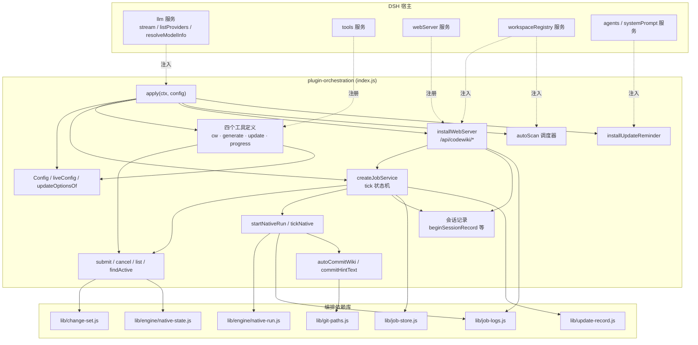
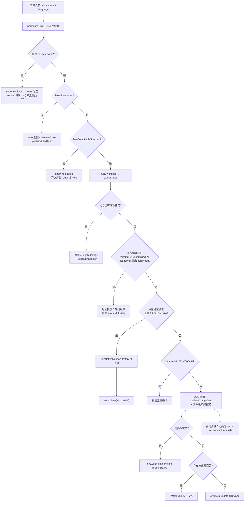
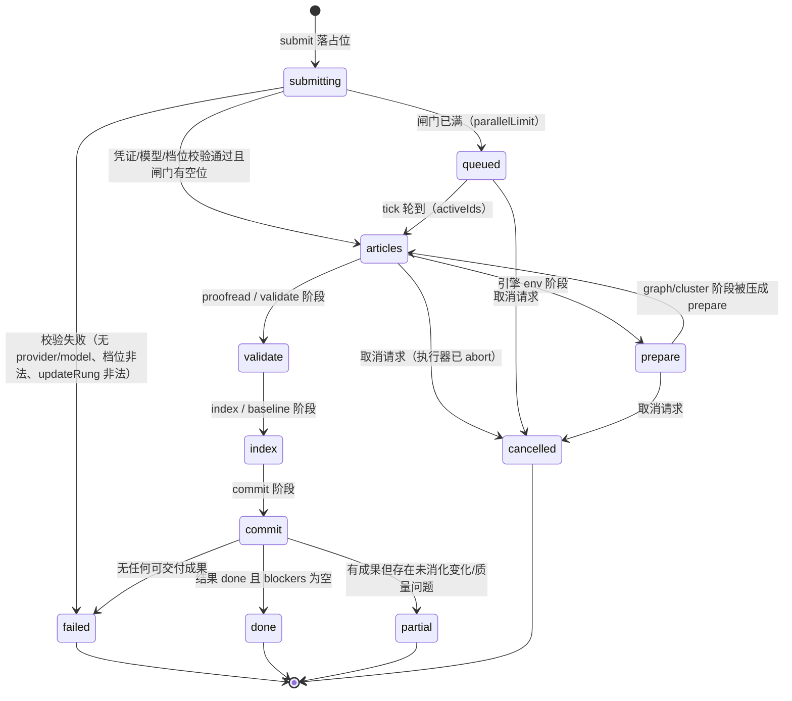
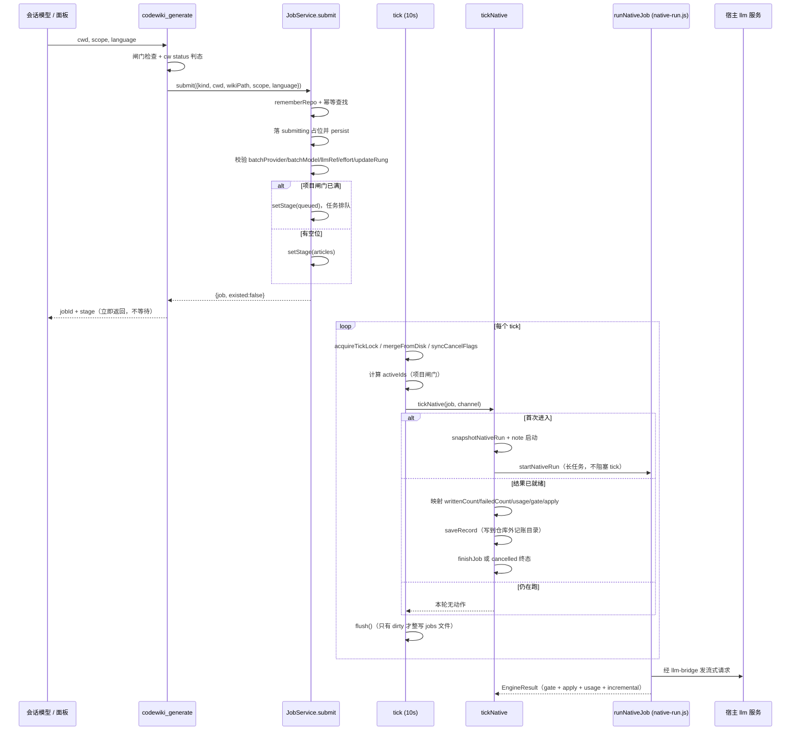
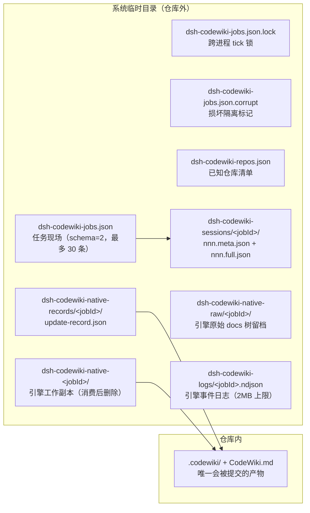
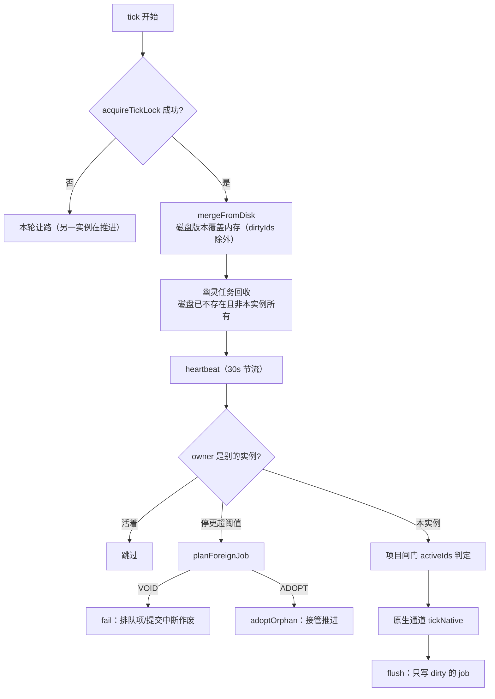
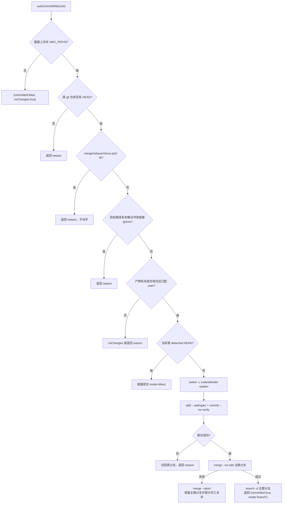
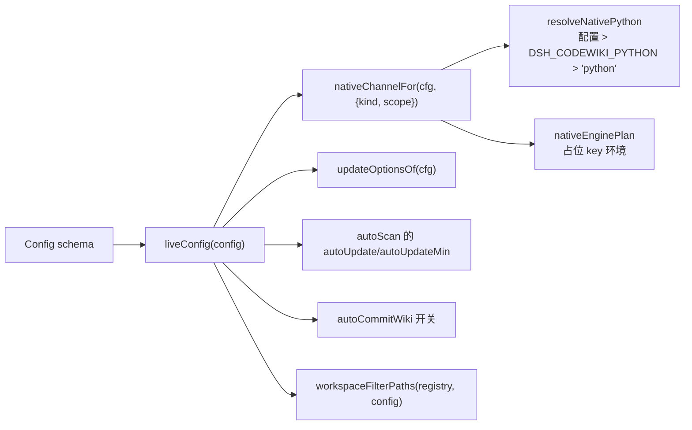
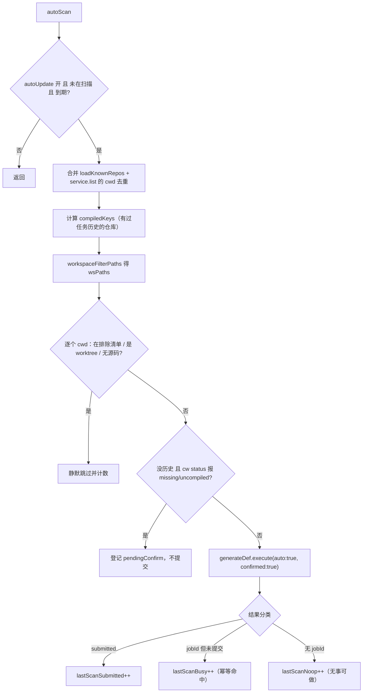

# 插件编排层（plugin-orchestration）

!!! info "Generated documentation"
    This page was written by CodeWiki from the source code at commit [`65890014`](https://github.com/ikliml666/dsh-codewiki/commit/6589001428bc8eb6662303a05b6be49bacbd4061) on 2026-11-09 with `deepseek-v4.1-flash`. Check the code before relying on details.

`plugin-orchestration` 是 `dsh-codewiki` 插件的**入口与编排层**，实现全部位于 `index.js`。它把「一个仓库的整轮 wiki 编译」从一次工具调用变成一条**可观测、可恢复、可取消的后台任务**：注册四个面向模型/用户的能力（`cw`、`codewiki_generate`、`codewiki_update`、`codewiki_progress`）、一个 10 秒节拍的任务状态机、一套会话内容记录、一组仅回环可访问的 HTTP 端点，以及编译产物的自动提交与系统提示注入。

本页只描述**编排与状态管理**。真正的编译裁决链在引擎侧（见 [engine-runner：原生引擎执行与裁决编排](../Documentation_Generation_Engine/engine-core/engine-orchestration/engine-runner.md) 与 [apply-plan 落地器](../Documentation_Generation_Engine/engine-core/engine-orchestration/apply-plan.md)），任务持久化与跨实例协调的纯函数在 `lib/job-store.js`（见 [作业状态与持久化层（job-and-state）](job-and-state.md)），面板前端在 [ui-client（浏览器半侧客户端）](../ui-client.md)。

---

## 1. 模块职责边界

| 职责 | 实现位置 | 说明 |
| --- | --- | --- |
| 工具注册与参数校验 | `cwToolDefinition` / `generateToolDefinition` / `updateToolDefinition` / `progressToolDefinition` | 四个工具；单个工具 schema 违规只丢该工具，不炸整个 `apply` |
| 判态与提交 | `codewiki_generate.execute`、`createJobService().submit` | 提交制：判态 → 落一条 job → 立即返回，不等编译 |
| 任务推进 | `createJobService().tick`（`TICK_MS`，默认 10s） | 项目闸门、取消、孤儿接管、原生通道启停与结果收割 |
| 状态落盘 | `createJobsStore`（`lib/job-store.js`） | 原子写 + 损坏隔离 + 跨进程 tick 锁 |
| 会话内容记录 | `beginSessionRecord` 等一组函数 | 每个 LLM 请求的 prompt/输出/思考/工具调用落盘，保留 24h |
| 本机 API | `installWebServer` | `/api/codewiki/*`，全部仅回环 |
| 产物自动提交 | `autoCommitWiki`、`commitHintText` | 主题分支提交后合并回原分支，只碰 `WIKI_PATHS` |
| 自动调度 | `apply` 内的 `autoScan`（60s 心跳） | 扫描已知仓库，`scope=auto` 判态提交；首次编译需用户确认 |
| 系统提示注入 | `installUpdateReminder`、`reminderText` | 仅在会话仓库根存在 `CodeWiki.md` 时出现 |

**核心设计取向**：编排层**不做编译判断**。它只负责「起进程 / 收进度 / 按结果判终态」，绝不在 tick 里重写裁决；`native-run.js` 里那条 `env → 增量决议 → 引擎 → gate → apply` 的直线是唯一裁决来源。

---

## 2. 架构与外部依赖

依赖方向是单向的：`index.js` 依赖 `lib/*`，`lib/job-store.js` 刻意**不反向依赖** `index.js`（它自己复制了一份 `normKey`），因此可以独立单测。

---

## 3. 四个工具与它们的语义分工

| 工具 | 语义 | 是否等待编译 |
| --- | --- | --- |
| `cw` | 薄封装 CodeWiki CLI，白名单子命令 `init/status/index/meta/path/projects/setup/uninstall` | 同步等待（120s 超时） |
| `codewiki_generate` | 判态 + 提交，`scope ∈ {auto, full, stale}` | 否（提交制） |
| `codewiki_update` | 固定 `scope=auto` 的日常维护快捷入口，复用 `generate` 的 `execute` 后改写文案 | 否 |
| `codewiki_progress` | 只读查询，数据与侧边栏面板同源（`jobSummary` + `progressView`） | 否 |

### 3.1 `cw` 的工具边界

`resolveBinary` 的解析顺序是**配置 `binaryPath` → PATH 里的 `cw` → 插件自带 `bin/cw(.exe)`**。PATH 优先是有意为之：用户自装的 `cw` 与其 `codewiki` 源码同步演进，捆绑副本只在 PATH 找不到时兜底，避免「bash 里原生正常、包装层报 No wiki found」的分叉。

`normalizeCwd` 只在 `win32` 上把 Git-Bash 盘符路径 `/e/...` 归一化为 `E:/...`；POSIX 上 `/e/...` 可能是真实绝对路径，原样保留。

### 3.2 `codewiki_generate` 的判态流程

关键设计点：

- **首次编译闸门**用**用户原始 `scope`** 而非修正后的 `effectiveScope` 判断。否则 `stale` 遇到无 wiki 仓库会被自动升成全量，闸门形同虚设。放行只有两种情形：显式 `scope=full`，或 `args.confirmed === true`（面板按钮/自动调度在扫描阶段已确认）。
- **`clean` 也要走原生通道**：`cw status` 只看 committed，工作区未提交变化与受管状态缺失它一概看不见，直接短路会让这些变化永远进不了引擎。
- **`idleNativeReason`** 是一道乐观的跳过判定：只有「基线可读 + 变更采集成功 + 受管状态齐备 + 记录 headCommit 等于当前基线 + 合并未消费后无有效变化」五项同时成立才返回跳过理由；任何一项判不准就返回 `null`（照常提交），宁可空跑也不丢变化。
- **`excludePaths` 命中不是错误**：`render` 只输出一句「本仓库无需处理」，不解释原因，避免模型去追问用户「为什么排除」。

### 3.3 `codewiki_progress` 的只读契约

`progressView(job)` 在 `jobSummary` 之上补一个 `progress` 百分比（`done / taskList.length`）。输出同时暴露两套阶段：

- `stage`：面板粗粒度五段（`prepare / articles / validate / index / commit`）；
- `nativeStage`：引擎自报的九段契约（`env/graph/cluster/articles/proofread/validate/index/baseline/commit`）。

两套阶段的映射在 `NATIVE_STAGE_TO_PANEL` 中固定，`prepare` 一格吞掉 `env/graph/cluster` 三段，因此另有 `nativeStageTimings` 单独记录引擎真实分段耗时——否则「时间花在哪」会永久丢失。

---

## 4. 任务状态机

终态集合 `TERMINAL = {done, partial, failed, cancelled}`（定义在 `lib/update-record.js`，编排层以 `JOB_TERMINAL` 引用）。语义：

- `done`：计划内必需文章全部写好、变更全部有归属、质量闸门全过 → **可推进编译基线**。
- `partial`：已写成的文章可以入库，但「全部已消化」不成立 → **不推进基线**，未消化的变化下一轮仍会被看见。
- `failed`：没有可交付成果。
- `cancelled`：取消是终态，`canAdvanceBaseline` 恒为 `false`，且绝不复活。

`finishJob(job, outcome, blockers)` 是终态写入的唯一入口；`partial` 的存在是为了避免旧实现「1 篇成功 + 19 篇失败也报 done 并推进基线」的静默落后。

---

## 5. 提交 → 编译 → 收割的完整时序

`startNativeRun` 必须拆成「启动 → 等结果 → 收割」三段：一次原生编译是**分钟级长任务**，塞进 tick 的一步会让下一次 tick 重复提交。`nativeRuns` / `nativeResults` / `nativeAborters` 三张表就是这三段之间的交接点。

### 5.1 原生通道的依赖注入

`runNativeJob` 的 `deps` 由编排层组装：

| 键 | 作用 |
| --- | --- |
| `config` | `liveConfig` 快照（含 `engineRoot: ''`） |
| `updateOptions` | `updateOptionsOf(c)`：`rung` 与四个 `tau_*` 阈值，留空的键不出现 |
| `llm` | 宿主 `llm` 服务引用（`llmRef`） |
| `chat` | 语义校对单轮通道，复用编译模型 |
| `onRequestStart` | 接到 `beginSessionRecord`，让面板「会话」视图对原生通道也可见 |
| `engineFor` | `nativeEnginePlan`：用**占位 key** 构造子进程环境，真实凭证从不进子进程 |
| `applyDeps.runCw` | 复用主实现的 `runCw` |
| `applyDeps.commit` | 复用 `autoCommitWiki` |

两个易错点写在注释里并被反复强调：

1. `bridge` 返回对象**不含 `model` 字段**，模型名必须由调用方显式传入，否则 `CODEWIKI_MAIN_MODEL` 变空串 → 每次编译在 `cluster` 阶段以 `engine-model` 失败。
2. `applyDeps.runCw` **故意不接 `ac.signal`**：落地事务（写盘 → index → 基线 → 提交）不可中断。曾经传了 signal，取消会 kill 正在跑的 `cw meta update` 并触发回滚，把「已落盘文章」连同基线一起撤掉。

### 5.2 取消语义

取消不是「立刻改终态」。`tick` 里对 `channel === 'native'` 分三种情况：

- 结果已落地 → 按**真实结果**收尾，不丢弃产物；
- 执行器已结束但结果未收割 → 交由结果收割核对落盘事实；
- 执行器仍在跑 → `abort()` 终止引擎进程树，但**终态交给执行器的真实结果**，因为落地器不接 signal，此刻直接判 `cancelled` 会把「已提交、基线已推进」改写成「未落地」。

`syncCancelFlags` 每轮从磁盘拾取另一实例写入的 `cancelRequested`——跨实例取消必须靠磁盘传递。

---

## 6. 状态持久化布局

**为什么大量状态放在仓库外**：任何写进 `.codewiki/` 的文件在「落地器已提交之后」才产生，就必然变成未跟踪文件，每轮编译都脏工作区。更新记录、原始树留档、日志、会话记录全部因此落在临时目录，只把路径写进 `job`。

`REPOS_FILE` 的命名跟随 `JOBS_FILE` 的**基名**（`reposFileFor`：把 `-jobs` 段换成 `-repos`），不是只跟随目录。否则测试把 `JOBS_FILE` 指向 `dsh-codewiki-jobs-test-<pid>.json` 时，写出的清单会与真实宿主的 `dsh-codewiki-repos.json` 撞同一个文件，把 fixture 路径塞进宿主清单。

---

## 7. 多实例协调与崩溃恢复

同一台机器可能有两个宿主窗口各跑一个 `JobService`，共享一份 jobs 文件。编排层用四层机制保证不重复执行、不丢现场：

| 机制 | 位置 | 不变量 |
| --- | --- | --- |
| 原子写 | `writeAtomic` | 临时文件 + `fsync` + `rename`（Windows 上 EPERM 退避重试 10/30/60/100ms） |
| 损坏隔离 | `quarantine` + `.corrupt` 标记 | 读不出来时**不当作空任务**；`loadForIdempotency().safe` 只在 `ok` / `missing` 时为真（fail-closed） |
| tick 锁 | `acquireTickLock` / `releaseTickLock` | 锁内容带 `instanceTag`，释放时校验归属，绝不删别人的锁；超时锁用真实 mtime 判活 |
| 脏标记 | `dirty` / `dirtyIds` | 无变更不整写；本实例改过的 job 不被磁盘快照反向覆盖 |
| 心跳 | `heartbeat`（`HEARTBEAT_MS = 30000`） | 长批次/等引擎不会被误判成孤儿 |
| 孤儿接管 | `planForeignJob`、`adoptOrphan` | `queued`/`submitting` 没有执行器可丢：自动调度遗留排队项作废、用户排队项接管、提交中断一律作废 |
| 原生重放 | `planNativeReplay` | 宿主重启后按 `nativeSnapshot` 重跑（最多 3 次）；取消是终态绝不复活；缺 `nativeChannel` 才真失败 |

`snapshotNativeRun` 只收「下次还能原样再下发的执行配置」（仓库/scope/kind/语言/并发度/入口/超时/docsDir/attempt），**明确不收** llm 服务、bridge（随机端口 + 占位 key）、回调与任何凭证。`serializeJobs` 还会主动拦截函数值与疑似凭证键名并抛错——因为 `JSON.stringify` 对函数是**静默丢弃**，不拦下来就会得到一个「看起来正常」但缺字段的快照。

---

## 8. 闸门与安全边界

| 闸门 | 触发点 | 行为 |
| --- | --- | --- |
| `excludePaths` | `submit` / `generate` 入口 / `autoScan` | 手动路径抛错，自动路径静默跳过，工具返回 `state=excluded` |
| linked worktree | `detectLinkedWorktree`（`git rev-parse --git-dir` vs `--git-common-dir`） | 拒绝编译，避免与主仓库产物互相覆盖；结果缓存 60s |
| 无可编译源码 | `hasCompilableSources` / `scanRepoFiles` | 空壳目录不提交；「有源码」缓存 10 分钟，「无源码」只缓存 60s |
| 首次编译确认 | `generate` 的 `state === 'missing' \|\| 'uncompiled'` | 要求用户点头，自动调度先放进 `pendingConfirm` |
| 项目闸门 | `serialProjects` / `parallelProjects` | 默认串行（上限 1），超出进 `queued`；`occupancyHeld` 让停更超阈值的任务不再占位 |
| 模型通道 | `submit` 内唯一校验点 | `batchProvider` / `batchModel` / `llmRef` / `effortError` / `updateOptionsOf` 全部在此拦下 |
| 自动提交 | `autoCommitWiki` | 只 `git add -- .codewiki CodeWiki.md`；merge/rebase/cherry-pick 进行中不动手；冲突/无 HEAD/未配 user/被 ignore 一律返回 `{committed:false, reason}` |

### 8.1 自动提交的分支合并式

返回值三态由 `autoCommitState(job)` 归一成 `committed` / `no-changes` / `pending`，`commitHintText` 与系统提示 section 共用同一结论——否则同一次「无需提交」会被两条通道各提醒一次。

### 8.2 系统提示注入

`installUpdateReminder` 通过 `agents` + `systemPrompt.section` 注入两段文本，`text` 是回调，每次组装系统提示时实时求值：

- `reminderText(cwd)`：仅当 `path.join(cwd, 'CodeWiki.md')` 存在时出现（不看 `.codewiki/` 目录——半途建出的空骨架会骗过目录存在性检查）。
- `commitHintText(cwd)`：只在**最近一次成功编译的完成时间晚于 `.codewiki/` 最后一次 git 提交时间**且 `autoCommitState === 'pending'` 时出现，60s TTL 缓存。

---

## 9. 配置与生效路径

配置由 `@deepseek-ai/schemastery` 的 `Config` 对象声明（全部 `volatile()`），`liveConfig(config)` 负责归一化，**每次 tick 都重新求值**——因此改设置无需重启。

几个刻意的归一化规则：

- `maxConcurrency`：非有限或 < 1 退回默认 2，硬顶 8。
- `moduleConcurrency`：0/未填 = 跟随默认档并发；它是**独立设置项**，不能与 `maxConcurrency`（LLM 请求并发）混用同一个值。
- `requestLimit`：非正值退回默认 100，硬顶 1000。
- `emptyStreakLimit`：`0` = 关闭空产出熔断；负值/非数字一律退回默认 3（真机实测正常任务最大连续空产出 1 次、故障任务 27 次，中间没有过渡带）。它随每轮原生编译一起下发（`startNativeRun` 的 `emptyStreakLimit`），与 `requestLimit` 并列构成单轮写作的请求预算与空产出熔断。
- `parallelLimit`：`serialProjects` 为真时恒为 1；否则 1–4，默认 2。
- `updateRung`：只接受 `0/1/2/3/3b`，非法值在**提交时**由 `updateOptionsOf` 抛错（job 直接进 `failed`），不在下游逐层判空。
- `updateTau*`：空串/NaN/越界一律返回 `undefined`，交给引擎用上游默认值——上游改默认时插件不会跟着漂移。

`nativeChannelFor` 的语义边界必须分清：`nativeEngine` 是**编译开关**（关掉就没有替代通道），`nativeEnginePython` 是**引擎解释器**。它只接受 `scope ∈ {full, stale, auto}`，`stale/auto` 进来后由 `native-run.js` 依据 change-set 与受管状态决定 `update` 还是 `full`——上层只负责如实传 `scope`，不按 `kind` 字面量猜。

---

## 10. 会话记录与观测面

会话记录是面板「会话」视图的数据底座：把每个 LLM 请求的 prompt 与流式输出落盘，让用户能看到「codewiki 现在在跟模型说什么」。

| 函数 | 作用 |
| --- | --- |
| `beginSessionRecord(job, task)` | 写 `nnn.meta.json`（running）+ `nnn.full.json`（prompt），返回 `{onDelta, onDone, onError}`；`inputTokens` 初值是按 prompt 字符折算的估算，`onDone` 收到上游 `usage` 时覆盖为实测值（含缓存读写）并置 `inputTokensMeasured = true`，供面板区分「实测 / 估算」 |
| `sessionDeltaOf(chunk)` | 按 `type` 分流正文 / `reasoning-delta` / `tool-call-delta` |
| `listSessionRecords` / `listAllSessionRecords` | 只读轻量 meta，按 `n` 倒序 |
| `readSessionRecordDetail` | meta + full 合并返回（阶段与统计只在 meta 里），并透出 `inputTokensMeasured` 让消费方区分实测与估算 |
| `countSessionRecords` / `countAllSessionRecords` | 只数文件名（2.4ms vs 读全部 meta 的 70ms） |
| `pruneSessionRecords` | 删除超 24h 记录，顺带清空目录 |

两条性能设计值得保留：终态 meta 写完之后再不会被写，所以读到即**永久缓存**（`sessionMetaFrozen`）；运行中的记录只会追加变大，比 `size` 就够，不用 mtime。

`recordNativeLog` 是双路日志：内存保留最近 40 条供面板即时看，同时逐条追加到 `lib/job-logs.js` 的 NDJSON（单任务 2MB 上限，超过丢前一半）。落盘失败会写 `job.logError` 并在 `notes` 里报出来——日志是任务唯一的黑匣子，写不进去不许静默。

### 10.1 本机 HTTP 端点

全部经 `isLoopbackRequest` 守卫（`127.0.0.1` / `::1` / `::ffff:127.0.0.1`），非回环一律 403。

| 端点 | 说明 |
| --- | --- |
| `GET /api/codewiki/jobs` | 任务列表；`workspaceOnly` 过滤只作用于终态任务，非终态始终可见；标注 `queueAhead` |
| `GET /api/codewiki/repos` | 仓库总览，`cw status` 现算 + 30s 缓存（缓存签名含工作区清单与活跃任务） |
| `GET /api/codewiki/sessions` | 单任务或全局会话列表 + `active` 进行中任务 |
| `GET /api/codewiki/sessions/item` | 单条会话全文 |
| `GET /api/codewiki/logs` | 引擎事件日志（`logStats` + `readLogTail`） |
| `GET /api/codewiki/models` | 模型目录（`listModelCatalog`），设置页级联下拉数据源 |
| `GET /api/codewiki/model-efforts` | 单个 provider/model 的思考档位（`resolveModelEfforts`，60s 缓存） |
| `POST /api/codewiki/control` | `cancel` / `compile` / `confirm` / `refresh` |

`/jobs` 与 `/repos` 都调用 `isDeadCompileTarget` 过滤掉 worktree 与空壳目录的任务/仓库——这类条目本身就不该存在，留着只会干扰「在等谁」的队列可见性。

`/control` 的 `compile` 与 `confirm` 都走带 `confirmed: true` 的 `generateDef.execute`：用户按按钮就是确认，不该被自己的首次编译闸门拦住。

---

## 11. 自动调度器

`autoScan` 由 `apply` 内的 60s 心跳驱动（`DSH_CODEWIKI_AUTO_SCAN_MS` 可覆盖），只有满足 `autoUpdate` 且距 `lastScan` 超过 `autoUpdateMin` 分钟才真正执行。

三个计数分开记（`submitted` / `busy` / `noop`）是为了让面板能区分「正在编译」与「无事可做」——只暴露 `submitted` 时，「扫到 N 仓、提交 0」无法解释。

`pendingConfirm` 只在内存里：重启后重新扫一遍会重新登记，而用户点过确认的仓库已有任务历史，不会再被登记。持久化反而会留下「确认过但任务被清理」的悬挂条目。

`workspaceOnly` 在自动调度里也必须生效：只让面板过滤遵守它，会出现「被移出工作区的仓库仍被后台定时编译、产物悄悄写进它的 `.codewiki/`，而面板上根本看不到这条任务」。

---

## 12. 关键不变量清单

1. **提交制**：`codewiki_generate` / `codewiki_update` 调用即返回，编译由 tick 推进；工具文案明确要求模型不要等待、不要轮询。
2. **裁决单一来源**：终态只由 `runNativeJob` 的 `EngineResult` 决定，tick 不重写裁决。
3. **失败不掩盖**：`jobs.json` 读不出来时抛错拒绝推进，绝不当成空任务（否则同仓重复提交、两个引擎同时写同一仓库）。
4. **取消是终态**：`canAdvanceBaseline` 恒 `false`，不复活、不覆盖已落地结果。
5. **基线只代表「全部变化已消化」**：`partial` / `failed` / `cancelled` 一律不推进。
6. **凭证不进子进程、不进 jobs 文件**：引擎子进程只拿随机占位 key；`serializeJobs` 拦截疑似凭证键名。
7. **自动提交只碰 `WIKI_PATHS`**：pathspec 形式，不 `-A`、不 amend、不 push、不改写历史。
8. **仓库外记账**：日志、更新记录、原始树留档、会话记录全在临时目录，工作区零副作用。

---

## 13. 相关模块

| 主题 | 页面 |
| --- | --- |
| 任务持久化、跨实例合并、原生重放的纯函数细节 | [作业状态与持久化层（job-and-state）](job-and-state.md) |
| 状态管理模块总览 | [作业编排与状态管理（Job Orchestration & State Management）](../Job_Orchestration___State_Management.md) |
| 引擎一次编译的裁决链（env → 增量决议 → 引擎 → gate → apply） | [engine-runner：原生引擎执行与裁决编排](../Documentation_Generation_Engine/engine-core/engine-orchestration/engine-runner.md) |
| 落地器（写盘 → index → 基线 → 提交） | [apply-plan 落地器](../Documentation_Generation_Engine/engine-core/engine-orchestration/apply-plan.md) |
| 引擎结果契约、质量门、语义校对 | [engine-contract-quality：引擎契约与质量裁决层](../Documentation_Generation_Engine/engine-core/engine-contract-quality.md) |
| 引擎清单/锁、受管状态、工作区快照 | [engine-state-manifest：引擎清单与跨轮受管状态](../Documentation_Generation_Engine/engine-core/engine-state-manifest.md) |
| llm-bridge、openai-bridge、TechDocs 导出 | [引擎外部集成层（模型桥与 TechDocs 回读）](../Documentation_Generation_Engine/engine-core/engine-integrations.md) |
| 文章契约与修复流水线 | [文章流水线（article-pipeline）](../Documentation_Generation_Engine/article-pipeline.md) |
| Python 引擎入口与运行时 | [engine-python-runtime：FSoft 原生引擎的 Python 侧运行时](../Execution_Runtime___Vendored_Engine/engine-python-runtime.md) |
| 侧边栏面板（消费本模块的 `/api/codewiki/*`） | [ui-client（浏览器半侧客户端）](../ui-client.md) |
| 安装、bundle patch、环境脚本 | [构建与配置（build-configuration）](../Build___Development_Infrastructure/build-configuration.md) |

??? abstract "Documented components (8)"
    - [`addUsage`](https://github.com/ikliml666/dsh-codewiki/blob/6589001428bc8eb6662303a05b6be49bacbd4061/index.js) — `index.js`
    - [`apply`](https://github.com/ikliml666/dsh-codewiki/blob/6589001428bc8eb6662303a05b6be49bacbd4061/index.js) — `index.js`
    - [`cancel`](https://github.com/ikliml666/dsh-codewiki/blob/6589001428bc8eb6662303a05b6be49bacbd4061/index.js) — `index.js`
    - [`jobSummary`](https://github.com/ikliml666/dsh-codewiki/blob/6589001428bc8eb6662303a05b6be49bacbd4061/index.js) — `index.js`
    - [`list`](https://github.com/ikliml666/dsh-codewiki/blob/6589001428bc8eb6662303a05b6be49bacbd4061/index.js) — `index.js`
    - [`onAbort`](https://github.com/ikliml666/dsh-codewiki/blob/6589001428bc8eb6662303a05b6be49bacbd4061/index.js) — `index.js`
    - [`progressView`](https://github.com/ikliml666/dsh-codewiki/blob/6589001428bc8eb6662303a05b6be49bacbd4061/index.js) — `index.js`
    - [`reposFileFor`](https://github.com/ikliml666/dsh-codewiki/blob/6589001428bc8eb6662303a05b6be49bacbd4061/index.js) — `index.js`

