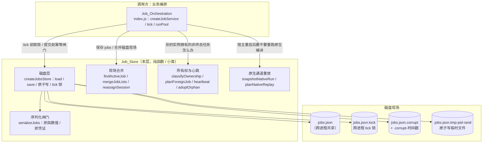
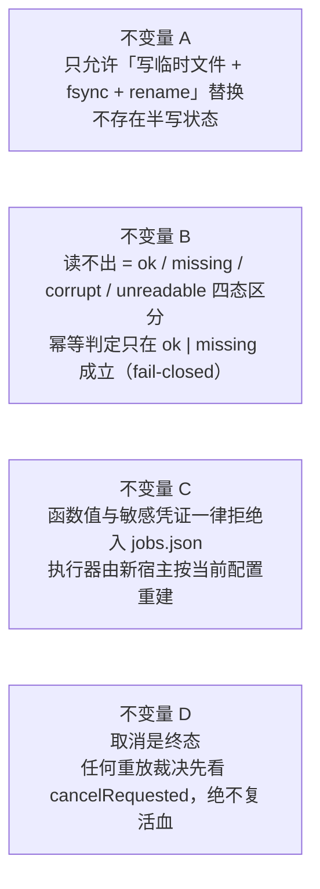
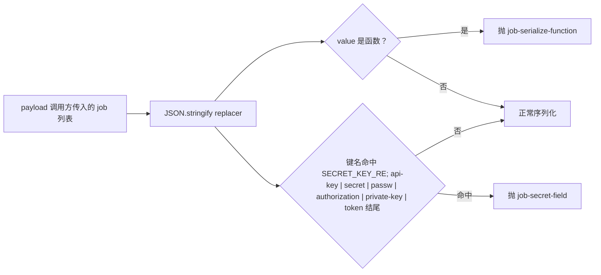
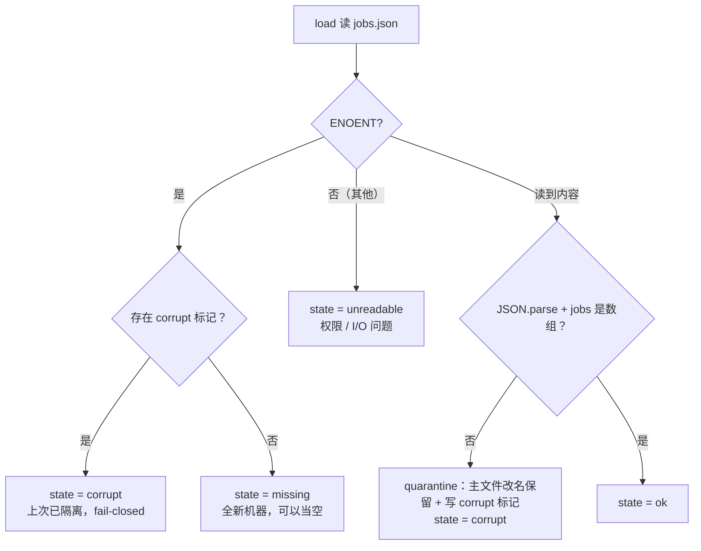
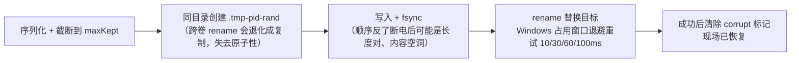
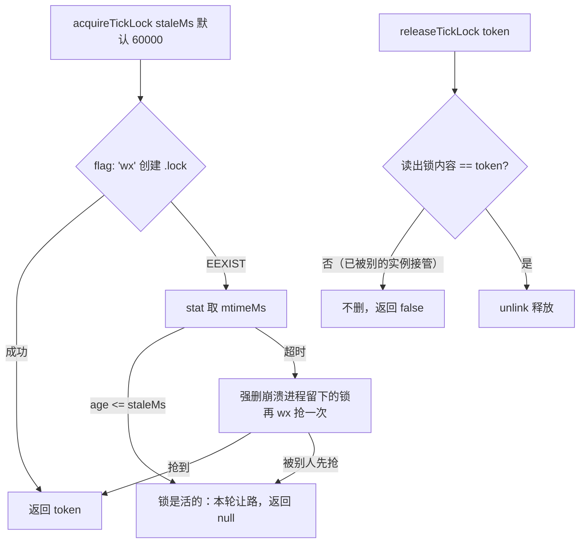
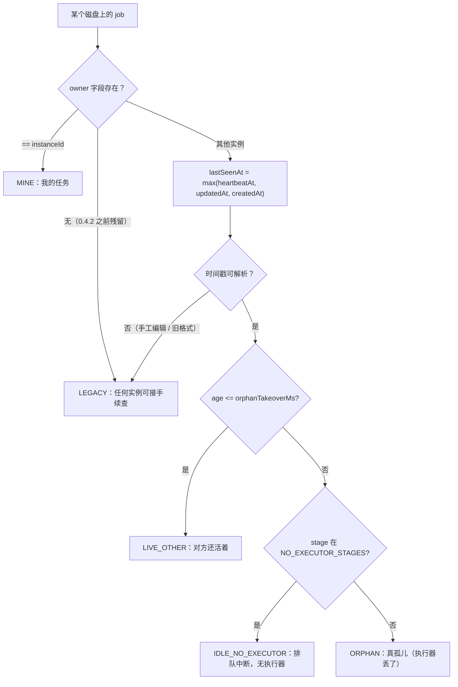
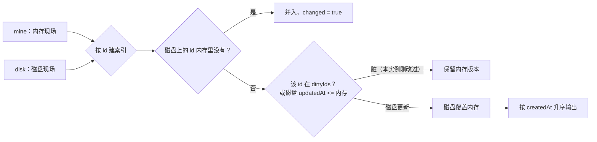
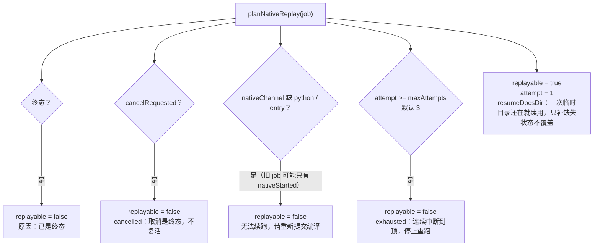
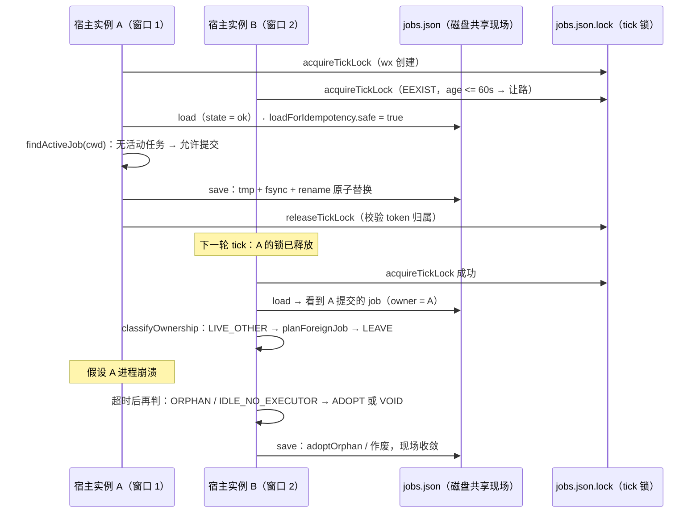

# Job Store（作业持久化与跨实例协调层）

!!! info "Generated documentation"
    This page was written by CodeWiki from the source code at commit [`695bf7d0`](https://github.com/ikliml666/dsh-codewiki/commit/695bf7d0681fd06c15e63a731761d443a069a9e3) on 2026-11-07 with `doubao-seed-2.1-lite`. Check the code before relying on details.

## 简介

`Job_Store`（实现于 `lib/job-store.js`）是 JobService 的**持久化 / 跨进程协调层**。它从原来 `index.js` 里的 `createJobService` 中抽出、独立成可单测的纯函数与小类集合，承担的核心场景是：**同一台机器上可能有多个宿主窗口（多个 JobService 进程）同时运行，却共享同一份磁盘上的 `jobs.json`**。此前作业状态与 tick 的业务推进缠在一起，任何一条语义都只能靠「起两个真宿主」来验证；拆出本层后，磁盘读写、现场合并与执行器重放裁决都可以在没有真实宿主的条件下测试。

本模块只保留三件事，且全部做成纯函数 / 小类：

1. **磁盘层**：原子读写、损坏检测、跨进程 tick 锁；读写失败一律显式抛出，绝不静默吞掉。
2. **现场合并**：多实例 job 列表合并、同仓幂等查找、所有权判定与心跳节流。
3. **原生通道重放**：可序列化的执行配置快照，以及「宿主重启后该重跑还是该显式失败」的裁决。

## 模块在系统中的位置

上游业务编排（作业提交、tick 推进、取消）见 [Job Orchestration（编译任务编排服务）](Job_Orchestration.md)；原生编译通道本身（Python 引擎子进程、临时工作区）见 [Engine_Native_Run（原生编译裁决编排层）](Engine_Native_Run.md) 与 [工作区快照（Engine_Workspace_Snapshot）](Engine_Workspace_Snapshot.md)。

## 核心概念

### 磁盘现场与 schema

- `JOBS_SCHEMA = 2`：写入 `jobs.json` 的顶层结构为 `{ schema, savedAt, jobs }`，其中 `jobs` 数组只保留最近 `maxKept`（默认 30）条，避免文件无限增长。
- 同一仓库只允许有**一条活动任务**：`findActiveJob` 在多条历史活动记录里返回 `createdAt` 最新的那条（旧版幂等只看内存，会让同仓挂多条）。

### 硬不变量（防重复执行的四道闸）

| 不变量 | 针对的旧事故 | 实现位置 |
| --- | --- | --- |
| A | 直接 `writeFileSync` 覆盖，写一半崩溃得到截断 JSON，被读成「没有任务」→ 同仓重复提交、两个引擎同时写同一仓库 | `writeAtomic`（临时文件必须与目标同目录、先 fsync 后 rename） |
| B | `loadJobs` 的 catch 把损坏文件当成「没有活动任务」 | `load` 返回四态、`loadForIdempotency` 增加 `safe` 布尔闸门 |
| C | `JSON.stringify` 对函数值静默丢弃，`llm` 等执行器字段悄悄消失 | `serializeJobs`  replacer 主动抛 `JobsStoreError` |
| D | 重放时可能把已取消任务又跑起来 | `planNativeReplay` 最先检查 `cancelRequested` |

### 错误类型

`JobsStoreError extends Error`，携带 `code`（如 `job-serialize-function`、`job-secret-field`、`jobs-write`、`jobs-rename`、`jobs-lock`）、`path` 与 `detail`，供上层把「为什么不能安全提交」显式报错给用户。

## 关键组件与函数

### 1. 路径身份

- `normKey(p)`：去尾分隔符 + `path.normalize`；在 win32 上折叠大小写。本模块自带一份而不反向依赖 `index.js` 的同名实现，保持层次独立。`findActiveJob` 等幂等查找都以它生成 cwd 的身份 key。

### 2. 序列化闸门（`serializeJobs`）

- 「放宽到键名包含」是因为真实事故里出现的是 `CODEWIKI_API_KEY` 这类环境变量名，而不是干净的 `apiKey`。
- 不收 `maxTokens` / `outputTokens` 这类计数字段：它们不含凭证，且面板要展示。
- 函数值被拦下来是因为「少一个执行器字段也没人知道」——执行期依赖（`llm` 等）应由新宿主按当前配置重建，不进快照。

### 3. 磁盘层（`createJobsStore`）

构造参数：`file`（`jobs.json` 路径，必填）、`maxKept`（默认 30）、`instanceTag`（默认 `'svc'`）。派生出三个配套文件：

| 派生文件 | 用途 |
| --- | --- |
| `${file}.lock` | 跨进程 tick 锁，内容为 `pid#124;instanceTag#124;时间戳` 的 token |
| `${file}.corrupt` | 「上一版是坏的」事实标记（JSON：quarantinedAt / detail / at） |
| `${file}.corrupt-<时间戳>` | 损坏主文件被改名保留的证据原件 |

#### 读取四态

- `loadForIdempotency()` 在 `load` 结果上追加 `safe = state === 'ok' #124;#124; state === 'missing'`，这是调用方发起提交前必须接的一步：**只有能断言「这个仓库当前没有活动任务」时才允许提交**；corrupt / unreadable 时调用方要报错给用户（报什么错属于 JobService，本层不替它决定）。
- corrupt 标记的意义：损坏文件被改名后原路径 ENOENT 会被误判成「现场干净」，幂等判定从这一刻起 fail-open（同仓重复执行）。改名必须留下「上一版是坏的」这条事实，直到一次成功写入证明现场恢复正常（`clearCorruptMarker`）。

#### 原子写

- 写盘路径全程同步 API：`save` 是同步接口，tick 的 `finally` 也要能同步落盘；退避睡眠用 `Atomics.wait`（`sleepSync`）而非忙等。
- rename 仍失败时抛 `jobs-rename`，让调用方决策；残留临时文件不会被当成 jobs 读，无害。

#### 跨进程 tick 锁

- 锁内容带 `instanceTag`、释放时校验归属：旧实现无条件 `unlink`，两实例交错时会把对方的锁删掉，于是两边同时推进同一 job。
- 存活判定只用文件系统真实时钟（mtime）；拿调用方合成的 `now` 去减会造成两个时钟混用，负年龄被读成「活的」，崩溃锁永远等不到接管。

### 4. 终态与阶段常量

- `TERMINAL_STAGES = ['done', 'partial', 'failed', 'cancelled']`，`isTerminalStage(stage)` 判断任务是否已完结。
- `NO_EXECUTOR_STAGES = ['queued', 'submitting']`：「没有执行器可丢」的阶段。超时只意味着没人替它推进，绝不意味着「原生引擎执行器丢失」——旧实现把排队任务也当孤儿接管，会把正常排队项写成「原实例停更 X 分钟，本实例接管推进」，并在原生通道上直接判失败。

### 5. 所有权判定与处置（跨实例协调的核心）

`planForeignJob(job, { instanceId, orphanTakeoverMs })` 在 tick 遇到「别的实例拥有的非终态任务」时给出处置动作：

| 情形 | ownership | action | 理由 |
| --- | --- | --- | --- |
| 我的 / 对方还活着 | MINE / LIVE_OTHER | `LEAVE` | 不干预 |
| `submitting` 阶段停更 | 任意非 mine | `VOID` | 提交未完成、没过凭证校验，没有可续状态 |
| `queued` 且 `job.auto === true` | 任意非 mine | `VOID` | 自动调度遗留的排队项，下一轮扫描会重新提交；作废后该仓库幂等记录释放 |
| 其余（用户手动提交的排队项） | 任意非 mine | `ADOPT` | 接管：排队项按 FIFO 继续排队；执行器类孤儿由 `adoptOrphan` 改挂本实例 |

- 直接作废自动排队项解决了旧实现的死锁：旧实现遇到这类任务 `continue`，宿主重启前的排队项永久卡在 `queued`——既占着闸门窗口，又让同仓幂等一直返回它，用户连重新提交都做不到。
- `lastSeenAt(job)` 取三个时间戳的 `max`（而非第一个存在的），因为 `mergeJobLists` 会用磁盘版本整体替换内存版本，两组时间戳可能不同步。
- `heartbeat(job, { instanceId, everyMs = HEARTBEAT_MS=30000 })`：只对「我的」任务生效，按 30s 节流（`jobs.json` 是整文件重写，每 tick 都写一遍没必要）；让长批次 / 等引擎的慢宿主不被别的实例误判成孤儿。
- `adoptOrphan` 接管时写入 `owner / ownerAdoptedAt / heartbeatAt / updatedAt`。

### 6. 现场合并（`mergeJobLists`）

- 磁盘覆盖内存的条件只有两条：本实例没改过它（`dirtyIds`），**且**磁盘版本更新。否则慢 tick 会用过期快照把对方刚写的 `note` / `batchRef` 洗掉。

### 7. 会话归属（`reassignSession`）

同一仓库被另一个会话再次提交时，完成唤醒必须发到**新的**会话（旧会话可能早已关闭，steer 会石沉大海）。`reassignSession(job, sessionId)` 追加一条 `{ from, to, at }` 到 `sessionOwnerHistory`（最多保留最近 10 条），让面板能解释「唤醒去了谁」。

### 8. 原生通道重放

#### 快照（`snapshotNativeRun`）

只收「下次还能原样再下发的执行配置」：`channel.python / entry / timeoutMs / scope`、`scope`、`kind`、`language`、`moduleConcurrency`、`rawTreeRoot`、`docsDir`、`attempt`、`capturedAt`，带 `version = NATIVE_SNAPSHOT_VERSION`。

明确**不收**的：`llm` 服务、bridge（随机端口 + 占位 key）、`onProgress/onLog` 回调、任何 provider 凭证——它们属于「当前宿主」，重启后必须由新宿主重建；持久化只会留下过期指针（桥端口已死）或泄密面。

#### 重放裁决（`planNativeReplay`）

- 设计动机：旧行为「`nativeStarted === true` 且内存里没有执行器 → 直接 `failed`」把「执行器丢了」误当成「这轮编译不可续」。原生通道的全部输入本来就在 job 上，重启后完全可重放；代价是重跑一次编译，收益是用户不必手工重新提交，而 `failed` 是纯损失（跑了一半的仓库被标成没有成果）。
- 三条刹车：取消（绝不复活血）、尝试次数到顶（宿主崩溃循环时不能无限烧全量编译）、终态。
- `resumeDocsDir`：宿主强杀不会执行 `startNativeRun` 的 `finally`，临时目录里保留了引擎已提交的叶子终态；重放时只补水缺失状态，不覆盖它（Python 适配器按签名决定能否续用）。临时工作区本身见 [工作区快照（Engine_Workspace_Snapshot）](Engine_Workspace_Snapshot.md)。

## 跨进程协作总览

## 与其他模块的关系

| 方向 | 模块 | 关系 |
| --- | --- | --- |
| 上游（本层的调用方） | [Job Orchestration（编译任务编排服务）](Job_Orchestration.md) | `createJobService` 的 tick 循环在提交前走 `loadForIdempotency`、每 tick 前取锁、保存时整文件落盘；取消语义（`cancelRequested`）由上游写入 |
| 上游（原生通道消费方） | [Engine_Native_Run（原生编译裁决编排层）](Engine_Native_Run.md) / [Engine_Native_State（原生引擎跨轮受管状态）](Engine_Native_State.md) | 启动子进程前写 `nativeChannel` 快照、重启后按 `planNativeReplay` 裁决重跑或续用 docsDir |
| 上游（临时工作区） | [工作区快照（Engine_Workspace_Snapshot）](Engine_Workspace_Snapshot.md) | `resumeDocsDir` 引用的临时目录生命周期由其管理 |
| 横向（日志） | [Job_Logs](Job_Logs.md) | 与 `jobs.json` 并列的日志文件清理（`removeLog`），不在本层范围内 |
| 横向（更新记录） | [Update_Record（编译更新记录）](Update_Record.md) | 更新/阶段记录的持久化与终态判定，与本层 `TERMINAL_STAGES` 语义对齐 |
| 配置来源 | [Cordis_Patch_Config（插件装配配置）](Cordis_Patch_Config.md) | 插件 `codewiki` 配置（并发、超时、原生引擎开关）决定 job 快照里要写哪些执行参数 |

## 工程要点速查

- **全部同步 API**：`load` / `save` / 锁的获取释放都是同步的（落盘路径不能 await）。
- **失败显式化**：任何 I/O、序列化、rename 失败都抛 `JobsStoreError`，code 见上表，方便面板与用户文案对号入座。
- **只收最近 30 条**：`save` 前 `slice(-maxKept)`，终态历史不留在活跃现场里。
- **测试性**：本层刻意不反向依赖 `index.js`（路径 key 自带一份 `normKey`），所有函数纯化，跨进程语义可用单测模拟两实例。

??? abstract "Documented components (1)"
    - [`normKey`](https://github.com/ikliml666/dsh-codewiki/blob/695bf7d0681fd06c15e63a731761d443a069a9e3/lib%5Cjob-store.js) — `lib\job-store.js`

