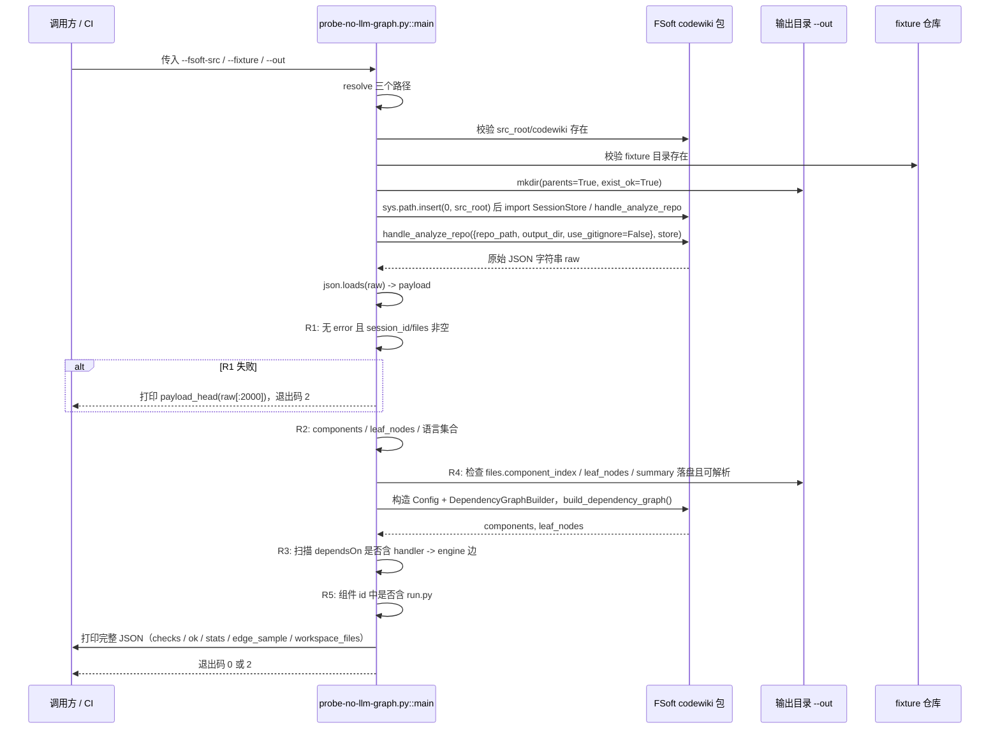
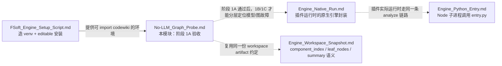

# No-LLM_Graph_Probe（无 LLM 依赖图验收探针）

!!! info "Generated documentation"
    This page was written by CodeWiki from the source code at commit [`49c39f44`](https://github.com/ikliml666/dsh-codewiki/commit/49c39f4493ac5c32df577599cdb2aef517dfa483) on 2026-11-07 with `deepseek-v4.1-flash`. Check the code before relying on details.

## 简介

`No-LLM_Graph_Probe` 是一个 **引擎侧验收探针**，由单个脚本 `tools/fsoft-engine/probe-no-llm-graph.py`（入口函数 `main`）构成。它的任务是：在**不依赖任何 LLM 模型、不依赖任何凭证、不触碰 DSH 插件**的前提下，直接调用 FSoft 原生引擎（`codewiki` Python 包）的 `handle_analyze_repo` 静态分析链路，验证「无模型的原生依赖图」这一基础环节在中文目录名、含空格路径（`中文 空格 fixture`）这类边界条件下能否端到端跑通。

它是整条 FSoft 迁移中**阶段 1A** 的验收工具：

> 因为 `handle_analyze_repo` 走 tree-sitter 静态分析，是整条迁移里唯一完全无模型的一环，所以必须先跑通它，才能在阶段 1B / 1C 里把「模型链路」和「图/artifact 链路」的故障分开定位。

探针不做编译、不生成 Wiki 页面，只做「图能不能建出来、图里有什么」的最小事实核查，并把结果以 JSON 打到 stdout、以退出码表达通过或失败。

## 在系统中的位置

本仓库是一个 DSH（DeepSeek Harness）插件（`@local/dsh-codewiki`），自 0.16.0 起默认走**原生引擎通道**：插件以子进程方式驱动上游 FSoft-AI4Code/CodeWiki 的 Python 引擎（见 `package.json` 的描述）。原生引擎相关的 Node 侧入口、Python 入口与环境准备分别由其他模块承担：

- [Engine_Python_Entry](Engine_Python_Entry.md) —— Node 侧通过子进程调用 Python 引擎的入口（`lib/engine/python/entry.py`）。
- [Engine_FSoft_Runtime：增量 Step 5 的受控并行与断点运行时](Engine_FSoft_Runtime.md) / [全量并行运行时（Engine_Full_Parallel_Runtime）](Engine_Full_Parallel_Runtime.md) —— 引擎内部 Python 运行时（叶子 Agent 执行、全并行运行时）。
- [Engine_Native_Run（原生编译裁决编排层）](Engine_Native_Run.md) —— 原生引擎运行封装（`noop` 占位与运行编排）。
- [工作区快照（Engine_Workspace_Snapshot）](Engine_Workspace_Snapshot.md) —— 工作区快照（`component_index.json` / `leaf_nodes.json` / `summary.json` 等 artifact 的产出语义）。
- [FSoft 引擎环境搭建脚本（FSoft_Engine_Setup_Script）](FSoft_Engine_Setup_Script.md) —— 探针所依赖的 Python 运行环境的搭建脚本（`tools/fsoft-engine/setup-env.sh`）。

探针本身不属于插件运行链路，而是一个**开发期 / CI 期的独立验收脚本**，放在 `tools/fsoft-engine/` 下，与 fixture、环境脚本同目录。

## 架构与依赖

```mermaid
flowchart TD
    subgraph 插件仓库 tools/fsoft-engine
        PROBE["probe-no-llm-graph.py::main<br/>（本模块）"]
        FIX["fixtures/中文 空格 fixture<br/>被测小仓库"]
        SETUP["setup-env.sh<br/>独立 venv 环境"]
    end

    subgraph 外部 FSoft 源码树 --fsoft-src
        SS["codewiki 包根目录"]
        S1["codewiki.mcp.session.SessionStore"]
        S2["codewiki.mcp.tools.analysis.handle_analyze_repo"]
        S3["codewiki.src.be.dependency_analyzer.DependencyGraphBuilder"]
        S4["codewiki.src.config.Config"]
    end

    subgraph 输出工作目录 --out
        WS["component_index.json<br/>leaf_nodes.json<br/>summary.json"]
    end

    PROBE -->|"1. 检查 codewiki/ 存在"| SS
    PROBE -->|"2. import 并调用"| S2
    S2 --> S1
    S2 --> WS
    PROBE -->|"3. 建图复核依赖边"| S3
    PROBE --> S4
    PROBE -->|"4. 分析目标仓库"| FIX
    SETUP -->|"产出可 import codewiki 的 venv"| PROBE
```

要点：

1. **环境前置**：探针运行前需先由 [FSoft 引擎环境搭建脚本（FSoft_Engine_Setup_Script）](FSoft_Engine_Setup_Script.md) 在独立目录里造好 venv（按 `locked-requirements.txt` 以 `--no-deps` 落盘冻结快照，再 editable 安装 FSoft 源码，`pip check` + import 冒烟兜底）。探针只负责「在这个环境里跑一次图」，不负责建环境。
2. **动态导入**：探针通过 `sys.path.insert(0, src_root)` 把 FSoft 源码树挂上，再 `from codewiki.mcp.session import SessionStore` / `from codewiki.mcp.tools.analysis import handle_analyze_repo`。
3. **双路径取图**：判据 R3（依赖边）不满足于 handler 的返回 payload，而是显式构造 `Config` 并调用 `DependencyGraphBuilder(cfg).build_dependency_graph()`，直接拿到含 `dependsOn` 的组件表来复核边方向。
4. **无凭证**：`Config` 里 `llm_base_url` / `llm_api_key` 填的是 `"not-needed"`，`main_model` / `cluster_model` 为 `"unused"`——静态分析完全不会触达模型。

## 命令行接口

```bash
python tools/fsoft-engine/probe-no-llm-graph.py \
    --fsoft-src <FSoft 源码根，含 codewiki/ 包> \
    --fixture <被测小仓库> \
    --out <工作目录>
```

| 参数 | 必填 | 默认值 | 说明 |
| --- | --- | --- | --- |
| `--fsoft-src` | 是 | 无 | FSoft 源码根目录（其下应存在 `codewiki/` 包；也接受直接指向 `codewiki/` 的父目录） |
| `--fixture` | 否 | `tools/fsoft-engine/fixtures/中文 空格 fixture` | 被测小仓库路径，默认仓库内自带的中文+空格 fixture |
| `--out` | 否 | `tools/fsoft-engine/out-1a` | 工作/输出目录，不存在会被创建 |

退出码语义：

| 退出码 | 含义 |
| --- | --- |
| `0` | 全部判据通过 |
| `2` | 判据未通过（R1 失败或 R2–R5 中有任一为假） |
| `3` | 前置检查失败（`--fsoft-src` 下没有 `codewiki/`、`--fixture` 不存在）或运行期异常（traceback 已写入 JSON） |

## 验收判据（R1–R5）

探针把五个判据的结果记录在输出 JSON 的 `checks` 字段，且 `ok = all(checks.values())`：

| 编号 | 判据 | 检查方式 |
| --- | --- | --- |
| **R1** `R1_analyze_returned` | `handle_analyze_repo` 返回的 JSON 不含 `error` 键，且 `session_id`、`files` 均为非空 | 直接解析 handler 返回的原始字符串 |
| **R2** `R2_nodes_and_languages` | `stats.total_components > 0`、`stats.total_leaf_nodes > 0`，且语言集合同时包含 `python` 与 `typescript` | 读 payload 的 `stats.languages` |
| **R3** `R3_dependency_edge` | 依赖图中存在 `web.handler -> core.engine` 方向的边（即 web 层依赖 core 层） | 用 `DependencyGraphBuilder` 重建图，扫描 `dependsOn`（兼容 `depends_on` 命名）；若首轮未命中，再退一步检查 `handler` 组件的依赖声明里是否含有 `engine` |
| **R4** `R4_workspace_files` | workspace 中的 `component_index.json` / `leaf_nodes.json` / `summary.json` 真实存在且可被 `json.loads` 解析 | 从 payload 的 `files` 字典取路径，逐文件校验 `is_file()` 与可解析性，并记录条目数 |
| **R5** `R5_artifact_node` | artifact 节点（如 `scripts/run.py`）被采集进组件表 | 在重建图的组件 id 列表里搜索包含 `run.py` 的节点 |

## 执行流程



## 输出 JSON 结构

探针始终以 `json.dumps(..., ensure_ascii=False, indent=2)` 打印结果，便于在中文路径下直接阅读。关键字段：

```json
{
  "ok": true,
  "fsoft_src": "<resolved FSoft 源码根>",
  "fixture": "<resolved fixture 路径>",
  "payload_keys": ["files", "session_id", "stats", "..."],
  "raw_len": 12345,
  "stats": { "total_components": 12, "total_leaf_nodes": 8, "languages": { "python": 5, "typescript": 2 } },
  "checks": {
    "R1_analyze_returned": true,
    "R2_nodes_and_languages": true,
    "R3_dependency_edge": true,
    "R4_workspace_files": true,
    "R5_artifact_node": true
  },
  "workspace_files": {
    "component_index": { "path": "...", "exists": true, "items": 12 },
    "leaf_nodes":     { "path": "...", "exists": true, "items": 8 },
    "summary":        { "path": "...", "exists": true, "items": 3 }
  },
  "edge_count": 7,
  "edge_sample": [ { "id": "web.handler", "dependsOn": ["core.engine"] } ],
  "artifact_ids": ["scripts/run.py"]
}
```

异常分支会额外附 `exception` 字段（traceback 文本），R1 失败时附 `payload_head`（原始返回前 2000 字符），便于定位是「图没建出来」还是「payload 结构变了」。

## 与周边模块的关系



- **不替代** [Engine_Python_Entry](Engine_Python_Entry.md)：探针绕过 Node 子进程封装，直接在 Python 里调 handler，目的是把「Node 集成」这一层变量排除掉。
- **不替代** [工作区快照（Engine_Workspace_Snapshot）](Engine_Workspace_Snapshot.md)：R4 只是校验该模块约定的三份 artifact 文件真实落盘且可解析，不做快照语义（短 SHA、是否存在快照）层面的校验。
- **上游依赖** [FSoft 引擎环境搭建脚本（FSoft_Engine_Setup_Script）](FSoft_Engine_Setup_Script.md)：如果 venv 没造好或 editable 安装失败，探针会在 `import codewiki...` 处抛异常，最终走到退出码 `3` 分支。

## 典型使用流程

1. 按 [FSoft 引擎环境搭建脚本（FSoft_Engine_Setup_Script）](FSoft_Engine_Setup_Script.md) 造独立 venv（不要把 venv 提进 git，也不要污染 DSH 进程的 Python）：
   ```bash
   bash tools/fsoft-engine/setup-env.sh ../.probe-fsoft/venv ../.probe-fsoft/src
   ```
2. 激活该 venv，运行探针（默认使用仓库内 `中文 空格 fixture`）：
   ```bash
   python tools/fsoft-engine/probe-no-llm-graph.py --fsoft-src ../.probe-fsoft/src
   ```
3. 查看 stdout 的 JSON：
   - `ok == true` 且退出码 `0` → 阶段 1A 通过，可以继续 1B（模型链路）/ 1C（图 artifact 落盘）。
   - 退出码 `2` → 看 `checks` 定位是哪条判据失败（R1 多为 handler 报错，R3 多为 tree-sitter 边提取逻辑回归，R4 多为输出目录约定变动）。
   - 退出码 `3` → 看 `exception` 字段，多为环境/路径问题。

## 设计取舍备注

- **为什么直接 `sys.path.insert` 而不是走正式包安装**：探针要能在任意 FSoft 源码树上重跑（`--fsoft-src` 参数化），绕过正式的 pip 安装路径，避免「环境里装的 codewiki 不是当前想看的那份」这一类歧义。
- **为什么 R3 要再独立跑一次 `DependencyGraphBuilder`**：handler 返回的 payload 可能只带聚合统计（`stats`）而不带逐节点的 `dependsOn`；为了把「边方向」这一关键事实独立验证一遍，探针直接调 builder，并用 `getattr(node, "dependsOn", None) or getattr(node, "depends_on", None)` 兼容上下游命名差异。
- **为什么 fixture 用「中文 空格」命名**：正是为了覆盖非 ASCII + 空格这类路径边界，验证 tree-sitter 扫描与 JSON artifact 落盘在 Unicode 路径下不出问题——这也是 [Job_Logs](Job_Logs.md) 中 `decodeGitPath`、fixture 目录与插件实际处理中文仓库名时共用的一类边界。

??? abstract "Documented components (1)"
    - [`main`](https://github.com/ikliml666/dsh-codewiki/blob/49c39f4493ac5c32df577599cdb2aef517dfa483/tools%5Cfsoft-engine%5Cprobe-no-llm-graph.py) — `tools\fsoft-engine\probe-no-llm-graph.py`

