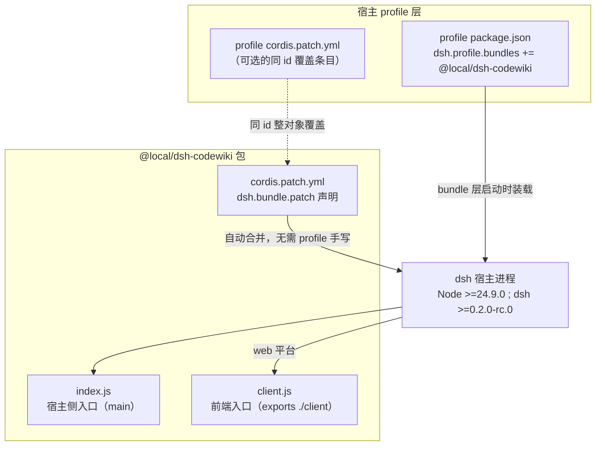
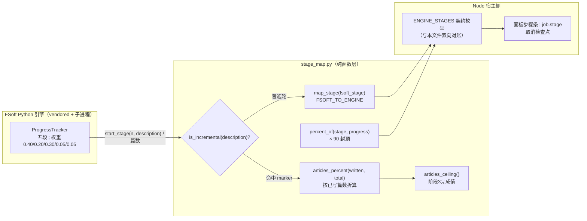

# Package_Manifest 包清单

!!! info "Generated documentation"
    This page was written by CodeWiki from the source code at commit [`4877231e`](https://github.com/ikliml666/dsh-codewiki/commit/4877231e2f743a3ba18890a9db2d6468a9885218) on 2026-11-07 with `doubao-seed-2.1-lite`. Check the code before relying on details.

`Package_Manifest` 是 dsh-codewiki 插件的**包级元数据清单**模块，承载三类互相独立、但同属「包身份与跨语言口径」的资产：

1. `package.json` —— npm 包身份、版本、运行时引擎约束、`dsh` 宿主集成声明（详见 [工程产物](#1-packagejson-npm-包清单)）。
2. `lib/engine/python/stage_map.py::articles_ceiling` —— Node ↔ Python 引擎之间共享的**阶段枚举口径**与进度映射纯函数（详见 [跨语言阶段映射](#2-stage_mappy-跨语言阶段口径)）。
3. `vendor/codewiki/src/meta.rs::WikiMeta` —— 上游 vendored Rust 引擎侧的 `_meta.yaml` wiki 元数据持久化结构（详见 [vendored 元数据](#3-wikimeta-rust-wiki-元数据)）。

> 说明：`stage_map.py` 与 `WikiMeta` 物理上分别属于引擎运行时与 vendored 源码，但它们在「包清单」视角下共同回答两个问题：**这个插件是谁、以什么契约被装载与驱动**，以及**两侧进程如何对同一套阶段编号达成一致**。

---

## 1. `package.json`：npm 包清单

仓库根目录的 `package.json`（`"name": "@ikliml666/dsh-codewiki"`，`"private": false`，并已按 npm 发布口径补齐 `repository` / `homepage` / `bugs` / `keywords` / `files` 发布元数据）是 DeepSeek Harness（dsh）的插件包。它的关键字段如下：

| 字段 | 值 | 含义 |
| --- | --- | --- |
| `name` | `@ikliml666/dsh-codewiki` | 插件包名；`cordis.patch.yml` 中以裸包名被 `file:///` 直挂或 bundle 依赖引用 |
| `version` | `0.18.1` | 当前版本号（版本演进史见 `description`） |
| `type` | `module` | 全 ESM 双模块（`index.js` 宿主侧 + `client.js` 前端侧） |
| `main` / `exports` | `./index.js`、`./client` | 双入口：Node 宿主侧入口与 web 前端入口 |
| `private` | `false` | 可发布包：随附 `repository`（`git+https://github.com/ikliml666/dsh-codewiki.git`）、`homepage`（GitHub README）与 `bugs`（issues 地址）发布元数据 |
| `files` | `index.js`、`client.js`、`cordis.patch.yml`、`lib`、`bin/cw`（`bin/cw.exe`）、`docs`、`tools/fsoft-engine/{setup-env.sh,constraints.txt}`、`LICENSE`、`README.md`、`CHANGELOG.md`、`CodeWiki.md`（排除 `lib/**/__pycache__`） | npm 发布时随包携带的文件清单 |
| `scripts` | （已移除） | 原先的 `test` 脚本（`node test-batch.mjs`）已从 `package.json` 删除 |
| `engines.node` | `>=24.9.0` | 最低 Node 版本 |
| `engines.dsh` | `>=0.2.0-rc.0` | 最低 dsh 宿主版本 |
| `dependencies` | `@deepseek-ai/schemastery ^3.18.4` | 唯一运行时依赖：配置 schema 校验 |
| `dsh.client.platform` | `web` | 前端产物走 web 平台（[Web_UI_Panel](Web_UI_Panel.md) 挂载） |
| `dsh.bundle.patch` | `./cordis.patch.yml` | 指向宿主自动合并的 bundle patch 配置（见 [Cordis_Patch_Config（插件装配配置）](Cordis_Patch_Config.md)） |

`description` 字段给出插件的产品定位，直接决定了模块树中两条编译通道的存在理由：

- **产物形态**：把整个仓库编译成 `.codewiki/` 下互链的 Markdown 文章，配套侧边栏面板展示进度、引擎日志与按阶段的模型设置；增量式设计，任何内容落盘前都先过文章契约闸门。
- **默认通道**：驱动上游 FSoft-AI4Code/CodeWiki Python 引擎，要求本机 Python 3.10+ venv 闭合依赖。
- **最小内置 Node 通道**：为无法运行 Python 引擎的宿主保留（旧版称为 Node 兼容通道 `nativeEngine: false`，仅保留顶层目录分组 + 文件级 `source_files` 归因）。

### 包装载与宿主集成

- **最小内置 Node 通道**：为无法运行 Python 引擎的宿主保留（旧版称为 Node 兼容通道 `nativeEngine: false`，仅保留顶层目录分组 + 文件级 `source_files` 归因）。

### 包装载与宿主集成

两条安装路径（详见 `cordis.patch.yml` 注释与 [Cordis_Patch_Config（插件装配配置）](Cordis_Patch_Config.md)）：

- **A. bundle 依赖（推荐）**：profile 的 `package.json` 用 `link:<绝对路径>` 引用本仓库，bundle patch 自动合并，配置覆盖只需在 profile 里写同 id（`codewiki`）条目。
- **B. `file:///` 直挂**：直接指到源码入口，适合改插件源码时本地调试；两种装法保持插件 id 一致：`codewiki`。

---

## 2. `stage_map.py`：跨语言阶段口径

`lib/engine/python/stage_map.py` 是 FSoft Python 进度（五段）到引擎契约（九段枚举）的**纯函数映射表**，模块树中暴露的核心函数是 [`articles_ceiling`](lib/engine/python/stage_map.py)，但整份文件的价值在于它是 Node 与 Python 之间**唯一共享的枚举口径**。

### 2.1 为什么需要这张映射表

- Node 侧契约 `ENGINE_STAGES`（`lib/engine/contract.js`）是面板步骤条、`job.stage` 与取消检查点的共同依据，见 [Engine_Contract 引擎契约](Engine_Contract.md)。
- FSoft 自带的 `ProgressTracker` 只有五段（Dependency Analysis / Module Clustering / Documentation Generation / HTML Generation / Finalization）。
- 两侧各自漂移会导致「面板显示在写作，实际已在校验」这类静默错位。因此映射被固定成表，并由 `test-engine-python-entry.mjs` **双向反向断言**两边集合完全一致——改一边不改另一边，测试立刻红。

### 2.2 关键口径

| 概念 | 值 | 说明 |
| --- | --- | --- |
| `ENGINE_STAGES` | `env, graph, cluster, articles, proofread, validate, index, baseline, commit` | 九段；`env` 由 doctor 承担，`index/baseline/commit` 由 Node 侧收尾 |
| `FSOFT_TO_ENGINE` | 1→graph，2→cluster，3→articles，4/5→validate | HTML 生成与 Finalization 都归 `validate`，避免面板一直钉在「写作」 |
| `DEFAULT_ENGINE_STAGE` | `articles` | 未知阶段不抛错（进度上报是旁路），归到最耗时的写作槽位 |
| `FSOFT_PROGRESS_CEILING` | `90` | FSoft 进度上限压到 90%，剩 10% 留给 Node 侧索引/基线/提交，杜绝「引擎 100% 但 wiki 未索引」的假完成 |
| `INCREMENTAL_DESCRIPTION_MARKER` | `"incremental update"` | 增量轮按 `start_stage` 的 description 语义识别，不按阶段号（阶段 2 槽位被增量轮复用） |
| `articles_ceiling()` | `percent_of(3, 1.0)` | 返回 articles 槽位的百分比上限，供 Node 侧计算增量轮文章进度区间 |

### 2.3 阶段映射数据流

**增量轮为什么要特殊处理**：FSoft 的 `_run_incremental_update` 复用 `start_stage(2, "Incremental Update")`（模块聚类槽位），实际整轮都在逐页写文章。若按阶段号 2 映射成 `cluster`，面板会把 90 分钟的写作显示成「聚合类模块」并钉在 36%。因此增量轮按 description 认语义、归到 `articles` 槽位，并用 `articles_percent(written, total)` 以真实篇数驱动进度——因为阶段 3 内的 `update_stage` 全部被 `verbose=False` 门控，阶段内进度恒为 0，**真实篇数是这段长跑唯一的进度事实**。

---

## 3. `WikiMeta`：Rust wiki 元数据

`vendor/codewiki/src/meta.rs::WikiMeta` 是 vendored 上游 Rust 引擎侧的 wiki 仓库元数据结构，持久化到 wiki 根目录的 `_meta.yaml`：

| 字段 | 类型 | 含义 |
| --- | --- | --- |
| `project` | `String` | 项目名 |
| `repo_path` | `String` | 源码仓库路径 |
| `last_compiled_commit` | `Option<String>` | 最近一次编译对应的 commit（增量判定的基准） |
| `last_compiled_at` | `Option<DateTime<Utc>>` | 最近一次编译时间 |
| `created_at` | `DateTime<Utc>` | wiki 创建时间 |

行为要点：

- `WikiMeta::new(project, repo_path)` 构造时把两个 `last_compiled_*` 置空，`created_at` 取当前 UTC 时间。
- `load(wiki_path)` / `save(wiki_path)` 走 `_meta.yaml`，失败时用 `anyhow::Context` 带上文件路径。
- 同文件还提供 `current_commit(repo_path)`：通过 `git rev-parse HEAD` 取当前 HEAD，失败时报「Not a git repository or no commits yet」。

该结构是 Node 侧 [Job Orchestration（编译任务编排服务）](Job_Orchestration.md) 中增量编译判定与引擎 workspace 快照（[工作区快照（Engine_Workspace_Snapshot）](Engine_Workspace_Snapshot.md)）所依赖的持久化事实来源之一。

---

## 4. 模块关系总览

```mermaid
flowchart TD
    subgraph MM["本模块：Package_Manifest"]
        PJSON["package.json<br/>包身份 #59; 双入口 #59; dsh 声明"]
        SMAP["stage_map.py<br/>articles_ceiling + 阶段映射"]
        WMETA["WikiMeta（Rust）<br/>_meta.yaml 持久化"]
    end

    PJSON -->|"bundle.patch 指向"| CPATCH["Cordis_Patch_Config<br/>cordis.patch.yml"]
    PJSON -->|"exports ./client 驱动"| UI["Web_UI_Panel<br/>client.js 前端"]
    PJSON -->|"main 驱动"| ORCH["Job_Orchestration<br/>index.js 编排"]

    SMAP -->|"ENGINE_STAGES 双向对账"| EC["Engine_Contract<br/>九段契约枚举"]
    SMAP -->|"被引擎子进程入口调用"| ENTRY["Engine_Python_Entry<br/>entry.py"]
    SMAP -->|"驱动面板进度显示"| UI

    WMETA -->|"last_compiled_commit 增量基准"| ORCH
    WMETA -->|"快照/基线对照"| SNAP["Engine_Workspace_Snapshot"]

    EC --> ORCH
```

**关键协作链**：

- `package.json` 的 `dsh.bundle.patch` 声明把 [Cordis_Patch_Config（插件装配配置）](Cordis_Patch_Config.md) 的 `cordis.patch.yml` 变成随包自动合并的配置，避免手工改 profile。
- `stage_map.py` 的九段枚举与 [Engine_Contract 引擎契约](Engine_Contract.md) 双向对账，经 [Engine_Python_Entry](Engine_Python_Entry.md) 的子进程入口上报进度，最终渲染到 [Web_UI_Panel](Web_UI_Panel.md) 的步骤条上。
- `WikiMeta` 的 `last_compiled_commit` 是 [Job Orchestration（编译任务编排服务）](Job_Orchestration.md) 判定增量编译、以及 [工作区快照（Engine_Workspace_Snapshot）](Engine_Workspace_Snapshot.md) 建立基线快照的事实依据。

---

## 5. 设计约束速查

1. **进度上限 90%**：FSoft 只负责前九段中的生成阶段，剩余 10% 必须留给 Node 侧的索引、基线与提交收尾——任何把 FSoft 进度乘到 100% 的改动都会重新引入「假完成」。
2. **未知阶段不抛错**：进度上报是旁路，阶段号/description 无法识别时回落 `articles`，绝不能因为版本差异打断编译。
3. **枚举漂移即测试红**：`ENGINE_STAGES` 的任何增删都必须同步 `lib/engine/contract.js` 与本文件，并跑 `test-engine-python-entry.mjs`。
4. **环境不闭合不回退**：原生引擎通道与 Node 兼容通道并存但互不回退（`description` 与 `cordis.patch.yml` 第 44 行明确）；Python 解释器路径按 `nativeEnginePython` → `DSH_CODEWIKI_PYTHON` → `python` 的顺序硬解析，不做启发式猜测。
5. **配置默认值集中**：`cordis.patch.yml` 的 `config: {}` 留空即回落 `index.js` 的 Config schema 默认值，覆盖条目采用同 id 整对象替换。

??? abstract "Documented components (4)"
    - [`articles_ceiling`](https://github.com/ikliml666/dsh-codewiki/blob/4877231e2f743a3ba18890a9db2d6468a9885218/lib%5Cengine%5Cpython%5Cstage_map.py) — `lib\engine\python\stage_map.py`
    - [`package.json`](https://github.com/ikliml666/dsh-codewiki/blob/4877231e2f743a3ba18890a9db2d6468a9885218/package.json) — `package.json`
    - [`WikiMeta`](https://github.com/ikliml666/dsh-codewiki/blob/4877231e2f743a3ba18890a9db2d6468a9885218/vendor%5Ccodewiki%5Csrc%5Cmeta.rs) — `vendor\codewiki\src\meta.rs`
    - [`test`](https://github.com/ikliml666/dsh-codewiki/blob/4877231e2f743a3ba18890a9db2d6468a9885218/package.json) — `package.json`

