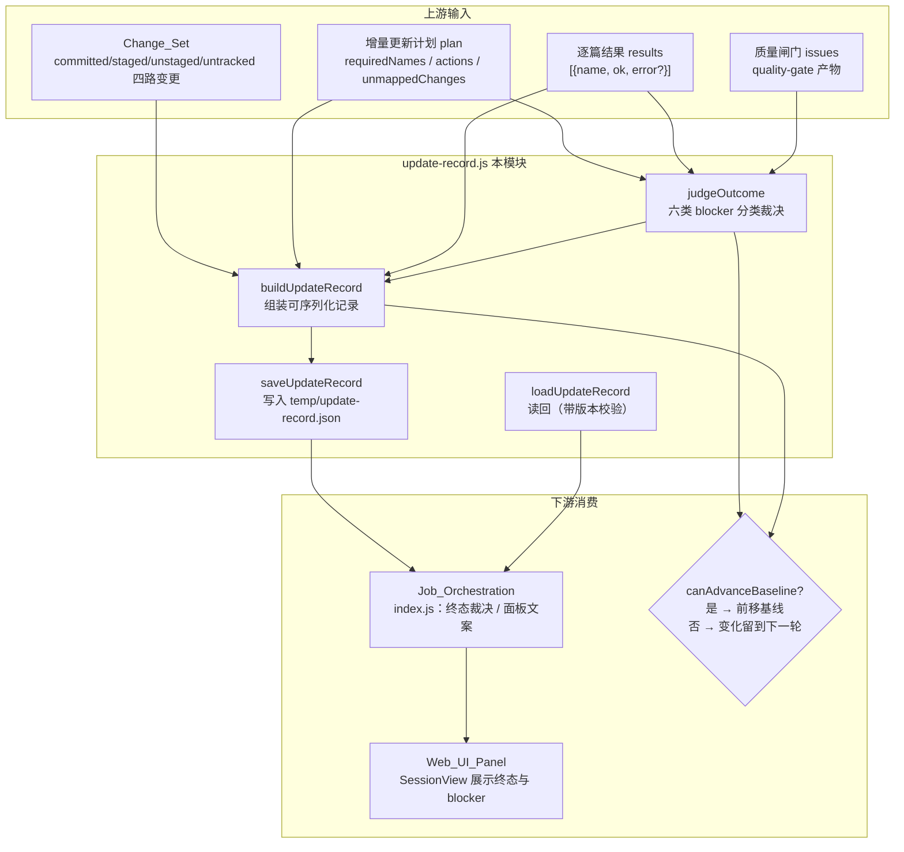
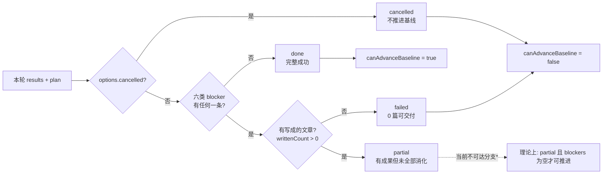
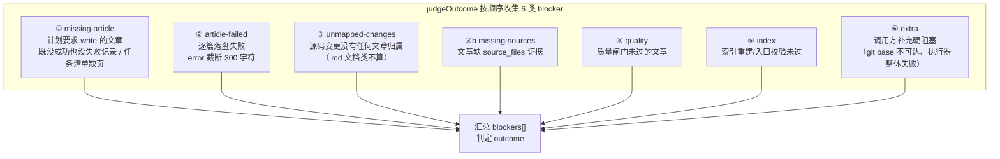
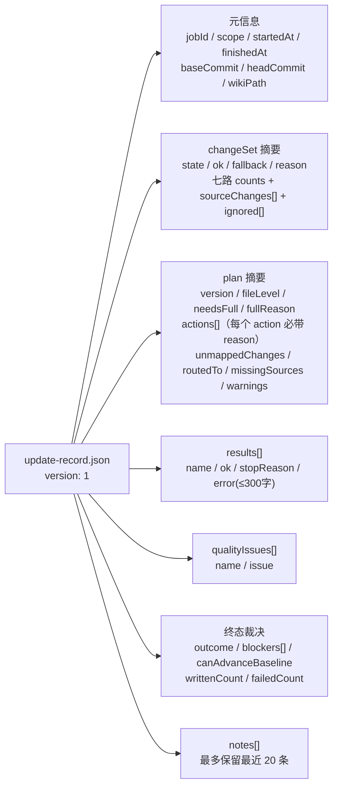
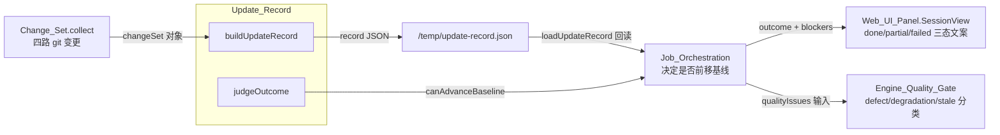
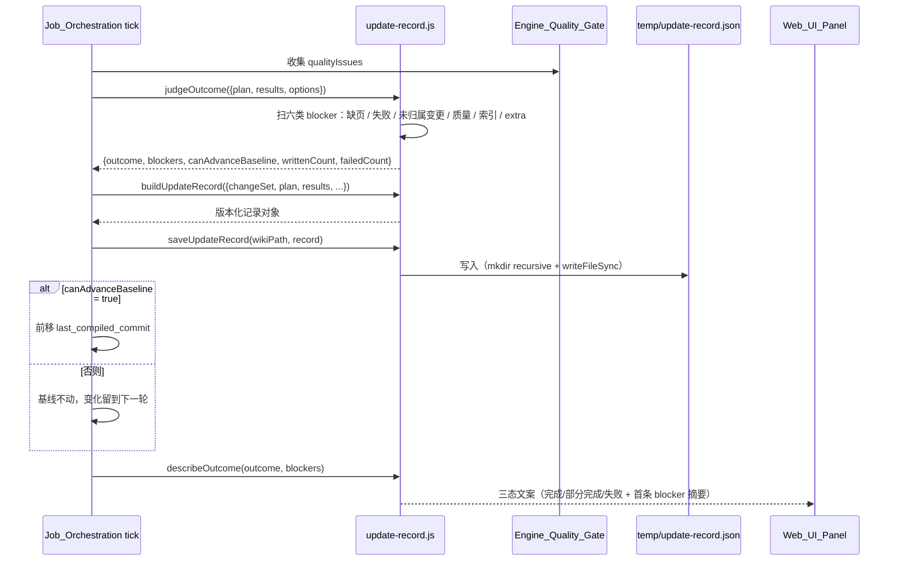

# Update_Record（编译更新记录）

!!! info "Generated documentation"
    This page was written by CodeWiki from the source code at commit [`cb632cb2`](https://github.com/ikliml666/dsh-codewiki/commit/cb632cb24604c377177c2d46a74e217c30704263) on 2026-11-07 with `doubao-seed-2.1-lite`. Check the code before relying on details.

## 简介

`lib/update-record.js` 是 CodeWiki 编译流水线的**终态裁决与可复盘记录**模块。它把一次编译的三个输入——[Change_Set 变更集采集模块](Change_Set.md)（四路变更集）、增量更新计划（plan）、逐篇落盘结果（results）——收成一份版本化、可机读的 JSON 记录，并明确回答两个问题：

1. **这轮编译到底算 done / partial / failed / cancelled 中哪一种？**——把「完整性不成立」的每种情形分类写进 `blockers`；
2. **能不能推进编译基线（`last_compiled_commit`）？**——只有完整成功（或明确的「有成果且无硬缺陷」）才允许把基线前移。

它要解决的历史缺陷（源码头注释中审计确认）是：旧实现编译结束只留下 `writtenCount/failedCount` 两个数字，job 文件里塞的是整张图与任务快照，于是「为什么这篇没重写」「哪几个变更没人管」事后无法复盘，面板也只能显示一句「完成」——而实际上可能 1 篇成功、19 篇失败。本模块因此同时承担**记账**（写了什么、为什么写）和**裁决**（算不算数）两项职责。

模块风格为「纯函数 + 两个 IO 助手（`saveUpdateRecord` / `loadUpdateRecord`，fs 可注入）」，便于离线单测。

---

## 架构与定位

## 核心组件

| 导出 | 职责 |
| --- | --- |
| `isTerminalStage(stage)` | 判定阶段是否落入终态集合 `done / partial / failed / cancelled`。空值安全。 |
| `judgeOutcome({plan, results, options})` | **裁决核心**：从逐篇结果与计划推导 `outcome / blockers / canAdvanceBaseline / writtenCount / failedCount`。 |
| `buildUpdateRecord({...})` | 组装完整记录对象（版本化、可 JSON 序列化），未显式给 `outcome` 时内部调 `judgeOutcome`。 |
| `saveUpdateRecord(wikiPath, record, fsImpl)` | 把记录写到 `<wiki>/temp/update-record.json`（自动建目录），返回 `{ok, path/reason}`。 |
| `loadUpdateRecord(wikiPath, fsImpl)` | 读回记录；**版本号不符（`rec.version !== UPDATE_RECORD_VERSION`）或读失败一律返回 `null`**，调用方不得当成「上次成功」。 |
| `describeOutcome(outcome, blockers)` | 面板/日志文案：三态一眼可分（「完成（所有变化已消化）」「部分完成（N 项未满足：…）」「失败（…）」）。 |

常量：`UPDATE_RECORD_VERSION = 1`、`UPDATE_RECORD_REL = 'temp/update-record.json'`、`TERMINAL = Set{done, partial, failed, cancelled}`。

---

## 终态语义

\* 代码注释中用探针实测（2026-10-30）标注：六类降级来源**每一个都会 push blocker**，所以 `partial` 分支在当前规则下**不可达**——`canAdvanceBaseline` 的显式写法（`outcome === 'done' || (outcome === 'partial' && writtenCount > 0 && blockers.length === 0)`）刻意保留了「done-only」与「有成果且无硬缺陷」两条不同语义，为将来放宽 blocker 规则留出确定的行为。

| 终态 | 含义 | 可否入库已成功文章 | 可否推进基线 |
| --- | --- | --- | --- |
| `done` | 计划内必需文章全部写好、变更全部有归属、质量闸门全过 | 可以 | 可以 |
| `partial` | 已成功文章可入库，但「全部已消化」不成立 | 可以（文章保留） | **不可以**——未消化的变化下一轮重新触发 |
| `failed` | 没有可交付成果（0 篇成功，或硬性前置缺失） | 不可 | 不可以 |
| `cancelled` | 任务被取消 | 不覆盖已写好的终态 | 不可以 |

---

## blocker 的六类来源（裁决规则）

关键设计决策：

- **缺页（missing）与失败（failed）分开记**——两者处置不同：失败篇是「写了但没成」，缺页是「计划要求却没有产出记录」。
- **unmapped 只算源码变更**：非源码文件（README / CodeWiki.md / CHANGELOG）没被任何文章引用是常态；混进来会让正常增量永远落 `partial`，等于把「诚实终态」退化成「永远不完整」。
- **0 篇成功且有失败/缺页/阻塞才是 `failed`**；只要写成了一部分就是 `partial`——「部分完成」不等于失败，但也不等于 `done`。

---

## 记录的数据形状（buildUpdateRecord 产物）

设计要点：job 文件里**只存记录路径与摘要，不塞整张图**（与 [Job Store（作业持久化与跨实例协调层）](Job_Store.md) 的「凭证/大对象不入 jobs.json」原则一致）。

---

## 与上下游模块的关系

- **Change_Set**（[Change_Set 变更集采集模块](Change_Set.md)）：提供 `baseCommit / headCommit / sourceChanges / 七路 counts`；其 `state='unreachable-base'` 这类前置失败会通过 `options.extraBlockers` 进入本模块的 blocker 列表。
- **Engine_Quality_Gate**（[Engine_Quality_Gate（原生引擎产物采用门）](Engine_Quality_Gate.md)）：产出逐篇质量问题，作为 `qualityIssues` 传入；gate 说 `partial` 时终态不许是 `done`（该不变量在 [Engine_Native_Run（原生编译裁决编排层）](Engine_Native_Run.md) 的裁决链中固定）。
- **Job_Orchestration**（[Job Orchestration（编译任务编排服务）](Job_Orchestration.md)）：`index.js` 从本模块导入 `judgeOutcome / buildUpdateRecord / saveUpdateRecord / loadUpdateRecord / describeOutcome / isTerminalStage / TERMINAL`，在 `finishJob / tickNative` 等终态收尾路径调用（旧 Node 兼容通道的 `tickArticles / tickIndex` 阶段处理器已整体删除）。
- **Job_Store**（[Job Store（作业持久化与跨实例协调层）](Job_Store.md)）：`TERMINAL_STAGES`（`done/partial/failed/cancelled`）与本模块的 `TERMINAL` 集合同语义，用于跨进程任务的终态判定；job 快照本身不存本记录，只存路径。
- **Web_UI_Panel**（[Web_UI_Panel](Web_UI_Panel.md)）：通过 `describeOutcome` 的文案与 `blockers` 明细渲染会话视图，取代旧实现的一句「完成」。

---

## 典型流程：一次编译的终态裁决

---

## 设计要点与不变量

1. **版本化读回**：`loadUpdateRecord` 对 `version !== UPDATE_RECORD_VERSION` 或任何读/解析错误一律返回 `null`——旧格式记录不得被当成「上次成功编译」，防止跨版本语义混淆。
2. **基线判据宁可严不可松**：本模块的 blocker 含「未归属变更」「缺页」这类「没消化完」语义；一旦放宽就会把未消化的变化记成已消化——下一轮这些变化不再触发文章更新，wiki 会静默落后于代码。因此本模块刻意保持比 [Engine_Native_Run（原生编译裁决编排层）](Engine_Native_Run.md) / [Engine_Quality_Gate（原生引擎产物采用门）](Engine_Quality_Gate.md) 通道更严。
3. **每个 action 必带原因**：记录中 `plan.actions[].reason` 是「可复盘」的最低要求——事后能回答「为什么这篇被重写/被 review」。
4. **错误截断**：`error / detail` 一律 `slice(0, 300)`，防止单条异常堆栈撑爆 JSON；`notes` 只留最近 20 条。
5. **IO 可注入**：`saveUpdateRecord / loadUpdateRecord` 的 `fsImpl` 参数默认用 `node:fs`，测试可注入假文件系统，配合纯函数裁决实现离线单测。

??? abstract "Documented components (2)"
    - [`isTerminalStage`](https://github.com/ikliml666/dsh-codewiki/blob/cb632cb24604c377177c2d46a74e217c30704263/lib%5Cupdate-record.js) — `lib\update-record.js`
    - [`loadUpdateRecord`](https://github.com/ikliml666/dsh-codewiki/blob/cb632cb24604c377177c2d46a74e217c30704263/lib%5Cupdate-record.js) — `lib\update-record.js`

