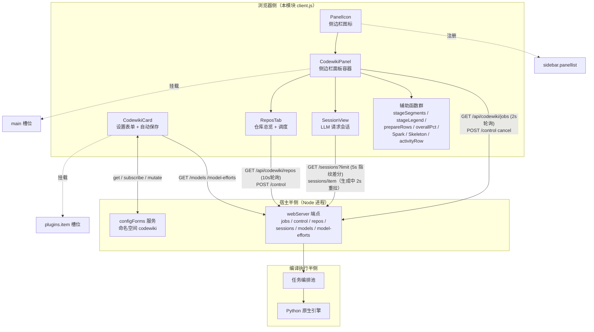
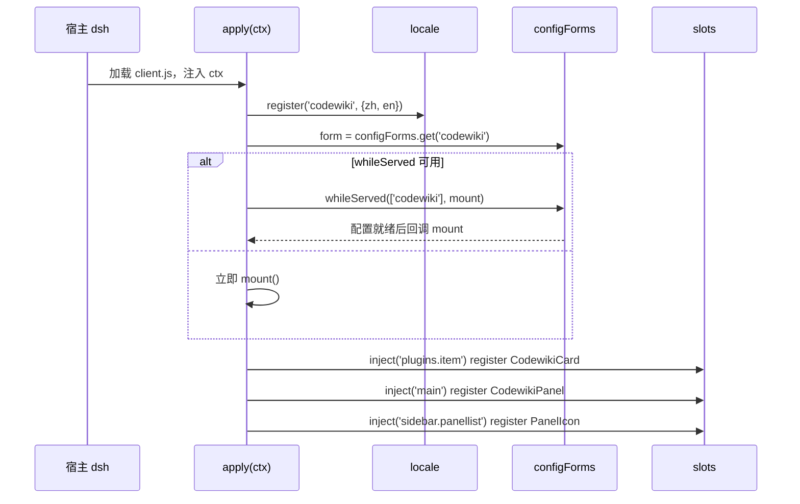
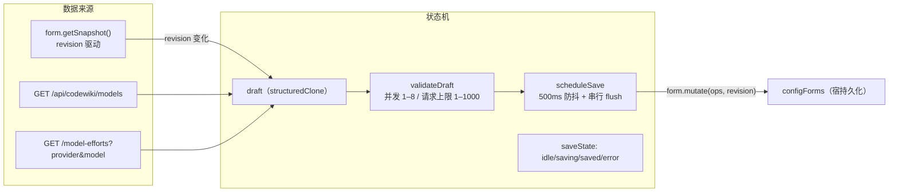
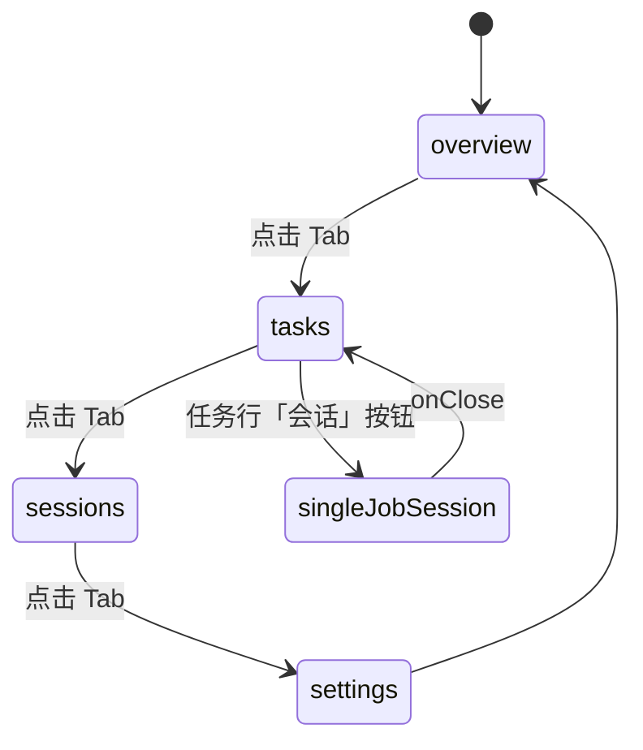
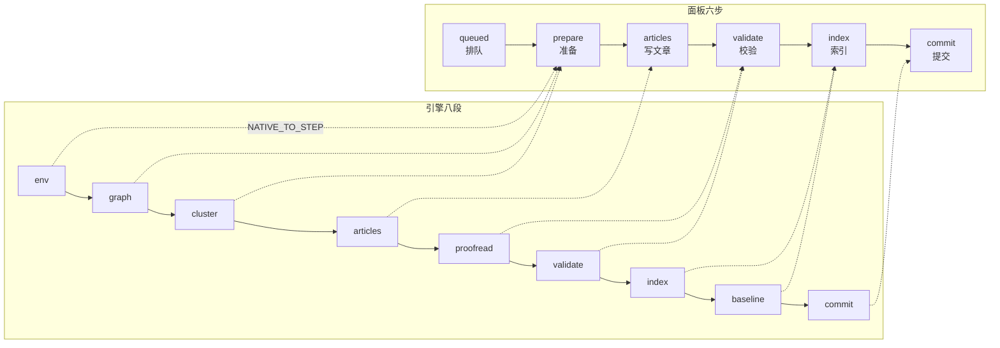
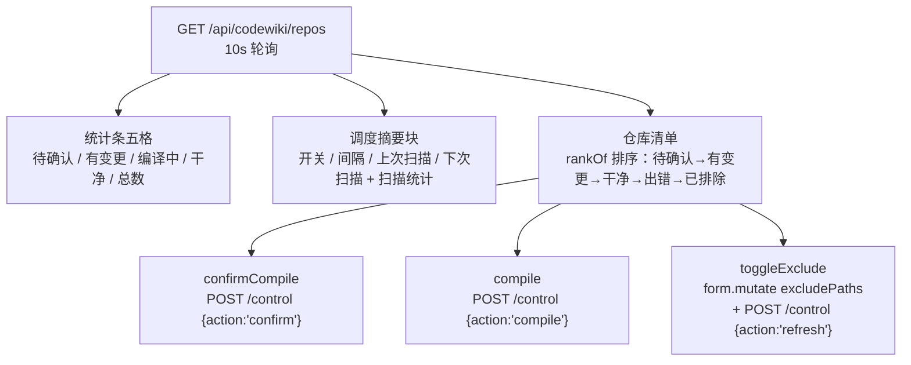
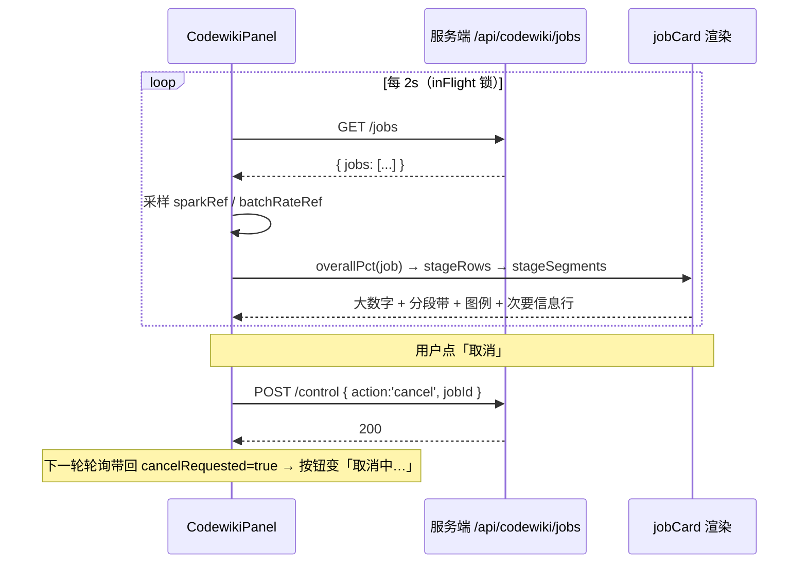
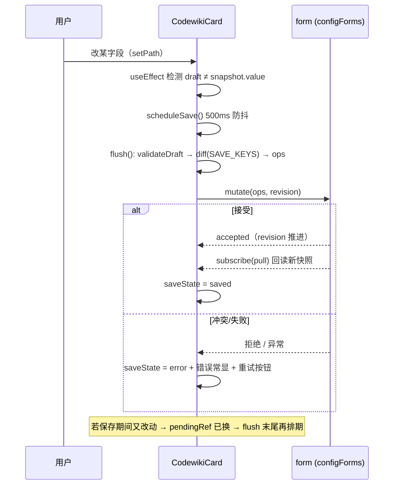

# Web_UI_Panel

!!! info "Generated documentation"
    This page was written by CodeWiki from the source code at commit [`cb7dda12`](https://github.com/ikliml666/dsh-codewiki/commit/cb7dda1277cfce7b125c45f4525ea42b890a6b24) on 2026-11-07 with `doubao-seed-2.1-lite`. Check the code before relying on details.

## 模块定位

`Web_UI_Panel` 是 dsh-codewiki 插件（`@local/dsh-codewiki`）的**浏览器客户端半侧**，是用户与编译流水线之间的全部交互界面。它在 dsh 宿主 UI 里挂载两个落点：

1. **插件设置页**（`plugins.item` 槽位）：读写 `codewiki` 配置命名空间的完整表单，自动保存、热生效；
2. **侧边栏面板**（`main` + `sidebar.panellist` 槽位）：编译任务的实时进度、总览、LLM 请求会话、取消控制。

整个模块是单一文件 [`client.js`](../../../client.js)（约 2800 行），通过 `window.__ModuleLoader__.load` 注册，由 dsh 宿主在浏览器侧加载。它不直接执行编译——所有数据来自宿主半侧的 REST 端点（`/api/codewiki/*`），所有配置变更经宿主 `configForms` 服务持久化。

---

## 架构总览

### 与系统其他模块的关系

| 上游/下游模块 | 关系 |
|---|---|
| [Cordis_Patch_Config（插件装配配置）](Cordis_Patch_Config.md) | `cordis.patch.yml` 中 `id: codewiki` 的 patch 条目是本模块的注册前提；设置命名空间 `codewiki` 与 patch id 一致 |
| [Job Orchestration（编译任务编排服务）](Job_Orchestration.md) | 面板轮询的 `/api/codewiki/jobs` 数据源自其 `jobSummary`；取消按钮发 `POST /api/codewiki/control {action:'cancel'}` |
| [Job Store（作业持久化与跨实例协调层）](Job_Store.md) | 任务卡片读取的 `stageTimings` / `taskList` / `notes` / `usage` 等字段由其持久化并回读 |
| [Job_Logs](Job_Logs.md) | `engineLogBlock` 渲染的 `job.nativeLogs`（NDJSON 最近 40 条）来自其日志写入 |
| [Engine_Python_Entry](Engine_Python_Entry.md) / [Engine_Native_State（原生引擎跨轮受管状态）](Engine_Native_State.md) | `nativeStage` / `nativePercent` / `nativeResult.gate` 等字段反映八段引擎契约；设置页的「原生引擎」分组直接控制其启停 |

| [Package_Manifest 包清单](Package_Manifest.md) | `package.json` 的 `dsh.client.platform: web` 声明本模块为 web 客户端；`exports['./client']` 指向本文件 |

---

## 核心组件

### 挂载入口：`mount`（`apply(ctx)`）

`apply` 通过 `inject: ['slots', 'locale', 'configForms']` 声明三个宿主服务依赖，随后完成四件事：

关键约定（代码注释中明确）：

- **`NS = 'codewiki'`** —— patch 条目 id 与设置命名空间；
- **`KEY = 'codewiki'`** —— 面板 key；`sidebar.panellist` 的 id 必须与 `main` 槽位注册的 key 一致，否则面板入口与内容对不上；
- **`PANEL_ORDER = 52`** —— 排在 `dsh-hindsight-on-demand`（50）之后；
- 词典值必须是字符串（`t()` 对函数值会回退返回键名）。

### `zh` / `en`：双语文档词典

两个工厂函数返回完整词条表（各约 200 条），覆盖设置页字段、面板阶段标签、空状态、按钮、错误提示。`ctx.locale.bind(NS)` 生成的 `tBound(key)` 是全模块统一的翻译入口。词条 key 与渲染代码强耦合（例如 `stage${Stage}`、`state${State}` 动态拼接），新增阶段或状态时必须同步补词条。

### `CodewikiCard`：设置卡片

**职责**：渲染「插件页」的完整配置表单，管理草稿态、自动保存、模型目录联动。

**分组结构**（`[data-dscw-cards]` 多列卡片布局，窄屏自动退列）：

| 分组 | 关键字段 |
|---|---|
| 运行 (`secRun`) | enabled / updateReminder / autoCommit / workspaceOnly |
| 并发与语言 (`secScale`) | maxConcurrency / moduleConcurrency / serialProjects / parallelProjects / articleLanguage / binaryPath |
| 原生引擎 (`secNative`) | nativeEngine / nativeEnginePython / nativeEngineEntry / nativeEngineTimeoutMs |
| 增量策略 (`secIncremental`) | updateRung / updateTauNb / updateTauGrow / updateTauFull / updateTauTree |
| 编译模型 (`secCompile`) | batchProvider / batchModel / batchReasoningEffort / requestLimit |
| 调度与排除 (`secSchedule`) | autoUpdate / autoUpdateMin / excludePaths |
| 调度与排除 (`secSchedule`) | autoUpdate / autoUpdateMin / excludePaths |

**自动保存策略**（注释中详述）：

- 字段改动 → 500ms 防抖 → `flush()` 串行提交（`savingRef` 锁）；
- 与快照逐键 `JSON.stringify` 比较，仅 diff 生成 `mutate` ops（`SAVE_KEYS` 白名单）；
- `flush` 末尾检测 `pendingRef` 已换草稿 → 再排期，避免保存期间的修改丢失；
- 卸载时补提交一次；冲突（revision 过期）进入 `error` 态并提供「立即重试」按钮。

**模型目录联动**（`modelTrio`）：提供商下拉来自 `/api/codewiki/models`；换提供商时清空模型与旧档位；目录不可用时退化为手填 `Input`；已配置但目录已不存在的 provider 保留为 `__custom` 选项，避免静默丢配置。思考程度档位来自 `/api/codewiki/model-efforts`，目录未声明时回退通用档位 `GENERIC_EFFORTS = ['off','low','medium','high','xhigh','max']`（选了不支持的值由宿主 llmChat 兜底剥档重试）。

### `CodewikiPanel`：侧边栏面板容器

**职责**：四 Tab 容器 + 任务轮询采样。是整个客户端数据密度最高的组件。

- **轮询**：`GET /api/codewiki/jobs` 每 `POLL_MS = 2000` 一次；`inFlight` 锁防止服务卡顿时重叠请求；
- **面板侧采样**（纯客户端派生，不占带宽）：
  - `sparkRef`：每 job 保留最近 30 个 `tps` 采样 → `Spark` 微趋势线；
  - `batchRateRef`：批量完成速率 EWMA（α=0.6 旧 + 0.4 新）→ 篇/分 + ETA；
  - `pctTrendRef`：整体进度斜率采样（已在新版移除）
- **分组**：`byCwd` 保持首次出现顺序，组内 `unshift` 最新在前；进行中任务（`isActive`）全部展开为「进行中」区，否则只取 `byUpdated` 最新一条当门面，其余进「历史任务」折叠区，再按仓库 `repofold` 二级折叠。

#### 阶段模型（面板与引擎对齐的关键）

- `LEGACY_STAGE = { plan: prepare, crosscut: articles, review: validate }`：历史任务里已退役的阶段名映射回当前六步，否则步骤条在失败/取消时整条熄灭；
- `STAGE_WEIGHTS = { prepare: 0.24, articles: 0.46, validate: 0.21, index: 0.05, commit: 0.04 }`：`overallPct` 线性加权，封顶 99（done/partial 才 100）；
- 每个阶段固定色相 `STAGE_HUE`（青→蓝→紫→琥珀→绿），明度饱和度写死在 CSS（58% / 52%），深浅两套主题通用；
- prepare 格子会展开：原生通道任务正在 prepare 且 `nativeStage` 落在 env/graph/cluster 时，分段带与图例都把 prepare 一格拆成 env / graph / cluster 三个子段（`prepareRows` + `expandPrepareRows`）——已到达（跑完或正在跑）的子段各用 `PREPARE_HUE` 专属色相、按 `nativeStageTimings` 真实耗时定宽并填各的完成度，没跑到的子段不单独成段（其预估权重并入带尾占位，见下条）；图例色块色相与带内已显示的子段一一对应；任务离开 prepare 后自动收回成原来的一格；
- prepare 段完成度归一化：引擎整体百分比在它覆盖的 0..54 区间内走动，不归一化时准备跑完这段只填到 8.6%、总进度偏小一半；`stageFraction` 用 `withinRange('cluster', nativePercent)` 把该区间映射回 0..1；
- 分段带语义随任务状态切换：**进行中**段宽 = 进度权重（prepare 子段再按其内子权重细分）；**终态**段宽 = 该阶段真实耗时（`stageTimings`），一眼看出「时间花在哪一步」；进行中的任务只要存在非排队的活跃阶段（`hasLiveSegments`）就画分段带与图例，不再等总进度 pct > 0。
- 未执行的阶段不进图：分段带与图例同口径，只列已 done / running / failedStep 的阶段（图例经过滤的 `reached` 行展开 prepare 子段后，未展开的子段也不列）——列出来只有一排 0%，没有信息量；已到达阶段之后还没开始的权重不丢弃，聚合为带尾一段无标签占位（`[data-dscw-p-seg-ahead]`），保持整条带子的总宽占比恒定，进度填充不会跳。

### `ReposTab`：仓库总览

- 首次编译必须用户**确认**（`needsConfirm`）：自动调度不替用户做首次决定；不想要就「排除」；
- 排除清单直接写 `excludePaths` 配置（与设置卡同一 `form.mutate` 链路），成功后通知服务端刷新总览缓存；
- `rankOf` 保证「需要人动手的」永远排在列表顶部，不因新仓库插入而漂移。

### `SessionView`：LLM 请求会话

两种形态共用一个组件：

| 形态 | 入口 | 数据源 | 展示 |
|---|---|---|---|
| 单任务 | 任务行「会话」按钮（`sessJob`） | `GET /sessions?jobId=&limit=` | 按编译阶段分组的列表（任务卡占满整页） |
| 全局 | 面板「会话」Tab（`job=null`） | `GET /sessions?limit=` 聚合 | 按仓库（cwd）分节、节内再按编译阶段分；仓库组默认展开可折叠，组按最新活动倒序 |

- **滚动归属**：会话页列表 + 详情各占一块，由外层 `[data-dscw-p-fixed]` 固定高度（任务行「会话」按钮与「会话」Tab 两种入口都置）——双层滚动条会把详情区挤成内容高度、下面留大片空白，因此组件不再套一层 page 布局；
- **列表 5s 轮询**：`inFlight` 锁防重叠；每轮回包按「total + active 摘要 + 每条 `jobId#n:status:stage:outputChars:reasoningChars`」算指纹（`sigRef`），内容一字未变就不进 state——此前每次 `setList` 都重建整棵列表，滚动位置与选中焦点被 5s 一轮打断；
- **拉取分页**：初始 `limit=80`，底部「再加载 80 条」按钮按 `cap`（全局聚合 500、单任务 2000，与服务端一致）算剩余数，到顶即隐去；头部常显「共 N 条」；
- **详情视图**：选中某条后 `GET /sessions/item?jobId&n` 拉 prompt/输出全文；还没有 `finishedAt` 就是仍在生成，2s 后自动重拉一次——正在跑的请求能看着输出逐段长出来。详情由 SegmentedTabs 页签切换：「输出」（默认，正文经 `MarkdownText` 渲染）、「输入」（prompt 按 `[system]/[user]/[assistant]/[tool]` 角色切块）、有 `reasoning` 时出「思考」页签、有工具调用时出「工具」页签；页头常显输出/思考/工具次数与输入输出 token 统计；
- **「只看任务」过滤**：全局视图的「进行中的任务」区每行可点，把列表收窄成该任务的请求（`focus`）、并回显「只看任务 <repo> · 看全部任务」工具条；聚焦态只有一个仓，不再按仓库分节，但仍按编译阶段分组。
- `activeJobs` 段：进行中但尚未发出过 LLM 请求的任务（准备/聚类/收尾）也可见，显示仓库名（无 cwd 时退回任务 id）、阶段（`stageLabel` / `nativeStageName`）、`nativePercent`、已写篇数、请求数；零请求的行标 `data-idle`。
会话页自身固定高度（`embedded` 嵌套模式已移除，两种入口统一）。
- **列表分层与行内空提示**：全局视图按仓库（cwd）分节、节内再按编译阶段分（单任务/聚焦态直接按阶段分）；阶段组按 `STAGE_ORDER` 的真实流程次序排，历史记录无阶段字段时归入「未标注阶段」组，组头显示条数与完成/失败/在跑汇总；仓库组与阶段组都可折叠（`collapsed` 态，仓库组默认全展开）。每行在输出为空时直接在行内给出原因（按判序：有思考 →「思考中」、调过工具 →「仅工具调用」、请求还在跑（`status === 'running'`，增量还没到）→「生成中」、否则 →「无内容」），点开详情前就知道为什么空；在跑的行即使输出为零也不打 `data-empty` 空行标记，不把「即将长出来」误报成「没有内容」。

### `Skeleton` / `Spark` / `PanelIcon` / 工具函数

| 组件 | 作用 |
|---|---|
| `Skeleton` | 三行 shimmer 呼吸条（宽 100/72/46%），替代光秃秃的「…」，数据到达时不跳高度 |
| `Spark` | 纯 SVG polyline 微趋势线（默认 56×16），专用于 tps 采样窗口 |
| `PanelIcon` | 摊开的书形 SVG（16×16），作为侧边栏面板入口图标 |
| `activityRow` | 活动流备注轻量归约：正则归 tone（ok/warn/error）+ 提取括号内阶段名；命中不了就按普通条目，不猜 |
| `fmtMs` / `fmtTok` / `fmtAgo` / `repoName` | 时长（亚秒级显示 ms）、token（k/M）、相对时间、目录名（取末两段）格式化 |

---

## 数据流与交互时序

### 任务卡片从轮询到渲染

### 设置自动保存

---

## 设计要点速览

1. **轮询不重叠**：所有端点拉取都带 `inFlight` 锁；卸载后置 `mountedRef = false` 阻止迟到回包 `setState`。
2. **进度双编码**：阶段身份用色相、完成度用填充宽度（`--seg-done`），互不抢通道；失败段整体标红。
3. **排队不计入平均**：`poolSummary` 只统计真正在跑的任务，排队数单独报，避免「最慢永远是那个没开始的」。
4. **历史归约**：同一仓库几十轮任务二级折叠（历史 → 仓库），避免平铺把别的仓库挤出视野。
5. **样式全部内联**：`<style data-plugin="@local/dsh-codewiki">` 一次注入，重复加载（HMR）不堆叠；颜色全部走 `--dsw-alias-*` 主题变量，深浅色自适应；`prefers-reduced-motion` 关闭动画。
6. **可读失败**：渲染构建期异常直接在面板内显形（`Panel error: ...`），不白屏。

---

## 配置端点对照

| 端点 | 方法 | 用途 | 调用方 |
|---|---|---|---|
| `/api/codewiki/jobs` | GET | 任务列表（2s 轮询） | CodewikiPanel |
| `/api/codewiki/repos` | GET | 仓库总览（10s 轮询） | ReposTab |
| `/api/codewiki/sessions` | GET | LLM 请求列表（`jobId` / `limit` 分页，5s 轮询） | SessionView |
| `/api/codewiki/sessions/item` | GET | 单条 prompt/输出全文（生成中 2s 重拉） | SessionView |
| `/api/codewiki/models` | GET | 模型提供商/目录 | CodewikiCard |
| `/api/codewiki/model-efforts` | GET | 某 provider/model 的思考档位 | CodewikiCard |
| `/api/codewiki/control` | POST | `cancel` / `compile` / `confirm` / `refresh` | CodewikiPanel / ReposTab |

> 注：`/api/codewiki/control` 仅监听回环地址（见 `client.js` 头部注释），面板侧不做额外鉴权假设。

??? abstract "Documented components (13)"
    - [`CodewikiCard`](https://github.com/ikliml666/dsh-codewiki/blob/cb7dda1277cfce7b125c45f4525ea42b890a6b24/client.js) — `client.js`
    - [`CodewikiPanel`](https://github.com/ikliml666/dsh-codewiki/blob/cb7dda1277cfce7b125c45f4525ea42b890a6b24/client.js) — `client.js`
    - [`PanelIcon`](https://github.com/ikliml666/dsh-codewiki/blob/cb7dda1277cfce7b125c45f4525ea42b890a6b24/client.js) — `client.js`
    - [`ReposTab`](https://github.com/ikliml666/dsh-codewiki/blob/cb7dda1277cfce7b125c45f4525ea42b890a6b24/client.js) — `client.js`
    - [`SessionView`](https://github.com/ikliml666/dsh-codewiki/blob/cb7dda1277cfce7b125c45f4525ea42b890a6b24/client.js) — `client.js`
    - [`Skeleton`](https://github.com/ikliml666/dsh-codewiki/blob/cb7dda1277cfce7b125c45f4525ea42b890a6b24/client.js) — `client.js`
    - [`Spark`](https://github.com/ikliml666/dsh-codewiki/blob/cb7dda1277cfce7b125c45f4525ea42b890a6b24/client.js) — `client.js`
    - [`byUpdated`](https://github.com/ikliml666/dsh-codewiki/blob/cb7dda1277cfce7b125c45f4525ea42b890a6b24/client.js) — `client.js`
    - [`en`](https://github.com/ikliml666/dsh-codewiki/blob/cb7dda1277cfce7b125c45f4525ea42b890a6b24/client.js) — `client.js`
    - [`line`](https://github.com/ikliml666/dsh-codewiki/blob/cb7dda1277cfce7b125c45f4525ea42b890a6b24/client.js) — `client.js`
    - [`mount`](https://github.com/ikliml666/dsh-codewiki/blob/cb7dda1277cfce7b125c45f4525ea42b890a6b24/client.js) — `client.js`
    - [`zh`](https://github.com/ikliml666/dsh-codewiki/blob/cb7dda1277cfce7b125c45f4525ea42b890a6b24/client.js) — `client.js`
    - [`row`](https://github.com/ikliml666/dsh-codewiki/blob/cb7dda1277cfce7b125c45f4525ea42b890a6b24/client.js) — `client.js`

