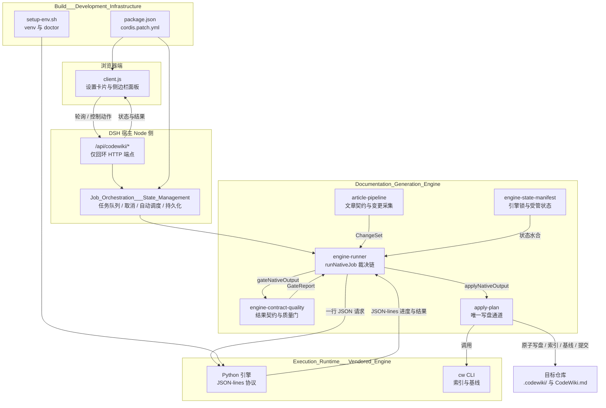
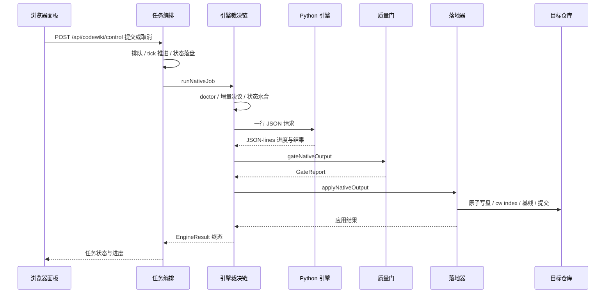

# dsh-codewiki 仓库概览

!!! info "Generated documentation"
    This page was written by CodeWiki from the source code at commit [`f824657b`](https://github.com/ikliml666/dsh-codewiki/commit/f824657b0de5972f39a52be0a2b9600347997915) on 2026-11-08 with `deepseek-v4.1-flash`. Check the code before relying on details.

`dsh-codewiki` 是 DSH 插件 `@ikliml666/dsh-codewiki`，目标是把“为仓库生成或更新 CodeWiki”从一次同步调用，变成一条**可观测、可恢复、可取消的后台任务**。插件由宿主 Node 半侧与浏览器半侧组成：前者负责任务编排、引擎裁决、质量门、状态持久化与本机 HTTP 端点；后者提供设置卡片和侧边栏面板。真正的文档理解、聚类与写作由随包分发的 FSoft Python 引擎完成，索引与基线由 Rust `cw` 工具完成，只有经过质量门裁决的产物才会写入目标仓库的 `.codewiki/` 与 `CodeWiki.md`。

## 仓库定位

- **编译任务化**：`codewiki_generate` / `codewiki_update` 调用即返回 `jobId`，由 10 秒 tick 状态机推进，支持排队、取消、自动扫描与自动提交。
- **双端协作**：`client.js` 只负责界面与轮询，不直接执行编译；所有数据经仅回环的 `/api/codewiki/*` 端点访问宿主半侧。
- **裁决与写盘分离**：引擎负责生成，质量门负责判定，`apply-plan` 是唯一修改 `.codewiki/` 与 `CodeWiki.md` 的通道。
- **工作区低副作用**：任务现场、日志、更新记录、会话与原始树留档落在仓库外临时目录，目标仓库只出现最终产物。
- **环境显式失败**：Python 依赖或引擎锁不成立时直接失败为 `engine-missing` / `engine-deps`，不自动安装依赖、不静默降级。

## 端到端架构

架构上可以分成四段：

1. **浏览器端**：`ui-client` 提供设置表单、侧边栏任务面板、仓库总览与编译会话视图，只消费宿主端点并下发少量控制动作。
2. **控制面**：`Job_Orchestration___State_Management` 负责工具注册、任务生命周期、队列与取消、自动调度、自动提交、会话记录和 `/api/codewiki/*` 端点，并把现场原子持久化到仓库之外。
3. **文档生成内核**：`Documentation_Generation_Engine` 负责跨语言进程协议、`EngineResult` 契约、质量门、受管状态、模型桥、文章契约以及落地事务与回滚。
4. **执行运行时与构建面**：`Execution_Runtime___Vendored_Engine` 提供 Python 引擎与 `cw` 工具；`Build___Development_Infrastructure` 负责包清单、DSH 插件装载、Python venv、环境诊断与无模型探针。

## 一次编译的主链路

贯穿全链路的硬约束是：**终态取最弱一环**，引擎、质量门、落地器任一步降级都不能得到 `done`；**写盘单通道**，只有 `apply-plan` 修改 `.codewiki/` 与 `CodeWiki.md`；**状态只由完整成功推进**，`partial` / `failed` / `cancelled` 不推进基线；**采不到变更不等于没有变化**，变更采集失败时显式退回全量编译；**凭证不进子进程**，任务文件与子进程只接触占位 key。

## 核心模块文档

| 模块 | 角色 | 关键内容 |
| --- | --- | --- |
| [ui-client（浏览器半侧客户端）](ui-client.md) | 浏览器半侧 | 设置卡片、侧边栏面板、任务进度、会话视图、仓库总览；只通过 `/api/codewiki/*` 与宿主交互 |
| [作业编排与状态管理（Job Orchestration & State Management）](Job_Orchestration___State_Management.md) | 控制面 | `cw` / `generate` / `update` / `progress` 四个工具、tick 状态机、取消、自动调度、自动提交、本机端点、任务现场持久化 |
| [Documentation_Generation_Engine 模块概览](Documentation_Generation_Engine.md) | 文档生成内核 | 跨语言协议、`EngineResult` 契约、质量门、受管状态、模型桥、落地与回滚、文章契约 |
| [Execution_Runtime___Vendored_Engine 概览](Execution_Runtime___Vendored_Engine.md) | 执行运行时 | Python 入口与阶段映射、并行与断点、`cw` 的索引、基线、frontmatter 语义 |
| [构建与开发基础设施（Build___Development_Infrastructure）概述](Build___Development_Infrastructure.md) | 构建与验收 | `package.json`、`cordis.patch.yml`、venv 构建、`doctor`、无 LLM 探针、路径归一 |

## 构建、运行与验证

`dsh-codewiki` 以 npm 包形态交付，`package.json` 同时声明 Node 入口、`exports["./client"]`、`files` 白名单以及 `dsh.client` / `dsh.bundle` 元数据。部署到 DSH 时，宿主 profile 的 bundle 列表配合 `cordis.patch.yml` 将 `id=codewiki` 插入插件配置；浏览器半侧由 `client.js` 在宿主启动时注册，修改后需要重启 dsh 才能生效。插件不另起独立服务，面板通过仅回环的 `/api/codewiki/*` 访问宿主。

运行前需要准备 Python 引擎环境：`tools/fsoft-engine/setup-env.sh` 以 `set -euo pipefail` 安装依赖快照并以 editable 方式安装引擎，`doctor` 再以只读方式检查 `pip check` 与 `.codewiki/engine-lock.json` 指纹；环境不闭合时任务直接失败为 `engine-missing` / `engine-deps`，不会自动安装依赖。工程验收链为 `setup-env.sh` → `doctor` → `probe-no-llm-graph.py` → 真实编译，前三段不消耗模型额度。构建、配置覆盖、发布白名单与探针细节见 [构建与开发基础设施（Build___Development_Infrastructure）概述](Build___Development_Infrastructure.md)。
