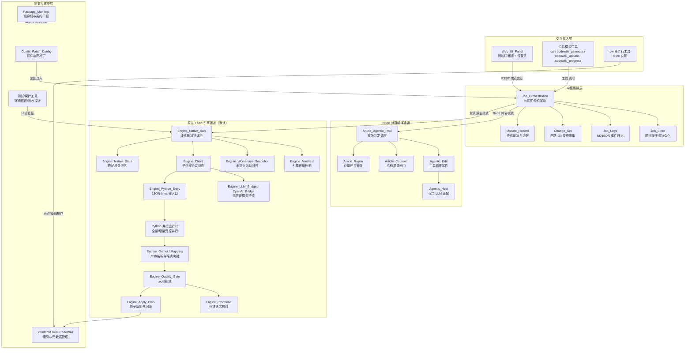

# dsh-codewiki 仓库总览

!!! info "Generated documentation"
    This page was written by CodeWiki from the source code at commit [`29bf6588`](https://github.com/ikliml666/dsh-codewiki/commit/29bf65881dbbc1d966bd0c8217bd8387a13d16f0) on 2026-11-06 with `doubao-seed-2.1-lite`. Check the code before relying on details.

## 仓库定位与核心目标
`dsh-codewiki` 是 DeepSeek Harness（dsh）宿主环境下的本地代码文档插件，npm 包名为 `@local/dsh-codewiki`。它的核心目标是将任意代码仓库自动编译为结构化、可追溯的 Wiki 文档体系，替代手工维护文档的低效模式。
核心能力包括：
- 服务化编译流水线：将同步编译动作改造为后台有限阶段机驱动的任务流，覆盖排队、文章写作、横切校验、文本校对、索引构建、自动提交全流程，提供实时进度反馈；
- 双编译通道：默认调用上游 FSoft Python 原生引擎完成依赖图分析、模块聚类与文章生成，同时内置可完全离线运行的 Node 兼容 agentic 写作通道，适配不同运行环境；
- 严格质量保障：全链路统一的文章结构契约、写集边界防护、终态裁决机制，彻底避免"单篇成功、多篇失败却上报编译成功"的历史缺陷；
- 增量记忆能力：通过跨轮持久化的受管状态实现组件级增量编译，避免每轮全量重算带来的时间与 token 成本；
- 配套工具链：Rust 实现的 `cw` CLI 负责 Wiki 生命周期管理，侧边栏 Web 面板提供全流程交互，模型凭证全程不出宿主、由 loopback 桥接注入引擎。

## 端到端架构
仓库整体分为五层，交互层请求最终在中枢编排层被分流到两条编译通道，底座层提供装配、校验与工具支撑：

## 核心模块文档导航
按功能域分组，可点击跳转至各模块的详细文档：
### 交互与配置域
- [Web_UI_Panel](Web_UI_Panel.md)：浏览器侧交互界面，提供编译进度展示、配置表单、LLM 请求会话查看能力
- [Cordis_Patch_Config（插件装配配置）](Cordis_Patch_Config.md)：dsh 宿主的插件装配补丁，负责插件身份与配置命名空间挂载
- [Package_Manifest 包清单](Package_Manifest.md)：包身份声明、Node/dsh 版本约束、跨语言阶段契约口径
- [CodeWiki 主入口（cw CLI）](CodeWiki_Main.md)：Rust 实现的 `cw` CLI 入口，负责 Wiki 初始化、状态检查、索引重建
- [CodeWiki 安装配置（CodeWiki_Setup）](CodeWiki_Setup.md)：会话规约向 Claude Code / Codex / QMD 的安装与卸载
### 中枢编排域
- [Job Orchestration（编译任务编排服务）](Job_Orchestration.md)：插件核心中枢，驱动有限阶段编译流水线、注册会话工具、暴露回环 API
- [Job Store（作业持久化与跨实例协调层）](Job_Store.md)：跨进程任务持久化、tick 锁、宿主重启后的任务重放裁决
- [Job_Logs](Job_Logs.md)：NDJSON 持久化事件日志、Wiki 链接扫描、Git 路径归一
- [Change_Set 变更集采集模块](Change_Set.md)：四路 Git 变更采集（已提交/暂存/未暂存/未跟踪）
- [Update_Record（编译更新记录）](Update_Record.md)：编译终态裁决、基线推进判定、可复盘的更新记录
### Node 兼容编译通道
- [Article Agentic Pool 文章智能体执行池](Article_Agentic_Pool.md)：双池并发的 agentic 文章执行调度
- [Agentic_Edit 模块](Agentic_Edit.md)：单篇文章写作的多轮工具循环，支持读码、列文件、增量编辑
- [Agentic_Host（agentic 工具循环 ↔ 宿主 llm 服务适配层）](Agentic_Host.md)：agentic 循环与宿主 LLM 服务的消息格式适配层
- [Article_Contract（文章契约闸门）](Article_Contract.md)：全通道共用的文章结构最低质量契约闸门
- [存量文章修复（Article_Repair）](Article_Repair.md)：存量坏页的格式修复裁决，避免误删有价值内容
### 原生 FSoft 引擎通道（默认）
- [Engine_Native_Run（原生编译裁决编排层）](Engine_Native_Run.md)：原生通道的线性裁决链编排，产出严格不可洗白的编译终态
- [引擎清单（Engine_Manifest）](Engine_Manifest.md)：引擎环境指纹与锁校验，环境漂移时直接终止编译
- [工作区快照（Engine_Workspace_Snapshot）](Engine_Workspace_Snapshot.md)：未提交改动的临时 Git 快照，对齐引擎记账口径
- [Engine_Client（引擎进程客户端）](Engine_Client.md)：Node 与 Python 子进程的 JSON-lines 协议适配层
- [Engine_Contract 引擎契约](Engine_Contract.md)：跨进程引擎结果的版本化数据契约
- [引擎 LLM 桥（Engine_LLM_Bridge）](Engine_LLM_Bridge.md)：loopback HTTP 桥，无凭证对接宿主 LLM 服务
- [Engine OpenAI 桥转换层](Engine_OpenAI_Bridge.md)：OpenAI 协议与 DSH 模型流的纯函数转换层
- [Engine_Python_Entry](Engine_Python_Entry.md)：Python 侧薄入口，负责协议翻译与进度桥接
- [Engine_FSoft_Runtime：增量 Step 5 的受控并行与断点运行时](Engine_FSoft_Runtime.md)：增量更新路径的受控并行与断点运行时
- [全量并行运行时（Engine_Full_Parallel_Runtime）](Engine_Full_Parallel_Runtime.md)：全量生成路径的兄弟模块并行调度
- [Engine_Mapping：FSoft 产物到 CodeWiki 的格式映射层](Engine_Mapping.md)：FSoft 产物到 CodeWiki 布局的纯函数格式映射
- [Engine_Output 模块文档](Engine_Output.md)：引擎产物的结构化解析与自洽性校验
- [Engine_Quality_Gate（原生引擎产物采用门）](Engine_Quality_Gate.md)：产物采用裁决，区分缺陷/降级/陈旧三类问题
- [Engine_Proofread：原生引擎产物的死链语义校对](Engine_Proofread.md)：死链问题的事后语义校对，仅修正链接不改动正文
- [Engine_Apply_Plan（原生产物落地器）](Engine_Apply_Plan.md)：产物原子落地，写盘/建索引/推基线/自动提交，失败可回滚
- [Engine_Native_State（原生引擎跨轮受管状态）](Engine_Native_State.md)：跨轮持久化的引擎增量记忆，避免每轮退化为全量编译
- [Engine_Process_Tree 模块文档](Engine_Process_Tree.md)：子进程树可靠终止、模块归属树自愈补丁
### 测试与工具域
- [FSoft 引擎环境搭建脚本（FSoft_Engine_Setup_Script）](FSoft_Engine_Setup_Script.md)：独立 venv 的 FSoft 引擎环境搭建脚本
- [No-LLM_Graph_Probe（无 LLM 依赖图验收探针）](No-LLM_Graph_Probe.md)：无 LLM 依赖图链路的验收探针

## 构建、运行与部署
本仓库的构建、配置与部署流程统一由包级元数据管理，核心要点如下：
1. **构建要求**：插件为纯 ESM Node 项目，无复杂编译步骤，要求 Node.js ≥ 24.9.0、dsh 宿主版本 ≥ 0.2.0-rc.0，运行时唯一依赖为 schema 校验库，版本与入口定义详见 [Package_Manifest 包清单](Package_Manifest.md)。
2. **插件装配**：通过 `cordis.patch.yml` 向 dsh 宿主注册插件身份，支持本地 bundle 依赖、file:/// 直挂两种安装方式，配置热生效无需手工修改宿主文件，装配机制详见 [Cordis_Patch_Config（插件装配配置）](Cordis_Patch_Config.md)。
3. **原生引擎环境**：默认编译通道依赖独立部署的 FSoft Python 引擎，需通过 `tools/fsoft-engine/setup-env.sh` 在仓库外创建隔离虚拟环境，自动解决 pip 依赖冲突、完成依赖闭合校验，环境搭建与故障验证详见 [FSoft 引擎环境搭建脚本（FSoft_Engine_Setup_Script）](FSoft_Engine_Setup_Script.md)、[No-LLM_Graph_Probe（无 LLM 依赖图验收探针）](No-LLM_Graph_Probe.md)。
4. **运行与部署**：插件无需独立部署服务，安装到 dsh 宿主后自动注册会话工具、侧边栏面板与回环 REST API，编译任务以后台服务化方式运行；编译产物自动写入仓库 `.codewiki/` 目录，支持索引重建、基线推进与自动提交，无需额外配置。
