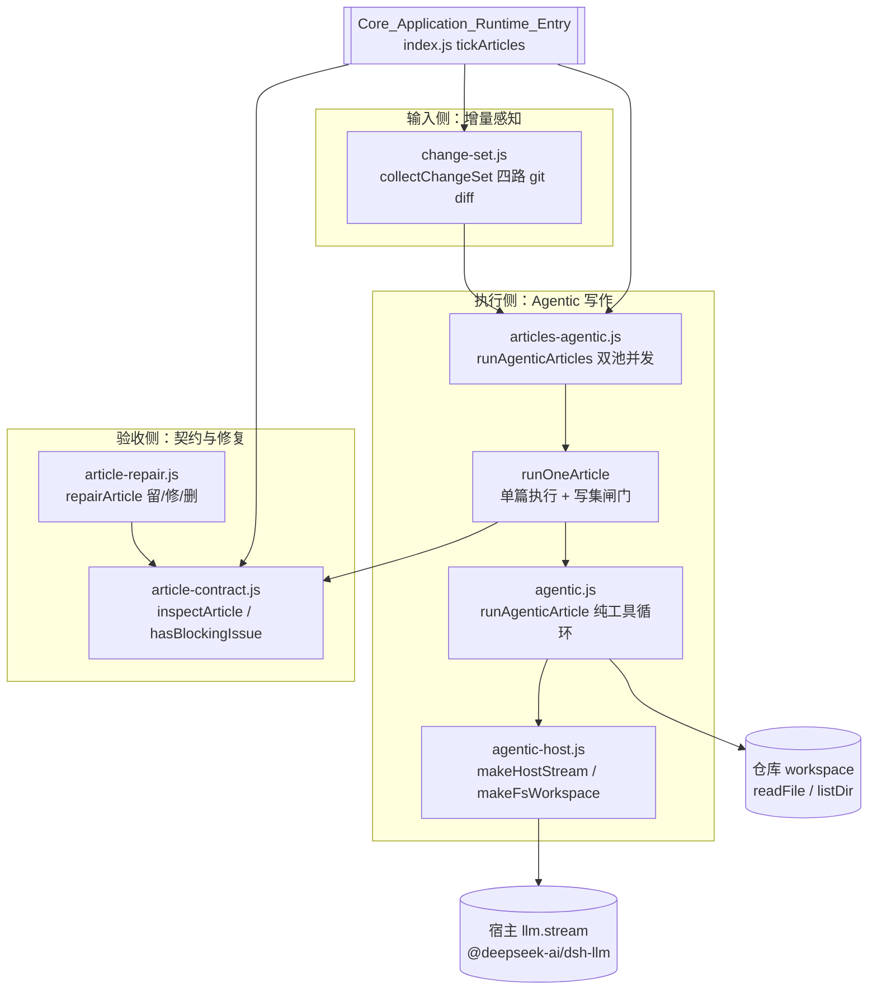
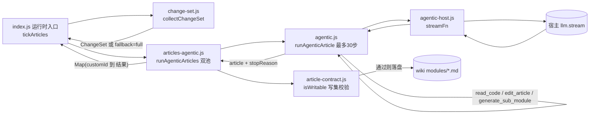

# Agentic 文章处理库

## 简介与用途

`Agentic_Article_Processing_Library` 是 CodeWiki 插件（`@local/dsh-codewiki`，见 `package.json`）中负责「把源码模块变成 wiki 文章」的核心库。它对应上游 FSoft-AI4Code/CodeWiki 的 module agent 与文章验收体系，但在本插件中被重写为一套**纯逻辑、可离线测试**的 Node 实现，不绑定 pydantic-ai，也不绑定宿主的 LLM 服务。

整库围绕三条主线组织：

1. **Agentic 写作执行**（`agentic.js` / `agentic-host.js` / `articles-agentic.js`）：模型不再把整包源码塞进一次 prompt，而是拿到一个「可反复读代码、可精确编辑文章、可把子模块拆给子任务」的工作台——行号、签名这类硬事实现场核对，文章用 `insert` 搭骨架、`str_replace` 逐段填实。
2. **文章契约与修复**（`article-contract.js` / `article-repair.js`）：一篇文章落盘前必须满足的最低结构（frontmatter、必填字段、必需章节、source_files 证据、死链），以及对「格式坏了但内容还在」的存量页的自动修复。
3. **变更集采集**（`change-set.js`）：一次编译要「看见」的全部源码改动（committed / staged / unstaged / untracked 四路合一），为增量编译提供输入。

## 架构概览



**关键设计决定**：

- **纯逻辑与宿主适配分离**：`agentic.js` 只消费 `{role, content}` 裸消息与 blocks，测试可完全离线；`agentic-host.js` 负责把裸消息翻译成宿主 `@deepseek-ai/dsh-llm` 要求的正式 Message（带稳定 id 的 `WeakMap` 缓存、一条 tool 消息拆成多条结果消息），并用 `BlockAssembler` 把 chunk 流收成 blocks。
- **写集闸门**：agentic 通道里模型有自由工具循环，但**能写哪些文件由调度器说了算**。`article-contract.js` 的 `makeWriteSet` / `isWritable` 在 `runOneArticle` 落盘前拦截越界写入（父任务只准写自己那一篇，子模块只准写分配给它的路径）。
- **诚实失败语义**：采集不到变更一律 `fallback='full'` 退回全量编译，绝不假装 clean；契约判不出内容是否健康时，error 级拒写、warning 级放行但把终态降为 partial——不允许「装绿」。

## 子模块详解

由于本子模块粒度较小（每块单文件、组件数少于两个可独立成篇的子单元），以下直接在本页展开各组件的职责与关键实现细节。

### 1. Agentic 写作循环（agentic 通道核心）

覆盖 `lib/agentic.js`、`lib/agentic-host.js`、`lib/articles-agentic.js`。

#### `lib/agentic.js` — 纯逻辑工具循环

- **`runAgenticArticle({ mission, streamFn, workspace, tools, editor, onSubModule, subModuleBlocked, maxSteps, signal, ... })`**：单篇写作循环本体。每步调注入的 `streamFn` 拿回 assistant blocks；无 tool-call 即视为写完（`stopReason='finished'`），有 tool-call 则执行后把结果作为 `tool` 消息回灌；超过 `maxSteps` 退出（`stopReason='max-steps'`），流失败为 `'stream-error'`、无响应为 `'empty-response'`、被取消为 `'aborted'`。
- **`DEFAULT_MAX_STEPS = 30`**：步数上限的唯一定义点（`articles-agentic.js` 再导出保持既有导入路径）。
- **四类内置工具**（`TOOL_SCHEMAS`）：
  - `read_code`（`makeReadCodeTool`）：按 `(path, start_line, end_line)` 读源码，带「重复读抑制」——同一段再读只回一句「你已在第 N 步读过」，并设 `MAX_READ_LINES=2000`、`MAX_READ_CHARS=40000` 双上限（防压缩产物单行 20 万字符一次回吐 5.7 万 token）。
  - `list_files`（`makeListFilesTool`）：列目录并屏蔽 `node_modules`/`.git`/`dist`/`vendor` 等噪音目录（深度钳制在 1–4）。
  - `edit_article`（`makeArticleEditor`）：闭包持有文章正文，支持 `view`/`str_replace`/`insert`；CRLF 感知——匹配前统一成 `\n`、写回时按原文行尾风格还原；负数行号、非唯一 `old_str`、越界 `insert` 行号都显式报错而非静默处理。
  - `generate_sub_module`：`onSubModule` 存在时派发子任务；`subModuleBlocked='max-depth'` 时如实告诉模型「到顶了，直接写成普通小节」，防止模型留下指向从未生成文件的死链。
- **`safeRelPath`**：路径越界防护，拒绝绝对路径、盘符、`../`。
- **参数解析容错**：`parseToolArgs` 对模型给出的「原样 → 剥 ```json 围栏 → 截取首个平衡 `{...}`」三级递进解析；坏 JSON 不中断，作为工具 warning 回灌让模型自己改。
- **`buildOpeningPrompt`**：开场提示词，明确「用 read_code 现场核对行号、禁止编造文件/行号、不要把整篇文章包进 markdown 围栏」。

#### `lib/agentic-host.js` — 宿主适配层

- **`toRequestMessages(messages, { provider, model })`**：把裸 `{role, content}` 消息翻译成宿主 `@deepseek-ai/dsh-llm` 的正式 Message。用 `WeakMap`（以裸消息对象为键）缓存已构造消息，保证同一轮对话里同一条消息的 id 稳定（满足宿主 MessageId「跨表示边界保持稳定身份」的契约）；一条装多条结果的 `tool` 消息按结果拆成多条 `ToolResultMessage`。
- **`makeHostStream({ llm, provider, model, reasoningEffort, onDelta, onFinish })`**：返回注入给 `runAgenticArticle` 的 `streamFn`——把 `llm.stream` 的 chunk 流用 `BlockAssembler` 收成 blocks，`finish.kind` 为 `error`/`aborted` 时抛错。
- **`makeFsWorkspace(fs, path, cwd)`**：把仓库抽象成 `{ readFile, listDir }`。核心是 `absOf(rel)`——解析成绝对路径并强制落在 `cwd` 内，越界返回 `null`（再由工具层报「越界路径」），是符号链接逃逸之外的第二道真实路径防线。

#### `lib/articles-agentic.js` — 执行器与并发池

- **`runOneArticle(task, {...})`**：单篇跑一次循环并落盘。已有旧文时读入作为 editor 初始内容（模型增量改而非从零重写）；落盘前过写集闸门（`isWritable`），越界返回 `stopReason='write-set'` 不落盘；空文章兜底判失败（`'empty-article'`），不覆盖旧文。
- **子模块递归派发**：`dispatchSub` 就地递归调 `runOneArticle`，子文章落在 `modules/<父 slug>/<子 slug>.md`；深度封顶 `subDepth=2`，重名子模块名加父模块名前缀、仍重则跳过（防 issue #76/#113 的互相覆盖）；子层写集只有它自己那一条路径。
- **`runAgenticArticles(tasks, {...})`**：并发池（`runPool` + `worker` 协程拉取），返回 `Map(customId → 结果)`，单任务失败只记账不影响其它任务。带 `bigTier` 标记的任务与默认档任务分池独立限流（`bigConcurrency` / `concurrency`），互不挤占配额。
- **`resolveTaskRoute`**：任务自带 provider+model（大档）时完全以任务为准，否则回落参数默认档。
- **`sourceTokensOf` / `markBigAgenticTasks`**：按模块源文本量（CJK 按 1、其余 3.5 字符/token）近似估算 token，超过 `bigTier.budget` 就给任务打上大档 provider/model/reasoningEffort——对应「大模块普通上下文读不完就换大上下文模型」。

### 2. 文章契约与修复闸门

覆盖 `lib/article-contract.js`、`lib/article-repair.js`。

#### `lib/article-contract.js` — 纯函数结构闸门

- **`inspectArticle(content, { cwd, articlePath, expectedType, readableSources, allowedLinks, fsImpl, requiredSections, allowEmptySourceFiles })`**：主入口，返回 `issues[]`（空 = 通过）。检查项依次为：空内容、frontmatter 是否存在/闭合、必填字段（`title`/`type`/`source_files`/`tags`）、`type` 与所在目录（`TYPE_BY_DIR`/`ROOT_TYPES`）是否匹配、source_files 格式（仓库相对、非目录、非 `../`）、是否真的存在（`fsImpl.exists`/`isDirectory`）、是否是「本次实际读过的证据」子集（`readableSources`）、正文非空、正文里有没有重复贴一份 frontmatter、代码围栏是否成对、必需章节存在且非空、重复章节、内部链接死链（`allowedLinks` 比对多种候选形态）。
- **`SEVERITY` 分级**：`error`（重复 frontmatter/围栏未闭合/source 不存在或非证据/死链/缺必填字段/正文空/必需章节空）必须拒写；`warning`（缺章节）放行但记账。由 `hasBlockingIssue(issues)` 判定是否含 error、`issueSummary(issues)` 压成一行人类可读文案。
- **代码感知**：`stripCode` 把围栏块与行内代码替换成**等长**占位（长度不变是硬契约，供 `rewritePageLinks` 回原文做偏移替换），让「文章在演示 frontmatter/链接语法」不被误判成重复贴头或死链。`parseFrontmatter`/`parseYamlLite` 为极简 YAML 解析（双引号标量优先 `JSON.parse` 还原转义）。
- **`NATIVE_ARTICLE_OPTS`**：原生引擎通道的固定检查口径（`requiredSections=[]`、`allowEmptySourceFiles=true`、不判 source 存在性），与 `CodeWiki_Engine_Subsystem` 的 quality-gate / apply-plan 共用，保证「刚渲染的页」与「存量页」同一把尺。
- **写集闸门**：`makeWriteSet` / `normalizeWritePath` / `isWritable`——把允许写入的路径清单编译成规范化 POSIX 集合，`articles-agentic.js` 落盘前用它拦截越界写入。

#### `lib/article-repair.js` — 存量页留/修/删

- **`repairArticle(text, rel)`**：返回 `{ action: 'keep'|'repair'|'drop', text, reasons }`。修复手段包括：剥掉外层 ```markdown 围栏（含未闭合的）、剥掉 frontmatter 之前的模型前言、展开嵌套的 `frontmatter:` 块、补上缺失字段（`title` 取正文一级标题或文件名、`type` 按目录推断、`source_files: []`/`tags: []`）、补未闭合 frontmatter 的结束 `---`、给纯正文补一份 frontmatter、把错配的 `type` 改回目录应有的值。
- **`assemble(fmText, body)`**：把修好的 frontmatter 文本与正文重新拼成标准文章（`---\n<fm>\n---\n\n<body>\n`）。
- **唯一判删依据**：文首第一个块（frontmatter 之前或正文头几行）命中 `LEAK_MARKERS` 指纹（「以下是基于源码…」「Compression of Compressed Context」「The user wants to…」等模型提示/思考回显）时判 `drop`——内容本身是污染，修开头也救不回来。正文中间引用日志不算泄漏。

### 3. 变更集采集

覆盖 `lib/change-set.js`。

- **`collectChangeSet(cwd, baseCommit, { execFile })`**：把一次编译要看见的改动收成可序列化 ChangeSet。四路采集：committed（`git diff base..HEAD`）、staged（`git diff --cached HEAD`）、unstaged（`git diff`）、untracked（`git ls-files --others --exclude-standard`）；统一开 `-M` 改名检测，改名保留 `from→to` 两端。
- **路径归一**：`normChangePath` 统一成 POSIX 相对路径、丢弃绝对/`../` 越界路径；经 `decodeGitPath` 还原 git quotepath 的非 ASCII 转义（`Shared_Infrastructure_Utilities` 提供），让中文路径正常参与 `.codewiki/` 排除。
- **分类与去重**：`all` 含改名两端；「删了又新建同名文件」从 deleted 集合移除；`.codewiki/` 产物目录（`isWikiProduct`）从 sourceChanges 排除、记入 ignored。
- **失败语义**：基线缺失（`missing-base`）、非 git 目录（`no-git`）、git 命令失败（`git-error`）、基线被 rebase/GC（`unreachable-base`）时一律 `state` 置错且 `fallback='full'`——调用方据此退回全量编译，**绝不把「采不到」当成「没变化」**。

## 端到端数据流



## 与其它模块的关系

- **上游调用方**：[Core_Application_Runtime_Entry](core-application-runtime-entry.md)（`index.js` 的 `tickArticles`）把模块任务清单交给本库的 `markBigAgenticTasks` + `runAgenticArticles` 执行，并用 `inspectArticle` 作为落盘闸门、`collectChangeSet` 作为增量感知输入。与该模块的单轮 prompt 通道并列，agentic 通道是第二条执行通道。
- **依赖的引擎子系统**：[CodeWiki_Engine_Subsystem](codewiki-engine-subsystem.md) 的 `lib/engine/wiki-links.js`（`scanPageLinks`）被 `article-contract.js` 的死链检测复用；`NATIVE_ARTICLE_OPTS` 与该子系统的 quality-gate / apply-plan 共用同一检查口径。
- **依赖的共享设施**：[Shared_Infrastructure_Utilities](shared-infrastructure-utilities.md) 的 `lib/git-paths.js`（`decodeGitPath`）被 `change-set.js` 用于还原 git 输出的非 ASCII 转义路径。
- **底层依赖**：`agentic-host.js` 直接消费宿主框架 `@deepseek-ai/dsh-llm` 的 `BlockAssembler` 与 `createUserMessage` / `createAssistantMessage` / `createToolResultMessage`。

## 关键常量与口径

| 常量 / 配置 | 位置 | 含义 |
| --- | --- | --- |
| `DEFAULT_MAX_STEPS = 30` | `lib/agentic.js` | 单篇 agentic 写作的最大工具调用轮次（唯一定义点） |
| `MAX_READ_CHARS = 40000` | `lib/agentic.js` | 单次 `read_code` 返回字符上限（≈11k token） |
| `subDepth = 2` | `lib/articles-agentic.js` | 子模块递归派发深度封顶 |
| `ARTICLE_CONTRACT_VERSION = 1` | `lib/article-contract.js` | 文章契约结构版本 |
| `CHANGE_SET_VERSION = 1` | `lib/change-set.js` | ChangeSet 结构版本 |
| `NATIVE_ARTICLE_OPTS` | `lib/article-contract.js` | 原生引擎通道的固定检查口径（requiredSections=[]、allowEmptySourceFiles=true） |
