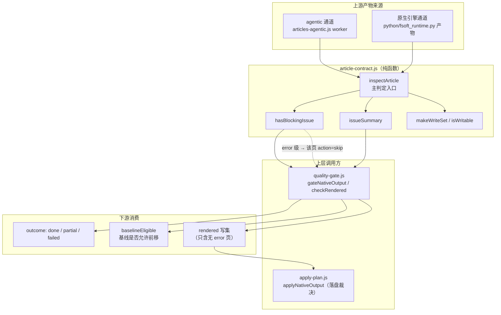
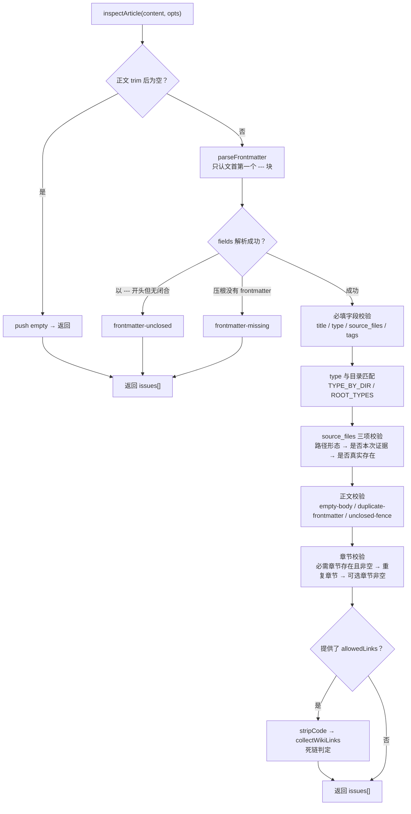
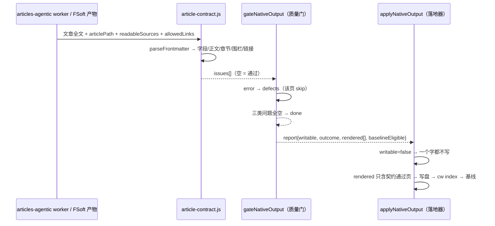

# 文章契约校验（article_validation）

## 概述

`article_validation` 是 [Code_Engine_Processing_Pipeline](code-engine-processing-pipeline.md) 中负责**单篇 wiki 文章结构合规判定**的纯函数模块，源码位于 `lib/article-contract.js`。它回答一个问题：「一篇由模型生成的文章，落盘进 wiki 之前，结构上够不够格？」

该模块是对旧版闸门 `validateArticleEnvelope`（曾只检查 frontmatter 「有没有开头、有没有闭合」）的审计级重写。旧闸门放过了一批坏文章入库——正文里重复贴一份 frontmatter、必需章节只有标题没有正文、`source_files` 指向不存在的文件或目录、正文里的 `[[链接]]` 指向已删除的文章、代码围栏没闭合把整篇后面的内容都吞进代码块。本模块把这些判据统一收敛到一处，并且**不碰文件系统**，因此每一条都可单测；真正的「落盘闸门」由上层（引擎质量门 `quality-gate.js`、agentic 通道的 worker）调用它来执行。

模块对外暴露的核心能力：

| 类别 | 导出 | 作用 |
| --- | --- | --- |
| 常量 | `ARTICLE_CONTRACT_VERSION`、`TYPE_BY_DIR`、`ROOT_TYPES`、`REQUIRED_SECTIONS`、`REQUIRED_FIELDS`、`SEVERITY` | 目录→类型映射、各类型必需章节表、问题词表及其严重级 |
| 解析 | `parseFrontmatter`、`parseYamlLite`、`extractSections`、`fencesBalanced`、`collectWikiLinks`、`hasDuplicateFrontmatter`、`stripCode` | 把文章文本拆成 frontmatter 字段 / 正文章节 / 围栏状态 / 链接目标；`stripCode` 把围栏块与行内代码抹成等长空白，供链接收集与改写避开代码区域 |
| 主判定 | `inspectArticle` | 输入文章全文 + 上下文选项，返回 `issues[]`（空数组 = 通过） |
| 消费包装 | `hasBlockingIssue`、`issueSummary` | issues 是否含 error 级阻塞；压成一行人类可读文案 |
| 写集安全 | `makeWriteSet`、`normalizeWritePath`、`isWritable` | 把允许写入的路径规范化为 POSIX 写集并判定越界 |

## 设计背景与问题分级

`SEVERITY` 表不是措辞差异，而是**闸门行为的分界**：

- **error（硬拒写）**——结构已破坏，落盘即污染 wiki：重复 frontmatter / 重复正文、围栏未闭合、`source_files` 不存在或不是本次证据、死链、缺必填字段、正文为空、必需章节空着。上层拿到 `hasBlockingIssue(issues) === true` 时必须拒写该页。
- **warning（放行但记账）**——内容不达标但结构完整：缺必需章节（`missing-section`）、非必需章节空着（`empty-section-optional`）。不拒写（旧 agentic 通道整包装填的文章天然是「一段正文」，硬拒会把存量全判死），但本轮编译终态会被降为 `partial` 并**阻止基线前移**——「装绿」是不允许的。

`missing-section` 与 `empty-section` 必须分开：「压根没写这一章」与「写了标题却空着」是两种缺陷，前者旧通道常见（warning），后者是明确的坏文章（error）。

## 架构定位与依赖关系



与周边模块的关系：

- [quality_gates](quality-gates.md)：原生引擎通道的**真正落盘闸门**。`gateNativeOutput` 逐篇渲染后调用渲染层封装的契约检查（`checkRendered`，其底层判据与本模块同源），把 error 级 issue 分流为 `defects`（该页 `action: 'skip'`，不进 `rendered`），warning 级分流为 `degradations`（记账但放行），最终合成 `outcome` 与 `baselineEligible`。
- [plan_application](plan-application.md)：落地器。它不重复契约判定，只认 gate 的结论——`report.writable === false` 时一个字都不写；`rendered` 数组里已经是契约过滤后的安全写集。
- [article_generation_worker](article-generation-worker.md)：agentic 写作池。worker 拿到模型输出后，写集越界判定走 `isWritable`；越界（`writeSetViolation`）时该任务记 ok=false、本次不落盘。
- [engine_contracts](engine-contracts.md)：引擎结果的外层词表校验（`validateEngineResult`）。本模块产出的是**页面级** defects/degradations，外层契约管的是这些结果在 job 终态 JSON 里的合法形态（`done` 不许带 blockers、`partial` 必须带 blockers 等）。
- [engine_output_processing](engine-output-processing.md)：`bodyLength` 等正文计量工具，与本模块的 `fencesBalanced`、正文非空判定在「正文是否为空」这条线上互相印证（gate 对入口页同时用 `bodyLength` 和本模块契约）。

## 主判定流程：inspectArticle



各校验环节的关键语义：

1. **frontmatter 解析**：`parseFrontmatter` 只认文首第一个 `---` 块（先剥 BOM）；配套的 `parseYamlLite` 是「极简 YAML」——不引依赖，只支持本仓库文章用到的 `key: value`、`key:` 后跟 `- item` 列表、`[a, b]` 内联数组三种形态。标量去引号时优先 `JSON.parse`（YAML 1.2 是 JSON 超集，能正确还原 `"C:\\src\\a.py"` 这类转义），失败再回退「切引号」（存量文章可能有 YAML 专有转义 `\e`，JSON 不认，不能因此判坏）；单引号标量里 `''` 还原为 `'`。
2. **必填字段**：`title` / `type` / `source_files` 缺一即 `missing-field`（error）；`tags` 也是必填字段但允许空列表（没有标签也要写成 `tags: []`）。`source_files` 的空列表是默认拒的——文章没有代码依据必须拒；只有调用方显式传 `allowEmptySourceFiles: true` 才放行（原生 whole-repository 模式是唯一例外：该模式下 `module_tree.json` 就是 `{}`，空 `source_files` 是诚实记录）。
3. **type 与目录匹配**：由 `articlePath` 推断（`modules/` → `module`、`concepts/` → `concept`、…，根目录 `_architecture.md` / `_index.md` / `_patterns.md` 有专表），与 frontmatter 的 `type` 不符即 `type-mismatch`——type 与目录错位会让 `cw index` 的分类错乱。调用方可用 `expectedType` 覆盖目录推断。
4. **source_files 三重校验**：① `isRepoRelativeFile` 查形态（拒绝绝对路径、盘符、`../` 越界、以 `/` 结尾的目录形态、无扩展名条目）；② 若提供了 `readableSources`，列表里不在本次实际读取证据中的条目报 `source-not-evidence`（防止模型编造引用）；③ 若注入了 `fsImpl.exists`，再判文件在仓库里是否真实存在。
5. **正文**：frontmatter 之后没有正文 → `empty-body`；`hasDuplicateFrontmatter` 扫正文里 40 行窗口内的第二个 `---` 块且中间含 `title/type/source_files:` 字段 → `duplicate-frontmatter`（重复贴头的特征）；`fencesBalanced` 数 ```/~~~ 标记总数为奇数 → `unclosed-fence`。
6. **章节**：`extractSections` 按 `## 标题` 切（围栏内的 `##` 不当章节），同一标题出现两次 → `duplicate-section`；必需章节（按 `wantType` 查 `REQUIRED_SECTIONS` 表，module/architecture 要求 `Overview` + `Key Components`，其余类型只要 `Overview`，`index` 不要求章节）缺章 → `missing-section`（warning），有标题但内容空 → `empty-section`（error）；出现的章节若不在必需表里但内容空 → `empty-section-optional`（warning）。原生引擎通道的章节名是上游 prompt 自己定的（`## Introduction and Purpose` 之类），所以调用方可用 `requiredSections` 覆盖默认表（传 `[]` 表示只查结构完整不查章节名）。
7. **死链**：`collectWikiLinks` **先用 `stripCode` 剥掉代码区域**再收集链接——文章里写 `[[target]]`、`](xxx.md)` 往往是在**讲链接语法**，它们是字面量而不是引用；不跳过就会得到「文档在解释契约、却被契约判违规」的荒谬结论（真机 `article_validation` / `plan_application` / `codewiki_vendor_binary` 三篇都这样被误判成 `dead-link` 拒写）。剥完代码后才同时收集 `[[target]]`/`[[target|text]]`/`[[target#anchor]]` 与 Markdown 链接 `](xxx.md)`（跳过 `http:` 类外链）；对每个候选目标尝试四种解析（原样、加 `.md`、相对文章所在目录拼接、拼接 + `.md`），全部不在 `allowedLinks` 集合中 → `dead-link`（error）。配套的 `stripCode` 把围栏块整行、以及行内成对的 `` `...` `` 替换成**等长**空白——等长是硬契约：[quality_gates](quality-gates.md) 的 `rewritePageLinks` 用它的匹配偏移回原文做替换，长度一变就会错位。

## 数据流：从文章文本到落盘裁决



关键不变量（与落地器侧对应）：

- `hasBlockingIssue(issues) === true` 的页**绝不进** `rendered`——落地器拿到的写集已经是契约过滤后的安全集，它自己不重复判定。
- `baselineEligible`（即 `canAdvanceBaseline`）只有一种来源：本轮 defects + degradations + 基线未入库三类**全空**（`outcome=done`）。warning 级契约问题（degradation）照写文章，但阻止基线前移，因此下一轮编译会重新消化这些变化。
- `issueSummary(issues)` 只取第一条 detail 压成一行（`文章契约未通过：…（共 N 项）`），用于 job 日志与面板展示；`null` 表示通过。

## 写集安全：isWritable

模型 agentic 写作时允许用 edit 工具改文件，但写什么、不许写什么必须有硬边界。`makeWriteSet(paths)` 把允许写入的路径列表规范化为 POSIX 写集（`normalizeWritePath`：反斜杠转正斜杠、剥空白、`path.posix.normalize`）；`isWritable(target, writeSet, { cwd })` 判定写入目标是否在集内——先按规范化相对路径比对，再以 `cwd` 为基准双向解析绝对路径比对，防止 `../` 越界写到别的仓库。写集为 `null` 表示调用方没设限（不检查）。worker 侧一旦发现越界写入，该任务记 `writeSetViolation`、本次不落盘。

## 扩展与维护指引

- **新增问题类别**：必须先在 `SEVERITY` 表里登记严重级，否则 `inspectArticle` 默认按 error 处理；上层 quality-gate 的 `DEFECT_SET` / `DEGRADATION_SET` 也要同步登记，未登记的产物问题在 gate 里会被兜底当成 defect 报出（逼维护者补映射，不许静默吞掉）。
- **新增文章类型**：在 `TYPE_BY_DIR`（目录）或 `ROOT_TYPES`（根目录特殊页）登记位置映射，在 `REQUIRED_SECTIONS` 登记该类型的必需章节——只列真正不能空的章节，避免对 learning/pattern 类过度要求。
- **新增通道的章节约定**：不要改默认 `REQUIRED_SECTIONS` 表，而是在调用方传 `requiredSections` 覆盖——默认表保护既有 agentic 通道的行为一字不变。
- **新增「扫正文语义」的判据**：先过 `stripCode` 再匹配——围栏块与行内代码里的 `[[链接]]`、`--- / title:` 是**示例字面量**，不是文档自己的内容，不剥就会把「正在解释契约的文章」判成违规（`collectWikiLinks` 的死链判定已遵循此规则）。`stripCode` 的等长占位是硬契约，任何依赖匹配偏移回原文替换的调用方（如 quality-gate 的 `rewritePageLinks`）都靠它。
- **测试**：本模块是纯函数（不碰文件系统；文件存在性走可注入的 `fsImpl.exists`），所有判据应直接单测，不依赖真实仓库或 cw 二进制。
