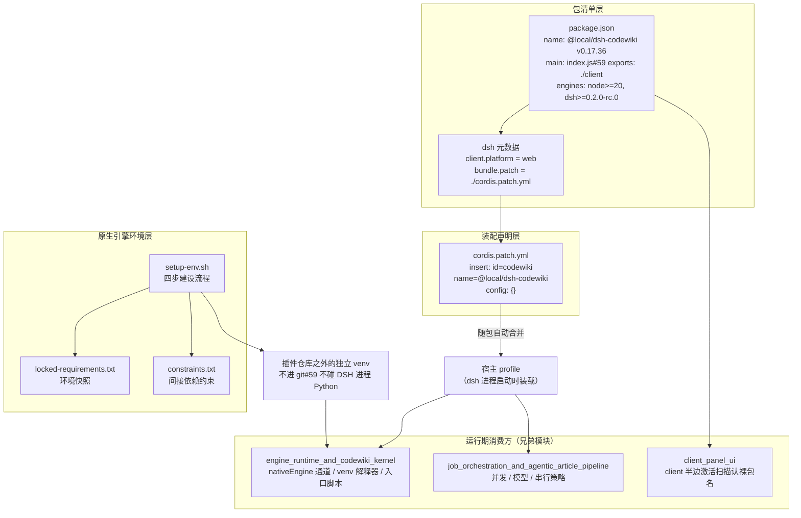
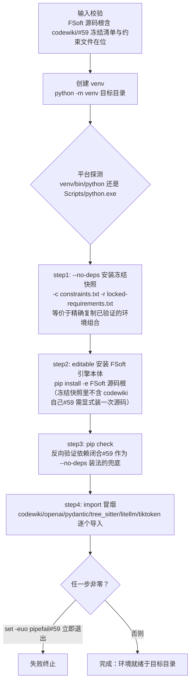
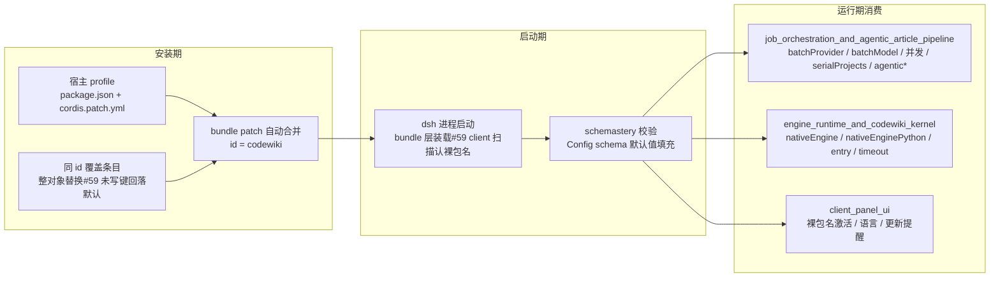

# 构建与配置装配（build_and_configuration）

本模块是 `@local/dsh-codewiki` 插件的**构建、打包与配置装配层**，负责回答三个问题：插件以什么形态被 DSH 宿主加载（`package.json` + `cordis.patch.yml`）、运行期有哪些可调配置（`codewiki` config 命名空间）、原生 Python 引擎的可信运行环境如何从零搭建（`tools/fsoft-engine/setup-env.sh` 及配套冻结清单）。本模块不包含业务逻辑——所有编译、编排、UI 行为都在兄弟模块中实现，本模块只提供它们的“出厂设定”和“环境地基”。

## 模块组成

| 文件 | 角色 |
| --- | --- |
| `package.json` | npm/DSH 包清单：包名、版本、ESM 入口、导出面、engines 约束、`dsh` 元数据（client 平台、bundle patch 指向） |
| `cordis.patch.yml` | 随包自动合并到宿主 profile 的 bundle patch：安装方式说明、`codewiki` 配置命名空间的完整设置项文档 |
| `tools/fsoft-engine/setup-env.sh` | 阶段 1A 环境建设脚本：在插件仓库之外独立目录里建造闭合的 FSoft 原生引擎 venv |
| `tools/fsoft-engine/locked-requirements.txt` | 已解析完成的依赖环境快照（~160 个精确钉死版本），作为 `--no-deps` 落盘的依据 |
| `tools/fsoft-engine/constraints.txt` | 约束文件，冻结间接依赖、防止 pip 升级跑偏 |

## 整体架构：构建与配置分层



## 包清单 `package.json` 详解

`package.json` 是插件被宿主识别的入口契约，关键字段：

- **身份**：`"name": "@local/dsh-codewiki"`，`"version": "0.17.36"`，`"private": true`（本地 link 包，不发布）。
- **模块形态**：`"type": "module"`（纯 ESM），`"main": "index.js"`，`"exports"` 暴露两个面：`.` → `index.js`（插件主半边），`./client` → `client.js`（侧边栏面板半边，见 [client_panel_ui](client-panel-ui.md)）。
- **引擎约束**：`engines.node >= 20`、`engines.dsh >= 0.2.0-rc.0`——宿主版本不够时直接拒绝装载。
- **运行时依赖**：仅 `@deepseek-ai/schemastery`（配置 schema 校验），其余全部是宿主自带能力，刻意保持零重依赖。
- **`dsh` 元数据**：`client.platform: web` 声明 UI 半边跑在 web 端；`bundle.patch: ./cordis.patch.yml` 声明本包携带随包自动合并的 patch 文件——这是“装法 A（bundle 依赖）”能省去手工 profile 条目的关键。

`description` 字段本身就是一份版本演进备忘：0.16.0 起默认通道切换为原生 Python 引擎（`nativeEngine: true`），插件内 Node 兼容通道降级为最小兜底（仅顶层目录分组 + 文件级 source_files 归属）；Node 侧重写的 FSoft 算法（symbols/cluster/graph-diff/incremental/update-planner）已在 0.16.0 阶段 7 删除；0.17.34 起**取消编译默认模型**——provider/model 必须在插件设置里显式选定，未选就提交的任务以明确报错失败，而不是悄悄跑在某个被猜的模型上；大档模型（超长输入 tier）同样自 0.17.34 起默认关闭。

## 插件装配：`cordis.patch.yml`

该文件随包自动合并到宿主 profile，**无需手工往 profile 追加 codewiki 条目**。文件头注释给出了两种安装方式：

### 装法 A：bundle 依赖（标准本地插件形态，推荐）

1. profile 的 `package.json`：`dependencies += "@local/dsh-codewiki": "link:<本仓库绝对路径>"`，`dsh.profile.bundles += "@local/dsh-codewiki"`；
2. 在 profile 目录跑一次 `pnpm install` 建立 node_modules 里的 link，然后重启 dsh（bundle 层只在进程启动时装载）。

此装法下 `name` 必须是**裸 npm 包名**（不带 `/dsh` 子路径）——因为 [client_panel_ui](client-panel-ui.md) 的 client 半边激活扫描只认裸包名行。

### 装法 B：`file:///` 直挂（本地调试插件源码用）

不装依赖，直接在 profile 的 `cordis.patch.yml` 手写：

```yaml
- insert:
    - id: codewiki
      name: "file:///<本仓库绝对路径>/index.js"   # URL 中空格写 %20
      config: {}
```

两种装法保持 `id: codewiki` 一致。

### 配置覆盖规则

想改默认值时，在 **profile 自己的** `cordis.patch.yml` 里写同 `id` 的覆盖条目：

- 同 id 覆盖是**整对象替换**；未写的键回落到插件 `index.js` 中 Config schema 的默认值；
- 本文件内置的 `config: {}` 不重复声明默认值（留空即用插件默认）。

### `codewiki` config 命名空间设置项

| 设置项 | 默认 | 含义 |
| --- | --- | --- |
| `binaryPath` | 空 | `cw` 可执行文件路径；留空优先用 PATH 里的 `cw`，找不到再用插件自带 `bin/cw.exe` |
| `batchProvider` | 空 | 编译模型提供商（必须是模型设置里已注册的 provider；0.17.34 起无默认，留空 = 提交任务时显式报错失败） |
| `batchModel` | 空 | 编译模型 id（0.17.34 起无默认；须与 `batchProvider` 一起在插件设置里选定） |
| `batchReasoningEffort` | 模型默认档 | 思考程度档位（取值来自模型目录 `reasoning.efforts`） |
| `bigEnabled` | 关（0.17.34 起默认关） | 大档模型（超长输入）开关：关闭后超过普通预算的请求不换大上下文模型，按大档预算兜底或退回会话通道；模型与预算配置保留，重开无需重填 |
| `bigProvider` | 空 | 大档模型提供商（单批输入超过大档阈值时改用的模型，通常是长上下文更便宜的档）；`bigEnabled` 关闭时不生效 |
| `bigModel` | 空 | 大档模型 id（该 provider 下） |
| `bigReasoningEffort` | 模型默认档 | 大档模型思考程度档位（取值来自模型目录 `reasoning.efforts`）；留空 = 模型默认档 |
| `bigTokenBudget` | `420000` | 大档单请求输入预算（token）：输入超普通预算的请求改用大档；生效值为 `max(普通预算, 此值)`。由 `bigTierOf(cfg)` 一次性解析——provider/model 任一留空即返回 `null`（大档不可用） |
| `maxConcurrency` | `2` | 默认档并发上限（1–8） |
| `bigConcurrency` | `0`（跟随默认档） | 大档并发上限（1–8）；两档独立限流、同时推进 |
| `serialProjects` | 开 | 同一时刻只推进一个仓库的编译任务，其余排队 |
| `articleLanguage` | 中文 | 文章语言 |
| `planMode` | `auto` | 模块划分：`auto` = AST 符号 + LLM 语义聚类；`dirs` = 顶层目录分组（旧行为） |
| `agenticArticles` | 开 | 文章写作走 agentic 工具循环（模型自己 `read_code`/`edit_article`，不整包内联） |
| `agenticMaxSteps` | `30` | agentic 单篇步数上限（1–100） |
| `symbolIncremental` | 开 | 增量按 AST 符号级判定：只重写接口真变了的模块，注释/空白改动跳过 |
| `updateReminder` | 开 | 会话系统提示注入 wiki 维护提醒（仅当会话仓库存在 `.codewiki/`） |
| `autoCommit` | 开 | 编译完成后自动提交 wiki 产物 |
| `nativeEngine` | `true` | 0.15.0 引入、0.16.0 起默认：编译交给上游 FSoft Python 引擎；`false` = 内置 Node 兼容通道 |
| `nativeEnginePython` | 空 → 环境变量 `DSH_CODEWIKI_PYTHON` → `python` | venv 解释器绝对路径；**不做“找一个能用的解释器”的启发式**（猜错会把环境不闭合伪装成引擎坏了） |
| `nativeEngineEntry` | `lib/engine/python/entry.py` | 入口脚本路径，一般不用改 |
| `nativeEngineTimeoutMs` | `2700000`（45 分钟） | 单次引擎调用上限 |

两条通道**并存、互不回退**：原生通道环境不闭合时以 `engine-deps` 明确失败，不会悄悄改用 Node 通道。通道的实际消费方见 [engine_runtime_and_codewiki_kernel](engine-runtime-and-codewiki-kernel.md)，其中 [engine_python_runtime](engine-python-runtime.md) 直接受 `nativeEnginePython` / `nativeEngineEntry` / `nativeEngineTimeoutMs` 三项驱动。

## 原生引擎环境建设：`setup-env.sh`

`tools/fsoft-engine/setup-env.sh` 是“阶段 1A”的环境建设脚本，用于在**独立目录**里造一个可信的 FSoft 原生引擎运行环境。

### 为什么不能用正常 `pip install -r freeze.txt`

FSoft 的依赖树里 `openai` / `pydantic-ai-slim` / `pydantic` 的版本约束互相打架，走正常解析必然 `ResolutionImpossible`（实测报错：`pydantic-ai-slim==2.61.0` 与其 extra 集合 `pydantic-ai-slim[anthropic,cli,evals,google,logfire,mcp,openai,web]==2.61.0` 冲突）。因此冻结清单本身被视为一个**已解析完成的完整环境快照**，脚本不重解析、直接按快照落盘。

### 用法

```bash
bash tools/fsoft-engine/setup-env.sh <目标目录> <FSoft 源码根> [python 可执行文件]
# 例：bash tools/fsoft-engine/setup-env.sh ../.probe-fsoft/venv ../.probe-fsoft/src
```

前置校验：`<FSoft 源码根>` 下必须存在 `codewiki/` 包目录；同目录下必须存在 `locked-requirements.txt` 与 `constraints.txt`，缺一即退出。

### 四步建设流程



### 关键设计决策

- **不找解释器启发式**：脚本只接受显式传入的 python，猜错环境会把“环境不闭合”伪装成“引擎坏了”。
- **venv 不进 git、不碰 DSH 进程的 Python**：环境永远建在插件仓库**之外**（示例目标 `../.probe-fsoft/venv`），宿主进程与引擎子进程的依赖树完全隔离。
- **约束文件兜底**：`-c constraints.txt` 防止清单里未钉死的间接依赖被 pip 升级跑偏。
- **editable 安装的原因**：`pip freeze` 快照里不会出现 `codewiki` 本体（它以 editable 形式存在于快照中），所以 step2 必须显式再装一次源码。

## 配置流向：从装配到消费



## 与其他模块的关系

- **[engine_runtime_and_codewiki_kernel](engine-runtime-and-codewiki-kernel.md)**：本模块 `nativeEngine*` 系列设置项的直接消费方。[engine_python_runtime](engine-python-runtime.md) 由 `setup-env.sh` 建造的 venv 驱动；通道选择（原生 vs Node 兼容）在此模块落地为 `runEngine` 等具体实现。
- **[job_orchestration_and_agentic_article_pipeline](job-orchestration-and-agentic-article-pipeline.md)**：`batchProvider` / `batchModel` / `maxConcurrency` / `bigConcurrency` / `serialProjects` / `agenticMaxSteps` 等编译调度参数的消费方。
- **[client_panel_ui](client-panel-ui.md)**：装法 A 要求裸包名的原因——client 半边激活扫描只认 `@local/dsh-codewiki` 这种裸 npm 包名行。
- **[test_fixtures_and_probes](test-fixtures-and-probes.md)**：与本模块同级的兄弟模块，承担测试夹具（含带中文与空格路径的 fixture）与无 LLM 探针脚本；`setup-env.sh` 建成的环境常被探针脚本复用验证。

## 验证清单

改动本模块后建议的自检路径：

1. `engines.dsh` 与 `engines.node` 满足宿主约束；
2. `cordis.patch.yml` 中 bundle 装法下的 `name` 保持裸包名；
3. 同 id 覆盖条目是整对象替换——若只想改一个键，确认 profile 条目里已写全不想回落默认的字段；
4. 在目标机器跑一次 `bash tools/fsoft-engine/setup-env.sh ../.probe-fsoft/venv ../.probe-fsoft/src`，观察四步输出全部为 `ok` 且退出码为 0；
5. 确认 venv 建在仓库之外、未被 git 跟踪。
