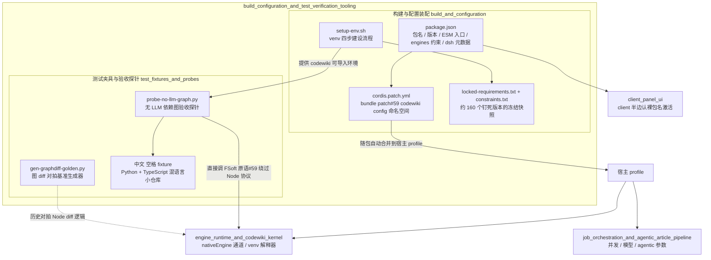

# 构建配置与测试验证工具（build_configuration_and_test_verification_tooling）

## 模块目的

本模块是 `@local/dsh-codewiki` 插件的**出厂设定、环境地基与验收工具层**。它不包含任何业务逻辑——编译、编排、UI 行为都在兄弟模块中实现；本模块只回答四个问题：

1. 插件以什么形态被 DSH 宿主加载（`package.json` + `cordis.patch.yml`）；
2. 运行期有哪些可调配置（`codewiki` config 命名空间）；
3. 原生 Python 引擎的可信运行环境如何从零搭建（`setup-env.sh` 及配套冻结清单）；
4. 迁移期如何对算法移植逐位对拍、并在最难复现的非 ASCII 路径上验收原生引擎通道（测试夹具与探针）。

## 架构概览

## 核心组件

### 构建与配置装配：[build_and_configuration](build-and-configuration.md)

- **包清单层**：`package.json` 声明身份（`@local/dsh-codewiki` v0.17.38，纯 ESM）、导出面（`.` 主半边 / `./client` 面板半边）、引擎约束（`node>=20`、`dsh>=0.2.0-rc.0`）与 `dsh` 元数据（`bundle.patch` 指向 `cordis.patch.yml`）。
- **装配声明层**：`cordis.patch.yml` 随包自动合并到宿主 profile，内置整个 `codewiki` 配置命名空间（`batchProvider` / `batchModel` / `maxConcurrency` / `nativeEngine` / `nativeEnginePython` 等设置项），并给出 bundle 依赖与 `file:///` 直挂两种装法，以及同 id 整对象替换的配置覆盖规则。
- **原生引擎环境层**：`tools/fsoft-engine/setup-env.sh` 在插件仓库之外的独立目录建造闭合 venv——`--no-deps` 按冻结快照落盘、editable 安装 FSoft 本体、`pip check` 反向验证、import 冒烟，四步全部通过才算环境就绪。

### 测试夹具与验收探针：[test_fixtures_and_probes](test-fixtures-and-probes.md)

- **图 diff 对拍基准生成器** `gen-graphdiff-golden.py`：用纯 Python `difflib`（显式关闭 `autojunk`）复现上游相似度 / 哈希 / unified diff 语义，固定随机种子产出确定性 JSON 期望集，供 Node 侧移植代码逐位比对。
- **无 LLM 依赖图验收探针** `probe-no-llm-graph.py`：在不碰任何模型与凭证的前提下，用五条判据（R1–R5）验证 `handle_analyze_repo` 在中文 + 空格路径上能正确出节点、出依赖边、出工作区产物、识别 artifact 脚本入口。
- **被测小仓库「中文 空格 fixture」**：刻意最小的多语言（Python + TypeScript）仓库，把非 ASCII、空格、跨语言依赖、artifact 入口全压在一个目录里——ASCII 路径永远复现不出 Windows cp936 解码错乱、tree-sitter 路径归一化等真实缺陷。

## 与其他模块的关系

- **[engine_runtime_and_codewiki_kernel](engine-runtime-and-codewiki-kernel.md)**：`nativeEngine*` 系列设置项的直接消费方；`setup-env.sh` 建成的 venv 驱动其 Python 运行时；探针刻意绕过 Node 适配层、直接在 Python 进程内调 FSoft 原语，从而把「环境 / 图 / artifact」故障与「跨语言协议」故障分离定位。
- **[job_orchestration_and_agentic_article_pipeline](job-orchestration-and-agentic-article-pipeline.md)**：`batchProvider` / `batchModel` / `maxConcurrency` / `serialProjects` / `agenticMaxSteps` 等编译调度参数的消费方。
- **[client_panel_ui](client-panel-ui.md)**：bundle 装法要求裸 npm 包名的原因——client 半边激活扫描只认 `@local/dsh-codewiki` 这种裸包名行。