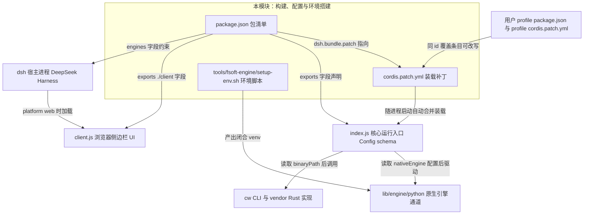
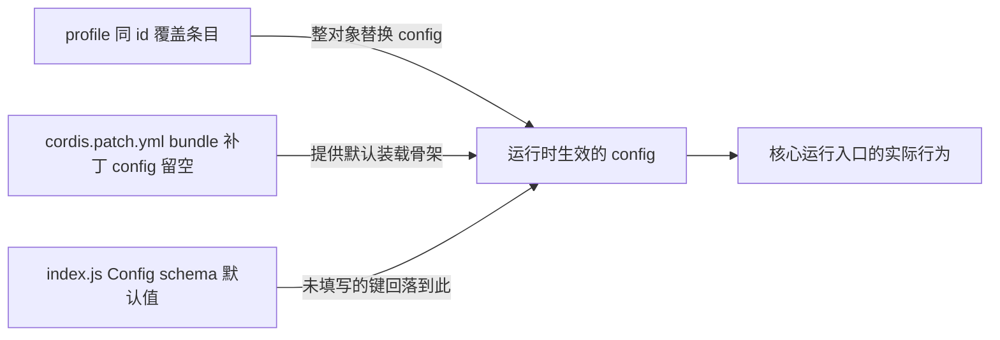
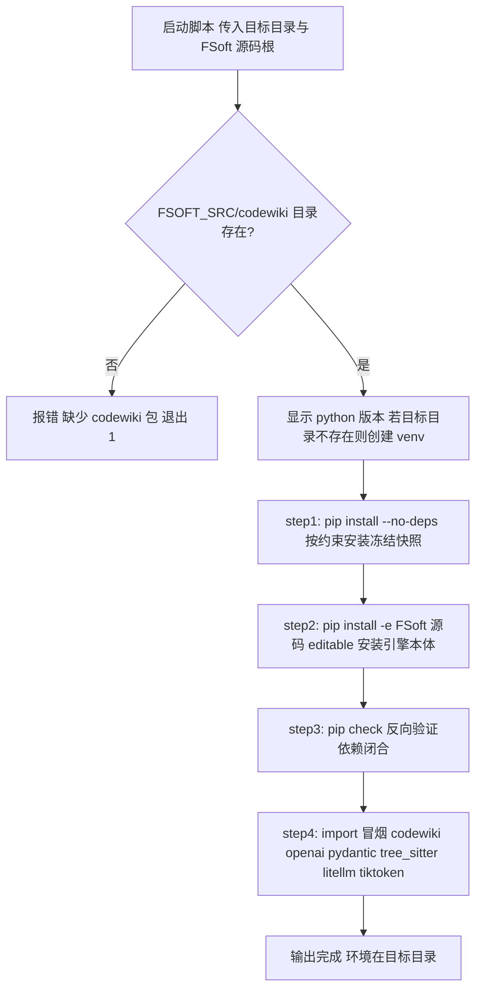
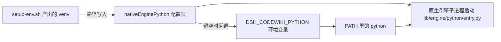

# 构建、配置与环境搭建（Build,_Configuration___Environment_Setup）

## 简介

本模块是 `@local/dsh-codewiki` 插件的**打包清单、装载配置与运行环境基础设施**。它不直接参与编译流水线，而是定义插件「如何被 dsh 宿主装载」「有哪些可调配置」以及「原生引擎通道的 Python 环境如何可信地搭建」。

包含三个核心工件：

| 工件 | 路径 | 职责 |
| --- | --- | --- |
| npm 包清单 | `package.json` | 包名、版本、导出入口、引擎要求（Node / dsh）、dsh bundle 元数据 |
| 装载补丁 | `cordis.patch.yml` | 声明插件如何以 bundle 形态被 dsh/cordis 自动合并装载，及配置命名空间说明 |
| 环境脚本 | `tools/fsoft-engine/setup-env.sh` | 在插件仓库之外为 FSoft 原生引擎构建一个依赖闭合的 Python venv |

与运行时的关系一句话概括：`package.json` 的 `dsh.bundle.patch` 指向 `cordis.patch.yml` → 后者把插件入口 `index.js` 注册进宿主 → 运行时行为则由 `index.js` 的 Config schema 与本模块描述的配置项共同决定；而要启用 0.16.0 起的默认**原生引擎通道**，必须先用 `setup-env.sh` 备好 Python 3.10+ venv。

---

## 模块在系统中的位置



---

## 一、`package.json`：npm 包清单与 dsh bundle 元数据

文件：[`package.json`](../repo/package.json)

### 基础身份

| 字段 | 值 | 说明 |
| --- | --- | --- |
| `name` | `@local/dsh-codewiki` | 本地插件包名（私有发布） |
| `version` | `0.17.51` | 当前版本 |
| `private` | `true` | 不发布到 npm registry |
| `type` | `module` | ESM 模块 |
| `main` / `exports` | `./index.js` 与 `./client.js` | 双入口：`index.js` 为宿主侧，`client.js` 为浏览器侧 |
| `engines.node` | `>=24.9.0` | Node.js 版本要求 |
| `engines.dsh` | `>=0.2.0-rc.0` | 宿主 dsh 平台版本要求 |
| `dependencies` | `@deepseek-ai/schemastery ^3.18.4` | 唯一运行时依赖：Config schema 校验库 |

### `dsh` 命名空间（dsh 平台专用元数据）

```json
"dsh": {
  "client": { "platform": "web" },
  "bundle": { "patch": "./cordis.patch.yml" }
}
```

- `client.platform: "web"`：告知 dsh 宿主在 Web 端加载 `exports["./client"]` 指向的浏览器 UI（即 [Browser_UI_Client](browser-ui-client.md) 模块）。
- `bundle.patch: "./cordis.patch.yml"`：声明本仓库自带 bundle 补丁文件，宿主装载本 bundle 时**自动合并**到 profile，用户无需手工往自己的 `cordis.patch.yml` 追加 codewiki 条目。

### 版本语义（description 字段提炼的重要承诺）

- **0.16.0 起默认原生引擎通道**：`nativeEngine: true`，以子进程驱动上游 FSoft-AI4Code/CodeWiki Python 引擎；插件内置 Node 流水线降级为最小兼容通道（`nativeEngine: false`），不再接收新能力。Node 侧对 FSoft 算法的重写（symbols/cluster/graph-diff/incremental/update-planner）已于 0.16.0 phase 7 删除。
- **0.17.34 起无默认编译模型**：provider/model 必须由用户在插件设置页选定；未选定就提交任务会显式报错，而不是静默跑在猜测的模型上。
- **大输入档位默认关闭**；零子代理、单项目串行。

---

## 二、`cordis.patch.yml`：bundle 装载补丁与配置命名空间

文件：[`cordis.patch.yml`](../repo/cordis.patch.yml)

该文件随包自动合并到 profile，核心内容是一条 `insert` 条目：插件 id 固定为 **`codewiki`**，`name` 为裸 npm 包名 `@local/dsh-codewiki`，`config: {}`（默认值不在补丁里重复声明，留空即回落 `index.js` 的 Config schema 默认值）。

### 安装方式（二选一，推荐 A）

| 维度 | A. bundle 依赖（标准本地插件形态，推荐） | B. file:/// 直挂（本地调试） |
| --- | --- | --- |
| 修改位置 | profile `package.json`：`dependencies += "@local/dsh-codewiki": "link:<本仓库绝对路径>"`，且 `dsh.profile.bundles += "@local/dsh-codewiki"` | profile 自己的 `cordis.patch.yml` 里手写 `insert` 条目 |
| `name` 写法 | 裸 npm 包名 `@local/dsh-codewiki`（不带 `/dsh` 子路径） | `file:///<本仓库绝对路径>/index.js`，URL 中空格写 `%20` |
| 生效动作 | 在 profile 目录跑一次 `pnpm install` 建立 link，然后**重启 dsh** | 重启 dsh |
| 适用场景 | 日常使用 | 改插件源码时的本地调试 |
| 共同点 | 两种装法保持插件 id 一致：`codewiki` | |

注意：**bundle 层只在进程启动时装载**；client 半边的激活扫描只认裸包名行（装法 B 下浏览器半边不会被激活扫描识别）。

### 配置覆盖机制

要改配置，在 profile 自己的 `cordis.patch.yml` 里写**同 id 覆盖条目**：

```yaml
- id: codewiki
  config: { batchModel: doubao-seed-2.1-lite }
```

- 同 id 覆盖是**整对象替换**，未写的键回落到 `index.js` 的 Config 默认值。



### 配置命名空间（`codewiki`）总览

权威默认值以 [Core_Application_Runtime_Entry](core-application-runtime-entry.md) 中 `index.js` 的 Config schema 为准（补丁文件注释与 schema 个别处存在版本漂移，以 schema 为最终判据）：

| 配置项 | 作用 | 默认 / 留空行为 | 归属通道 |
| --- | --- | --- | --- |
| `binaryPath` | `cw` 可执行文件路径 | 留空 = 优先 PATH 里的 `cw`，再找不到用插件自带 `bin/cw.exe` | cw CLI（见 [Vendored_CodeWiki_Rust_Implementation](vendored-codewiki-rust-implementation.md)） |
| `batchProvider` | 编译模型提供商（必须是模型设置里已注册的 provider） | 留空 = 提交任务时显式报错（0.17.34 起无默认） | 全部通道 |
| `batchModel` | 编译模型 id（该 provider 下） | 留空 = 同上，显式失败 | 全部通道 |
| `batchReasoningEffort` | 思考程度档位（取值来自模型目录） | 留空 = 模型默认档 | 全部通道 |
| `maxConcurrency` | 默认档并发上限（1–8） | 默认 2 | 全部通道 |
| `bigConcurrency` | 大档并发上限（1–8） | 0 = 跟随默认档；与默认档独立限流、同时推进 | Node 兼容通道 |
| `serialProjects` | 单项目串行 | 默认开：同一时刻只推进一个仓库的编译，其余排队 | 全部通道 |
| `articleLanguage` | 文章书写语言 | 默认中文 | 全部通道 |
| `nativeEngine` | 编译通道选择 | `true`（0.16.0 起默认）= FSoft Python 引擎；`false` = 内置 Node 兼容通道 | 通道开关 |
| `nativeEnginePython` | venv 解释器绝对路径 | 留空 → 环境变量 `DSH_CODEWIKI_PYTHON` → `python` | 原生通道 |
| `nativeEngineEntry` | 引擎入口脚本路径 | 留空 = 插件自带 `lib/engine/python/entry.py` | 原生通道 |
| `nativeEngineTimeoutMs` | 单次引擎调用上限 | 0 = 引擎内置默认超时（约 180 分钟）；超时由进程树终止兜底，已写文章按 partial 抢救 | 原生通道 |

> 补丁注释中提到的 `planMode`、`agenticArticles`、`agenticMaxSteps`、`symbolIncremental` 等属于早期 Node 通道时代的开关；0.16.0 删除 Node 算法重写后，这些开关已不在当前 Config schema 中，相关能力由 [Agentic_Article_Processing_Library](agentic-article-processing-library.md) 与 [Python_Parallel_Agent_Execution_Runtime](codewiki-engine-subsystem.md) 的引擎内部逻辑接管。

### 两条通道并存、互不回退

原生通道环境不闭合时以 `engine-deps` 明确失败，**不会悄悄改用 Node 通道**——这是刻意设计，避免把「环境不闭合」伪装成「引擎坏了」。

---

## 三、`tools/fsoft-engine/setup-env.sh`：原生引擎环境搭建脚本

文件：[`tools/fsoft-engine/setup-env.sh`](../repo/tools/fsoft-engine/setup-env.sh)，配套 [`locked-requirements.txt`](../repo/tools/fsoft-engine/locked-requirements.txt)（约 163 个钉死版本的依赖快照）与 [`constraints.txt`](../repo/tools/fsoft-engine/constraints.txt)。

### 为什么需要这个脚本

FSoft 的依赖树里 `openai` / `pydantic-ai-slim` / `pydantic` 的版本约束互相打架，用 `pip install -r freeze.txt` 走**正常解析**必然 `ResolutionImpossible`（实测报错示例：`pydantic-ai-slim==2.61.0` 与 extras 元包版本冲突）。因此策略是：把冻结清单当作**已解析完成的完整环境快照**，不再重解析，直接按快照落盘。

### 设计原则

1. `--no-deps` 全量安装冻结快照 = 精确复制已验证的环境组合；
2. `pip check` 反向验证依赖闭合（`--no-deps` 装出来的环境靠这步兜底）；
3. 约束文件（`-c constraints.txt`）防止清单里未钉死的间接依赖被 pip 升级跑偏；
4. **只在插件仓库之外建环境**：venv 不进 git，也不碰 DSH 进程的 Python。

### 用法

```bash
bash tools/fsoft-engine/setup-env.sh <目标目录> <FSoft 源码根> [python 可执行文件]
# 例：
bash tools/fsoft-engine/setup-env.sh ../.probe-fsoft/venv ../.probe-fsoft/src
```

- 参数 `<FSoft 源码根>` 必须含 `codewiki/` 包目录，否则脚本报错退出。
- Python 解释器不做「找一个能用的解释器」的启发式猜测——猜错会把环境问题伪装成引擎故障（对应配置项 `nativeEnginePython` 的同一原则）。

### 执行流程



各步骤要点：

| 步骤 | 动作 | 失败后果 |
| --- | --- | --- |
| venv 探测 | 优先 `$TARGET/bin/python`，否则回退 Windows 的 `$TARGET/Scripts/python.exe` | 跨平台自动适配 |
| step1 | `pip install --no-deps -c constraints.txt -r locked-requirements.txt` | 任何非零立刻退出（`set -euo pipefail`） |
| step2 | `pip install --no-deps -e "$FSOFT_SRC"` | 冻结快照里不含 `codewiki` 自身（editable 安装），必须显式再装一次源码 |
| step3 | `pip check` | 依赖不闭合直接中断 |
| step4 | 依次 `import codewiki / openai / pydantic / tree_sitter / litellm / tiktoken` | 任一模块导入失败即环境不合格 |

### 与运行时配置的衔接



环境就绪后，[Native_CodeWiki_Runtime_Lifecycle_Management](codewiki-engine-subsystem.md) 中的 `native-run.js` 即可按 `nativeEngine*` 配置拉起 [Python_Parallel_Agent_Execution_Runtime](codewiki-engine-subsystem.md)（`entry.py` / `fsoft_runtime.py`）执行编译。

---

## 四、与其他模块的关系

| 模块 | 关系 |
| --- | --- |
| [Core_Application_Runtime_Entry](core-application-runtime-entry.md) | `index.js` 是本补丁装载的入口；Config schema 是配置默认值的权威来源 |
| [Browser_UI_Client](browser-ui-client.md) | 由 `package.json` 的 `dsh.client.platform: "web"` 与 `exports["./client"]` 声明并被加载 |
| [CodeWiki_Engine_Subsystem](codewiki-engine-subsystem.md) | `nativeEngine*` 配置驱动其 Python 原生通道；环境脚本为其提供闭合 venv |
| [Vendored_CodeWiki_Rust_Implementation](vendored-codewiki-rust-implementation.md) | `binaryPath` 配置指向的 `cw` CLI 来源；插件自带 `bin/cw.exe` 是 PATH 找不到时的兜底 |
| [Agentic_Article_Processing_Library](agentic-article-processing-library.md) | 早期由 `agenticArticles` 等开关控制，现随原生通道默认开启而常驻 |
| [Test_Fixtures___Diagnostic_Tooling](test-fixtures-diagnostic-tooling.md) | `tools/fsoft-engine/` 下的探针脚本（`probe-no-llm-graph.py` 等）复用同一套 venv 环境做无 LLM 诊断 |

---

## 五、常见问题排查

| 现象 | 排查方向 |
| --- | --- |
| 提交编译任务报「未选模型」类错误 | 0.17.34 起 `batchProvider` / `batchModel` 无默认值，需在插件设置页显式选定 |
| 改了配置不生效 | ① bundle 只在 dsh 进程启动时装载，需重启；② 同 id 覆盖是整对象替换，未写的键不会合并 |
| 原生通道报 `engine-deps` 失败 | 环境不闭合的明确信号：重跑 `setup-env.sh`，确认 `pip check` 与 import 冒烟全过；这是刻意不回退 Node 通道的设计 |
| venv 路径写错 | 脚本不做启发式探测，猜对才通：直接把 venv 的 `python` 绝对路径填进 `nativeEnginePython` 或设 `DSH_CODEWIKI_PYTHON` |
| Windows 下脚本找不到解释器 | 脚本自动回退 `Scripts/python.exe`；MSYS/Git-Bash 下盘符路径 `/e/...` 由运行入口 `normalizeCwd` 归一化为 `E:/...` |
| 把 venv 提交进了仓库 | 脚本刻意只在插件仓库之外建环境；venv 不属本仓库，不要加进 git |
