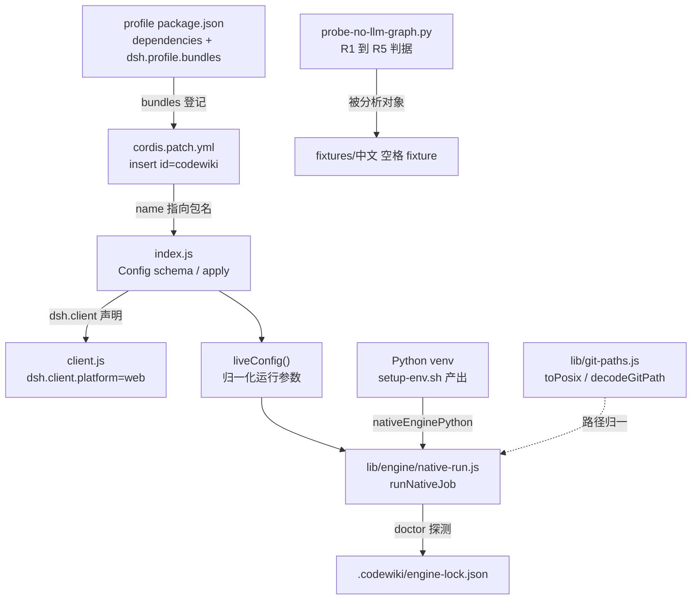
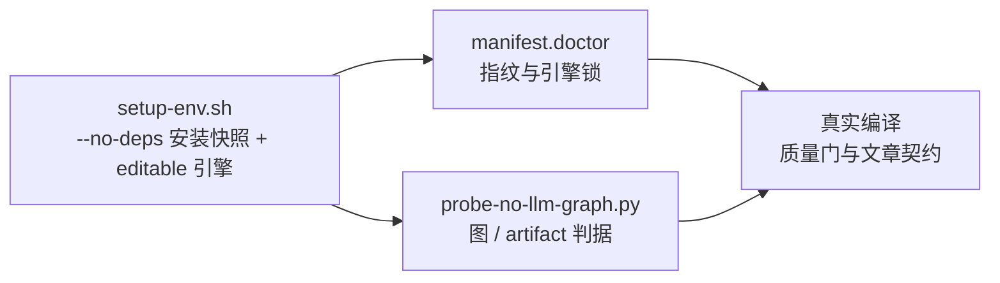

# 构建与开发基础设施（Build___Development_Infrastructure）概述

本模块是 `dsh-codewiki` 的**构建面、配置面与验收工具面**。它不参与一次编译的裁决链，也不写 `.codewiki/` 产物，而是回答三个前置问题：

1. **这个包长什么样、怎么被宿主装载** —— npm 清单与 DSH 插件声明（`package.json` 的 `dsh.client` / `dsh.bundle`）；
2. **装载后拿到哪些配置、从哪覆盖** —— bundle 补丁 `cordis.patch.yml` 与 `Config` schema 的单一事实来源约定；
3. **在真正调用模型之前，怎么确定引擎这一侧是对的** —— 原生 Python 环境的构建脚本（`setup-env.sh`）、路径语义归一工具（`lib/git-paths.js`），以及不花模型费的阶段 1A 验收探针（`probe-no-llm-graph.py` + 中文空格 fixture）。

模块由两个子模块组成，一个偏「交付与配置」，一个偏「工具与验收」：

| 子模块 | 关注点 | 关键工件 |
| --- | --- | --- |
| [build-configuration](build-configuration.md) | 包清单、插件装载、配置入口、Python venv 构建 | `package.json`、`cordis.patch.yml`、`tools/fsoft-engine/setup-env.sh`、`constraints.txt` |
| [fsoft-engine-tools](fsoft-engine-tools.md) | 路径语义归一、无 LLM 的图/artifact 验收、fixture | `lib/git-paths.js`、`tools/fsoft-engine/probe-no-llm-graph.py`、`fixtures/中文 空格 fixture/` |

---

## 一、架构总览

从宿主 profile 到引擎进程，构建面与工具面各占一段：`package.json` 与 `cordis.patch.yml` **成对生效**（bundle 层只在进程启动时装载，profile 未登记本包则补丁文件根本不会被读取），`setup-env.sh` 负责「造环境」，`doctor` 负责「判环境」，探针负责「判图」。

两条容易被忽略的连线：

- **`client.js` 的模块 id 必须等于包名**：宿主 `client-modules` 按 `nearestPackage` 的 `name` 校验注册者，`id` 对不上则浏览器半侧不会注册成功；改完 `client.js` 必须重启 dsh（client bundle 只在启动时装载）。
- **`lib/git-paths.js` 是被依赖方而非叶子**：`apply-plan` / `manifest` / `mapping` / `native-state` / `output` / `quality-gate` / `change-set` / `workspace-snapshot` 都从这里取路径归一与 git 八进制转义解码，因此「Windows 反斜杠要不要归一」全仓库只有一处实现。

---

## 二、三段式验证链

构建期的资产按「造环境 → 判环境 → 判图 → 判模型」分层，前三段都不消耗模型额度，可以在改动引擎侧代码后快速回归：

- `setup-env.sh` 以 `set -euo pipefail` 运行，`pip check` 必须零破损、import 冒烟必须全过，任一步非零即退出，不留「看起来装好了但缺依赖」的环境。
- `doctor` 只做只读诊断（不装依赖、不修环境、不联网），指纹只吃决定产物内容的三项：引擎版本、Python 版本、上游源码 commit；`pip check` 的 ok 是「能不能跑」的闸门，不进指纹。
- 探针直接 `import` 上游 `codewiki` 包、不经过插件的引擎适配层，因此**探针通过而插件仍失败时，问题范围落在进程/协议/模型/落地，而不是「引擎算不算得出图」**。

---

## 三、贯穿全模块的硬约束

| 约束 | 含义 |
| --- | --- |
| 配置单一事实来源 | 默认值只存在于 `index.js` 的 `Config` schema；`cordis.patch.yml` 的 `config: {}` 表示不重复声明，profile 同 id 条目是**整对象替换**而非深合并 |
| 字段双侧对齐 | 29 个 `Config` 字段必须与 `client.js` 的 `SAVE_KEYS` 一一对应；新增项只进一侧，会表现为「面板上改不了」或「改了静默丢值」 |
| 发布白名单是正向枚举 | 新增运行期资源必须同时改 `package.json` 的 `files`，否则源码里存在、发布后消失 |
| 环境问题显式失败 | 锁不一致或依赖不闭合 → 直接 `failed`，不跑引擎；环境问题一律以 `engine-deps` / `engine-missing` 报错，**不自动 pip install**、不降级到其它实现 |
| 首次运行不提前建目录 | `absent` 状态不在 `env` 阶段写锁，避免落地器把「有目录但没有 `_meta.yaml`」判成人工破坏的半截库；锁与产物同事务落盘 |
| 路径归一只有一处实现 | `toPosix` 只换分隔符，刻意不 `trim()`、不去 `./`、不做 `path.posix.normalize`；越界路径的拒绝在 `normChangePath` 与落地器写集校验里 |

---

## 四、子模块文档

| 页面 | 内容概要 |
| --- | --- |
| [build-configuration](build-configuration.md) | `package.json` 的入口/`dsh` 声明/`files` 白名单/`engines` 策略；`cordis.patch.yml` 的两种安装形态与覆盖语义；29 项配置键目录；`setup-env.sh` 的四步流程与 `doctor` 锁契约；新机器上线的端到端时序 |
| [fsoft-engine-tools](fsoft-engine-tools.md) | `decodeGitPath` / `decodeGitPaths` / `toPosix` 的双保险设计与保守解码规则；探针的五条判据（R1–R5）、退出码与输出结构；中文空格 fixture 的目录意图与依赖关系；已知限制 |

---

## 五、相关模块

| 主题 | 页面 |
| --- | --- |
| 引擎核心（doctor / 质量门 / 落地器） | [engine-core](engine-core.md) |
| 一次编译的裁决链与增量决议 | [engine-orchestration](engine-orchestration.md) |
| 引擎锁、指纹与受管状态 | [engine-state-manifest](engine-state-manifest.md) |
| 进程与协议层 | [engine-runner](engine-runner.md) |
| Python 入口、阶段映射 | [engine-python-runtime](engine-python-runtime.md) |
| `cw` 的 vendored 源码与索引规则 | [codewiki-vendor](codewiki-vendor.md) |
| 文章契约闸门与变更采集 | [article-pipeline](article-pipeline.md) |
| 设置卡片与侧边栏面板 | [ui-client](ui-client.md) |
| 任务队列、排队与自动调度 | [Job_Orchestration___State_Management](job-orchestration-state-management.md) |