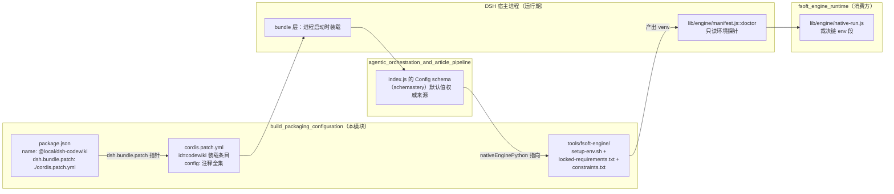
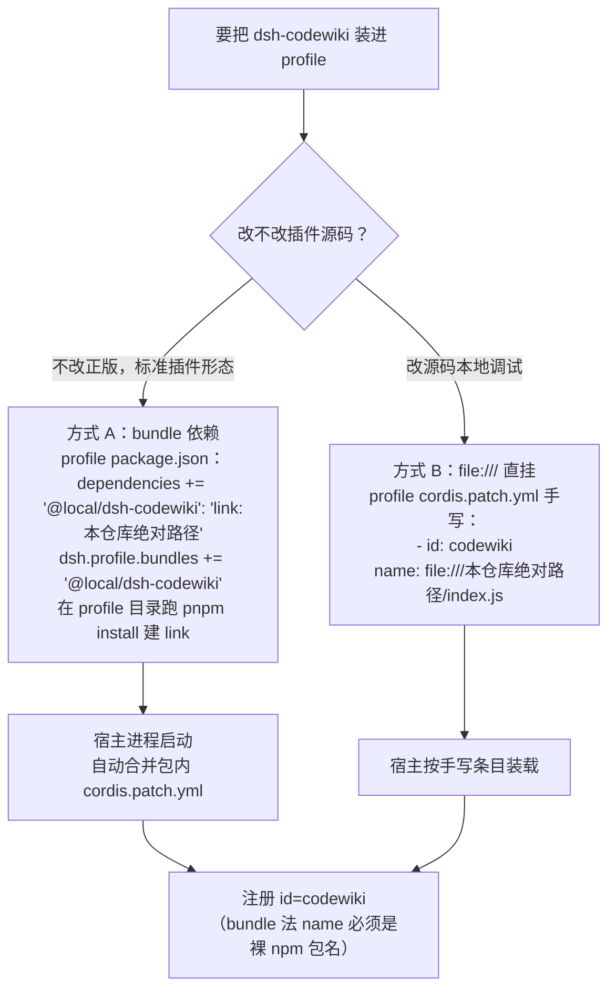
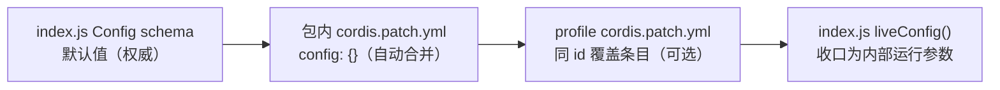
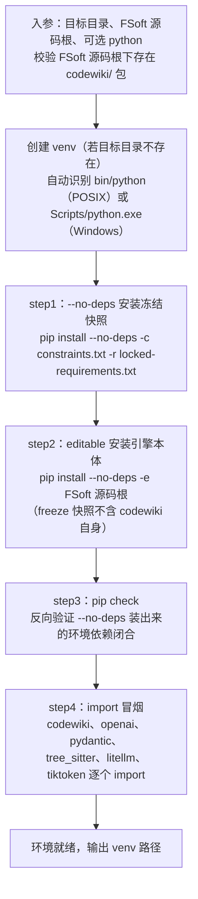
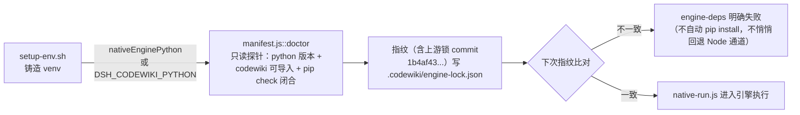
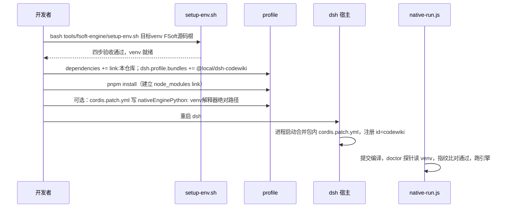

# 构建、打包与运行环境配置（build_packaging_configuration）

## 简介

本模块负责 `@local/dsh-codewiki` 插件的**打包清单、宿主装载方式与原生引擎运行环境的铸造**，是整个插件与 DSH（DeepSeek Harness）宿主之间的接线层。它由三件产物构成：

| 产物 | 路径 | 角色 |
|------|------|------|
| npm 包清单 | `package.json` | 声明插件身份、版本、导出入口、引擎版本要求，以及向宿主声明「本包携带一个 bundle patch」 |
| 宿主 bundle patch | `cordis.patch.yml` | 随包自动合并进 DSH profile 的插件装载条目（`id: codewiki`），并集中注释全部可配置项 |
| 原生引擎环境脚本 | `tools/fsoft-engine/setup-env.sh` | 在独立目录铸造一个依赖闭合的 FSoft Python 引擎 venv（配套同目录的 `locked-requirements.txt` / `constraints.txt`） |

简言之：`package.json` 回答「这个插件是谁、怎么被宿主发现」，`cordis.patch.yml` 回答「插件如何被装载进 profile、能配什么」，`setup-env.sh` 回答「原生引擎通道（0.16.0 起的默认编译通道）所需的 Python 环境如何可靠地造出来」。

---

## 模块在系统中的位置



本模块不承载任何编译逻辑——它的产出物分别被两条线消费：

1. **装载线**：宿主在进程启动时读取 `package.json` 的 `dsh.bundle.patch` 指针，自动合并 `cordis.patch.yml`，插件 `id=codewiki` 由此注册进宿主，随后 `index.js` 的 `Config` schema 生效（见 [agentic_orchestration_and_article_pipeline](agentic-orchestration-and-article-pipeline.md) 的主编排层）。
2. **环境线**：`setup-env.sh` 铸造的 venv 被运行期的 `doctor` 探针只读探测（见 [fsoft_engine_runtime](fsoft-engine-runtime.md) 的 workspace_state_and_integrity 子模块），探测结论决定编译任务能否进入原生引擎通道。

---

## 一、打包清单 `package.json`

### 字段速览

```json
{
  "name": "@local/dsh-codewiki",
  "version": "0.17.32",
  "private": true,
  "type": "module",
  "main": "index.js",
  "exports": { ".": "./index.js", "./client": "./client.js" },
  "engines": { "node": ">=20", "dsh": ">=0.2.0-rc.0" },
  "dependencies": { "@deepseek-ai/schemastery": "^3.18.4" },
  "dsh": {
    "client": { "platform": "web" },
    "bundle": { "patch": "./cordis.patch.yml" }
  }
}
```

| 字段 | 含义 |
|------|------|
| `name` | 裸 npm 包名 `@local/dsh-codewiki`。**bundle 装法下宿主 client 半边的激活扫描只认裸包名行**（不能带 `/dsh` 子路径），这也是 `cordis.patch.yml` 里 `name` 必须与之一致的原因 |
| `private` | 私有包：不发布到公共 registry，只以本地 link 形态装进 profile |
| `exports` | 双入口：`.` 指向插件服务端 `index.js`，`./client` 指向侧边栏面板前端 `client.js`（见 [codewiki_user_facing_surfaces](codewiki-user-facing-surfaces.md)） |
| `engines` | 硬要求 Node ≥ 20、dsh ≥ 0.2.0-rc.0 |
| `dependencies` | 运行期唯一外部 npm 依赖 `@deepseek-ai/schemastery`——即 `index.js` 里 `Config` schema 的声明库 |
| `dsh.client.platform` | 声明自带 Web 平台客户端（侧边栏 CodeWiki 面板） |
| `dsh.bundle.patch` | **本模块最关键的一行**：声明本包携带的 bundle patch 文件路径，宿主启动时自动合并，profile 侧无需手写任何 codewiki 条目 |

### 版本演进要点（写在 `description` 里）

- 0.16.0 起默认编译通道切换为原生引擎（`nativeEngine: true`），驱动上游 FSoft-AI4Code/CodeWiki Python 子进程；
- 0.16.0 阶段 7 删除了 Node 侧的 FSoft 算法重写（symbols/cluster/graph-diff/incremental/update-planner），`nativeEngine: false` 降级为只保留顶层目录分组 + 文件级归属的兼容通道；
- 0.16.13 起默认模型定为 `volces-ark/glm-5.3-flash`（512k 上下文），更早的 `workbuddy/hy3` 192k 默认被弃用。

---

## 二、宿主装载条目 `cordis.patch.yml`

### 两种安装方式

`cordis.patch.yml` 注释里定义了 A/B 两种把插件装进 DSH profile 的方式，**两种方式保持同一个插件 id：`codewiki`**。



| 方式 | 适用场景 | profile 需要写什么 |
|------|----------|--------------------|
| **A. bundle 依赖（推荐）** | 标准本地插件形态 | `package.json` 加 link 依赖 + `dsh.profile.bundles` 条目，再跑 `pnpm install`；**profile 自己的 `cordis.patch.yml` 里一行 codewiki 都不用写** |
| **B. file:/// 直挂** | 改插件源码时的本地调试 | profile 的 `cordis.patch.yml` 手写 `- insert: [{ id: codewiki, name: file:///<绝对路径>/index.js, config: {} }]`（URL 中空格写 `%20`） |

### 配置覆盖规则（重要）

包内条目本身只写 `config: {}`——**默认值故意不重复声明**，留空即用 `index.js` 的 `Config` schema 默认值。需要改配置时，在 **profile 自己的 `cordis.patch.yml`** 里写同 id 覆盖条目：

```yaml
- id: codewiki
  config: { batchModel: doubao-seed-2.1-lite }
```

覆盖语义是**整对象替换**：未写的键回落到 `index.js` 的 `Config` 默认值（而不是回落包内 patch 文件里的值——包内 `config` 本来就是空的）。因此默认值的权威来源永远是 `index.js` 的 schemastery schema；`cordis.patch.yml` 的注释只是给用户看的配置说明书。



### 配置项清单（config 命名空间 = `codewiki`）

下表是 `cordis.patch.yml` 注释中登记的全部设置项。注意注释部分早于 0.17.x 的演进，**以 `index.js` 的 `Config` schema 为最终口径**（例如 `nativeEngineTimeoutMs` 在 schema 中默认 `0` 表示 180 分钟，而非注释里的 2700000ms）。

| 设置项 | 默认（注释口径） | 作用 |
|--------|------------------|------|
| `binaryPath` | 空 | `cw` 可执行文件路径；留空优先用 PATH 里的 `cw`，找不到再用插件自带 `bin/cw.exe` |
| `batchProvider` | `volces-ark` | 编译模型提供商（必须是模型设置里已注册的 provider；留空 = 提交失败） |
| `batchModel` | `glm-5.3-flash` | 编译模型 id（512k 上下文） |
| `batchReasoningEffort` | 空 | 思考程度档位（留空 = 模型默认档） |
| `maxConcurrency` | 2 | 默认档并发上限（1–8） |
| `bigConcurrency` | 0（跟随默认档） | 大档并发上限，与默认档各自独立限流、同时推进 |
| `serialProjects` | 开 | 同一时刻只推进一个仓库的编译任务，其余排队 |
| `articleLanguage` | 中文 | 文章书写语言 |
| `planMode` | `auto` | 模块划分：AST 符号 + LLM 语义聚类（注释保留旧行为 `dirs`） |
| `agenticArticles` | 开 | 文章写作走 agentic 工具循环（模型自己 read_code/edit_article） |
| `agenticMaxSteps` | 30 | agentic 单篇步数上限（1–100） |
| `symbolIncremental` | 开 | 增量按 AST 符号级判定（注释口径；Node 侧增量已在 0.16.0 删除，现由原生引擎承担） |
| `updateReminder` | 开 | 会话系统提示注入 wiki 维护提醒 |
| `autoCommit` | 开 | 编译完成后自动提交 wiki 产物 |
| `nativeEngine` | `true` | 编译通道开关：原生 FSoft Python 引擎 ↔ 内置 Node 兼容通道 |
| `nativeEnginePython` | 空 | venv 解释器绝对路径；留空 → 环境变量 `DSH_CODEWIKI_PYTHON` → `'python'` |
| `nativeEngineEntry` | `lib/engine/python/entry.py` | 入口脚本路径，一般不用改 |
| `nativeEngineTimeoutMs` | 2700000（注释）/ 0=180 分钟（schema 实际） | 单次引擎调用上限 |

两条硬不变量（写在注释里，也是运行期裁决链的前提）：

- **不做「找一个能用的解释器」的启发式**——猜错会把「环境不闭合」伪装成「引擎坏了」；
- **两条通道并存、互不回退**——原生通道环境不闭合时以 `engine-deps` 明确失败，不会悄悄改用 Node 通道。

---

## 三、原生引擎环境脚本 `tools/fsoft-engine/setup-env.sh`

### 为什么不能用常规 `pip install`

脚本头部注释给出了直接动机：FSoft 的依赖树里 `openai` / `pydantic-ai-slim` / `pydantic` 的版本约束互相打架，走正常解析必然 `ResolutionImpossible`（实测报错：`pydantic-ai-slim==2.61.0` 与其 extras 集合依赖冲突）。因此冻结清单本身被当作**已解析完成的完整环境快照**对待，安装时不再重新解析。

### 四步铸造流程



任何一步非零即由 `set -euo pipefail` 立即中止。

### 设计约束（脚本注释明示）

| 约束 | 原因 |
|------|------|
| 环境只建在插件仓库**之外** | venv 永不提进 git |
| 不碰 DSH 进程的 Python | 宿主运行环境与引擎环境完全隔离 |
| 同目录配套 `locked-requirements.txt`（冻结快照）与 `constraints.txt`（约束文件） | 防清单里未钉死的间接依赖被 pip 升级跑偏 |
| `--no-deps` 落盘 + `pip check` 兜底 | 精确复制已验证的环境组合，跳过必然失败的依赖解析 |
| editable 安装引擎本体 | 冻结快照是 `pip freeze` 产物，不含 `codewiki` 自身 |

### 与运行期探针的衔接

脚本产出的 venv 不是一次性的——它会被运行期反复验证：



关键边界：`doctor` 是**只读诊断**，它报告事实；装依赖、修环境永远是 `setup-env.sh` 的职责。上游源码锁 `UPSTREAM_COMMIT = 1b4af43d...` 是显式常量（见 [fsoft_engine_runtime](fsoft-engine-runtime.md) 的 workspace_state_and_integrity 子模块），升级上游必须改该常量并跑契约测试，而不是 pip 装最新版。

---

## 典型操作流：从新机器到跑通原生编译



---

## 与其他模块的关系

| 模块 | 关系 |
|------|------|
| [agentic_orchestration_and_article_pipeline](agentic-orchestration-and-article-pipeline.md) | `index.js` 的 `Config` schema 是本模块所有配置项默认值的权威来源；`cordis.patch.yml` 的注释清单是其用户面向的镜像 |
| [codewiki_user_facing_surfaces](codewiki-user-facing-surfaces.md) | `package.json` 的 `exports["./client"]` 与 `dsh.client.platform=web` 指向其侧边栏面板；面板的 CodeWiki 设置页即上述配置命名空间的 GUI |
| [fsoft_engine_runtime](fsoft-engine-runtime.md) | `setup-env.sh` 的产出 venv 被其 `manifest.js::doctor` 只读探测、被 `native-run.js` 裁决链的 env 段消费；`nativeEngineEntry` 指向其 `lib/engine/python/entry.py` |
| [job_repository_infrastructure](job-repository-infrastructure.md)（同级兄弟） | 同属 platform_infrastructure_and_developer_tooling：它管运行期任务存储，本模块管装包与环境 |
| [test_fixtures_and_probes](test-fixtures-and-probes.md)（同级兄弟） | `tools/fsoft-engine/probe-no-llm-graph.py` 与本目录的 setup 脚本配套，用于在不依赖 LLM 的前提下验证引擎图构建 |

## 关键文件清单

- `package.json` — 插件身份、双入口导出、`dsh.bundle.patch` 指针
- `cordis.patch.yml` — bundle 装载条目 + 全部配置项注释
- `tools/fsoft-engine/setup-env.sh` — venv 四步铸造脚本
- `tools/fsoft-engine/locked-requirements.txt` — 已解析完成的冻结快照
- `tools/fsoft-engine/constraints.txt` — 防漂移约束清单
