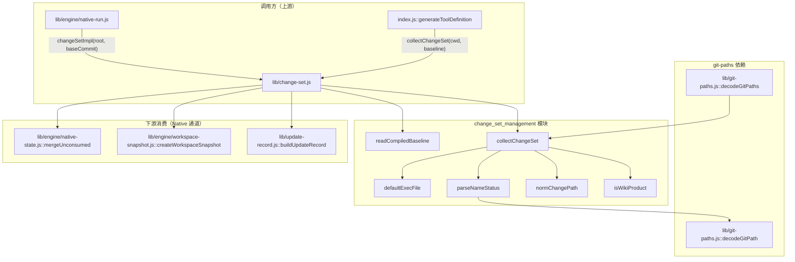
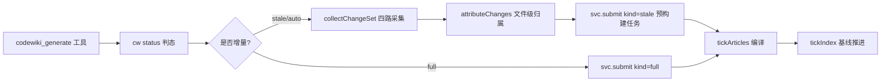
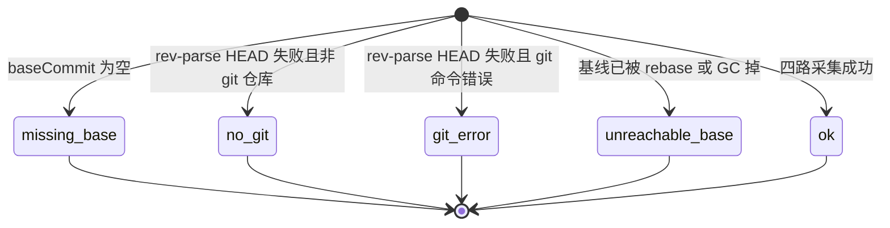
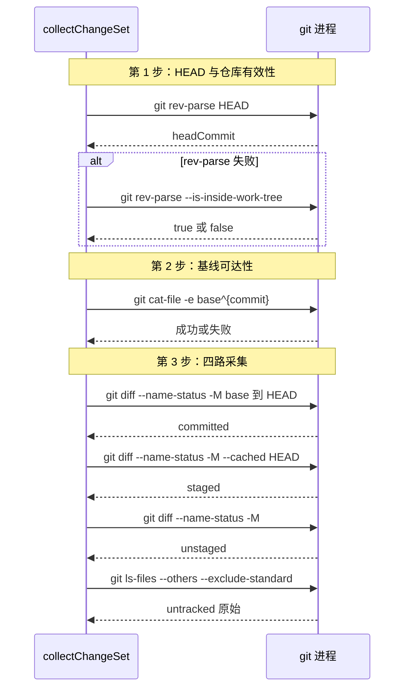
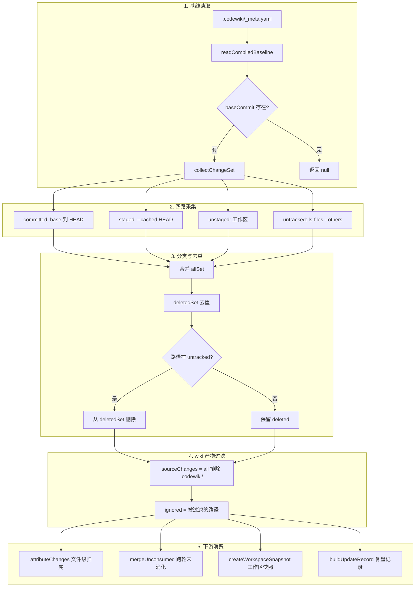
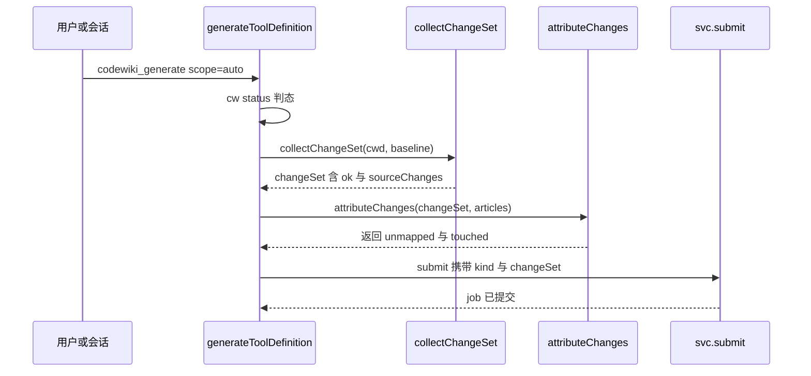
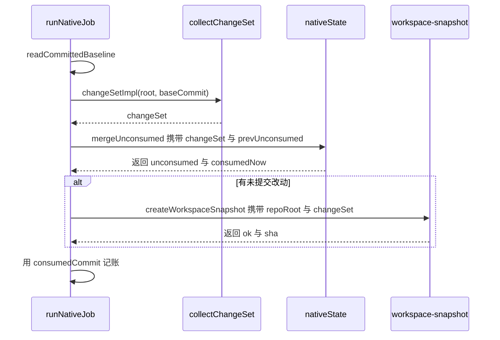
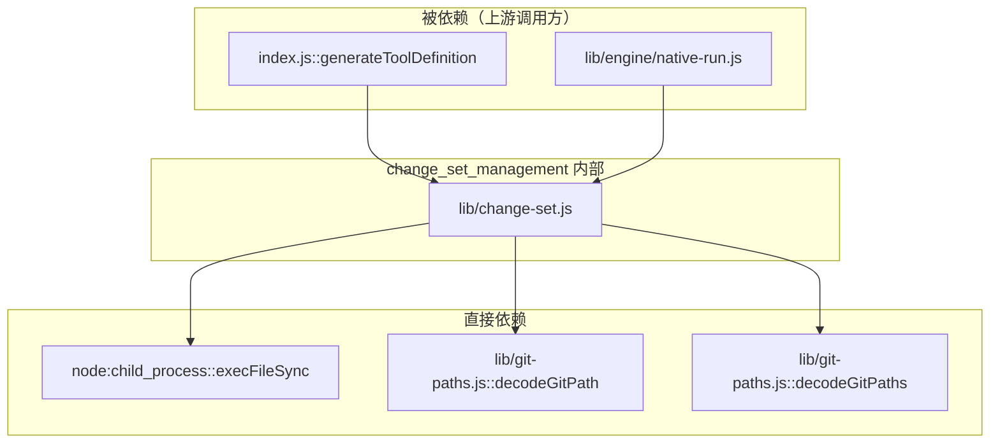

# 变更集管理（change_set_management）

## 简介

`change_set_management` 模块是 dsh-codewiki 插件的**变更感知底座**，负责把一次编译需要「看见」的全部源码改动——**committed / staged / unstaged / untracked** 四路合一——收成一个规范化、可序列化的 `ChangeSet`。它的唯一职责是回答两个问题：

1. **变了什么？**（四路采集 + 分类去重 + wiki 产物过滤）
2. **采得到吗？**（基线缺失 / 非 git 仓库 / git 命令失败 / 基线不可达 → 明确暴露降级信号）

它是增量编译语义的**第一块基石**：没有它，cw 基线前移后未消化的变化会被永久遗忘，文章与源码脱节却一路绿到底。

---

## 核心问题：为什么需要四路采集

`cw status` 只跑 `git diff <last_compiled_commit>..HEAD`，于是三类改动对它完全隐形：

| 隐形类别 | 含义 |
|---|---|
| 工作区修改（unstaged） | 改完代码还没 `git add` |
| 暂存区改动（staged） | `git add` 了但没 `git commit` |
| 未跟踪文件（untracked） | 新建文件还没被 git 跟踪 |

旧行为是「改完代码就编译」会把未消化的变化当成已消化（基线被前移），文章与源码脱节却一路绿到底。本模块把这个缺陷作为首要修复目标——**变更不能丢**。

---

## 架构总览



### 模块在系统中的位置



---

## 核心组件详解

### 1. `collectChangeSet(cwd, baseCommit, opts)` — 主入口

采集一次编译要「看见」的全部改动，返回 `ChangeSet` 对象。

**签名：**

```javascript
collectChangeSet(cwd, baseCommit, opts = {})
// cwd        仓库工作目录
// baseCommit 上次成功编译的基线 commit（_meta.yaml:last_compiled_commit）
// opts.execFile(cmd, args) -> stdout；抛错表示该命令失败
```

**返回值形状：**

```javascript
{
  version: 1,              // CHANGE_SET_VERSION
  ok: false,                // 采集是否成功
  state: 'unknown',        // 状态机
  fallback: null,           // 降级建议（'full' = 退回全量编译）
  reason: '',               // 失败原因（ok=false 时必有）
  baseCommit: '',           // 基线 commit
  headCommit: '',           // 当前 HEAD
  committed: [],            // 已提交变更（base..HEAD）
  staged: [],               // 暂存区变更
  unstaged: [],             // 工作区变更
  untracked: [],            // 未跟踪文件
  deleted: [],              // 汇总删除路径
  renamed: [],              // 汇总改名（from 到 to）
  all: [],                  // 全部路径去重排序
  sourceChanges: [],        // 排除 wiki 产物后的源码变更
  ignored: [],              // 被忽略的 wiki 产物路径
}
```

**关键不变量：**
- `ok=false` 时**一定**带 `state` 与 `reason`，且 `fallback='full'`——调用方据此退回全量编译
- **绝不**把「采不到」当成「没变化」（不假装 clean）

### 2. 状态机（state）



| state | 含义 | fallback |
|---|---|---|
| `missing-base` | 没有编译基线 commit，无法计算增量 | `full` |
| `no-git` | 不是 git 仓库或无法读取 HEAD | `full` |
| `git-error` | git rev-parse HEAD 失败（仓库存在但命令出错） | `full` |
| `unreachable-base` | 编译基线已不在历史里（被 rebase/GC 掉） | `full` |
| `ok` | 四路采集成功 | `null` |

### 3. 四路采集的 git 命令



**为什么用 `-M`（改名检测）？**
否则改名会被拆成「删一个 + 加一个」，下游 planner 就看不出「同一份内容换了位置」。

### 4. `parseNameStatus(out)` — `git diff --name-status` 输出解析

把 git 输出的每一行解析成结构化条目：

```javascript
// R/C 类型（改名/拷贝）：两列路径 from 到 to
{ kind: 'renamed', from: 'old/path.js', path: 'new/path.js', status: 'R100' }

// D 类型（删除）
{ kind: 'deleted', path: 'old/path.js', status: 'D' }

// 其他类型（修改）
{ kind: 'modified', path: 'file.js', status: 'M' }
```

**关键处理：** 每条路径都过 `decodeGitPath`——git 默认 `core.quotepath=true` 会把非 ASCII 路径输出成 `"a/\344\270\255.md"`（八进制字节转义 + 双引号）。不还原的话 `isWikiProduct` 匹配不上 `.codewiki/`，中文名的 wiki 产物会被当成源码变更。

### 5. `normChangePath(p)` — 路径归一与安全过滤

```javascript
normChangePath('lib\\foo.js')      // 结果：'lib/foo.js'
normChangePath('/absolute/path')   // 结果：null（绝对路径不安全）
normChangePath('C:\\win\\path')    // 结果：null（Windows 盘符不安全）
normChangePath('../escape.js')     // 结果：null（跳出仓库不安全）
normChangePath('./index.js')       // 结果：'index.js'（去掉 ./ 前缀）
```

**安全边界：** 越界路径（绝对路径 / `../` 跳出）一律判为不安全，直接丢弃——它们不该出现在变更集里。

### 6. `isWikiProduct(relPath)` — wiki 产物过滤

```javascript
isWikiProduct('.codewiki')              // 结果：true
isWikiProduct('.codewiki/modules/x.md') // 结果：true
isWikiProduct('README.md')              // 结果：false
isWikiProduct('CodeWiki.md')            // 结果：false
```

**为什么要过滤？** `.codewiki/` 每次编译都会被重写，把它算成「源码变更」会让增量永远处于 dirty 状态，还会让「未映射变更」永远无法清零。README/CHANGELOG/CodeWiki.md 这类被文章 `source_files` 引用的文档仍是合法源码，不在此列。

---

## 数据流转：从采集到消费

### 完整数据流图



### 关键场景：删了又建同名文件

```javascript
// 场景：删除 old/a.js，又新建 a.js
// 旧逻辑：deletedSet = {a.js}, untracked = [a.js]
// 新逻辑：deletedSet.delete(a.js)
// 原因：当前存在就不是删除，否则 planner 会为一篇还在的文件安排 delete action
```

---

## 下游消费关系

### 消费方 1：`index.js`（旧 Node 通道）



`changeSet` 被精简后存入 `job.changeSet`，供终态判定与 update-record 复盘：

```javascript
// index.js submit() 内
changeSet: changeSet ? {
  version: changeSet.version,
  state: changeSet.state,
  baseCommit: changeSet.baseCommit,
  headCommit: changeSet.headCommit,
  committed: changeSet.committed,
  staged: changeSet.staged,
  unstaged: changeSet.unstaged,
  untracked: changeSet.untracked,
  deleted: changeSet.deleted,
  renamed: changeSet.renamed,
} : null,
```

### 消费方 2：`native-run.js`（原生引擎通道）



**关键设计：** FSoft 只从 `<old_commit>..<new_commit>` 取 diff，未提交改动不进它的 update_record。`mergeUnconsumed` 把「已读进产物、但还没进任何 commit」的路径记进 `state.json` 的 `unconsumed`，每轮并入变化集，直到它们真的出现在 `git diff base..HEAD` 里才移出。

### 消费方 3：`update-record.js`（复盘记录）

```javascript
// saveRecord(job, judged) 内
buildUpdateRecord({
  changeSet: job.changeSet ?? null,   // 变更集摘要
  plan: job.updatePlan ?? null,
  results: job.articles ?? [],
  outcome: judged,
  // ...
})
```

---

## 依赖关系



### 依赖详解

| 依赖 | 用途 |
|---|---|
| `node:child_process::execFileSync` | 默认执行器（真实链路）；测试可注入假执行器 |
| `lib/git-paths.js::decodeGitPath` | 解开 git 的 `core.quotepath` 八进制转义（非 ASCII 路径还原） |
| `lib/git-paths.js::decodeGitPaths` | 批量解码 `ls-files --others` 输出的路径清单 |

> 关于 `lib/git-paths.js` 的完整设计（quotepath 处理、POSIX 归一、Windows 兼容），详见独立文档。

---

## 关键设计决策

### 1. 依赖注入 execFile 是为了离线单测

```javascript
export function collectChangeSet(cwd, baseCommit, opts = {}) {
  const run = opts.execFile ?? defaultExecFile(cwd)
  // ...
}
```

真实链路用 `execFileSync`，测试给假执行器——模块因此可以完全离线测试，不依赖真实 git 仓库。

### 2. 绝不假装 clean

所有失败路径都返回 `ok=false` + `state` + `reason` + `fallback='full'`：

```javascript
// 错误示例（被禁止）：
if (!baseCommit) return emptyChangeSet('', { state: 'ok', ... })  // 假装干净

// 正确行为：
if (!baseCommit) {
  return emptyChangeSet('', {
    state: 'missing-base',
    fallback: 'full',
    reason: '没有编译基线 commit，无法计算增量'
  })
}
```

### 3. wiki 产物过滤的边界

`.codewiki/` 被排除，但以下**不排除**：
- `README.md` / `CHANGELOG.md` / `CodeWiki.md`（被文章 `source_files` 引用）
- 其他根级文档（可能是合法源码）

### 4. 越界路径安全过滤

绝对路径、Windows 盘符路径、`../` 跳出路径一律丢弃——它们不该出现在变更集里，否则可能导致安全漏洞。

---

## 与其他模块的协作

### 与 `State___Observability_Management` 的关系

| 协作点 | 说明 |
|---|---|
| `job-store.js` | `job.changeSet` 字段随 job 持久化到磁盘 |
| `update-record.js` | `changeSet` 作为复盘记录的输入，记录「这一轮看见了什么变化」 |

### 与 `Code_Engine_Processing_Pipeline` 的关系

| 协作点 | 说明 |
|---|---|
| `native-state.js` | `mergeUnconsumed` 把 changeSet 的 staged/unstaged/untracked 并入跨轮未消化集合 |
| `workspace-snapshot.js` | `createWorkspaceSnapshot` 根据 changeSet 判断是否有未提交改动需要合成临时 commit |
| `native-run.js` | 增量决议（full vs update）的输入来自 changeSet 的 `ok` / `state` / `baseCommit` / `headCommit` |

### 与 `Extension_Host_Execution_Orchestration` 的关系

| 协作点 | 说明 |
|---|---|
| `index.js::generateToolDefinition` | `runStaleUpdate()` 内调用 `collectChangeSet(cwd, baseline)` |
| `index.js::attributeChanges` | 消费 `changeSet.all` / `changeSet.renamed` 做文件级归属判定 |

---

## 扩展阅读

- 增量编译的终态判定与基线推进闸门：[State___Observability_Management](state-observability-management.md)
- 原生引擎的增量决议（full vs update）：[Code_Engine_Processing_Pipeline](code-engine-processing-pipeline.md)
- 旧 Node 通道的任务编排与阶段机：[Extension_Host_Execution_Orchestration](extension-host-execution-orchestration.md)
- git 路径转义与 POSIX 归一：`lib/git-paths.js`（本仓内）
