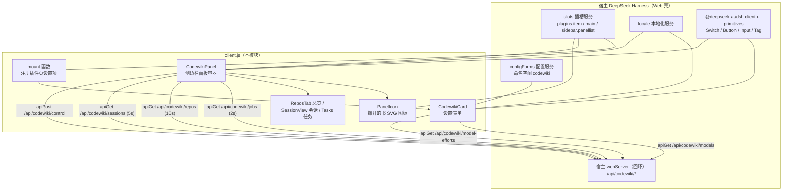
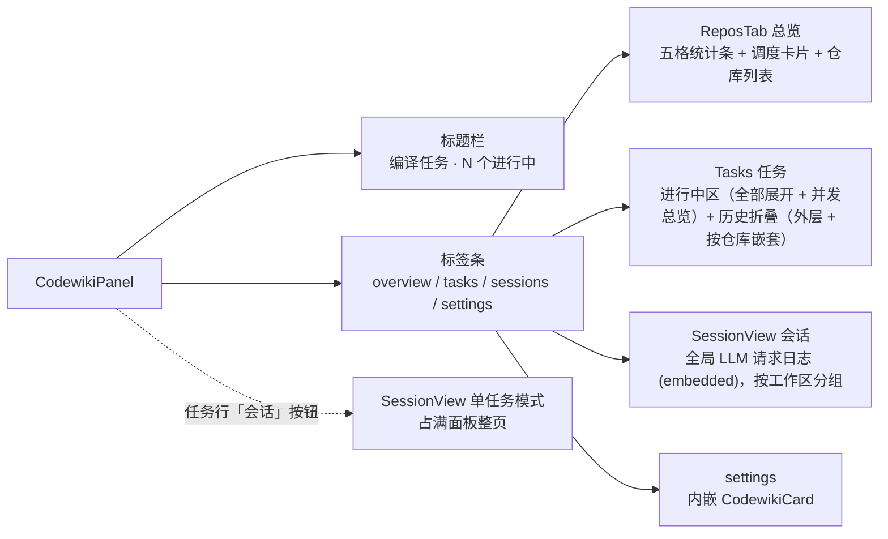
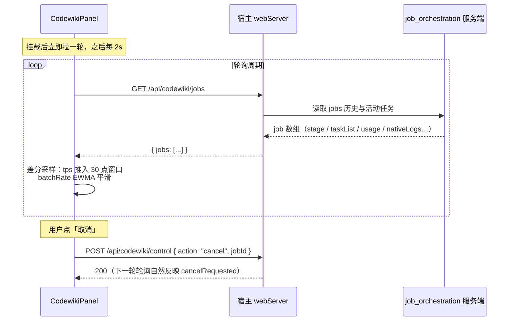
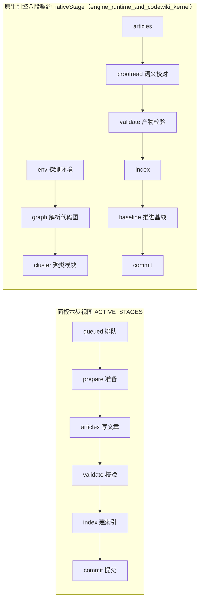
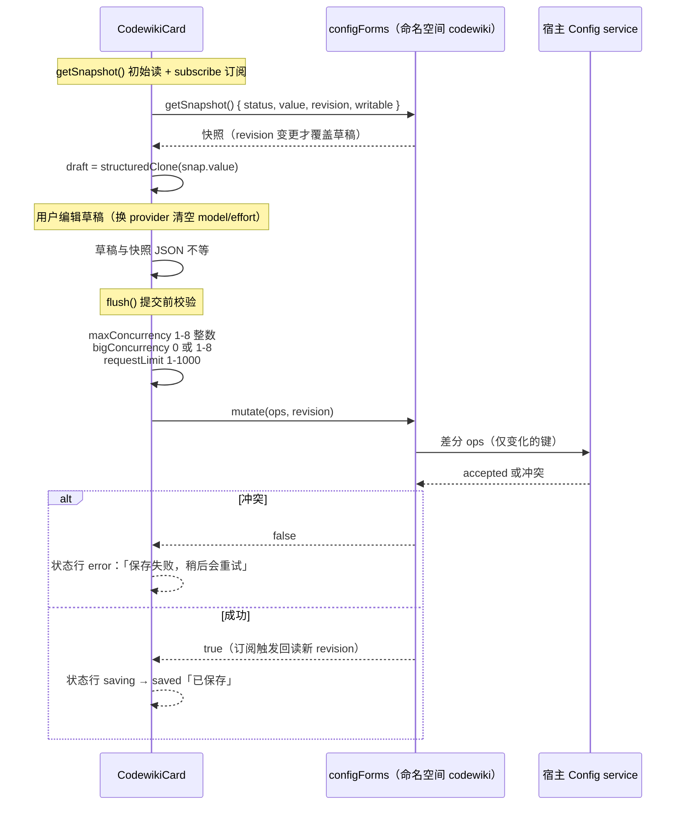

# client_panel_ui —— CodeWiki 插件客户端半侧（浏览器 UI）

## 简介

`client_panel_ui` 是插件 `@local/dsh-codewiki`（见 `package.json`）的**浏览器半侧**，全部代码集中在 `client.js` 一个文件内，由宿主 DeepSeek Harness（dsh）的模块加载器 `window.__ModuleLoader__` 在 Web 端激活。它在界面上承担两类职责：

1. **设置表单**：挂在宿主「插件」页的 `plugins.item` 插槽（id = `codewiki`，与 `cordis.patch.yml` 的 profile patch 条目一致），通过宿主 `configForms` 服务读写命名空间 `codewiki` 的配置，热生效、无需重启。
2. **侧边栏面板**：挂在宿主 `main` 插槽（渲染面板主体）与 `sidebar.panellist` 插槽（面板出入口图标，`order = 52`，排在 `dsh-hindsight-on-demand` 之后），实时展示编译任务进度、取消任务、总览各仓库 wiki 状态、查看 LLM 请求会话记录。

所有运行数据不来自本地计算，而是**轮询宿主半侧 webServer 端点**（`/api/codewiki/*`）取得——真正的任务调度、引擎驱动、状态持久化都在服务端完成（见 [job_orchestration_and_agentic_article_pipeline](job-orchestration-and-agentic-article-pipeline.md)）。

---

## 架构总览

`apply(ctx)` 是模块入口，声明依赖注入 `inject: ['slots', 'locale', 'configForms']`，并完成三件事：

1. 调用 `ctx.locale.register(NS, { zh: zh(), en: en() })` 注册中英文词典；
2. 用 `mount` 注册插件页设置项（优先通过 `configForms.whileServed` 等宿主服务该命名空间时才挂载）；
3. 用两个 `ctx.effect` 分别注册 `main` 面板与 `sidebar.panellist` 图标，卸载时回收。

---

## 组件构成

### 组件清单

| 组件 | 类型 | 职责 |
| --- | --- | --- |
| `CodewikiCard` | React 组件 | 设置表单：`view='summary'` 时渲染一行简介；`view='page'` 时渲染完整表单（运行 / 并发与语言 / 原生引擎 / 增量策略（`secIncremental`）/ 编译模型 / 大档模型 / 调度与排除七个 `data-dscw-sec` section，整体包在 `data-dscw-cards` 容器内；每个 section 由 `data-dscw-head` 标题行与 `data-dscw-grid` 字段网格组成，文本字段包在 `data-dscw-field` 内，开关类字段（`enabled` / `updateReminder` / `autoCommit` / `workspaceOnly` / `serialProjects` / `nativeEngine` / `bigEnabled` / `autoUpdateLabel`）包在 `data-dscw-toggle` 容器内（label + Switch），两类字段的 `data-dscw-hint` 说明都挂作兄弟节点；新增的「并发与语言」section（词典键 `secScale`）把默认档并发 / 模块并行度 / 单项目串行 / 并行上限 / 文章语言（留空跟随当前会话语言）/ `cw` 路径从「运行」拆出集中摆放——开关是「要不要跑」，这里是「怎么跑」；新增的「增量策略（原生通道）」section（词典键 `secIncremental`）只在增量轮（scope=auto/stale 且已有编译基线）生效：`updateRung` 档位下拉（留空 = 上游默认 3，可选 3 / 3b / 2 / 1 / 0）与 `updateTauNb` / `updateTauGrow` / `updateTauFull` / `updateTauTree` 四个 0–1 阈值输入（`type=number`，min 0 max 1 step 0.05，留空 = 上游默认 0.5 / 0.33 / 0.5 / 0.3）——五项全部可选，留空即不写入配置，避免把上游默认「焊死」在插件侧）+ 底部自动保存状态行 `data-dscw-bar`：不再有「保存 / 放弃」按钮，只报 idle / saving / saved / error 四种状态，校验失败时附「立即重试」按钮，`writable=false` 时附「当前配置只读」提示 |
| `CodewikiPanel` | React 组件 | 侧边栏面板容器：四个标签页（总览 / 任务 / 会话 / 设置），jobs 轮询差分采样（tps 30 点窗口、吞吐 EWMA、总进度 24 点趋势窗），进行中任务全部展开（无进行中时留最近一个当门面）、进行中头部附并发总览 `poolSummary`，历史区按仓库各自折叠，取消任务、复制 wiki 路径 |
| `ReposTab` | React 组件 | 「总览」标签页：顶部五格统计条 `data-dscw-p-stats`（待确认 / 有变更 / 编译中 / 干净 / 仓库总数，已排除的仓不进任何一格计数）+ 自动更新调度信息 + 仓库状态列表；列表按 `rankOf` 排序（待确认 > 有变更 > 其他 > 干净 > 出错 > 已排除，同档按最近有任务优先），行带 `data-rank`；支持排除 / 取消排除、确认首次编译、手动「更新」 |
| `SessionView` | React 组件 | 「会话」视图：并发池里每一次 LLM 请求的列表（5s 轮询）+ 点开看 prompt / 模型输出全文；支持 job 级单任务视图与 `job=null` 全局聚合视图，`embedded=true` 时嵌在面板标签页内不套 page 容器；全局视图按工作区（`cwdOf` 取 `s.cwd ?? job?.cwd`）在 `data-dscw-p-sessgroups` 容器内分组成 `
` 折叠（按组内最新一条时间倒序、第一组默认展开，组头显示仓库名与「{n} 条请求」计数），单任务视图不分组 |
| `PanelIcon` | React 组件 | 16×16 摊开的书 SVG，供 `sidebar.panellist` 渲染出入口 |
| `Spark` | React 组件 | 纯 SVG polyline 微趋势线（默认 56×16），用于吞吐徽标里的 tok/s 趋势与进度行的总进度趋势（48×14） |
| `Skeleton` | React 组件 | 加载骨架占位（默认 `rows = [100, 72, 46]`）：首轮数据未回包时渲染 `data-dscw-p-skel` 容器与三条不同宽度的 `i` 占位条，取代旧的单行「…」文本，用于任务列表、会话列表与会话详情三处 loading 态 |
| `byUpdated` | 函数 | 任务排序比较器（按 `updatedAt ?? createdAt` 倒序）：进行中任务按它排序全部展开；无进行中任务时由它挑最近更新的一张当门面卡 |
| `flush` / `scheduleSave` | 函数（位于 `CodewikiCard` 内） | 设置草稿的自动保存：`scheduleSave` 草稿改动后排 500ms 防抖（`unref` 防止 Node 测试环境吊住进程），`flush` 串行提交（校验 + `form.mutate` 差分 ops，pendingRef 保留最新草稿、保存期间又改动则再排一次）；旧的手动 `save` / `discard` 与「放弃 / 保存」按钮已删除 |
| `line` | 函数（位于 `engineLogBlock` 内） | 引擎日志条目渲染器：把 NDJSON 事件拼成 `[phase] kind detail` 单行 |
| `zh` / `en` | 函数 | 中 / 英词典工厂（值必须为字符串，否则 `t()` 回退返回键名） |
| `mount` | 函数 | `plugins.item` 插槽的注册闭包 |

### 面板标签页结构

列表加载与空态：任务列表、会话列表与会话详情首轮未回包时渲染 `Skeleton` 骨架屏（取代旧的单行「…」占位）；三个列表为空时，空态由单行说明改为「标题 + 说明」双层结构（`data-dscw-p-empty` 内 `<strong>` 标题 + `` 说明）——仓库列表标题 `emptyReposTitle` / 说明 `reposEmpty`，任务列表标题 `emptyTasksTitle` / 说明 `panelEmpty`，会话列表标题 `emptySessionsTitle` / 说明 `sessEmpty`（有进行中任务时不显示空态）；仓库列表整体包裹在 `data-dscw-p-repolist` 容器内。

### 任务区组织（`CodewikiPanel`）

- **进行中区**：所有活动任务卡片全部展开；多于一个活动任务时，分区头部附并发总览 `poolSummary`——只统计真正在跑的任务（排队中的进度恒为 0，算进平均会让「最慢」永远是没开始的仓库），输出「平均进度% · 最慢 <仓库> <最慢进度>%（· 排队 N）」，全部排队时显示「N 个排队中」；
- **历史区**：外层一个「历史任务 (N)」折叠；内部按仓库（`cwd`）再各套一个默认收起的折叠 `data-dscw-p-repofold`（标题显示仓库名与该仓库轮数），避免同一仓库的几十轮历史把别的仓库挤出视野。

### 任务卡片（`jobCard`）渲染要素

- **头部行**：类型标签（全量 / 增量 / 续查）、所属仓库（`repoName` 取父目录/目录名两段）、阶段状态、吞吐徽标、「会话」按钮、（活动任务的）「取消」按钮——动作集中在右侧 `data-dscw-p-actions` 容器内；仓库名只在「进行中区的卡片」（`showCwd=true`）上显示，历史卡由分组头报目录，不重复；
- **总进度读数** `overallPct`：按 `STAGE_WEIGHTS` 定权，逐行累加各阶段 `frac × 权重`（进行中阶段的 frac 取 `taskList` 完成占比，原生通道取引擎自报的 `nativePercent`），封顶 99%、终态（`done` / `partial`）才 100%；进度不可知时整段不渲染，不编数字；
- **进度行**：大数字百分比、主进度条与当前阶段读数压成单行 `data-dscw-p-progress`——左侧大数字 + 内嵌 `data-dscw-p-bar` 总进度条（填充宽度 = 百分比，`data-tone` 随阶段着色）+ 进度趋势 spark + 右侧当前阶段读数（当前步骤名 + 该步已用时；原生通道再附「引擎阶段名 + 引擎自报百分比」，以 ` · ` 连接）；
- **进度趋势**：每轮轮询把 `overallPct` 推入 24 点窗口（与上轮相同则跳过），窗口多于一个点时在进度行内画 `data-dscw-p-trend` 微趋势线（悬停提示「最近若干次采样的总进度」）——数字告诉你在哪，斜率告诉你还动不动；
- **分段带与图例** `stageSegments` / `stageLegend`：取代原七行 `stageBreakdown` 明细表（已删除），改为一条紧凑的分段带 + 图例，**按两种模式出现**——活动且真有进度（pct > 0）时以「进行中」模式绘制；非活动任务只要 `hasTimings(job)`（`stageTimings` 里存在非排队阶段的真实耗时）就以「终态耗时」模式绘制，失败 / 取消任务总进度是 null 也照样画——「时间花在哪一步」恰恰是这类任务最该看的东西；老任务没有 `stageTimings` 则不画，免得出一条空带。两种模式经 `stageWeight(job, stage, running)` 取段宽：进行中模式沿用 `STAGE_WEIGHTS` 阶段权重（段宽 = 该步占总进度的比例），终态模式改用 `timingsOf(job)[stage]` 的真实耗时（段宽 = 该阶段耗时）；图例整体悬停提示按模式切换：进行中用 `legendHint`（颜色 = 阶段状态：绿=已完成 / 蓝=进行中 / 灰=未开始 / 红=失败），终态用 `legendHintDone`（颜色仍是阶段状态，段宽是该阶段真实耗时）；每行图例由「色块 `data-swatch`（颜色与上方分段带里同色段一致）+ 阶段名 + 读数」组成——进行中模式读数为百分比、行悬停 `title` 显示「阶段名 · 状态（`legendState_*` 词典）· 百分比」，终态模式读数降级为 `fmtMs(dur)`（终态全 100%，百分比写出来只是重复）、行悬停显示「阶段名 · 耗时」；分段带色块悬停 `title` 同理：进行中为「阶段名 · 百分比 · 耗时」，终态为「阶段名 · 耗时」；
- **次要信息流水线** `data-dscw-p-subline`：元信息、用量、最新一条备注压成一行（放不下自动换行），取代原先各占一行的排布；

- **元信息**：已写 / 失败篇数、原生引擎阶段（`nativeStage` + 百分比）、质量门 / 落地结果、批次进度、排队 / 执行用时拆分、自动提交结果（短 sha 或失败原因）；
- **排队可见性**：`queueAhead` 列出「在等谁」；
- **用量** `usageLine`（现为 `span` 元素）：输入 / 输出 token（`fmtTok` 缩写）、请求数（批量 + 实时拆分）、超单请求预算的请求数红字警示；
- **最新备注**：`job.notes` 只常显最后一条（`data-dscw-p-note`，悬停看全文），历史备注进活动流折叠且**排除最后一条**避免重复；
- **活动流 / 引擎日志** `engineLogBlock`：活动流（`data-dscw-p-activity`）与引擎日志都是折叠区，引擎日志只渲染内存里最近 40 条（完整文件可能上 MB，2s 轮询不直接读大文件）；活动流折叠标题显示「活动流 (展开条数/总条数)」（最新一条已常显，计数按实际展开数写），悬停提示 `activityHint`；折叠内每条活动经 `activityRow(n)` 拆成「状态点 `data-dot` + 阶段标签 `data-stage` + 正文 `data-text`」三列的 `data-dscw-p-actrow` 行（`data-tone` 表达该条状态），不再整段文字平铺；
- **逐篇清单**：由平铺列表改为折叠 `data-dscw-p-tasklist`，标题显示「逐篇 (ok/总)」，仅活动卡片出现；
- wiki 路径 + 「复制路径」按钮。

---

## 与服务端的交互：端点与轮询

所有请求经 `apiGet` / `apiPost` 两个薄封装（JSON、非 2xx 抛错），端点均为宿主半侧实现：

| 常量 | 方法 | 路径 | 周期 / 触发 | 消费组件 |
| --- | --- | --- | --- | --- |
| `JOBS_PATH` | GET | `/api/codewiki/jobs` | 2s（`POLL_MS`） | `CodewikiPanel` |
| `REPOS_PATH` | GET | `/api/codewiki/repos` | 10s（`REPOS_POLL_MS`） | `ReposTab` |
| `SESSIONS_PATH` | GET | `/api/codewiki/sessions`（可带 `?jobId=`） | 5s | `SessionView` |
| `SESSIONS_ITEM_PATH` | GET | `/api/codewiki/sessions/item?jobId=&n=` | 选中行时 | `SessionView` |
| `MODELS_PATH` | GET | `/api/codewiki/models` | 挂载时一次 | `CodewikiCard` |
| `EFFORTS_PATH` | GET | `/api/codewiki/model-efforts?provider=&model=` | 提供商/模型变化时 | `useEfforts`（普通档与大档各一份） |
| `CONTROL_PATH` | POST | `/api/codewiki/control`（回环） | 取消 / 确认编译 / 手动更新 / 排除后刷新 | `CodewikiPanel`、`ReposTab` |

防重叠保护：每个轮询组件都持有 `inFlightRef`，上次请求未回包时跳过本轮，避免服务卡顿叠加请求；组件卸载后统一置 `mountedRef.current = false`，晚到的回包不再 `setState`。

---

## 阶段模型：六步视图 vs 原生引擎八段契约

面板的六步视图（`ACTIVE_STAGES`）与引擎自报的细粒度阶段是两套体系；六步同时是词典里 `step*` 短名、进度权重与分段带 / 图例（`stageRows` → `stageSegments` / `stageLegend`）行结构的来源：

- **退役阶段名映射**：`LEGACY_STAGE = { plan: 'prepare', crosscut: 'articles' }`——历史任务里残留旧阶段名时，`stageOf(job)` 先映射再查六步，否则失败 / 取消时分段带行会找不到当前行；阶段耗时 `stageTimings` 同样经 `timingsOf` 归一。
- **细粒度展示**：同名的 `articles / index / commit` 直接映射回六步行标签，其余阶段经 `NATIVE_STAGE_KEYS`（env / graph / cluster / proofread / validate / baseline）以「引擎阶段：xxx」另起一行显示，不混入六步行序号。
- **总进度权重** `STAGE_WEIGHTS = { prepare: 0.24, articles: 0.46, validate: 0.21, index: 0.05, commit: 0.04 }`（原 `review` 校对步已并入 `validate` 校验步，步骤条由七步收敛为六步）：准备阶段（环境 + 代码图 + 聚类）在大仓库最耗时，给到最高权重 0.24，避免百分比在相邻步骤间凭空跳点。`overallPct` 对 `stageRows(job)` 的每行（已完成阶段 frac=1、进行中阶段 frac 按 `taskList` / `nativePercent` 折算）求 `frac × 权重` 之和。同一份 `STAGE_WEIGHTS` 也是分段带 / 图例「进行中」模式的段宽来源；终态模式段宽改由 `stageWeight(job, stage, false)` 取 `stageTimings` 真实耗时（`queued` 恒 0），`hasTimings(job)` 据此判断是否存在值得展示的耗时分布。
- **终态语义**：`done` 六行全 100%；`partial`（部分完成）也按 100% 显示——活干完了，由终态标签 + `blockers` 悬停说明「为什么没算完整成功」；只有 `failed / cancelled` 才在最后计时段标红 / 标黄（`lastTimedStage`）。

---

## 设置表单：读写模型与保存流程

要点：

- **草稿隔离与自动保存**：`snapshot`（服务端值）与 `draft`（编辑态）分离；草稿与快照 `JSON.stringify` 不等即经 `scheduleSave` 排一次 500ms 防抖提交——界面上不再有「保存 / 放弃更改」按钮，状态行常显 idle「改动会自动保存」/ saving「保存中…」/ saved「已保存」/ error「保存失败，稍后会重试」（校验失败时附「立即重试」，`writable=false` 时附「当前配置只读，改动不会落盘」）；
- **串行防抖提交**：`flush` 串行执行（`savingRef` 未完成不并发），`pendingRef` 保留最新草稿，保存期间又改动则 `finally` 里再排一次；组件卸载前补提交一次未落盘的草稿，切走面板不丢值；
- **乐观并发**：`mutate(ops, snapshot.revision)` 携带 revision，他处改过则返回 false 报冲突，不强制覆盖；
- **差分提交**：只把 `draft[key] !== base[key]` 的键生成 `{ op: 'set', path: [key], value }` 操作，覆盖 enabled / 并发 / 模型 / 大档 / 原生引擎 / 增量策略（`updateRung` / `updateTauNb` / `updateTauGrow` / `updateTauFull` / `updateTauTree`）/ 调度 / 排除清单等 32 个键（此前只能改配置文件的 `nativeEngine` / `nativeEnginePython` / `nativeEngineEntry` / `nativeEngineTimeoutMs` 四项已纳入表单，原「兜底档位 `sessionTier`」输入框已移除；增量策略五项留空时即不写入配置——空字符串草稿与快照里缺该键在 JSON 比较时相等，不会触发提交，上游默认值因此不被「焊死」在插件侧）；
- **模型目录联动**：拉不到 `/api/codewiki/models` 时（`catalogError`）整体退回「手填 provider / model id」形态，不阻断保存；已配置但目录里消失的 provider 保留为 `__custom` 选项，避免静默丢配置；换 provider 时自动清空 model 与 effort；
- **思考程度档位**：优先取 `/api/codewiki/model-efforts` 返回的 `efforts` 列表；目录未声明时退回通用档位 `GENERIC_EFFORTS = ['off','low','medium','high','xhigh','max']`，选了模型不支持的值由服务端 `llmChat` 兜底剥档重试。
- **大档的通道边界**：大档 section 的提示语 `secBigHint`（`zh` / `en` 两份词典同文）写明——超过普通 110k 单请求预算的模块换大档模型，这一行为只对 Node 兼容通道生效（关闭「使用原生引擎」时）；原生通道的输入预算由引擎在内部按模块切分，不经这一档。
- **增量策略（原生通道）**：`secIncremental` section 只在增量轮（scope=auto/stale 且已有编译基线）生效——`updateRung` 档位下拉（`3` / `3b` / `2` / `1` / `0`）与 `updateTauNb` / `updateTauGrow` / `updateTauFull` / `updateTauTree` 四个 0–1 数字输入全部可选，留空即用上游默认（3 / 0.5 / 0.33 / 0.5 / 0.3）；词典提示语明确：改错只会让增量更保守或更激进，不会写坏文章。
- **`requestLimit` 预填默认**：草稿中没有该键时输入框预填 `100`（提交前校验边界仍是 1–1000）。

---

## 关键常量

| 常量 | 值 | 含义 |
| --- | --- | --- |
| `NS` | `'codewiki'` | 词典与 configForms 命名空间（= profile patch 条目 id） |
| `KEY` | `'codewiki'` | 面板 key / `sidebar.panellist` 的 id（两者必须一致） |
| `PANEL_ORDER` | `52` | 面板在侧边栏列表的排序（50 = dsh-hindsight-on-demand） |
| `POLL_MS` | `2000` | jobs 轮询周期 |
| `REPOS_POLL_MS` | `10000` | repos 轮询周期 |
| `GENERIC_EFFORTS` | 6 档 | 模型目录未声明时的通用思考档位 |

样式为运行时注入的 `<style data-plugin="@local/dsh-codewiki">` 表（一套 `[data-dscw-*]` 属性选择器），HMR / 重复加载时通过 `document.head.querySelector` 去重，不堆叠。

---

## 与其他模块的关系

- **[job_orchestration_and_agentic_article_pipeline](job-orchestration-and-agentic-article-pipeline.md)**：服务端半侧，实现 `/api/codewiki/jobs`、`/api/codewiki/control`、`/api/codewiki/repos`、`/api/codewiki/sessions(/item)`、`/api/codewiki/models`、`/api/codewiki/model-efforts` 全部端点；`jobSummary`、`runPool`、`tick*` 等函数产出本面板渲染的 job 字段（`stage` / `taskList` / `usage` / `queueAhead` / `nativeLogs` / `batchProgress` / `autoCommit` 等）。本模块不重复实现这些字段的含义。
- **[engine_runtime_and_codewiki_kernel](engine-runtime-and-codewiki-kernel.md)**：原生引擎的八段契约（`nativeStage` 的 env / graph / cluster / proofread / baseline 以及质量门 `gateLabel`、落地 `applyLabel` 结果）由该模块产出，本模块只做标签映射与展示。
- **[build_configuration_and_test_verification_tooling](build-configuration-and-test-verification-tooling.md)**：`package.json` 声明 `@local/dsh-codewiki`（exports `./client` 即本文件）与 `dsh.client.platform = 'web'` 的客户端属性；`cordis.patch.yml` 给出插件安装方式（bundle 依赖 / file:// 直挂）与 `codewiki` 配置命名空间的键说明，客户端设置表单的字段集合与之对应。
