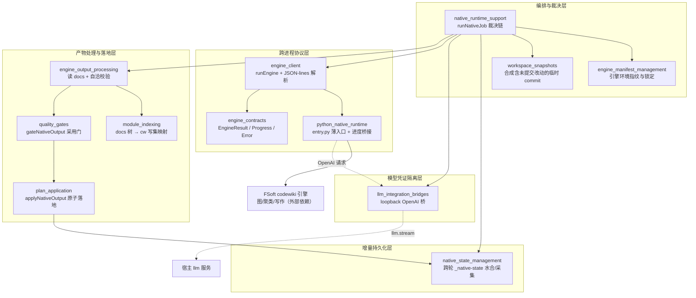
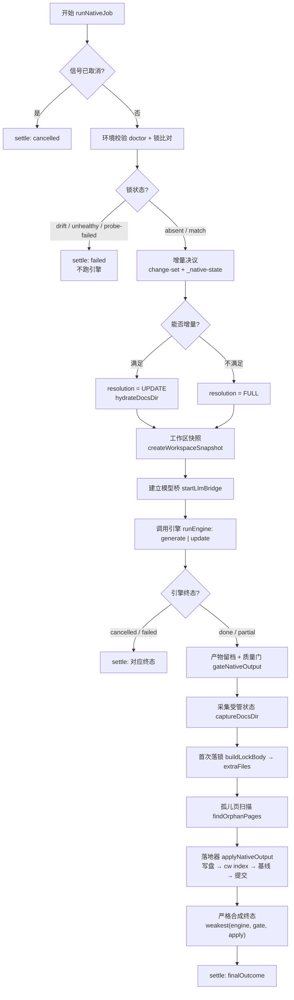

# 代码引擎模块（code_engine_module）总览

`code_engine_module` 是 DSH CodeWiki 扩展中**驱动 Python FSoft 原生引擎完成知识库编译**的完整子系统。它把「一次编译」固定为一条单向裁决链——从环境指纹、增量决议、模型桥、子进程协议、产物映射与自洽校验、采用门、受管状态采集，到原子落地与严格终态合成——确保任何一步的失败都不能被后续步骤洗成 `done`。

它存在的根本动因是 0.14.0 的教训：「1 篇成功 + 19 篇失败也报 done」。模块因此用版本化契约（[engine_contracts](engine-contracts.md)）、三类可机读裁决（[quality_gates](quality-gates.md) 的 defect / degradation / stale）和最弱终态合成（`weakest(engine, gate, apply)`）把模糊终态全部消灭。

## 模块架构

## 一次编译的裁决链

## 核心不变量

| # | 不变量 | 实现位置 |
|---|--------|----------|
| 1 | 锁不一致 / 依赖不闭合 → 直接 `failed`，**不跑引擎** | [engine_manifest_management](engine-manifest-management.md) |
| 2 | 引擎 `done` 不能替代质量门：gate 说 `partial`，终态就是 `partial` | [quality_gates](quality-gates.md) |
| 3 | 落地器说 `partial`/`failed`，终态不许是 `done` | [plan_application](plan-application.md) |
| 4 | 写集封闭：只写 `.codewiki/` 与根 `CodeWiki.md`，白名单外路径整批拒写 | [plan_application](plan-application.md) |
| 5 | 水合是**复制**而不是移动；只有「完整成功」才把本轮状态写成下一轮基线 | [native_state_management](native-state-management.md) |
| 6 | 桥自始至终看不见真实凭证——真实 key 只存在于宿主 provider 内部 | [llm_integration_bridges](llm-integration-bridges.md) |

## 核心组件文档

| 模块 | 职责一句话 |
|------|-----------|
| [native_runtime_support](native-runtime-support.md) | 最关键的编排层：把环境校验、增量决议、引擎调用、质量门、落地固定成一条单向裁决链 |
| [engine_contracts](engine-contracts.md) | 跨进程契约层：版本化的 `EngineResult` / `EngineProgress` / `EngineError` 与终态语义硬不变量 |
| [engine_client](engine-client.md) | Node ↔ Python 唯一跨语言边界：`runEngine` 进程编排 + `createProtocolReader` 增量 JSON-lines 解析 |
| [python_native_runtime](python-native-runtime.md) | Python 侧薄入口：协议守卫、五段→八段进度映射、异常分类与 `_salvage` 部分成功交付 |
| [llm_integration_bridges](llm-integration-bridges.md) | 凭证隔离层：loopback OpenAI 桥 + 纯转换层，让引擎的 OpenAI 客户端落到宿主 `llm.stream` |
| [engine_manifest_management](engine-manifest-management.md) | 引擎环境指纹与锁定：版本 + Python + 上游 commit 的 sha256 漂移判定与 `engine-lock.json` 落盘 |
| [workspace_snapshots](workspace-snapshots.md) | 输入对齐：用独立 `GIT_INDEX_FILE` 合成含未提交改动的临时 commit（不写 ref），纠正记账基线 |
| [module_indexing](module-indexing.md) | 格式翻译层：FSoft docs 树 → cw 写集计划的唯一纯函数映射边界（不臆造 `source_files`） |
| [engine_output_processing](engine-output-processing.md) | 阶段 2：读 `docs/` 为结构化事实、调映射、对产物自洽性给出可机读 `problems` |
| [quality_gates](quality-gates.md) | 采用门：把产物自洽问题、入口页、逐篇契约、基线可推进性合成 `GateReport` |
| [plan_application](plan-application.md) | 原子落地器：写集校验 → pre-image 快照 → 写盘 → `cw index` → 基线 → 自动提交，失败整体回滚 |
| [native_state_management](native-state-management.md) | 跨轮增量持久化底座：`.codewiki/_native-state/` 的水合、采集、消费与回滚语义 |