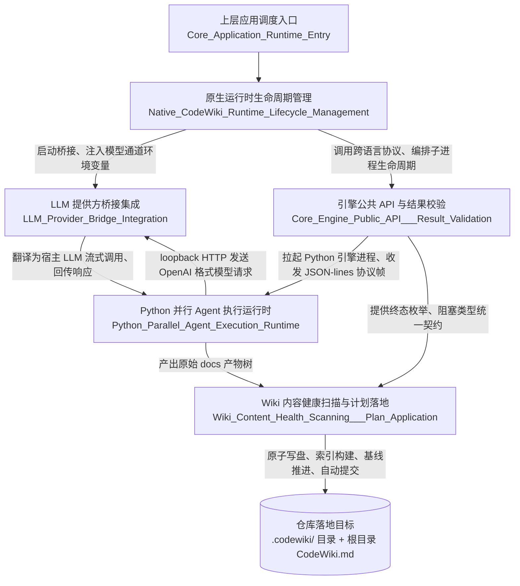

# CodeWiki 引擎子系统（CodeWiki_Engine_Subsystem）

## 模块定位
本模块是 CodeWiki 原生编译通道的核心执行层，承接上层应用调度的代码wiki编译请求，打通「Node 侧编排治理 → Python 并行引擎执行 → 产物健康落地」的全链路闭环。子系统的设计初衷是根治两类长期存在的系统缺陷：
- **假装成功**：引擎报告编译完成，但产物未实际入库、错误推进编译基线，典型案例为 0.14.0 版本出现的「1 篇文章成功 + 19 篇失败仍整体报 done」的问题；
- **悄悄退化**：环境版本漂移、增量凭据缺失、脏工作区对账失败时，系统不做明确提示就静默退化为全量重复编译，消耗不必要的模型调用成本。

子系统遵循统一治理原则：**只读诊断、证据驱动、同事务落地、以全链路最弱一环裁决最终终态**，绝不允许出现模糊的成功判定。

## 核心能力边界
子系统覆盖原生编译通道的五个关键环节，各环节职责严格分层、互不越界：
1.  **跨语言契约边界**：定义 Node 侧与 Python 引擎之间的版本化数据协议，把「引擎到底成功了没有」这个问题收敛为唯一、可校验的机读结果，杜绝模糊异常、吞错报喜的行为；
2.  **全生命周期编排治理**：从环境版本校验、增量资格判定、脏工作区快照、子进程监控到终态合成，形成固定顺序的裁决链，任意环节不满足运行要求即提前终止，绝不启动无效的引擎运行；
3.  **安全模型通道桥接**：在插件进程内启动绑定 loopback 的临时 HTTP 端点，在不读取、不存储、不转发真实模型凭证的前提下，把 Python 侧 OpenAI 协议格式的模型请求翻译为宿主的 LLM 流式调用，守住密钥安全红线；
4.  **并行 Agent 执行适配**：在不修改 vendor 锁版本源码的前提下，通过源码锚点替换把原本串行的模块文章写作流程改造为受控并行执行，同时保留协议流纯净、进度可观测、崩溃可自救的兜底能力；
5.  **原子化产物落地**：把引擎产出的原始 docs 树经过自洽校验、格式映射、死链校对、存量残骸扫描后，通过四阶段事务原子写入仓库，任意环节失败可完整回滚，绝不留下半成品写集。

## 整体架构

## 核心组件文档索引
子系统的各子模块职责独立、边界清晰，详细实现与设计细节可通过以下文档查阅：

| 组件名称 | 核心职责 | 详细文档 |
|---------|---------|---------|
| 原生 CodeWiki 运行时生命周期管理 | 原生编译通道的总编排层：负责环境校验、增量判定、工作区快照、进程监控、终态合成的完整裁决链 | [查看文档](native-codewiki-runtime-lifecycle-management.md) |
| 引擎公共 API 与结果校验 | Node 与 Python 引擎的唯一跨语言边界：负责子进程拉起、JSON-lines 协议解析、版本化结果契约定义，保证终态语义无歧义 | [查看文档](core-engine-public-api-result-validation.md) |
| LLM 提供方桥接集成 | 模型调用的安全通道：在 loopback 端口提供 OpenAI 兼容端点，实现凭证不落盘的模型请求转发与流协议转换 | [查看文档](llm-provider-bridge-integration.md) |
| Python 并行 Agent 执行运行时 | Python 侧的引擎执行层：负责协议入口适配、FSoft 引擎并行改造、进度桥接、异常分类与崩溃自救 | [查看文档](python-parallel-agent-execution-runtime.md) |
| Wiki 内容健康扫描与计划落地 | 产物入库的最后一公里：负责产物自洽校验、格式映射、死链校对、存量残骸扫描与原子事务落地 | [查看文档](wiki-content-health-scanning-plan-application.md) |

> 子系统的所有组件共享同一套终态判定规则：只有当引擎执行、质量门裁决、产物落地三个环节全部通过，才会推进编译基线、完成自动提交；任意环节出现可机读的失败、阻塞、超时，都会如实返回对应状态，绝不伪装成功。