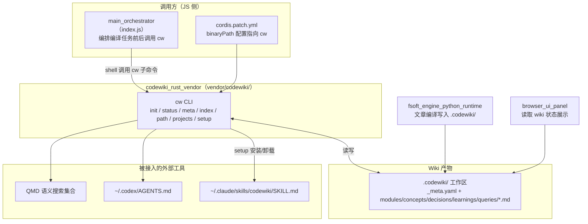
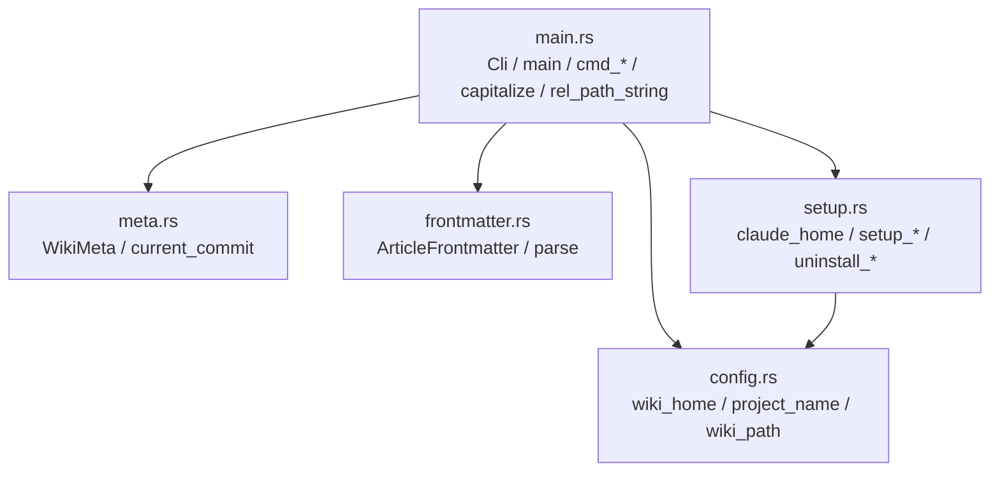
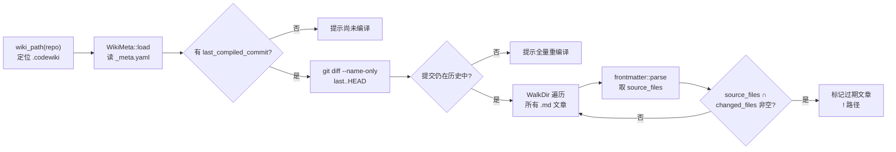
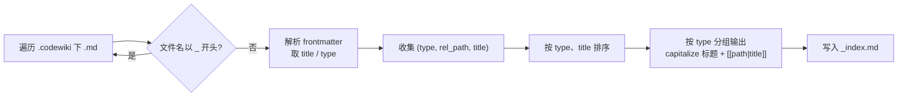
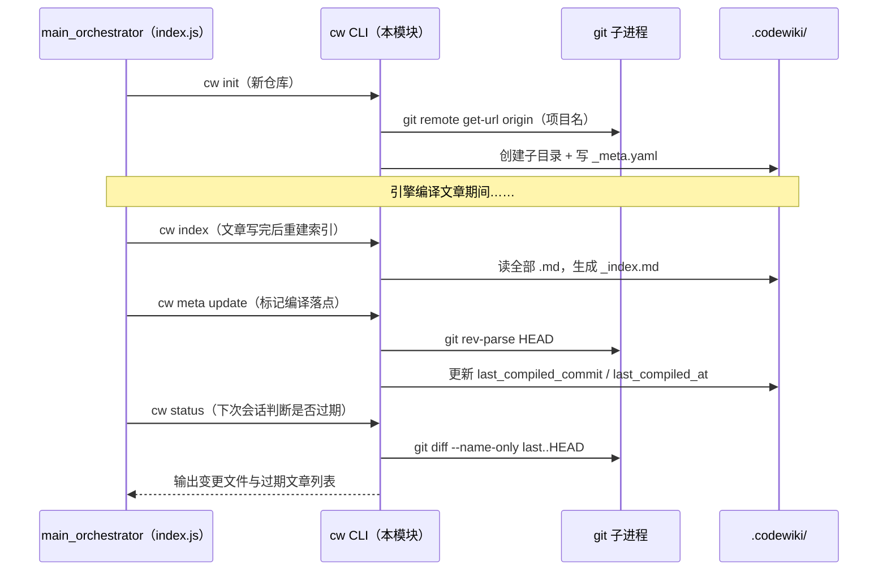

# codewiki_rust_vendor：cw Rust 命令行工具

## 简介

`codewiki_rust_vendor` 是 CodeWiki 插件内置的 Rust 命令行工具源码（位于 `vendor/codewiki/`），编译产物即 `cw` 可执行文件，随插件打包为 `bin/cw.exe`。它是上游 [FSoft-AI4Code/CodeWiki](https://github.com/FSoft-AI4Code/CodeWiki) CLI 的一个 fork，负责 Wiki 工作区的**生命周期管理**：初始化目录结构、跟踪已编译提交、检测代码变更导致的文章过期、重建索引、同步元数据，以及把 CodeWiki 接入各类 AI Agent（Claude Code、Codex、QMD 语义搜索）。

本模块**不负责**文章的编译生成——编译由 [fsoft_engine_python_runtime](fsoft-engine-python-runtime.md)（原生 Python 引擎通道）与 [agentic_article_pipeline](agentic-article-pipeline.md)（Node agentic 通道）完成。`cw` 只负责编译之外的「工作区基础设施」操作。

## 在整体系统中的位置

配置文件 `cordis.patch.yml`（见 [build_packaging_configuration](build-packaging-configuration.md)）中的 `binaryPath` 项说明：留空时优先使用 `PATH` 中的 `cw`，找不到再回退到插件自带 `bin/cw.exe`——后者即本 Rust crate 的编译产物。

## 模块架构与组件依赖

模块共 5 个源文件、单向依赖：`main.rs` 是唯一入口，`config.rs` 是纯路径工具，被 `meta.rs`（通过调用方间接）、`setup.rs` 使用，`frontmatter.rs` 与 `meta.rs` 均为无副作用的序列化/解析组件。

## 核心组件详解

### config.rs — 路径与项目名解析

| 函数 | 职责 |
| --- | --- |
| `wiki_home()` | 返回全局 Wiki 根目录 `~/.codewiki/`（用于 `cw projects` 列出所有项目） |
| `project_name(repo_path)` | 先在仓库内执行 `git remote get-url origin`，从 URL 末段剥离 `.git` 得到项目名；失败则回退为仓库目录名 |
| `wiki_path(repo_path)` | 返回**仓库内** Wiki 路径 `<repo>/.codewiki` |

> **FORK MOD**：上游把 Wiki 放在 `~/.codewiki/<project>`，本 fork 改为 `<repo>/.codewiki`，使 Wiki 产物随代码一起纳入版本控制。注意 `wiki_home()`（全局根）仍保留，供 `cw projects` 与 `cw setup qmd` 使用——这是 fork 中遗留的双路径模型。

### meta.rs — Wiki 元数据

`WikiMeta` 是 `_meta.yaml` 的序列化结构，字段包括：

- `project` / `repo_path`：项目名与仓库绝对路径；
- `last_compiled_commit`：最近一次编译对应的 git HEAD 哈希（增量检测的锚点）；
- `last_compiled_at` / `created_at`：UTC 时间戳。

`WikiMeta::load/save` 负责读写 `<wiki>/_meta.yaml`；辅助函数 `current_commit(repo_path)` 通过 `git rev-parse HEAD` 获取当前提交，供 `cw meta update` 使用。

### frontmatter.rs — 文章 YAML 头解析

`ArticleFrontmatter` 反序列化 markdown 文件开头的 YAML 块：

| 字段 | 类型 | 用途 |
| --- | --- | --- |
| `title` | `Option<String>` | 索引展示标题 |
| `article_type`（YAML 键 `type`） | `Option<String>` | 文章分类（module / concept / decision / learning / query），索引按此分组 |
| `source_files` | `Option<Vec<String>>` | 该文章覆盖的源码文件列表，是 `cw status` 检测过期的依据 |
| `tags` | `Option<Vec<String>>` | 自由标签 |

`parse(content)` 只在内容以 `---` 开头且能找到 `\n---` 闭合时返回 `Some`，否则返回 `None`（无 frontmatter 的文件被视为普通文档）。

### main.rs — CLI 入口与全部命令实现

基于 `clap` 派生的 `Cli` 结构，顶层命令分发到 7 个 `cmd_*` 函数。`capitalize()` 用于把文章类型首字母大写作为索引分组标题；`rel_path_string()` 把 `Path` 转成统一的 `/` 分隔相对路径（FORK FIX，见下文）。

### setup.rs — Agent / 工具集成安装

- 内嵌 `SKILL_MD`（`include_str!("../skills/codewiki-session.md")`）与一段 Codex 指令文本 `CODEX_AGENTS_SECTION`；
- `claude_home()` 返回 `~/.claude`，同类还有 `codex_home()` 返回 `~/.codex`；
- `setup_claude_code()`：写 `~/.claude/skills/codewiki/SKILL.md`；
- `setup_codex()`：幂等地向 `~/.codex/AGENTS.md` 追加 CodeWiki 指令段（已含 `## CodeWiki` 则跳过）；
- `setup_qmd()`：检测 `qmd` 在 PATH 中后，把 `wiki_home()` 加入名为 `codewiki` 的 QMD 集合并执行 `qmd embed` 建索引；
- 卸载侧：`uninstall_claude_code()` 删目录，`uninstall_codex()` 用 `remove_section()` 按章节标题剥离 AGENTS.md 中已注入的段落。

## CLI 命令参考

| 命令 | 实现函数 | 行为概要 |
| --- | --- | --- |
| `cw init` | `cmd_init` | 在 `<repo>/.codewiki` 创建 `modules/ concepts/ decisions/ learnings/ queries/` 五个子目录，写入初始 `_meta.yaml`；已存在时打印上次编译提交并退出 |
| `cw status` | `cmd_status` | 对比 `last_compiled_commit..HEAD` 的变更文件列表，再遍历文章 frontmatter 的 `source_files`，列出**过期文章** |
| `cw meta update` | `cmd_meta_update` | 把当前 HEAD 与时间戳写入 `_meta.yaml`（编译完成后由编排层调用，标记本次编译落点） |
| `cw index` | `cmd_index` | 扫描全部 `.md`（跳过 `_` 开头文件），按 `type` 分组、生成 `_index.md`，使用 Obsidian 风格 `[[path\|title]]` 链接 |
| `cw projects` | `cmd_projects` | 遍历 `~/.codewiki/` 下含 `_meta.yaml` 的项目并打印编译状态 |
| `cw path` | `cmd_path` | 仅打印当前仓库的 Wiki 绝对路径（供脚本取用） |
| `cw setup claude-code / codex / qmd` | `setup::setup_*` | 向对应 Agent/工具安装 CodeWiki 指令 |
| `cw uninstall claude-code / codex` | `setup::uninstall_*` | 反向卸载 |

## 关键流程

### `cw status` 增量过期检测（最核心流程）

设计要点：过期判定完全依赖文章 frontmatter 的 `source_files` 字段——这也是 [agentic_article_pipeline](agentic-article-pipeline.md) 编译生成文章时必须写入该字段的契约原因。若 `last_compiled_commit` 已不在当前历史（rebase/force-push），命令不会报错崩溃，而是建议全量重编译。

### `cw index` 索引重建

### 系统侧调用时序

## Fork 修改点（与上游差异）

| 修改 | 位置 | 原因 |
| --- | --- | --- |
| Wiki 存放在仓库内 `<repo>/.codewiki` 而非 `~/.codewiki/<project>` | `config.rs::wiki_path` | 让 Wiki 产物随代码版本控制；与 [fsoft_engine_js_core](fsoft-engine-js-core.md) 的 workspace 快照机制配套 |
| 相对路径统一输出 `/` 分隔符 | `main.rs::rel_path_string` | Rust `Path::display` 在 Windows 上输出 `\`，会污染过期列表与 `_index.md` 的 `[[...]]` 链接；而 `source_files` 等其余环节一律使用 `/` |

## 构建与打包集成

- 本 crate 由插件构建流程编译为 `bin/cw.exe`，随 npm 包 `@local/dsh-codewiki` 分发；
- `cordis.patch.yml` 的 `codewiki.binaryPath` 配置项决定运行时调用哪个 `cw`：显式路径 → `PATH` 中的 `cw` → 打包内置 `bin/cw.exe`；
- 依赖的外部命令：`git`（项目名、提交哈希、diff）、`qmd`（可选，仅 `setup qmd` 需要）；
- Rust 侧依赖（从代码可见）：`clap`、`serde` / `serde_yaml`、`anyhow`、`chrono`、`dirs`、`walkdir`。

## 与其他模块的关系

- [main_orchestrator](main-orchestrator.md)：编译编排层，在任务前后通过 shell 调用 `cw init / index / meta update / status`，是本 CLI 的主要调用方；
- [agentic_article_pipeline](agentic-article-pipeline.md)：编译通道负责写文章内容，必须遵守 frontmatter 契约（尤其 `source_files`），`cw status` 的过期检测才有意义；
- [fsoft_engine_python_runtime](fsoft-engine-python-runtime.md) / [fsoft_engine_js_core](fsoft-engine-js-core.md)：原生引擎通道，文章落盘后由 `cw index`/`cw meta update` 收口；
- [browser_ui_panel](browser-ui-panel.md)：前端面板读取 `.codewiki/` 产物展示 Wiki 状态（含 `cw path` 定位的目录）；
- [build_packaging_configuration](build-packaging-configuration.md)：`binaryPath` 与 `bin/cw.exe` 打包约定的配置层。
