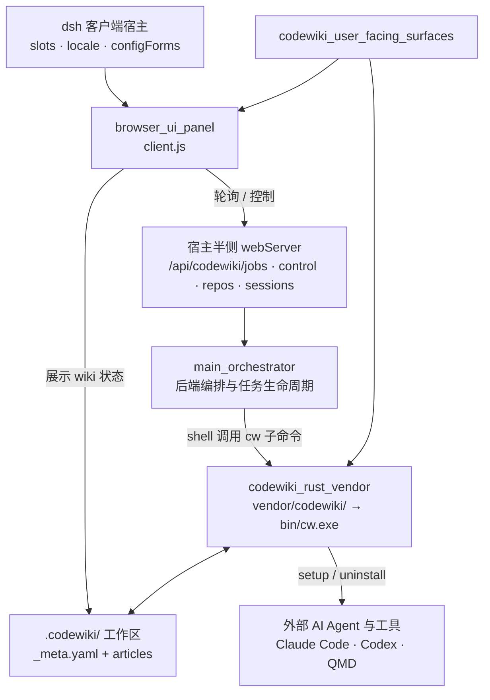

# CodeWiki 用户面向表面层（codewiki_user_facing_surfaces）

## 模块定位

`codewiki_user_facing_surfaces` 是 CodeWiki 插件中直接面向用户与外部工具的表面集合，主要由两个子模块组成：

- **[browser_ui_panel](browser-ui-panel.md)**：客户端浏览器渲染层 UI，代码位于 `client.js`。它在 dsh 宿主中挂载设置卡片与侧边栏面板，负责流水线参数配置、任务进度展示、仓库总览、LLM 会话记录查看，以及取消/立即编译等控制操作。该层不直接执行编译逻辑，也不直接触碰文件系统、LLM 或 git。
- **[codewiki_rust_vendor](codewiki-rust-vendor.md)**：内置 Rust CLI `cw` 的源码，编译产物为 `bin/cw.exe`。它负责 `.codewiki/` 工作区的初始化、过期检测、元数据更新、索引重建、路径查询，以及向 Claude Code、Codex、QMD 等外部工具安装 CodeWiki 接入；它不负责文章生成。

这一层的共同价值是：让用户能配置编译、观察进度、查看 Wiki 产物，并把 Wiki 工作区接入外部 AI 开发环境。

## 仓库结构

```text
codewiki_user_facing_surfaces/
├── browser_ui_panel/        # client.js
└── codewiki_rust_vendor/   # vendor/codewiki/
```

## 架构总览



关键边界：

- UI 面板的所有状态来自宿主 webServer 端点，通过定时轮询获取任务、仓库与会话数据；后端编排层才是任务状态与 job 数据的来源。
- `cw` 只维护编译之外的工作区基础设施；文章编译由原生 Python 引擎或 Node agentic 通道完成，之后再由 `cw index` 与 `cw meta update` 收口。
- UI 中的阶段展示与 `cw` 的工作区检测面向同一份 `.codewiki/` 产物，但职责分离：UI 负责呈现，CLI 负责读写与维护。

## 核心组件文档

| 组件 | 文档 | 核心职责 |
|---|---|---|
| 浏览器 UI 面板 | [browser_ui_panel.md](browser-ui-panel.md) | 设置卡片、侧边栏四 Tab 面板、轮询进度、任务取消、仓库总览、会话记录查看 |
| Rust CLI 工具 | [codewiki_rust_vendor.md](codewiki-rust-vendor.md) | `cw init / status / meta update / index / path / projects / setup`，Wiki 工作区生命周期与外部 Agent 接入 |

## 相关上下文

本表面层依赖后端编排与编译通道提供真实数据，包括：

- `main_orchestrator`：提供 `/api/codewiki/*` 端点与任务生命周期；
- `agentic_article_pipeline` 与 `fsoft_engine_python_runtime`：负责文章编译生成；
- `result_contract_and_quality_gates`：定义原生引擎阶段与质量门徽标语义；
- `job_repository_infrastructure`：提供 job 与更新记录存储。