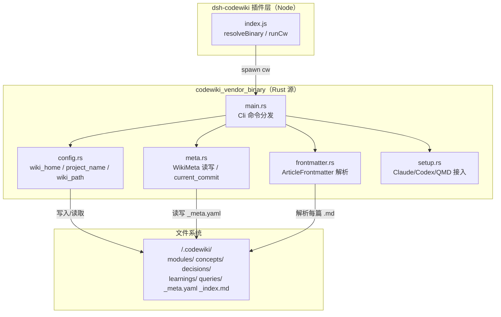
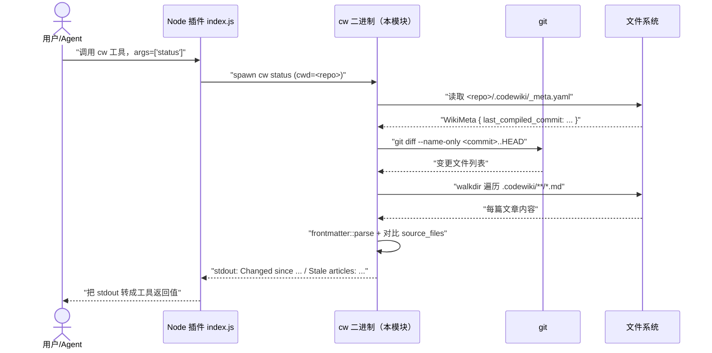
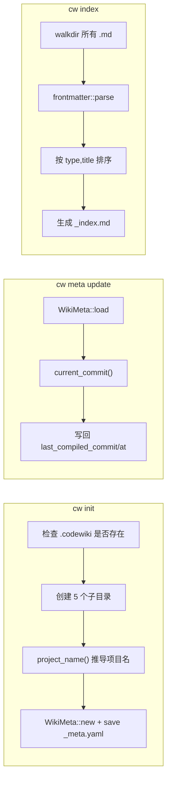
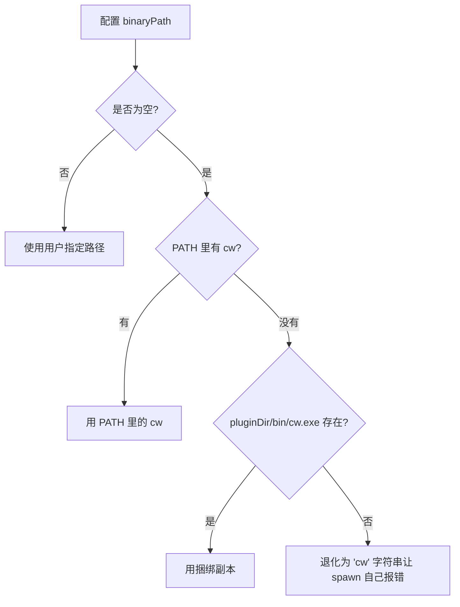

# codewiki_vendor_binary

## 简介

`codewiki_vendor_binary` 是本仓库**内置捆绑的 `cw` 命令行工具源码**（Rust 语言实现）。它源自上游项目 [mraza007/codewiki](https://github.com/mraza007/codewiki)（行为基线上游 main 提交 `64323823`），被 fork 后放入 `vendor/codewiki/` 目录，并被改造为「wiki 仓库内自托管」版本，最终编译为插件自带的二进制 `bin/cw` 或 `bin/cw.exe`。

该模块与上层 Node 插件（见 `index.js`）的关系是：插件里的 `cw` 工具（薄封装 `init`/`status`/`index`/`meta`/`path`/`projects`/`setup`/`uninstall` 八个子命令）就是直接调用本模块产出的二进制。插件通过 [resolveBinary()](https://github.com/local/dsh-codewiki) 解析 `cw` 路径：优先使用 PATH 里已安装的 `cw`（与用户的 codewiki 源码同步演进），找不到时回落到插件自带的 `bin/cw(.exe)`。

> 注：编译引擎本体（CodeWiki Python 原生引擎）并不在本模块中，而是由 [Code_Engine_Processing_Pipeline](code-engine-processing-pipeline.md) 中的 `lib/engine/python/entry.py` 负责，且需要用 `tools/fsoft-engine/setup-env.sh` 单独建立 venv 环境。两者是**两套独立的工具链**，但共用同一份 `.codewiki/` 产物目录与 `_meta.yaml` 元数据格式。

## 架构总览



图：`cw` 二进制在整个 dsh-codewiki 体系中的位置

## 核心模块分解

### `main.rs` — 命令行入口与分发

使用 [clap](https://docs.rs/clap) 定义的 `Cli` 结构及 `Subcommand` 枚举，提供 8 个子命令：

| 子命令 | 入口函数 | 作用 |
|--------|----------|------|
| `cw init` | `cmd_init` | 在当前仓库创建 `.codewiki/` 目录骨架（`modules/ concepts/ decisions/ learnings/ queries/`），并落写 `_meta.yaml` |
| `cw status` | `cmd_status` | 对比 `_meta.yaml` 里的 `last_compiled_commit` 与 `HEAD`，列出变更文件与因此过期的文章（基于每篇文章 frontmatter 的 `source_files` 字段反查） |
| `cw meta update` | `cmd_meta_update` | 把当前 `git rev-parse HEAD` 写回 `_meta.yaml`，并记录 `last_compiled_at` |
| `cw index` | `cmd_index` | 扫描所有 `.md`，按 `type` 分组、按 `title` 排序，重建 `_index.md`（Obsidian 风格的 `[[link|title]]`） |
| `cw projects` | `cmd_projects` | 列出 `~/.codewiki/` 下所有项目及其编译状态 |
| `cw path` | `cmd_path` | 打印当前仓库的 `.codewiki/` 绝对路径 |
| `cw setup <target>` | `setup::setup_*` | 把 codewiki 接入 Claude Code / Codex / QMD |
| `cw uninstall <target>` | `setup::uninstall_*` | 反向卸载 |

辅助函数 `capitalize(s)` 用于把 `type` 字段（如 `module`）标题化（`Module`）作为 `##` 分组标题；`rel_path_string(rel)` 把路径统一成 `/` 分隔（**FORK 修复**：上游 `Path::display()` 在 Windows 下输出 `\`，污染了 `cw status` 的 stale 列表和 `_index.md` 的 `[[...]]` 链接，因为插件其余部分都约定 `/`）。

### `config.rs` — 路径与项目名解析

- `wiki_home() -> Result<PathBuf>`：所有 wiki 的基目录 `~/.codewiki/`，仅被 `cw projects` 和 `cw setup qmd` 使用。
- `project_name(repo_path) -> Result<String>`：优先从 `git remote get-url origin` 的 URL 末段（去 `.git` 后缀）推导；失败时退回到仓库目录名。
- `wiki_path(repo_path) -> Result<PathBuf>`：**关键的 FORK 修改点**——上游把 wiki 放在 `~/.codewiki/<project>`，本 fork 改为放在 `<repo>/.codewiki/` 内部，这样 wiki 产物与代码一起进入 git 版本控制，配合插件的 `autoCommit` 设置项（默认开启）自动提交 `docs(wiki)`。

### `meta.rs` — `_meta.yaml` 元数据

`WikiMeta` 结构体（serde 序列化）字段：

```yaml
project: dsh-codewiki
repo_path: E:/ik/Documents/trae_projects/1/dsh plugin/dsh-codewiki
last_compiled_commit: 9f1e4b2c...      # Option<String>；未编译时为 null
last_compiled_at: 2025-...T...Z        # Option<DateTime<Utc>>
created_at: 2025-...T...Z
```

`WikiMeta::load/save` 直接读写 `<wiki>/_meta.yaml`；`current_commit(repo_path)` 运行 `git rev-parse HEAD` 获取当前完整哈希——`cmd_meta_update` 用它打基线，`cmd_status` 用它做 `git diff <commit>..HEAD`。

### `frontmatter.rs` — YAML frontmatter 解析

`ArticleFrontmatter` 字段（全部 `Option`，缺字段不报错）：

```yaml
---
title: "引擎客户端"
type: module           # 对应 serde rename = "type"
source_files:         # 被 cw status 用来检测 stale
  - lib/engine/client.js
tags: [engine, llm]
---
```

`parse(content)` 是一个手写的极简解析器：仅支持 `---\n...\n---` 形式，没有闭合符时返回 `Ok(None)`，不 panic。`serde_yaml::from_str` 负责真正的 YAML 反序列化。

### `setup.rs` — Agent 工具接入

把 codewiki 的"会话开始前查 wiki，会话结束后更新 wiki"行为注入到外部 agent：

- **Claude Code**（`setup_claude_code`）：把内嵌的 `SKILL_MD`（`include_str!("../skills/codewiki-session.md"`）写入 `~/.claude/skills/codewiki/SKILL.md`。
- **Codex**（`setup_codex`）：把一段 `CODEX_AGENTS_SECTION` 文本追加到 `~/.codex/AGENTS.md`（若已含 `## CodeWiki` 段则跳过）；`uninstall_codex` 用 `remove_section()` 按 `## ` 二级标题边界删除该段。
- **QMD**（`setup_qmd`）：调用 `qmd collection add ~/.codewiki --name codewiki` 把 wiki 加入 QMD 语义检索集合，再跑 `qmd embed` 建向量索引。

辅助 `claude_home()`/`codex_home()` 在 `dirs::home_dir()` 失败时兜底为 `.`。

## 命令数据流



图：`cw status` 的典型执行链



图：三个最常用写命令的内部流程

## 与插件的集成

`index.js` 中的 `runCw(binary, cwd, args, timeoutMs)` 是唯一调用本模块二进制的桥：

- 超时默认 120s（`meta update`/`status` 等都够用）。
- 通过 `AbortSignal` 响应插件会话取消。
- 三态输出契约（见 `index.js` 注释）：
  - `'No wiki found. Run \`cw init\` first.'` / `'Wiki has not been compiled yet.'` → 未初始化
  - `'Wiki is up to date.'` → 已是最新
  - `'Changed since last compile (<hash>):'` + `'  M <file>'` + `'Stale articles:'` + `'  ! <article>'` → 需要增量更新

配置项 `binaryPath`（见 [cordis.patch.yml](cordis.patch.yml)）允许用户强制指定某一份 `cw`：留空时按 `PATH → 插件自带 bin/cw` 顺序解析。



图：`resolveBinary()` 的解析优先级

## FORK 与上游的差异

`vendor/codewiki/src/` 中的两处注释明确标注了 fork 改动：

1. **`wiki_path()` 放仓库内**（`config.rs`）：上游是 `~/.codewiki/<project>`，本 fork 改为 `<repo>/.codewiki`——为了让 wiki 产物受 git 版本控制、配合 `autoCommit` 自动提交。
2. **`rel_path_string()` 统一 `/`**（`main.rs`）：上游 `Path::display()` 在 Windows 输出 `\`，会污染 `cw status` stale 列表和 `_index.md` 的 `[[...]]` 链接（其他模块都约定 `/`）。

其余行为遵循上游基线（commit `64323823`），包括子命令集合、frontmatter 字段、`_meta.yaml` schema。

## 构建与分发

- 本目录是**纯 Rust 源码**，不参与 Node 打包流程（`package.json` 里没有任何 Rust build 脚本）。
- 实际可用的 `bin/cw` / `bin/cw.exe` 需要单独 `cargo build --release` 后拷贝；`package.json` 的 `dsh.bundle.patch` 只引用 `cordis.patch.yml`，不涉及本 Rust 源码。
- 因此：如果你只在 Node 侧开发，不需要动本目录；只有修改了 `cw` 行为（例如要新增子命令、调整 frontmatter schema）才需要到 `vendor/codewiki/` 里改 Rust，然后重新编译并把产物放进 `bin/`。

## 相关模块

- [Extension_Host_Execution_Orchestration](extension-host-execution-orchestration.md)：宿主侧如何调用 `cw status` / `cw meta update` 来驱动增量编译（`tickCommit` / `currentCommit` 等）。
- [Code_Engine_Processing_Pipeline](code-engine-processing-pipeline.md)：Python 原生编译引擎，负责真正的"写文章"环节；产出的 `.md` 文件格式（frontmatter 字段）与本模块解析的格式必须保持一致。
- [State___Observability_Management](state-observability-management.md)：JS 侧的 job 状态存储，与本模块的 `_meta.yaml` 是两套独立的元数据（前者追踪编译任务运行时，后者追踪 wiki 产物版本基线）。
- [build_deployment_config](build-deployment-config.md)：`cordis.patch.yml` 中的 `binaryPath` 配置项定义了本二进制的解析入口。
