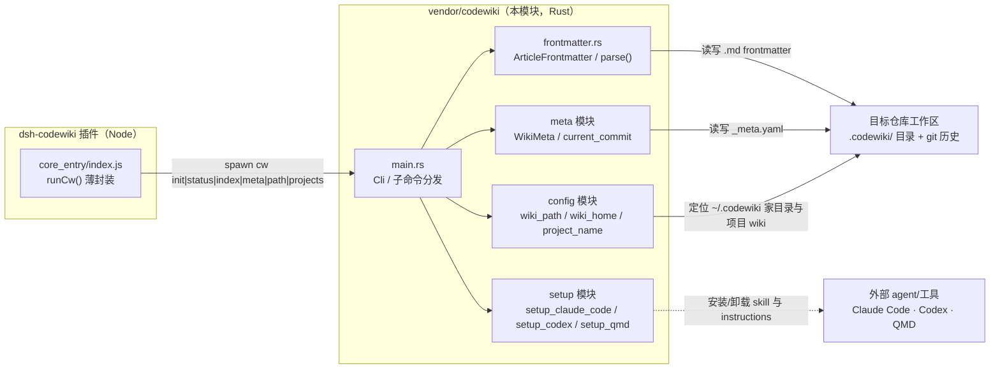
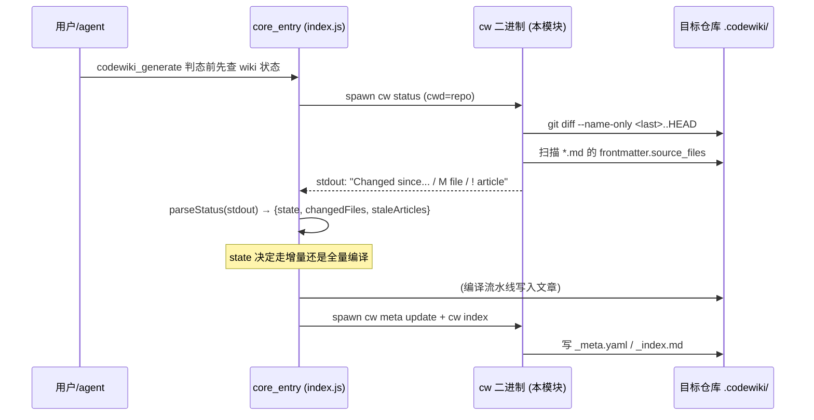

# codewiki_vendor（cw CLI 上游 Rust 供应商副本）

## 模块定位

本模块是插件仓库 `vendor/codewiki/` 下的一份**上游 CodeWiki（`mraza007/codewiki`）Rust CLI 源码的本地 fork（vendor 副本）**，二进制命令名为 `cw`。它是整个 dsh-codewiki 插件的"地基级"基础设施：负责 LLM 编译型代码 wiki 的**仓库侧静态管理**——初始化 wiki 目录、计算自上次编译以来的变更、重写 `_index.md`、记录与展示编译元数据（`.codewiki/_meta.yaml`）、以及把 codewiki 能力安装/卸载到各类外部 agent 或工具（Claude Code、Codex、QMD）。

> 注意职责边界：`cw` 本身**不执行编译**。编译流水线（Node 通道或 FSoft Python 原生通道）由 [core_entry](core_entry.md)（`index.js`）、[agentic_support](agentic_support.md) 与 [engine_core](engine_core.md) 实现；`cw` 只提供 wiki 的文件布局约定、frontmatter 契约与状态查询能力。

## 架构概览

## 核心组件

### `vendor/codewiki/src/main.rs` — CLI 入口与全部子命令

基于 [`clap`](https://crates.io/crates/clap) 的派生式命令行解析，命令组 `cw`（"Manage LLM-compiled code wikis"）。`Cli` 枚举所有子命令，`main()` 按 `command` 分发到各 `cmd_*` 自由函数；未在本页展开的 `config` / `meta` / `setup` 模块通过 `mod` 声明被同一二进制编译。

| 子命令 | 实现函数 | 行为 |
| --- | --- | --- |
| `cw init` | `cmd_init()` | 在当前仓库下创建 `.codewiki/`（`modules/`、`concepts/`、`decisions/`、`learnings/`、`queries/` 五个子目录）并落盘 `_meta.yaml`；已存在时只打印项目名与最近编译 commit 短哈希 |
| `cw status` | `cmd_status()` | 用 `git diff --name-only <last_compiled>..HEAD` 取变更文件清单，再扫描所有文章 frontmatter 的 `source_files`，输出"变更文件（`M`）"与"过期文章（`!`）"两段清单；commit 已不在历史时提示全量重编译 |
| `cw meta update` | `cmd_meta_update()` | 把当前 HEAD commit 与 UTC 时间写回 `_meta.yaml` 的 `last_compiled_commit` / `last_compiled_at` |
| `cw index` | `cmd_index()` | 遍历所有 `.md`（跳过 `_` 开头的元文件），按 `article_type` 分组、按 `title` 排序，重写 `_index.md`，条目格式为 `[[<路径不含.md>|<标题>]]` |
| `cw projects` | `cmd_projects()` | 列出 wiki 家目录（`~/.codewiki` 下）全部项目的 `_meta.yaml`，显示项目名、仓库路径与编译状态 |
| `cw path` | `cmd_path()` | 仅打印当前仓库对应的 wiki 绝对路径 |
| `cw setup {claude-code|codex|qmd}` / `cw uninstall {claude-code|codex}` | `setup::*` | 把 codewiki skill/instructions 安装或卸载进外部 agent/工具 |

`capitalize()` 是一个极小的工具函数：把字符串首字母转大写，用于 `_index.md` 里文章类型分组标题的首字母大写。

### FORK FIX：`rel_path_string()`

`cmd_status()` 与 `cmd_index()` 输出的所有 wiki 相对路径都经过 `rel_path_string()`：把 Rust `Path::display()` 在 Windows 上产出的 `\` 替换为规范 `/`。注释里明确记录了动机——这是本 fork 相对上游 main 的一次"根治"：否则 Windows 后端的 stale 清单与 `_index.md` 的 `[[...]]` 链接会带上反斜杠污染，与 frontmatter `source_files`、插件解析器约定的正斜杠路径不一致。

对应地，[core_entry](core_entry.md)（`index.js`）里保留了双层纵深防御：`normalizeArticlePath()` 与 `normalizeIndexLinks()` 在旧二进制或上游原版的 Windows 输出上再做一次归一化。

### `vendor/codewiki/src/frontmatter.rs` — 文章 frontmatter 契约

`ArticleFrontmatter` 是一个 `serde::Deserialize` 结构，字段全部 `Option` 容错：

| 字段 | 作用 |
| --- | --- |
| `title: Option<String>` | 文章显示标题；缺省时 `cw index` 退回用文件相对路径当标题 |
| `article_type`（serde rename 自 YAML `type`） | 文章类型分组键（`module` / `concept` / …）；`cw index` 据此分节，`cw status` 不依赖 |
| `source_files: Option<Vec<String>>` | 该文章依据的源码文件列表；`cw status` 用它判断"哪些文章因源码变更而过期" |
| `tags: Option<Vec<String>>` | 自由标签 |

`parse(content: &str) -> Result<Option<ArticleFrontmatter>>` 是 frontmatter 解析器：仅当内容 trim 后以 `---` 开头才尝试，在其后找 `\n---` 定界，中间段交给 `serde_yaml` 反序列化；缺 frontmatter、定界缺失或 YAML 解析失败分别回退 `Ok(None)` 或 `Err`。这是**整个插件与 wiki 文件之间的稳定契约**——Node 通道的文章写入（[agentic_support](agentic_support.md)）与原生引擎通道（[engine_core](engine_core.md)）产出的文章都必须遵守同一 frontmatter 形状，`cw status` 才能跨通道正确判 stale。

## 在系统中的位置与依赖关系

- **被谁调用**：[core_entry](core_entry.md) 把 `CW_SUBCOMMANDS = ['init','status','index','meta','path','projects','setup','uninstall']` 列为受支持子命令；`resolveBinary()` 的查找顺序为 `config.binaryPath` → PATH 里的 `cw` → 插件自带 `bin/cw(.exe)` 兜底 → 最后回退裸 `cw`。注释强调 PATH 优先是为了让用户安装的 cw 与 codewiki 源码同步演进，避免捆绑副本落后造成的"手工 bash 正常、包装层 `No wiki found`"分叉。
- **依赖的外部工具**：`cw status` 直接调用 `git` 子进程（`git diff --name-only`），因此要求当前目录是 git 仓库。
- **与其它模块的边界**：
  - [agentic_support](agentic_support.md)（`lib/articles-agentic.js` 等）负责写出符合 `ArticleFrontmatter` 契约的文章；本模块只负责**读**这些 frontmatter 来判 stale。
  - [engine_core](engine_core.md) 的原生通道编译完成后，仍由本模块的 `meta update` / `index` 收口元数据与索引。
  - [client_ui](client_ui.md) 在侧边栏展示的 wiki 篇数、最近编译 commit 短哈希等，均来自本模块 `cmd_projects()` / `cmd_init()` 打印的人类可读输出经插件侧解析。

## 构建与分发上下文

- 本模块源码编译出的二进制由构建/配置层的包清单（`package.json`，`@local/dsh-codewiki`）声明，插件通过 `bin/cw(.exe)` 携带兜底副本；Cordis 补丁配置 `cordis.patch.yml` 中的 `binaryPath` 配置项（留空时按上面的优先级解析）负责定位它。详见 [Build___Dependency_Configuration_Layer](Build___Dependency_Configuration_Layer.md)。
- fork 相对上游 main 的行为基线（main 64323823）与 Windows 路径根治历史，详见源码树内的 `vendor/codewiki/FORK.md` 与 wiki 笔记 `.codewiki/learnings/cw-binary-source-lost.md`（由 `cw index` 收录进索引）。
