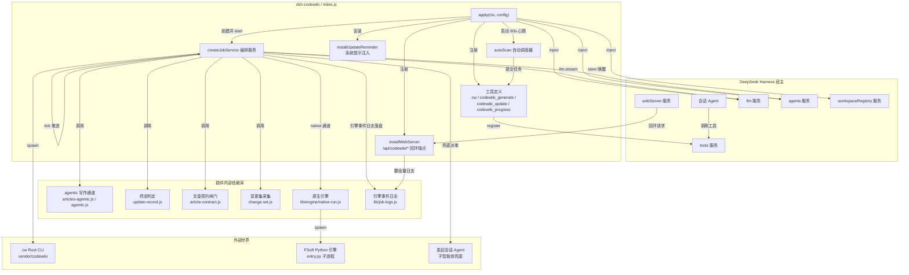
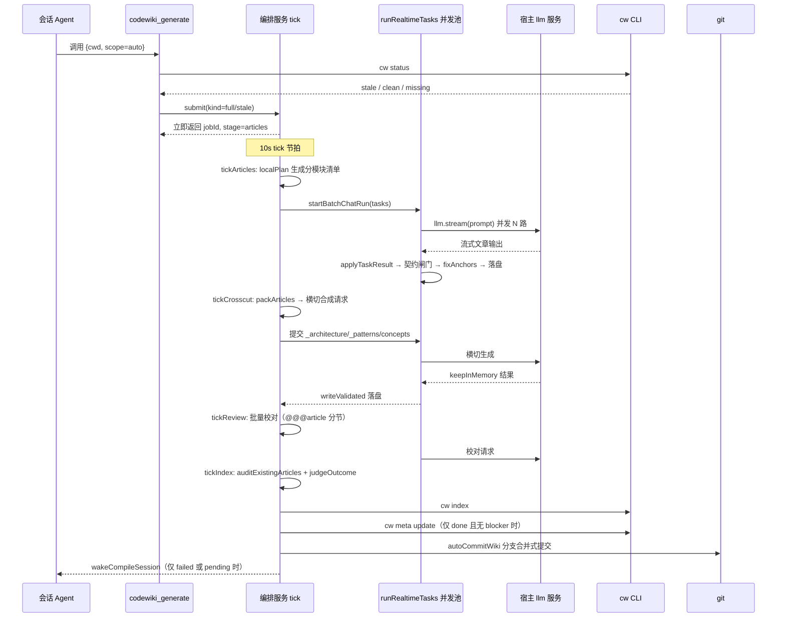
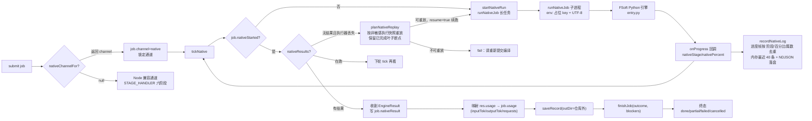
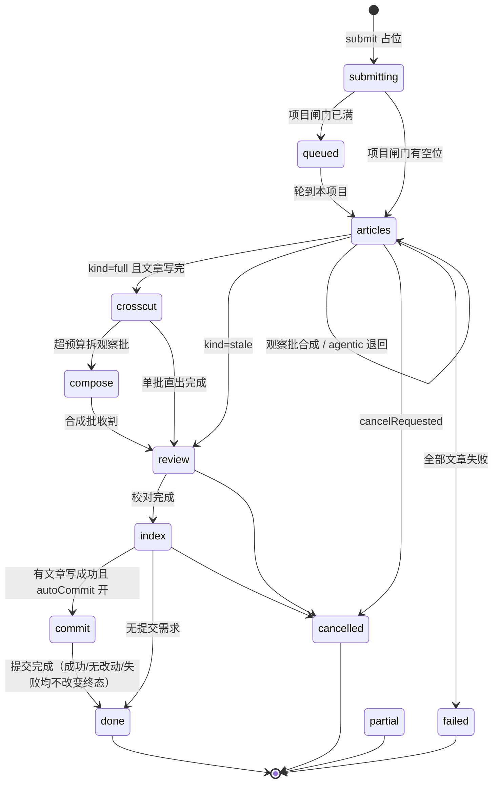
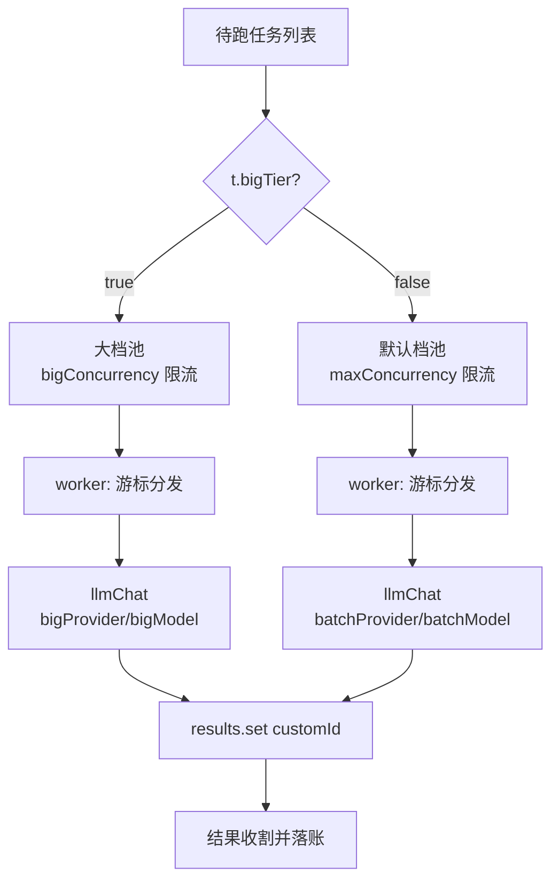
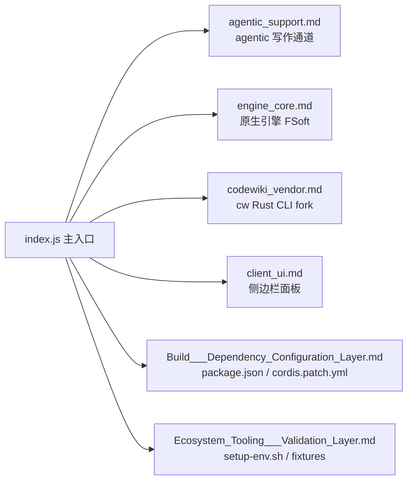

# core_entry 模块文档

## 简介

`core_entry` 是 **dsh-codewiki 插件（`@local/dsh-codewiki` v0.17.x）** 的主入口模块，位于插件根目录的 `index.js`。它承担三大职责：

1. **薄封装 CodeWiki CLI（`cw`）**：提供 `cw` 工具，执行 `init` / `status` / `index` / `meta` / `path` / `projects` / `setup` / `uninstall` 等子命令，对仓库根 `.codewiki/` 目录进行初始化、判态与索引维护。
2. **服务化编译编排**：提供 `codewiki_generate` / `codewiki_update` / `codewiki_progress` 三个工具，把编译任务提交给宿主常驻后台服务（job service），由该服务以 **10s tick** 节拍驱动阶段状态机推进（写文章 → 横切 → 校对 → 索引 → 自动提交），全程零子代理。
3. **原生引擎通道（默认）与兼容通道（Node 流水线）**：`nativeEngine=true`（0.16.0 起默认）时，编译委托给上游 FSoft Python 引擎子进程；关闭则退回内置 Node 流水线（`nativeEngine=false`）。

> 插件通过 [package.json](Build___Dependency_Configuration_Layer/package_manifest.md) 声明的 cordis 插件 id 为 `codewiki`，配置命名空间同名。挂载方式见 [cordis.patch.yml](Build___Dependency_Configuration_Layer/cordis.patch.yml)。

> 0.17.1 起，原生通道新增**引擎事件日志双通道**：内存里只留最近 40 条（给面板即时看），同时逐条追加到仓库外临时目录的 NDJSON（`lib/job-logs.js`），并经 `GET /api/codewiki/logs?jobId=&limit=` 端点按需翻全量；原生通道的真实 token 用量也按 FSoft `usage_ledger` 的字段映射落进 `job.usage`。

---

## 架构总览

---

## 核心组件分组

`index.js` 体量较大（约 2000 行），可按职责划分为以下几簇：

### 1. 配置与二进制解析

| 组件 | 职责 |
|------|------|
| `Config`（schemastery schema） | 全部 30+ 配置项声明：模型 provider/model、并发、原生引擎开关、自动提交等 |
| `liveConfig(config)` | 把 volatile 配置对象收敛为运行时快照，统一做边界钳制（并发硬顶 8、预算下限等） |
| `resolveBinary(cfg)` | `cw` 可执行文件解析：优先 PATH，兜底插件自带 `bin/cw(.exe)` |
| `runCw(binary, cwd, args, timeoutMs, signal)` | spawn `cw` 子进程并超时/可中止地收集 stdout/stderr |
| `normalizeCwd(input)` | Windows Git-Bash `/e/...` 路径归一化为 `E:/...` |

### 2. 编译通道决策

| 组件 | 职责 |
|------|------|
| `nativeChannelFor(cfg, {kind, scope})` | **通道选择唯一入口**：返回 `null` = 走旧 Node 流水线；否则返回 `{python, entry, timeoutMs, scope}` |
| `resolveNativePython(cfg)` | 解释器解析：配置 > `DSH_CODEWIKI_PYTHON` 环境变量 > `python`（不做启发式猜测） |
| `nativeEnginePlan(channel, {bridge, model, clusterModel})` | 组装引擎子进程环境变量（占位 key、UTF-8、无 keyring） |

### 3. 文章质量与契约闸门

| 组件 | 职责 |
|------|------|
| `contractCheck(content, {...})` | 统一调用 [article-contract.js](agentic_support.md) 的 `inspectArticle`，拆出 `blocking` / `warnings` |
| `allowedLinkTargets(job)` | 收集现存 wiki 文章 + 本轮计划产出文章，供死链校验 |
| `makeLinkExists(wikiPath, extraNames)` | 返回 `(target) => boolean` 链接解析函数 |
| `validateArticleEnvelope(content)` | 校验 frontmatter 成对开合 |
| `fixAnchors(content, cwd)` | 落盘前确定性校正行号锚点 `file:NN(-MM)` |
| `fixChangelogAnchors(content, cwd)` | CHANGELOG 流水账按「版本节首 + 相对偏移」重定位 |
| `pruneOrphanModules(job)` | 全量编译时清理 `modules/` 下改名遗留的孤儿文章 |
| `ensureWikiEntry(cwd, language)` | 仓库根缺 `CodeWiki.md` 时自动生成入口 |

### 4. 并发池与 LLM 通道

| 组件 | 职责 |
|------|------|
| `llmChat({llm, provider, model, reasoningEffort, prompt, signal, onDelta})` | 唯一的 LLM 请求通道（走宿主 `llm.stream`），凭证由宿主按 provider 解析 |
| `runRealtimeTasks(tasks, {...})` | **唯一执行器**：按 `bigTier` 标记把任务拆成默认档池 + 大档池，各自独立限流并发 |
| `runPool(pool)` / `worker()` | 池内消费逻辑：游标分发、单请求失败记账、会话记录回调 |
| `applyTaskResult(task, content, notes)` | 统一写盘点：先过契约闸门，再 `fixAnchors`，最后落盘 |
| `estimateTokens(text)` | 粗算 token（CJK ≈ 1，其余 ≈ 3.5 字符/token） |
| `collectSources(cwd, files, budget)` | 按 token 预算整文件内联源码（不做半文件截断） |
| `prepareArticleTasks(tasks, {...})` | 装填决策：普通档 / 大档 / 观察批→合成 / 会话通道兜底 |

### 5. 编排服务（job service）

由 `createJobService(config, onSettled)` 闭包返回，核心是一组 **tick 阶段处理器**：

| 组件 | 职责 |
|------|------|
| `tick()` | 10s 节拍主循环：tick 入口/出口的跨实例锁（经 `lib/job-store.js` 的 `acquireTickLock`/`releaseTickLock`）、磁盘合并、心跳续期、取消标记同步、项目闸门、分发到各 stage handler |
| `recordNativeLog(job, entry)` | 引擎事件日志收口（0.17.1）：内存 `job.nativeLogs` 截断保留最近 40 条，同时经 `lib/job-logs.js` 逐条追加仓库外 NDJSON；落盘失败置 `job.logError` 并记一条 note。`onLog` 回调（桥请求失败、stderr、阶段切换）与去重后的 `onProgress` 帧（按 `阶段|百分比|篇数` 签名）都经它落账 |
| `tickArticles(job)` | 写文章阶段：本地规划 → agentic 或单轮通道 → 收割 → 观察批合成 / agentic 退回判定 |
| `tickCrosscut(job)` | 横切阶段：合成 `_architecture.md` / `_patterns.md` / 概念文章；超预算拆观察批 |
| `tickCompose(job)` | 横切观察批的合成批收割 |
| `tickReview(job)` | 校对阶段：本地核对 → 批量校对请求（`@@@article` 标记分节）→ 会话通道兜底 |
| `tickIndex(job)` | 索引前：存量体检、`judgeOutcome` 完整性判定、孤儿清理、wiki 骨架守卫（目录不在先 `cw init`、目录在却缺 `_meta.yaml` 记 `wiki-missing` 硬阻塞）、`cw index`、基线推进闸门（`cw meta update`）、index/meta 后用 `hardBlockers` 重裁终态并落 `baselineEligible` / `baselineAdvanced` |
| `tickCommit(job)` | 自动提交产物（`autoCommitWiki` 分支合并式） |
| `tickNative(job, channel)` | 原生通道专属推进：启动一次长任务后只等待；宿主重启/旧实例退出后按持久化的非敏感执行快照（`planNativeReplay` / `snapshotNativeRun`）重放重跑——旧引擎产物目录不再删除，而是落成 `job.nativeResumeDocsDir` 断点，由 `startNativeRun` 以 `runNativeJob` 的 `resume: true` 传给引擎续跑（已完成的叶子直接保留，note 记「保留已完成叶子断点」）；断点目录已消失则清空它、从空目录重新跑；已落盘结果按事实收割；结果收割后直接 `finishJob`。收割时把引擎上报的真实 token 用量（FSoft `usage_ledger`）映射进 `job.usage`（沿用 `inputTok`/`outputTok`/`requests`/`cachedTok` 旧形状，全量记在实时侧），并在 `nativeResult.usage` 保留引擎原值 |
| `submit({kind, cwd, ...})` | 任务提交入口：排除清单 / worktree / 空壳目录闸门、磁盘合并后的幂等判定（同仓库活动任务可重归属会话）、占位落盘 |
| `cancel(jobId)` | 置 `cancelRequested` 标记，跨 tick 存活；原生结果已落地/执行器已结束时按真实结果收尾而非丢弃产物 |
| `list()` / `jobSummary(job)` | 导出任务只读视图（供工具与面板共用）：除 `canAdvanceBaseline` 外还透出 `baselineEligible` / `baselineAdvanced` / `deliveryComplete`；0.17.1 起新增透出 `nativeLogs`（内存最近 40 条）、`logFile`（NDJSON 落盘路径，仅 native 通道）与 `logError`（日志落盘失败原因） |
| `finishJob(job, outcome, blockers)` | 三态收尾：`done` / `partial` / `failed`；只算 `deliveryComplete`，`canAdvanceBaseline` 直接采信 index/meta 或落地器已经实测的 `baselineAdvanced` |
| `occupancyHeld(job)` | 项目闸门占位判定：原实例停更超过 `ORPHAN_TAKEOVER_MS` 的任务不算占位，避免重启后新任务一直卡在 queued |

### 6. 会话通道与会话记录

| 组件 | 职责 |
|------|------|
| `dispatchSessionTasks(job, tasks)` | 超预算任务写任务文件，steer 给发起会话派子智能体 |
| `classifySessionTask(task)` | 三态判定：`harvest` / `wait` / `timeout` |
| `progressSessionTasks(job)` | 收割会话通道产出，过 `writeValidated` 闸门落盘 |
| `buildSessionSteerText({job, snapshots, tier, resend})` | steer 文本组装（`sessionTier` 非空时钉死档位） |
| `beginSessionRecord(job, task)` | 每个 LLM 请求的 prompt/流式输出落盘（面板「会话」视图数据底座）；batch / agentic / 原生三条通道分别经执行器的 `onRequestStart` 钩子各自接线 |
| `wakeCompileSession(job, outcome, agents)` | 终态唤醒发起会话：失败或「产物待提交」才打扰，否则静默 |

### 7. 面板后端与工具注册

| 组件 | 职责 |
|------|------|
| `installWebServer(ctx, service, extra)` | 注册 `/api/codewiki/jobs`、`/repos`、`/sessions`、`/models`、`/control`（仅回环）；0.17.1 起另注册 `/api/codewiki/logs?jobId=&limit=`，经 `lib/job-logs.js` 的 `logStats` / `readLogTail` 翻仓库外 NDJSON 全量日志 |
| `cwToolDefinition(cfg)` | `cw` 工具定义 |
| `generateToolDefinition(cfg, svc)` | `codewiki_generate` 工具定义（提交制） |
| `updateToolDefinition(cfg, generateDef)` | `codewiki_update` 工具定义（固定 scope=auto 快捷入口） |
| `progressToolDefinition(cfg, svc)` | `codewiki_progress` 工具定义（只读查询）：输出 schema 0.17.1 起新增 `nativeStage` / `nativePercent` / `nativeMessage` / `nativeLogs` / `logFile` / `logError` 六个字段，文本视图追加「引擎：…% — message」与「日志：…」两行 |
| `progressView(job)` | 在 `jobSummary` 上计算百分比 |

### 8. 仓库与基线辅助

| 组件 | 职责 |
|------|------|
| `currentCommit(cwd)` | `git rev-parse --short HEAD` 快照 |
| `reposFileFor(jobsFile, explicit)` | 已知仓库清单文件路径推导（跟随 JOBS_FILE 名字隔离） |
| `detectLinkedWorktree(cwd)` / `isWorktreeCwd(cwd)` | linked worktree 检测（带 60s 缓存） |
| `hasCompilableSources(cwd)` / `isDeadCompileTarget(cwd)` | 空壳目录判定（带缓存） |
| `autoCommitWiki(cwd, {...})` | 分支合并式自动提交：只 add `.codewiki/` 与 `CodeWiki.md` |
| `parseStatus(stdout)` | 解析 `cw status` 三态输出 |
| `collectWikiArticles(wikiPath)` | 遍历 wiki 全部文章（含 frontmatter 的 `source_files`） |

---

## 数据流：一次完整编译（兼容通道）

---

## 数据流：原生引擎通道（默认）

> 原生通道的裁决链（环境检测 → 图提取 → 聚类 → 文章 → 质量门 → 落地 → 基线 → 提交）全部固定在 [engine_core](engine_core.md) 的 `native-run.js` / `apply-plan.js` 内，`index.js` 只负责「起进程 / 收进度 / 按结果判终态」，绝不在 tick 里重写裁决。
>
> 起进程时经 `runNativeJob` 的 `deps.onRequestStart` 把原生通道的每个模型请求（全部经 llm-bridge 打进来）接入 `beginSessionRecord`：此前不在这里接线，面板「会话」视图对原生任务永远是空列表（batch / agentic 通道早已各自接好）。桥侧回调契约与 batch 通道一致（`onDelta` / `onError` / `onDone`），且只记 messages 文本与模型输出，绝不落 Authorization 请求头或占位 key。
>
> 0.17.1 起，`onLog` 回调（桥请求失败、stderr、阶段切换）与去重后的 `onProgress` 帧统一经 `recordNativeLog` 双通道落账（内存最近 40 条 + 仓库外 NDJSON），`/api/codewiki/logs` 端点按需翻全量；结果收割时把引擎侧 `usage_ledger` 的真实 token 数映射进 `job.usage`，此前面板与 `codewiki_progress` 对原生通道一直显示 0。

---

## 阶段状态机

> 原生通道：`job.channel === 'native'` 的 job **一律只走 `tickNative`**，不进入上述 handler 表——避免同一批产物被新旧两套实现各写一遍。

---

## 并发模型（双池分档）

**设计要点**：
- 大档任务（单批输入超 110k 普通预算）走 `bigProvider/bigModel`（默认 512k 上下文的 `volces-ark/glm-5.3-flash`），与默认档独立限流、同时推进——两者配额互不相干。
- `bigConcurrency=0` 时回落跟随默认档并发（向后兼容）。
- 总在飞请求数 = 默认档并发 + 大档并发，硬顶各 8。

---

## 跨实例与持久化

| 机制 | 位置 | 作用 |
|------|------|------|
| `JOBS_FILE` | `os.tmpdir()/dsh-codewiki-jobs.json` | 任务持久化（仅保留最近 30 条；读写由 `lib/job-store.js` 的 `createJobsStore` 收口，落盘走 `save` → 同目录临时文件 + fsync + 重试 rename 的原子写盘） |
| tick 锁 | `lib/job-store.js` 的 `acquireTickLock` / `releaseTickLock` | 跨实例 tick 锁（原 `JOBS_LOCK_FILE` 自写锁已迁入 job-store）；现场损坏时停止推进，避免重复执行 |
| `mergeFromDisk()` | tick 前 | 吸收另一实例新增/更新的 job，防止过期快照覆盖；同时回收「磁盘上已不存在」的幽灵任务，避免它们一直占住项目闸门 |
| `syncCancelFlags()` | tick 开头 | 从磁盘拾取另一实例置的 `cancelRequested` |
| 心跳 | tick 每轮 | 活动任务经 `heartbeat` 更新 `lastSeenAt`，供 `occupancyHeld` 与孤儿接管判据使用；归属分类统一由 `lib/job-store.js` 的 `classifyOwnership` 收口（本实例 / 存活他例 / 孤儿 / 无执行器空闲 / 旧格式残留） |
| `ORPHAN_TAKEOVER_MS` | 5 分钟 | 原实例停更超时的 job 由本实例经 `adoptOrphan` 接管；停更未超阈值但 owner 已消失的任务经 `occupancyHeld` 不占闸门 |
| `REPOS_FILE` | 跟随 JOBS_FILE 名字推导 | 已知仓库清单（独立于 job 历史） |
| 会话记录 | `<tmp>/dsh-codewiki-sessions/<jobId>/` | LLM 请求 prompt/output，24h TTL |
| 引擎事件日志 | `<tmp>` 下按 jobId 命名的 NDJSON（`lib/job-logs.js`） | 0.17.1 起：内存只留最近 40 条给面板即时看，完整日志逐条追加落盘；落盘失败置 `job.logError`（日志是任务唯一的黑匣子，写不进去必须显形），端点 `/api/codewiki/logs` 按需翻全量 |

---

## 依赖关系（指向其他模块文档）

- **[agentic_support.md](agentic_support.md)**：`runAgenticArticles` / `markBigAgenticTasks` / `judgeOutcome` / `hasBlockingIssue` 等被 `tickArticles`、`tickIndex`、`contractCheck` 直接 import。
- **[engine_core.md](engine_core.md)**：`runNativeJob` 是原生通道的执行体，`entry.py` 是被 spawn 的 Python 入口。
- **[codewiki_vendor.md](codewiki_vendor.md)**：`cw` CLI 的 Rust 源码 fork（基线为上游 main `64323823`），`resolveBinary` 兜底用插件自带 `bin/cw`。
- **[client_ui.md](client_ui.md)**：侧边栏面板通过 `/api/codewiki/jobs`、`/repos`、`/sessions`、`/logs` 回环端点消费本模块的 `jobSummary`。
- **[Build___Dependency_Configuration_Layer.md](Build___Dependency_Configuration_Layer.md)**：插件的依赖与挂载声明（`@deepseek-ai/schemastery`、cordis 插件 id `codewiki`）。
- **[Ecosystem_Tooling___Validation_Layer.md](Ecosystem_Tooling___Validation_Layer.md)**：`tools/fsoft-engine/setup-env.sh` 是原生引擎 venv 的建环境脚本，与 `nativeEnginePython` 配置配套。

---

## 关键设计约束（来自代码注释的不变量）

1. **绝不中途换通道**：`nativeChannelFor` 返回 `null` 才走旧流水线；环境不闭合时以 `engine-deps` 明确失败，不悄悄降级。
2. **基线只在 done 且实测推进成功时置位**：`partial` / `failed` / `cancelled` 一律 `baselineAdvanced=false`，未消化的变化下次编译还会被看见；`finishJob` 不再自己推算 `canAdvanceBaseline`，而是采信 `tickIndex`（兼容通道 `cw meta update` 成功与否）或原生落地器已经实测的 `baselineAdvanced`。
3. **自动提交只认两个 pathspec**：`WIKI_PATHS = ['.codewiki', 'CodeWiki.md']`，绝不用 `-A` 卷进用户其它改动。
4. **坏文章不落盘**：`contractCheck` 的 `blocking` 级问题直接拒绝写盘；`keepInMemory` 结果还要再过 `validateArticleEnvelope`。
5. **模型凭证不进插件**：唯一通道是宿主 `llm.stream`，原生引擎用随机占位 key，真实凭证从不进子进程环境与日志。
6. **worktree 与空壳目录不编译**：`submit` 与自动调度双重闸门，避免产物互相覆盖与失败任务刷屏。
7. **引擎事件日志双通道、双路都必须有**（0.17.1）：内存留最近 40 条给面板即时看，同时逐条追加到仓库外 NDJSON——内存那份随任务记录截断/宿主重启消失，落盘那份才能回答「99 分钟里到底发生了什么」；进度帧必须按「阶段/百分比/篇数」去重（引擎每秒可能发好几帧，全量落盘会把真正的事件——桥请求失败、stderr、阶段切换——挤出去）；落盘失败不能静默，`logError` 必须显形（日志是任务唯一的黑匣子）。

---

## 配置项速查（与代码默认值一致）

| 配置 | 默认值 | 含义 |
|------|--------|------|
| `batchProvider` / `batchModel` | `volces-ark` / `glm-5.3-flash` | 编译主模型（512k 上下文） |
| `bigProvider` / `bigModel` | 同上 | 大档模型（单批输入超 110k 时切换） |
| `bigTokenBudget` | 420000 | 大档单请求输入预算 |
| `maxConcurrency` | 2（硬顶 8） | 默认档并发 |
| `bigConcurrency` | 0（跟随默认档） | 大档并发 |
| `moduleConcurrency` | 0（跟随默认档） | 原生引擎模块生成并行度 |
| `nativeEngine` | `true` | 原生引擎通道开关（0.16.0 起默认） |
| `nativeEngineTimeoutMs` | 180 分钟 | 单次原生编译超时 |
| `autoCommit` | `true` | 编译完成后自动提交产物 |
| `serialProjects` | `true` | 单项目串行 |
| `agenticArticles` | `true` | 文章写作走 agentic 工具循环 |
| `agenticMaxSteps` | 30（硬顶 100） | 单篇 agentic 最大步数 |
| `autoUpdate` | `false` | 定时扫描自动增量编译 |
| `updateReminder` | `true` | 会话系统提示注入维护提醒 |
