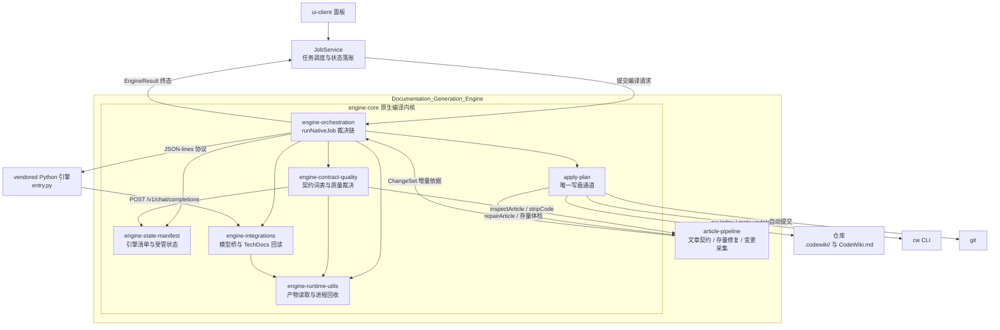
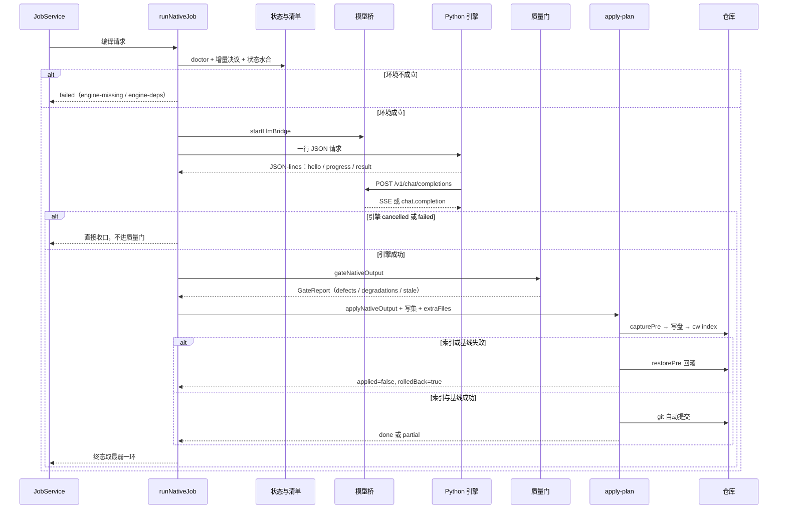

# Documentation_Generation_Engine 模块概览

`Documentation_Generation_Engine` 是 CodeWiki 的**文档生成引擎**：它接收一次「为某个仓库生成或更新 wiki」的请求，把请求从环境探测推进到可机读的终态结论（`done` / `partial` / `failed` / `cancelled`），并且只把通过质量门的产物真正写进 `.codewiki/` 与 `CodeWiki.md`。

它**不实现文章生成算法**：聚类、图 diff、写作都在 vendored 的 Python 引擎里（见 [Execution_Runtime___Vendored_Engine](execution-runtime-vendored-engine.md)）。本模块实现的是围绕这台外部引擎的**全部工程约束**：跨语言进程协议、结果契约、质量裁决、跨轮状态记忆、模型桥接、变更采集、落地事务与回滚。整条设计主线只有一句：**每一步的结论都不能被下一步洗白**。

模块分为两个互补部分：

| 部分 | 角色 | 关键性质 |
| --- | --- | --- |
| [engine-core](engine-core.md) | 原生（FSoft）编译内核，五层结构 | 编排、裁决、状态、桥接、工具各司其职；只有 `apply-plan` 写盘 |
| [article-pipeline](article-pipeline.md) | 最靠近磁盘的一层：文章契约、存量修复、变更采集 | 三个模块以纯函数为主，可单测、可被门与落地器共用 |

## 架构

模块的依赖方向单一：工具层不认业务，裁决层不写盘，编排层不直接改仓库；`article-pipeline` 既向增量决议提供「这一轮改了什么」，又向质量门与落地器提供「这篇文章能不能入库」。

| 层 | 职责 | 是否写盘 |
| --- | --- | --- |
| [engine-orchestration](engine-orchestration.md) | `client.js` 跨语言边界与 `runNativeJob` 裁决链；`apply-plan` 写盘、索引、基线、提交与回滚 | 仅 `apply-plan` |
| [engine-contract-quality](engine-contract-quality.md) | `EngineResult` / `EngineProgress` / `EngineError` 契约、采用门、死链语义校对、wiki 链接扫描规则 | 仅 `proofread.js` 改正文 |
| [engine-state-manifest](engine-state-manifest.md) | 引擎指纹与 `engine-lock.json`、跨轮受管状态、产物映射、工作区快照 | 产出写集项，不直接落盘 |
| [engine-integrations](engine-integrations.md) | 进程内 loopback 模型桥（OpenAI 兼容 ↔ 宿主 LLM）、TechDocs 站点回读 | 否 |
| [engine-runtime-utils](engine-runtime-utils.md) | `docs` 树读取与自洽性校验、受管子进程树终止 | 否 |
| [article-pipeline](article-pipeline.md) | `article-contract.js` 结构契约、`article-repair.js` 存量修复、`change-set.js` 四路 git 变更采集 | 仅采集侧调用 git（只读） |

## 一次编译的主干流程

贯穿全层的硬约束：

- **终态取最弱**：引擎、质量门、落地器三者中任一降级，终态都不能是 `done`；`done` 不许带 blockers，`partial` 必须带 blockers，`failed` 必须带 error。
- **契约是唯一词表**：`BLOCKER_KINDS`、`ENGINE_STAGES`、`ENGINE_ERROR_CODES` 只允许追加，其它模块不得硬编码复制；文章结构判据同样只在 `article-contract.js` 里定义一份。
- **写盘单通道**：只有 `apply-plan` 修改 `.codewiki/` 与 `CodeWiki.md`，文章、受管状态、`engine-lock.json`、TechDocs 站点共享同一份 pre-image 与回滚语义。
- **状态只由完整成功推进**：`partial` / `failed` / `cancelled` 一律不推进基线、不裁剪状态，未消费的改动显式携带到下一轮。
- **采不到不等于没变化**：变更采集失败时显式 `fallback='full'` 退回全量编译，绝不假装干净。

## 核心组件文档

| 文档 | 覆盖内容 |
| --- | --- |
| [engine-core](engine-core.md) | 原生编译内核总览：模块定位、五层架构、主干流程与硬约束 |
| [engine-orchestration](engine-orchestration.md) | 执行与裁决层总览，含 [engine-runner](engine-runner.md)、[engine-runner_process-protocol](engine-runner-process-protocol.md)、[engine-runner_native-pipeline](engine-runner-native-pipeline.md)、[apply-plan](apply-plan.md) |
| [engine-contract-quality](engine-contract-quality.md) | 结果契约、采用门三类问题（defect / degradation / stale）、死链语义校对、基线可推进性 |
| [engine-state-manifest](engine-state-manifest.md) | 引擎指纹与锁状态机、受管状态水合与采集、未消费账合并、工作区快照 |
| [engine-integrations](engine-integrations.md) | 模型桥安全模型、OpenAI 双向转换语义、空产出可观测性、TechDocs 回读 |
| [engine-runtime-utils](engine-runtime-utils.md) | `collectOutput` / `validateOutput` 问题类别、页别名与死链判定、跨平台进程树终止 |
| [article-pipeline](article-pipeline.md) | 文章结构契约与 `NATIVE_ARTICLE_OPTS` 统一口径、存量页修复与判删边界、四路 git 变更采集与降级 |

## 相关模块

- 上游引擎实现：[Execution_Runtime___Vendored_Engine](execution-runtime-vendored-engine.md)（`entry.py`、并行运行时、`stage_map.py`、`cw index` 的 frontmatter 解析语义）
- 任务调度与进度落账：[Job_Orchestration___State_Management](job-orchestration-state-management.md)
- 引擎环境与依赖闭合、`git-paths.js` 路径归一：[Build___Development_Infrastructure](build-development-infrastructure.md)
- 面板进度消费：[ui-client](ui-client.md)