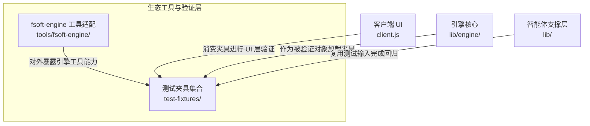

# 生态工具与验证层（Ecosystem_Tooling___Validation_Layer）概述

## 模块定位与用途

`Ecosystem_Tooling___Validation_Layer` 是整个仓库中面向**生态协同与验证保障**的顶层模块。它不承载产品运行时的核心业务逻辑，而是围绕工具链集成与测试验证两大职责展开：一方面提供与 `fsoft-engine` 相关的外部工具适配能力，另一方面通过标准化的测试夹具（fixtures）为引擎核心、客户端 UI 等模块的正确性验证提供可复用的输入与预期输出基准。该层作为整个系统质量的"校验底座"，横向支撑上层各模块的功能回归与边界测试。

## 架构与协作关系

下图展示了本模块的内部组成，以及它与仓库其他核心部分的依赖与支撑关系：

从职责分层来看，`tools/fsoft-engine/` 负责将引擎能力包装成可被生态调用的工具形态，而 `test-fixtures/` 则沉淀了验证所需的标准化数据与样例。二者共同构成"工具输出 + 验证基准"的闭环，确保引擎对外行为的可观测、可比对、可回归。

## 核心组件文档

以下为该模块下两个核心子模块的详细文档入口，可点击查看具体实现说明：

- [fsoft-engine 工具适配（fsoft_engine_tools）](Ecosystem_Tooling___Validation_Layer/fsoft_engine_tools.md)：位于 `tools/fsoft-engine/`，说明如何基于引擎核心封装可供生态侧调用的工具接口。
- [测试夹具集合（test_fixtures）](Ecosystem_Tooling___Validation_Layer/test_fixtures.md)：位于 `test-fixtures/`，沉淀用于各模块验证的标准化测试输入与预期结果。