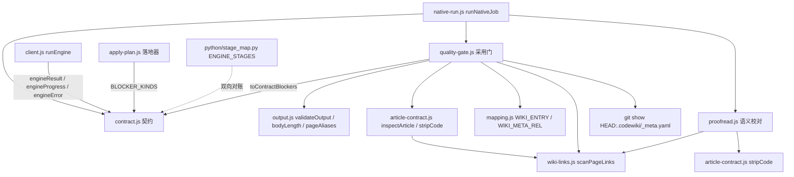
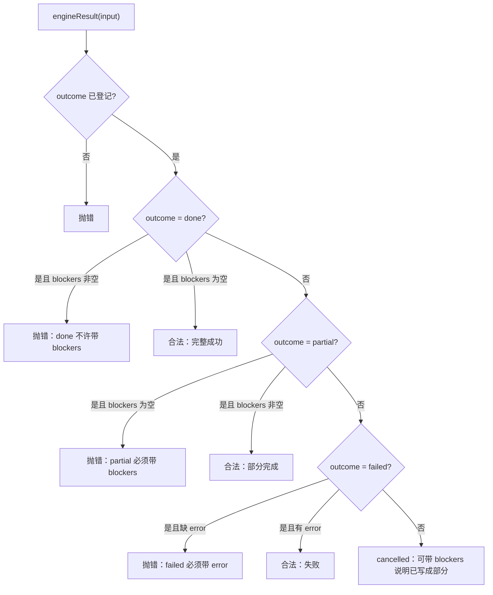
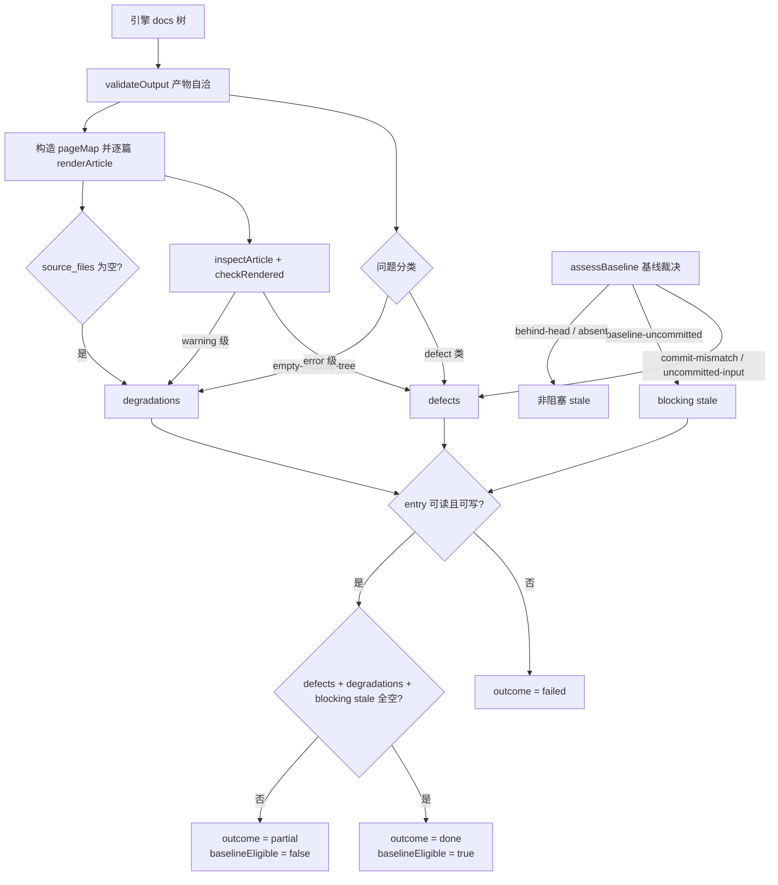
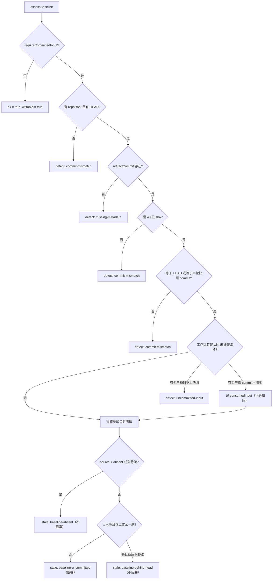
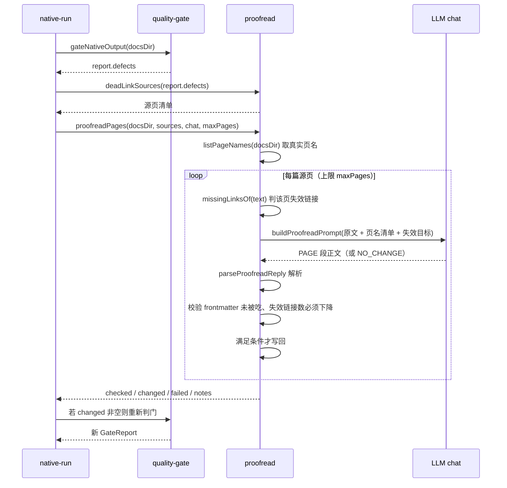
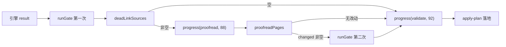
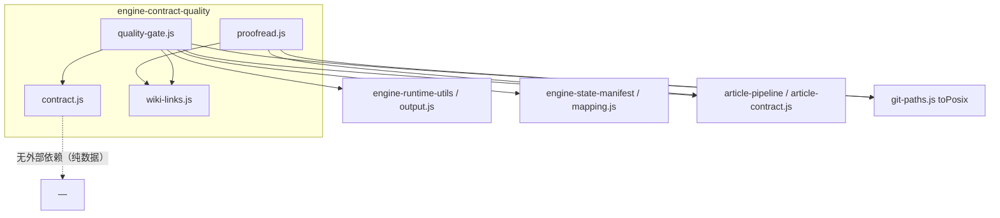

# engine-contract-quality：引擎契约与质量裁决层

本模块是 Documentation_Generation_Engine 中负责「**判据**」的那一层：它定义 Node 与 Python 引擎之间的跨进程结果契约，并把引擎交回来的产物裁决成可机读的终态（`done` / `partial` / `failed` / `cancelled`）、阻塞原因与「基线能不能推进」。它本身**不跑引擎、不写文件、不改文章正文**，只做纯数据校验与判定，因此可以被逐条测试钉死。

一句话概括职责边界：

- `lib/engine/contract.js` — 结果/进度/错误三种数据形状的**唯一**定义与校验入口。
- `lib/engine/quality-gate.js` — 产物能不能被 wiki 采用的**采用门**（含渲染与基线裁决）。
- `lib/engine/proofread.js` — 针对死链的**语义校对**（修正文，不放宽判据）。
- `lib/engine/wiki-links.js` — 跨页链接的**唯一扫描规则**（门、校对、契约、改写器共用）。

---

## 1. 模块定位

| 维度 | 说明 |
| --- | --- |
| 所属 | [engine-core](engine-core.md) → engine-contract-quality |
| 上游调用方 | [engine-runner](engine-runner.md)（`runNativeJob` 的 validate / proofread 段） |
| 下游依赖 | [engine-runtime-utils](engine-runtime-utils.md)（`output.js`）、[engine-state-manifest](engine-state-manifest.md)（`mapping.js` 的路径常量）、[article-pipeline](article-pipeline.md)（`article-contract.js`） |
| 平行协作方 | [engine-orchestration](engine-orchestration.md) 的 `apply-plan.js`（消费 `BLOCKER_KINDS`，落地时复用 `NATIVE_ARTICLE_OPTS`） |
| 是否写盘 | 仅 `proofread.js` 会改写 docs 产物里的文章（改前留证据、改后重判门） |
| 是否碰模型 | 仅 `proofread.js` 通过注入的 `chat` 调用一次模型 |

设计上刻意保持「纯函数优先」：`contract.js` 不碰文件/进程/模型，`quality-gate.js` 除读 docs 与 `git show` 外不产生副作用，`wiki-links.js` 是纯字符串扫描。只有 `proofread.js` 需要外部能力，且通过参数注入（`chat`、`signal`）。

---

## 2. 组件清单

| 组件 | 文件 | 作用 |
| --- | --- | --- |
| `validateEngineResult` | `lib/engine/contract.js` | 校验「可能来自外部/旧版本/磁盘」的结果对象，返回逐条 errors（不抛错） |
| ~~`describeEngineResult`~~（已删除） | `lib/engine/contract.js` | 四态终态文案改由 `lib/update-record.js` 的 `describeOutcome` 唯一提供 |
| `normalizeBlocker` | `lib/engine/contract.js`（内部） | 阻塞原因归一：未登记的 `kind` 降级为 `engine-error`，detail 截断 |
| `gateNativeOutput` | `lib/engine/quality-gate.js` | 采用门主入口，产出 GateReport |
| `toQualityIssues` | `lib/engine/quality-gate.js` | 把 GateReport 翻成 `judgeOutcome` 的 `qualityIssues` 输入 |
| `proofreadPages` | `lib/engine/proofread.js` | 对死链源页做单轮语义校对并写回 |
| `isExternalTarget` | `lib/engine/wiki-links.js` | 判外部协议链接（`http:`、`mailto:` 等），不参与页内解析 |

同文件内的其它导出（`engineResult`、`engineProgress`、`engineError`、`renderArticle`、`assessBaseline`、`readCommittedBaseline`、`rewritePageLinks`、`yamlScalar`、`deadLinkSources`、`scanPageLinks` 等）也是本层的公开面，下文按主题说明。终态文案不在此列：它由 `lib/update-record.js` 的 `describeOutcome` 提供（`contract.js` 原先的 `describeEngineResult` 已删除）。

---

## 3. 架构总览



三条关键结构关系：

1. **契约是唯一的词表**：`BLOCKER_KINDS` / `ENGINE_STAGES` / `ENGINE_ERROR_CODES` 一旦被别的模块硬编码复制，就会出现「门说一个 kind、终态判定认另一个」。`apply-plan.js` 的 `toApplyBlockers` 甚至会在 kind 不在 `BLOCKER_KINDS` 里时直接抛错。
2. **门不重写上游判定**：`quality-gate.js` 复用 `output.js` 的 `validateOutput`（产物自洽）与 `article-contract.js` 的 `inspectArticle`（目标格式），自己只补「原生通道专属」的两条判据（非空二级标题、剥头后的正文长度）。
3. **校对修正文、门管判据**：`proofread.js` 只把「指向不存在页面」的链接改成真实页名或降级为纯文字，改完仍要重新过一遍门；改不掉就照旧判 partial。

---

## 4. 契约层：`contract.js`

### 4.1 三种数据形状

| 类型 | 构造器 | 用途 |
| --- | --- | --- |
| `EngineResult` | `engineResult(input)` | 一次 `generate`/`update` 的完整结果（版本化、可校验） |
| `EngineProgress` | `engineProgress(input)` | 推进中的阶段/计数快照，面板与 tick 共用 |
| `EngineError` | `engineError(input)` | 可机读失败事实，`code` 决定重试语义 |

`engineResult` / `engineProgress` 对非法输入**抛错**（契约破坏必须响）；`validateEngineResult` 对反序列化边界上的对象**不抛错**，返回 `{ ok, errors[] }`。这两种态度是有意分开的：构造期是编程错误，读取期是数据不可信。

### 4.2 版本与枚举

```js
export const ENGINE_CONTRACT_VERSION = 3
export const ENGINE_STAGES = ['env', 'graph', 'cluster', 'articles', 'proofread', 'validate', 'index', 'baseline', 'commit']
export const TERMINAL_OUTCOMES = ['done', 'partial', 'failed', 'cancelled']
export const UPDATE_OUTCOMES = ['incremental', 'no_change', 'full_fallback', 'detector_failure']
export const CONSUMING_UPDATE_OUTCOMES = ['incremental', 'no_change']
```

- **阶段枚举是契约不是实现细节**：面板步骤条、`job.stage` 映射、取消检查点都按它对齐，顺序即推进顺序。`proofread` 是 0.17.38 补登的——此前进度帧写 `'proofread'` 而表里没有，`engineProgress` 抛错被调用方 catch 吞掉，面板上「校对」格永远不亮（0.17.32 的缺陷根因）。因此 `native-run.js` 与 `client.js` 现在都**不吞**进度帧异常。
- **`stage_map.py` 与这里双向对账**：`lib/engine/python/stage_map.py` 的 `ENGINE_STAGES` 必须与 JS 侧完全一致，由测试反向断言。详见 [engine-python-runtime](engine-python-runtime.md)。
- **`updateOutcome` 是「基线能不能推进」的第二个证据源**：`full_fallback` / `detector_failure` 意味着引擎没有真正做增量，哪怕产物看着完整，基线也不能照推进——否则下一轮起点被抬到「其实没消化」的位置，这批变化就永久丢了。未登记的值直接抛错，不允许「不认识 → 忽略」（忽略等于把退全量洗成增量成功）。

`BLOCKER_KINDS` 全表（新增只允许追加，不允许改名）：

| kind | 语义 |
| --- | --- |
| `article-failed` | 计划内必需文章没写成/校验不过 |
| `article-missing` | 计划内必需文章缺失 |
| `unmapped-change` | 有变更没能归属到任何文章 |
| `unmapped-page` | 引擎产出了无法映射进 wiki 的页 |
| `quality-gate` | 质量闸门拦下 |
| `index-failed` | `cw index` 失败 |
| `baseline-failed` | `cw meta update` 失败 |
| `commit-failed` | 自动提交失败（不算引擎失败，但产物未入库） |
| `engine-error` | 引擎自身错误（崩溃/协议破坏） |
| `cancelled` | 用户取消 |
| `incremental-fallback` | 增量不可用而降级（产物照写、基线不推进） |
| `engine-timeout` | 单阶段超时（超时但已写出文章时整轮判 partial 并挂这条） |

`ENGINE_ERROR_CODES` 与可重试性：

| code | 含义 | 可重试 |
| --- | --- | --- |
| `engine-missing` | 解释器/入口/venv 不存在 | 否 |
| `engine-deps` | 依赖锁定不一致（pip check / manifest 不符） | 否 |
| `engine-timeout` | 单阶段超时 | **是** |
| `engine-cancelled` | 取消（不是失败） | 否 |
| `engine-crashed` | 非零退出/进程树异常 | 否 |
| `engine-protocol` | stdout 协议破坏（非法 JSON / 缺字段） | 否 |
| `engine-model` | 模型通道失败（上游报错/限流/鉴权） | **是** |
| `engine-output` | 产物缺失或不可解析 | 否 |
| `engine-unknown` | 未归类（原 code 保留在 `rawCode`） | **是** |

### 4.3 语义硬不变量



这四条不变量由 `engineResult`（构造期抛错）与 `validateEngineResult`（读取期记 error）**双重保证**。动机是 0.14.0 的缺陷类型「1 篇成功 + 19 篇失败也报 done」：只要允许 `done` 携带 blockers，消费方就永远无法判断「引擎到底成功了没有」。

### 4.4 结果对象的字段分组

`engineResult` 的返回按语义分组，消费方按组读取：

| 组 | 字段 | 说明 |
| --- | --- | --- |
| 终态 | `contractVersion` `outcome` `stage` `blockers` `error` | `stage` 是引擎侧最后到达的阶段；非法值归 `null` |
| 计数 | `writtenCount` `failedCount` `keptCount` `removedCount` `unmappedCount` | 全部归一为非负有限数，非法值按 0 |
| 自检 | `checks[]` | 只有 `doctor` 会填；**空数组 = 这项动作没有自检**，不是「全部失败」 |
| 增量 | `updateOutcome` | 只有 update 轮有值；`null` 表示不是增量轮 |
| 用量 | `usage` | `inputTokens` / `outputTokens` / `cachedTokens` / `requests` |
| 环境 | `engine.version` `engine.commit` `engine.python` `engine.deps.ok/summary` | doctor 的产物，用于面板展示与回滚取证 |
| 产物 | `artifacts.docsDir` `rawTreeDir` `updateRecord` `rawTree` `rawTreeFiles` | `rawTreeDir` 是「引擎说它产出了什么」，`rawTree` 是「产出的原样」快照 |
| 时间 | `startedAt` `finishedAt` | ISO 字符串或 `null` |

`normalizeChecks` 的归一规则值得注意：`ok` 必须是布尔真值（字符串 `'true'` 不算通过），`detail` 截断到 2000 字符，非法项**丢弃而不是抛错**——`checks` 是诊断信息，不能因为它格式不对就让整个 doctor 失败。

### 4.5 终态文案

四态终态文案现在**只有一处实现**：`lib/update-record.js` 的 `describeOutcome(outcome, blockers)`。`contract.js` 原先并列提供的 `describeEngineResult` 已删除——同一口径写两份正是文案漂移的来源；契约层只保留可机读字段（`outcome` / `blockers` / `error`），给人看的措辞统一由 `describeOutcome` 提供。

- `done` → `完成（所有变化已消化）`
- `partial` → `部分完成（N 项未满足：<首条 blocker 的 detail 或 kind，截断 120 字符>）`
- `failed` → `失败（<首条 blocker 的 detail 或 kind，截断 160 字符；无 blocker 时为「无可用成果」>）`
- `cancelled` → `已取消`

---

## 5. 采用门：`quality-gate.js`

### 5.1 位置与三件事

门位于「引擎把 docs 树交回来之后、写进 `.codewiki/` 与 `CodeWiki.md` 之前」，把三件事合成一个可机读裁决：

1. **产物自洽**：复用 `output.js` 的 `validateOutput`，不重写任何判定；
2. **目标格式契约**：把映射结果渲染成真正的 wiki 文章（合成 frontmatter + 正文），再走 `article-contract.js` 的 `inspectArticle`；
3. **基线可推进性**：产物对应的 commit 必须是**已提交**的 HEAD（或本轮合成的工作区快照），且 `.codewiki/_meta.yaml` 的基线本身已入库。

### 5.2 三类问题必须分开

这是本模块存在的核心理由：把一切都塞进一个 blockers 数组会让**引擎被归咎于不是它的问题**，或让 **wiki 的陈旧状态被当成产品缺陷**。

| 类别 | 含义 | 处置 |
| --- | --- | --- |
| `defect`（产品缺陷） | 本次引擎产物自身的问题 | 不算完整成功 |
| `degradation`（能力降级） | 产物可用但证据不足（页是真的、内容是真的，只是没法归属） | 可以入库，但增量归属不可信 → **不得推进基线** |
| `stale`（wiki 陈旧） | 不是本次产物的错（既有基线落后 HEAD、基线只在工作区未提交） | 如实报告；只有 `baseline-uncommitted` 阻止推进 |

终态仍然严格：**只有三类皆空才是 `done`**。分类改变的是「谁来修、修什么」的定位，不是放宽闸门。

**defect 类别**（`GATE_DEFECT_KINDS`）：`missing-docs-dir`、`missing-metadata`、`missing-module-tree`、`bad-json`、`entry-missing`、`empty-body`、`article-missing`、`unmapped-page`、`source-missing`、`dead-link`、`article-contract`、`commit-mismatch`、`uncommitted-input`。

**degradation 类别**（`GATE_DEGRADATION_KINDS`）：`empty-module-tree`（whole-repository 模式归属证据整体缺失）、`no-source-evidence`（该页 `source_files` 为空）、`missing-section` / `empty-section-optional`（原生通道 warning 级）。

**stale 类别**（`GATE_STALE_KINDS`）：`baseline-behind-head`（本次跑的目的，只报告）、`baseline-uncommitted`（**唯一阻塞项**）、`baseline-absent`（首次编译）。

`pushDefect` / `pushDegradation` 对未登记 kind 直接抛错，并且对 `validation.problems` 里未来新增、此处未映射的类别统一记成 `article-contract` 缺陷——**逼着这里补映射，而不是静默吞掉**。

### 5.3 裁决流程



`baselineEligible` 只有一种来源：`outcome === 'done'`。0.16.1 曾允许 partial 也可推进基线以打破「永远 partial ⇒ 基线永不推进 ⇒ 下一轮重复消费」的死循环，但那条例外把「没消化完」直接记成已消化，且与落地器的「partial 不推基线」互相矛盾。**正确解法是让首次编译能走成 done**（空骨架不算未入库基线），而不是让 partial 偷偷推进。

### 5.4 基线裁决



三个辅助函数撑起这条判定：

- **`readCommittedBaseline`** 读 `git show HEAD:.codewiki/_meta.yaml`，**不读工作区文件**。工作区的 `_meta.yaml` 可能是上一轮刚写、还没提交的内容（自动提交是插件侧异步做的），把它当基线等于把未提交产物宣布成「已消化」。
- **`parseMetaCommit`** 把 `last_compiled_commit: null`（YAML null）归一为 `null`，否则会得到一个字面量字符串 `"null"` 被当成真实基线 commit。
- **`uncommittedSourceChanges`** 用 `git status --porcelain --untracked-files=all` 取「非 wiki」的未提交路径；`.codewiki/` 与 `CodeWiki.md` 被排除（它们正是本轮要写的东西）。

`consumedInputCommit` 是本轮合成的工作区快照 commit（见 [engine-state-manifest](engine-state-manifest.md) 的 `createWorkspaceSnapshot`）。产物 commit 等于快照不是「对不上代码」，而是「对上了比 HEAD 更完整的代码」，所以记成 `consumedInput`（可见但不阻塞），而不是缺陷。快照不挂 ref 这件事仍要紧：基线由 `cw` 记成 HEAD，未提交改动的连续性靠 native-state 的 `unconsumed` 携带。

### 5.5 文章渲染：格式翻译，不改正文

`renderArticle({ article, body, pageMap })` 生成「合成 frontmatter + FSoft 原文」，三条硬约束：

1. **正文一字不动**。只做两类规范化：剥 BOM、把跨页链接改成落地路径（`rewritePageLinks` 的 `dropUnresolved: true` 会把指向不存在页面的链接降级为纯文字）。不删 H1、不改标题、不补章节——正文一旦被本层改写，「模型写了什么」就无法逐字复核。
2. **frontmatter 只填有证据的字段**。`source_files` 原样来自映射（空就写 `source_files: []`，显式表达「声明为空」而不是「没声明」）；`type` 由映射给；`tags: []`。
3. **可回溯**。`fsoft_page` 记住正文来自原始树的哪个文件，于是「wiki 里的这篇 ≠ 引擎产出的那篇」永远可以逐字比对。

结束标记 `---` 后**不插空行**：`parseFrontmatter` 会把空行算进 body，那样「正文一字不动」就变成「正文 = 原文 + 一个换行」，逐字比对永远对不上。

**`yamlScalar` 为什么必须存在**：`cw` 用 serde_yaml 解析 frontmatter（见 [codewiki-vendor](codewiki-vendor.md) 的 `parse_frontmatter`）。真实页标题会出现 `# Core Engine (src/core/engine.py)`、`Support: batch & stream`、带反斜杠的 Windows 路径；plain scalar 一旦含 `: ` 或 ` #`，serde_yaml 会解析成嵌套映射或截断成注释，整篇文章被判坏头、`cw index` 里缺这篇。做法是只在**确实不安全**时加双引号，转义直接用 `JSON.stringify`（YAML 1.2 是 JSON 超集）。

**`rewritePageLinks` 为什么必须存在**：引擎产物页名是 `agent_runtime.md`，落地时按 slug 规则改名成 `agent-runtime.md`，而正文里的跨页链接仍写着原名。不改写的话真机实测本仓 420 条内部链接有 412 条失效。实现要点：

- 解析基准是**引擎源页所在目录**（不是落地目录），因为层级布局下正文写 `x_sibling.md` 与 `../parent.md`，而落地时页被拍平到 `.codewiki/modules/` 单层；
- 只在 `stripCode` 之后的**非代码**区域改写（正文里演示链接写法时用的是行内代码，那是语法示例）；
- 只替换 `](href)` 这一段，`[文字]` 原样保留；
- 倒序应用偏移，避免互相干扰。

### 5.6 逐篇检查 `checkRendered`

先走 `inspectArticle`（带 `NATIVE_ARTICLE_OPTS`），再补两条原生通道专属判据：

- `allowedLinks` 传「落地后」的页路径集合，让契约层的链接检查认得 slug 之后的真实文件名；
- 空正文判定必须**剥掉自己合成的 frontmatter** 再算。`bodyLength` 只跳过第一个标题行，直接喂全文会把 8 行 frontmatter 当成正文，于是 `# Web` 这种只有标题的空壳页 `bodyLength` 反而 ≈ 100，永远判不出空；而 `inspectArticle` 的 `empty-body` 判 `body.trim()`，H1 在就非空。两条路都放过空壳页，所以这里用剥头后的正文兜住。

### 5.7 GateReport 结构与两个转换器

`gateNativeOutput` 返回可 JSON 序列化的 GateReport：

```js
{
  version, ok, outcome, writable, baselineEligible, canAdvanceBaseline,
  entry: { source, path, ok } | null,
  articles: [{ source, wikiPath, type, pageKind, moduleName, sourceFiles, attribution, action, defects, degradations }],
  rendered: [{ source, wikiPath, type, content, defects }],
  defects: [], degradations: [], stale: [], blockers: [],
  counts: { pages, articles, writable, skipped, unmapped, defects, degradations, stale },
  baseline: { headCommit, artifactCommit, source, consumedInput },
}
```

- `rendered` 收**全部**页的渲染结果（带 `defects` 计数），不只是 `action === 'write'` 的页。早先只收可写页，落地器因此永远看不见「有缺陷的旧落地页」，渲染规则改了以后这些页在库里继续是旧样子。写不写由落地器按轮次决定：正常轮只写 `defects === 0` 的页，规范化轮全写。
- `toContractBlockers(report)` 把 gate 的 blockers 翻成 `contract.js` 的 `BLOCKER_KINDS`（一一对应不了的一律归 `quality-gate`，宁可粗也不能漏），原 kind 保留在 detail 前缀里。
- `toQualityIssues(report)` 把结论翻成 `judgeOutcome` 的 `qualityIssues`。这条**必须有**：`judgeOutcome` 只按「计划内文章写成了没有」判 done，一篇可写但 `source_files` 为空的页在它眼里就是「成功」；而空 `source_files` 正是证据降级，推进基线等于把归属不明的产物记成「已消化」。两条判定路径不能一个严一个松。注意 `stale` 里只有 `baseline-uncommitted` 进 `qualityIssues`——`baseline-behind-head` 正是本轮要消化的对象，混进去会让每次增量都落 partial。

---

## 6. 语义校对：`proofread.js`

### 6.1 为什么需要这一层

模型写作时会照着旧版聚类的记忆**编造页面名**（真机：`client_review_console/status_readouts.md`、漏写 `_ui` 后缀的 `settings_and_logs.md`），而模块树里根本没有那些页。质量门如实判 `dead-link`，于是这些仓库每轮都停在「部分完成」——判据没错，是产物真的错。

这一层的立场必须说清楚：**它修的是正文，不是判据**。校对后的正文仍要重新过一遍门，改不掉就照旧判 partial；绝不在渲染期或终态里豁免缺页/死链。它只管一类问题（跨页链接目标不存在），因为这是模型幻觉里唯一可以「只看本页 + 页名清单」就修对的问题。

### 6.2 流程



### 6.3 关键判据

- **`deadLinkSources`** 必须认两种来源：`kind === 'dead-link'`（`output.js` 判引擎原始页之间的引用）与 `kind === 'article-contract' && issue === 'dead-link'`（契约层判落地后 wiki 页的链接，被 quality-gate 统一改名成 `article-contract`，真实类别留在 `issue` 字段）。只认前者会漏掉「渲染期把链接降级成纯文字」那条兜底路径。
- **`missingLinksOf`** 两种链接形态都认：标准行内链接（`[文字]` + `(目标.md)`）与 `[[x]]` / `[[x|文字]]`。只认前者会有个哑口：门因 `[[x]]` 判了死链，校对却看不见这条链接，拿到源页之后仍然为空直接跳过，白跑一次门。目标不带 `.md` 的按 `.md` 补一次再判（wiki 词条约定就是省略后缀），任一写法命中已知页就算有效。
- **写回门槛**：模型若把 frontmatter 吃掉或改坏，这篇宁可不动（原样保留，问题留给质量门如实上报）；校对后失效链接数必须**下降**（`after.length < missing.length`）才写盘。
- **`maxPages`** 默认 6（`DEFAULT_MAX_PAGES`），每篇一次模型请求。再多就变成整轮重跑。
- **失败不致命**：任何单篇失败只进 `failed`/`notes`，不影响本轮终态——门会如实上报死链。

---

## 7. 链接扫描：`wiki-links.js`

单一正则来源，四个消费方共用（`article-contract.js`、`proofread.js`、`quality-gate.js`、`renderArticle`）。历史上这里各写一份并在演进中分叉，后果是「门判它是死链、改写器却认不出这条链接」，两边结论对不上却没人发现。

约定：

- 目标是**第一个** `.md` 结尾的那一段（惰性），锚点 `#...` 单独捕获；
- `index` / `whole` 用于在**原文**里原位替换（`stripCode` 保证长度不变时偏移一致）；
- 外部协议（`http:`、`mailto:`、`data:` 等）由调用方按需跳过——`isExternalTarget` 就是这条判据的唯一实现。

```js
const LINK_RE = /\[([^\]\n]*)\]\(([^)\s]+?\.md)(#[^)\s]*)?\)/g
```

---

## 8. 与编排层的接线

`native-run.js` 的 validate 段是本模块唯一的生产调用点：



要点：

- **门跑两次没有副作用**（纯读 docsDir），第一次只为拿到「哪几篇有失效链接」。
- **`runGate` 只在真的造出工作区快照时才传 `consumedInputCommit`**；否则让 `commit-mismatch` 照旧按 HEAD 判，不能用一个不存在的对齐去掩盖不一致。
- **`report.baseline.consumedInput`** 会被落成一条 note，让「脏工作区也能推基线」这件事在任务记录里可见。
- **门异常 → `engine-output` 失败**（`stage: 'validate'`），不降级继续。
- **`advanceBaseline` 由编排层额外否决**：`(stateIncomplete || engineOutcome !== 'done') ? false : null`。质量门只看产物质量，它不知道引擎有一批叶子失败了；曾只传 `stateIncomplete`，于是「引擎 partial + 门 done」时基线照常前移，终态却是 partial，下一轮从新基线算变化集，那批没写完的变化永久失明。
- **落地器复用同一套判据**：`apply-plan.js` 的 `auditExistingArticles` 与 `checkRendered` 逐字对齐（`NATIVE_ARTICLE_OPTS`），否则会出现「门说 defects=0、存量体检说这篇坏了」同时挂在一个终态里。

---

## 9. 依赖关系



`contract.js` 刻意零依赖：它是被所有层 import 的最底层词表，一旦引入文件/进程依赖就会让「纯数据校验」变成需要环境才能跑。

---

## 10. 配置与运维

相关设置来自插件 config（`cordis.patch.yml` 的 `config` 命名空间 `codewiki`）：

| 设置 | 与本模块的关系 |
| --- | --- |
| `nativeEngine` | 关闭时整条原生通道不跑，本模块不参与 |
| `nativeEngineTimeoutMs` | 超时由 `client.js` 判 `engine-timeout`，本模块负责把它作为 blocker kind 正确表达 |
| `autoCommit` | 提交失败记 `commit-failed`（`toContractBlockers` 的 `commit-failed`），不影响文章有效性 |
| `articleLanguage` | 影响引擎写作语言，不改变判据 |

环境不闭合（`engine-deps`）在 `env` 阶段就失败、**不跑引擎**——那是 [engine-state-manifest](engine-state-manifest.md) 的 `doctor` 与 `tools/fsoft-engine/setup-env.sh` 的职责；本模块只保证这类失败被如实表达为不可重试的 `engine-deps`。

---

## 11. 常见失败模式与定位

| 现象 | 可能原因 | 定位点 |
| --- | --- | --- |
| 面板某一步永远不亮 | 进度帧用了未登记的 stage，异常被吞 | `ENGINE_STAGES` 与 `engineProgress` 的抛错路径 |
| 每轮都 `partial`、基线永不推进 | `baseline-uncommitted`（基线只在工作区）或 degradation 常驻 | `assessBaseline` 的 `stale` / `degradations` |
| 产物看着完整却仍 `partial` | `updateOutcome = full_fallback` / `detector_failure`，或 `source_files` 为空 | `engineResult` 的 `updateOutcome`、`no-source-evidence` |
| wiki 里跨页链接大量 404 | `pageMap` 未覆盖引擎页名别名 | `pageAliases` + `rewritePageLinks` |
| 文章被判坏头、`cw index` 缺篇 | frontmatter 值含 `: ` / ` #` / 反斜杠未加引号 | `yamlScalar` |
| 死链每轮都在、校对没效果 | 校对后失效链接数没下降，写回被拒 | `proofreadPages` 的 `after.length >= missing.length` 分支 |
| `done` 却带 blockers 的构造抛错 | 上游某分支给 done 塞了阻塞原因 | `engineResult` 不变量，检查合成终态处 |

---

## 12. 扩展指引

1. **新增阶段**：必须同时改 `contract.js` 的 `ENGINE_STAGES`、`lib/engine/python/stage_map.py` 的 `ENGINE_STAGES`（测试双向对账），并**升 `ENGINE_CONTRACT_VERSION`**——否则「同一份结果按哪个版本解释」失去意义。
2. **新增 blocker / defect / degradation kind**：只允许**追加**，不允许改名（消费者按 kind 分派）；同时在 `TO_CONTRACT_KIND`（`quality-gate.js` 与 `apply-plan.js` 各一张）补映射，否则会被归成 `quality-gate` 并在 detail 里保留原名。
3. **新增 error code**：同步决定它是否可重试（`RETRYABLE_CODES`）；不可重试的错误重试只是浪费。
4. **新增产物问题类别**（`output.js` 的 `OUTPUT_PROBLEM_KINDS`）：`gateNativeOutput` 会把它当 `article-contract` 缺陷报出来——必须回来补一条显式映射，否则运维会被指向错误的原因。

---

## 相关页面

- 上层：[engine-core](engine-core.md)
- 编排与落地：[engine-orchestration](engine-orchestration.md)、[engine-runner](engine-runner.md)、[apply-plan](apply-plan.md)
- 产物解析与状态：[engine-runtime-utils](engine-runtime-utils.md)、[engine-state-manifest](engine-state-manifest.md)
- 文章契约与修复：[article-pipeline](article-pipeline.md)
- 引擎运行环境：[engine-python-runtime](engine-python-runtime.md)、[codewiki-vendor](codewiki-vendor.md)
- 构建与打包：[build-configuration](build-configuration.md)、[fsoft-engine-tools](fsoft-engine-tools.md)
