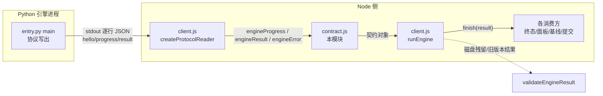
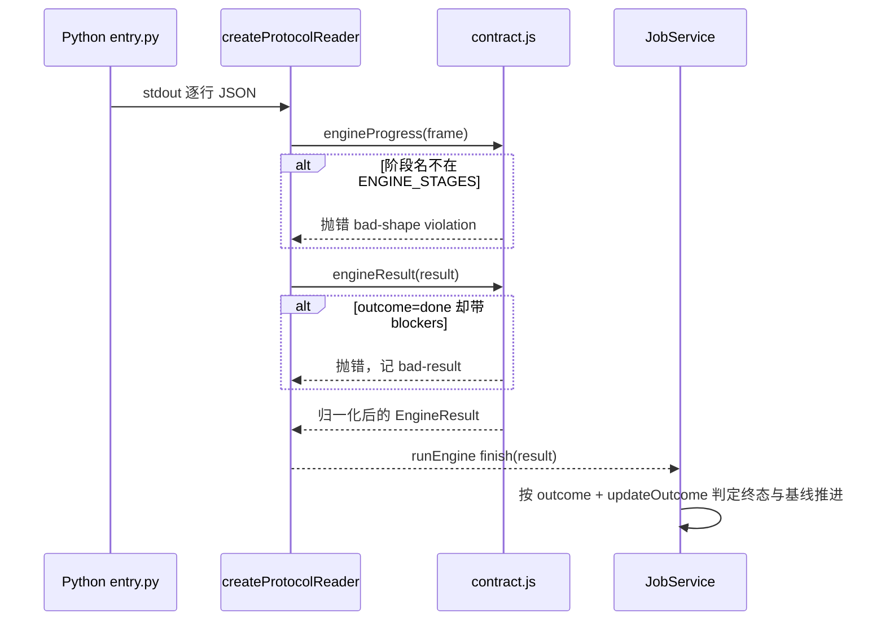
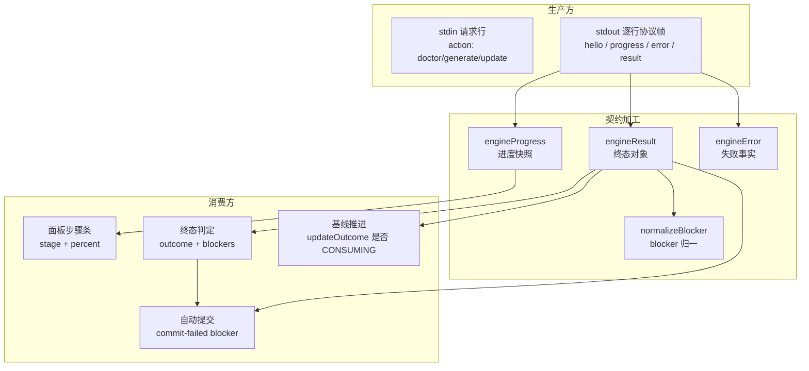

# Engine_Contract 引擎契约

## 简介

`Engine_Contract` 是 FSoft 原生引擎（Python）与 Node 侧之间的**跨进程数据契约层**，对应实现文件为 `lib/engine/contract.js`。迁移到原生引擎之后，Node 不再自己计算依赖图、聚类与增量，一切结论都来自 Python 引擎的一次返回。本模块把这条边界固定为版本化、可校验、纯函数的数据结构，让所有消费方（终态判定、进度面板、cw 基线推进、自动提交、降级提醒）对「引擎到底成功了没有」有**唯一口径**，而不是各自猜测。

它只做纯数据校验：不碰文件、不碰进程、不碰模型——这是它能被 TDD 钉死的前提。

## 为什么需要这条契约

历史缺陷（0.14.0）：1 篇文章成功 + 19 篇失败，整轮却上报 `done`。根因是没有统一的终态判定规则，每个消费方按自己的口径解释引擎输出。本模块用 `engineResult`（构造时校验）与 `validateEngineResult`（反序列化时校验）**双重保证**语义硬不变量：

| outcome | 语义硬不变量 |
| --- | --- |
| `done` | 完整成功，**不许**携带 blockers（带了即自相矛盾） |
| `partial` | 部分完成，**必须**携带至少一条 blockers（否则等于伪装成功） |
| `failed` | 失败，**必须**携带 error |
| `cancelled` | 取消，可携带 blockers 说明已写成的部分 |

## 架构定位



契约对象在两个边界上被校验：

1. **构造边界**（进程内）：`createProtocolReader` 每收到一帧就调用 `engineProgress` / `engineResult` / `engineError`，非法输入当场抛错——契约破坏必须响。
2. **反序列化边界**（磁盘/旧版本）：`validateEngineResult` 不抛错，返回逐条 `errors`，用于检查从磁盘读回的历史结果是否仍可解释。



## 核心数据模型

### 版本与枚举常量

| 常量 | 含义 |
| --- | --- |
| `ENGINE_CONTRACT_VERSION = 3` | 契约版本号。阶段枚举、终态、blocker 类别、错误码都是契约的一部分，改动必须升版本 |
| `ENGINE_STAGES` | 阶段枚举（顺序即推进顺序） |
| `TERMINAL_OUTCOMES` | 四种终态：`done / partial / failed / cancelled` |
| `UPDATE_OUTCOMES` | 引擎自报的增量结局（来自 `update_record.json`） |
| `CONSUMING_UPDATE_OUTCOMES` | 只有 `incremental` / `no_change` 算「增量真的成立」，基线才允许推进 |
| `BLOCKER_KINDS` | 阻塞原因类别（只允许追加，不允许改名） |
| `ENGINE_ERROR_CODES` | 可机读失败码，`retryable` 集合决定重试语义 |

### 阶段枚举 ENGINE_STAGES

```mermaid
flowchart LR
  env["env<br/>解释器与依赖锁定"] --> graph["graph<br/>依赖图构建"]
  graph --> cluster["cluster<br/>模块聚类"]
  cluster --> articles["articles<br/>文章写作"]
  articles --> proofread["proofread<br/>语义校对"]
  proofread --> validate["validate<br/>质量门"]
  validate --> index["index<br/>cw index"]
  index --> baseline["baseline<br/>cw meta update"]
  baseline --> commit["commit<br/>自动提交"]
```

`env` 在最前（Python 解释器/venv/依赖锁定），`commit` 在最后（自动提交 `.codewiki/` 与 `CodeWiki.md`）。阶段枚举是契约而非实现细节：面板步骤条、`job.stage` 映射、取消检查点都按它对齐。

> 版本 3 的由来（0.17.38）：补登 `proofread`。0.17.32 曾出现「校对格子永远不亮」——进度帧用的 stage 是 `'proofread'`，表里没有它，`engineProgress` 构造时抛错，被调用方的 catch 吞掉后，该步骤在面板上彻底消失。

### 增量结局 UPDATE_OUTCOMES

增量结局不是终态，而是「这一轮到底是组件级增量、无变化、还是引擎自己退了全量」：

| updateOutcome | 含义 | 基线是否推进 |
| --- | --- | --- |
| `incremental` | 真的做了组件级更新（图 diff 命中，只重写受影响模块） | 是 |
| `no_change` | 图 diff 为空：源码没变，文档已最新 | 是 |
| `full_fallback` | 想增量但阈值/可比性触发回退，引擎已整份重建 | **否** |
| `detector_failure` | 连旧状态都读不到 → 回退全量 | **否** |

`full_fallback` / `detector_failure` 意味着引擎**没有**真正做增量：哪怕产物看着完整，基线也不能照推进——否则下一轮起点被抬到「其实没消化」的位置，这批变化就永久丢了。`null` 表示这轮不是 update（全量编译没有增量结局可言）。

### 阻塞类别 BLOCKER_KINDS

机读、稳定、可被终态判定与面板文案共用。新增类别只允许追加（消费者按 `kind` 分派），不允许改名：

`article-failed`、`article-missing`、`unmapped-change`、`unmapped-page`、`quality-gate`、`index-failed`、`baseline-failed`、`commit-failed`、`engine-error`、`cancelled`、`incremental-fallback`、`engine-timeout`。

> `engine-timeout` 的补登历史：超时但已写出文章时，`client.js` 把整轮判成 `partial` 并必须给出 blocker；此前该类别未登记，`normalizeBlocker` 会静默降级成 `engine-error`，「这轮是超时被救回」的事实从终态与面板里消失——而超时恰恰是最需要被一眼认出、直接重跑的那类结局。

### 错误码 ENGINE_ERROR_CODES 与重试语义

| code | 触发场景 | 可重试 |
| --- | --- | --- |
| `engine-missing` | 解释器/入口/venv 不存在 | 否 |
| `engine-deps` | 依赖锁定不一致（pip check / manifest 不符） | 否 |
| `engine-timeout` | 单阶段超时或静默卡死 | **是** |
| `engine-cancelled` | 取消（不是失败） | — |
| `engine-crashed` | 非零退出/进程树异常 | 否 |
| `engine-protocol` | stdout 协议破坏（非法 JSON / 缺字段） | 否 |
| `engine-model` | 模型通道失败（上游报错/限流/鉴权） | **是** |
| `engine-output` | 产物缺失或不可解析 | 否 |
| `engine-unknown` | 未登记的 code 兜底 | **是** |

`retryable` 集合为 `{engine-timeout, engine-model, engine-unknown}`：同一输入再来一次可能成功；其余一律视为确定性失败，重试只是浪费。

## 模块导出的纯函数

### `engineResult(input)`

构造一次 generate/update 的完整结果。非法输入**抛错**而非静默归一——契约破坏必须响。输出结构要点：

- `contractVersion` / `outcome` / `stage` / `blockers` / `error`：终态五要素（语义硬不变量见上表）。
- `writtenCount / failedCount / keptCount / removedCount / unmappedCount`：计数只接受有限正数，非法归一为 `0`。
- `checks`：doctor 自检明细，每项含 `name / ok / detail`。**空数组 = 该动作没有自检**，消费方不得解读为「全部检查失败」。
- `updateOutcome`：只接受登记过的枚举；引擎升级后改名必须响，而不是被当成「不认识 → 忽略」——忽略它等于把「引擎其实退了全量」洗成增量成功。
- `usage`：token 与请求计数归一。
- `engine`：引擎自报的版本 / commit / python 解释器 / 依赖闭合结论（`deps.ok` + `deps.summary`），用于面板展示与回滚取证。
- `artifacts`：`docsDir` / `rawTreeDir`（引擎自报原始树指针）/ `updateRecord` / `rawTree`（消费前 Node 留下的整棵 docs 快照）/ `rawTreeFiles`。`rawTreeDir` 是「引擎说它产出了什么」，`rawTree` 是「产出的原样」，两者不可混淆。

### `engineProgress(input)`

推进中的阶段/计数快照，tick 与面板共用。字段只增不减（旧 job 缺字段按 `0/null` 解释）。`stage` 必须在 `ENGINE_STAGES` 之内，否则当场抛错。`percent` 钳制到 `[0, 100]`。

### `engineError(input)`

可机读失败事实。未登记的 code 归到 `engine-unknown`，并把原文留在 `rawCode` 便于排障（不改 code 本身的机读语义）。`message` 截断到 4000 字符给人看，`stage` 记录错误发生在哪一阶段。

### `normalizeBlocker(b)`（内部组件）

把任意 blocker 归一为 `{kind, detail, target?, source?}`：未登记的 `kind` 静默降级为 `engine-error`，`detail` 截断到 2000 字符。`normalizeUsage` / `normalizeChecks` 同理：诊断类字段容错归一，而终态类字段严格抛错。

### `validateEngineResult(value)`

对「可能来自外部/旧版本/磁盘」的结果对象做校验。**不抛错**，返回 `{ok, errors[]}`。逐条检查：对象形态、`contractVersion` 匹配、`outcome` 合法性、done/partial 的 blockers 自洽性、计数非负、blockers 已登记、failed 必带 error、`updateOutcome` 已登记。

### `describeEngineResult(result)`

终态文案，与 `lib/update-record.js` 的 `describeOutcome` 同一口径（四态可一眼分清）：

- `done` → `完成（写入 N 篇）`
- `partial` → `部分完成（写入 N 篇，M 篇未完成）：<首个 blocker>`
- `failed` → `失败：<error.message>`
- `cancelled` → `已取消（已写入 N 篇）`

## 数据流转



- **面板**只信任 `engineProgress.stage`（必须在枚举内）与 `percent`，不自行猜测阶段名。
- **终态判定**信任 `outcome` + `blockers` 的自洽组合：`partial` 必然有 blocker，据此决定交付口径。
- **基线推进**是双证据：质量门说产物完整，但若 `updateOutcome` 是 `full_fallback`，这批变化不算消化，基线不推进。

## 关联模块

- [Engine_Client](engine-client.md)：`runEngine` 与 `createProtocolReader` 是契约的第一个消费者——负责进程生命周期、超时/静默/取消判定，并把 raw 协议帧加工成契约对象。
- [Engine_Python_Entry](engine-python-entry.md)：Python 侧 `entry.py` 按同一协议写出 `hello / progress / result`，并用 `_ProtocolOnly` 把非协议输出全部改道 stderr，保证 stdout 流不被日志污染。
- [Update_Record](update-record.md)：`update_record.json` 的 `outcome` 即本契约 `UPDATE_OUTCOMES` 的事实来源，`loadUpdateRecord` / `isTerminalStage` 与本模块共用同一口径的终态文案。
- [Engine_Manifest](engine-manifest.md)：`doctor` 产出的自检项填充本契约 `checks` 与 `engine.deps` 字段。
- [Engine_Native_State](engine-native-state.md)：引擎产物状态目录，对应契约 `artifacts.rawTree` / `rawTreeFiles`。
- [Web_UI_Panel](web-ui-panel.md)：面板步骤条按 `ENGINE_STAGES` 对齐渲染。
- [Job_Orchestration](job-orchestration.md)：任务编排按 `outcome` + `updateOutcome` 决定后续 tick 与是否推进基线。

## 变更契约的规则

1. 新增阶段、终态、blocker 类别、错误码之前，先评估消费方是否按枚举分派——只允许**追加**，不允许改名或删除。
2. 任何枚举改动必须同步升 `ENGINE_CONTRACT_VERSION`，否则「同一份结果按哪个版本解释」失去意义。
3. 终态自洽性（done 不带 blockers / partial 必带 / failed 必带 error）是硬不变量，只能在 `engineResult` 与 `validateEngineResult` 两处同时修改，并在 TDD 用例中钉死。
