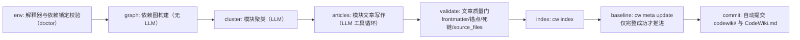
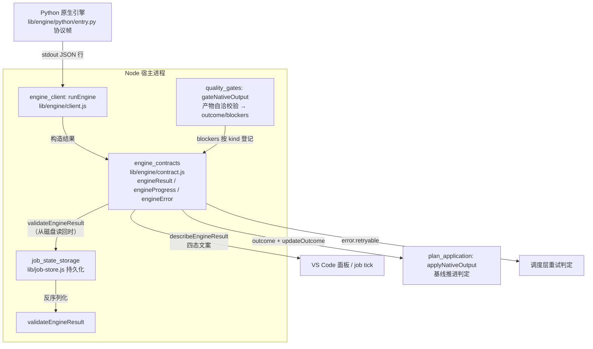
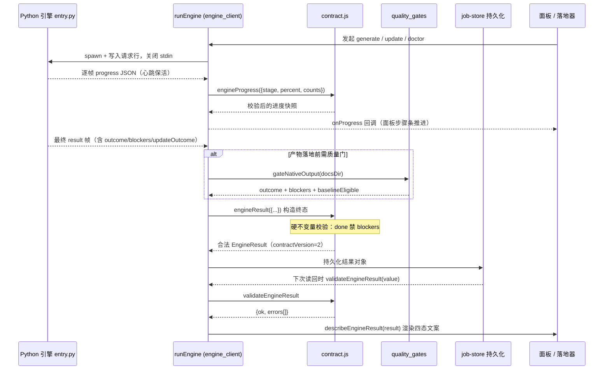

# 引擎结果契约（engine_contracts）

## 概述

`engine_contracts` 模块由单一文件 `lib/engine/contract.js` 构成，是 **Node 宿主进程与 Python 原生引擎之间的跨进程契约层**。它把「一次 generate/update/doctor 跑完之后，引擎到底成功了没有」这个问题，从各消费方各自猜测的默契，固化为版本化、可校验、机读的纯数据结构。

存在的根本动机（来自源码注释）：0.14.0 曾出现「1 篇成功 + 19 篇失败也报 done」的缺陷——终态判定含糊时，JobService、侧边面板、cw 基线、自动提交、降级提醒等每个消费方都会对同一结果做出不同解释。本模块因此固定三件事：

- **EngineResult** — 一次 generate/update 的完整结果（版本化，可校验）；
- **EngineProgress** — 推进中的阶段/计数快照（面板进度条与 job tick 共用）；
- **EngineError** — 可机读失败事实（`code` 决定重试语义，`message` 只给人看）。

模块的设计铁律是**纯数据、纯函数**：不碰文件系统、不碰进程、不碰模型——只有这样才能被单元测试（TDD）钉死。

### 语义硬不变量

`engineResult()` 构造函数与 `validateEngineResult()` 校验函数双重保证以下四条不变量：

| 终态 outcome | 语义 | blockers | error |
| --- | --- | --- | --- |
| `done` | 完整成功 | **严禁携带**（带了即自相矛盾） | 无要求 |
| `partial` | 部分完成 | **必须至少一条**（否则等于伪装成功） | 无要求 |
| `failed` | 失败 | 无要求 | **必须携带** |
| `cancelled` | 用户取消 | 可携带，说明已写成的部分 | 无要求 |

构造时违反不变量会**直接抛错**（契约破坏必须响，而不是被静默归一）；从磁盘/外部反序列化回来的对象则走 `validateEngineResult()`，逐条返回错误列表而不抛错。

---

## 核心数据结构

### 版本与枚举常量

- `ENGINE_CONTRACT_VERSION = 2` — 契约版本号。任何结果对象都必须携带 `contractVersion`，反序列化时比对，不匹配即拒绝信任。
- `ENGINE_STAGES` — 八个阶段，顺序即推进顺序。阶段枚举是**契约**而非实现细节：面板步骤条、`job.stage` 映射、取消检查点全部按它对齐。

- `TERMINAL_OUTCOMES = [done, partial, failed, cancelled]` — 四种终态。
- `UPDATE_OUTCOMES` — 引擎自报的**增量结局**（来自 FSoft 的 `update_record.json:outcome`）。它不是终态，而是「这一轮到底真做了组件级增量、无变化、还是引擎自己退了全量」。
  - `incremental` — 真做了组件级更新（图 diff 命中，只重写受影响模块）；
  - `no_change` — 图 diff 为空：源码没变，文档已最新；
  - `full_fallback` — 想增量但阈值/可比性触发回退，引擎已整份重建；
  - `detector_failure` — 连旧状态都读不到，回退全量。
  - 只有 `CONSUMING_UPDATE_OUTCOMES = [incremental, no_change]` 算「增量真的成立」：只有这两种结局允许推进基线、把变化视为已消化。`null` 表示这轮不是 update（全量编译没有增量结局可言）。

> 为什么 `updateOutcome` 必须过契约：`full_fallback` / `detector_failure` 意味着引擎**没有**真正做增量。哪怕产物看着完整，基线也不能照推进——否则下一轮的起点被抬到「其实没消化」的位置，这批变化就永久丢了。引擎升级后若改名（写成未登记的字符串）必须抛错，而不是被当成「不认识 → 忽略」，忽略它等于把「引擎退了全量」洗成增量成功。

### BLOCKER_KINDS — 阻塞原因类别

机读、稳定、可被终态判定与面板文案共用。新增类别只允许**追加**（消费者按 `kind` 分派），不允许改名：

| kind | 含义 |
| --- | --- |
| `article-failed` | 计划内必需文章没写成/校验不过 |
| `article-missing` | 计划内必需文章缺失 |
| `unmapped-change` | 有变更没能归属到任何文章 |
| `unmapped-page` | 引擎产出了无法映射进 wiki 的页 |
| `quality-gate` | 质量闸门拦下 |
| `index-failed` | cw index 失败 |
| `baseline-failed` | cw meta update 失败 |
| `commit-failed` | 自动提交失败（不算引擎失败，但产物未入库） |
| `engine-error` | 引擎自身错误（进程崩溃/协议破坏） |
| `cancelled` | 用户取消 |
| `incremental-fallback` | 增量不可用而降级（非失败：产物照写、基线不推进，下一轮仍从旧基线重算） |
| `engine-timeout` | 单阶段超时被救回（超时但已写出文章时，整轮判 partial 并给出此 blocker） |

未登记的 `kind` 由 `normalizeBlocker()` 静默降级为 `engine-error`——所以新增 `BLOCKER_KINDS` 成员时必须同步登记，否则「这轮是超时被救回」之类的关键事实会从终态与面板里消失。

### ENGINE_ERROR_CODES — 可机读失败码

`code` 决定重试语义；`message` 只给人看：

| code | 含义 | 可重试 |
| --- | --- | --- |
| `engine-missing` | 解释器/入口/venv 不存在 | 否 |
| `engine-deps` | 依赖锁定不一致（pip check / manifest 不符） | 否 |
| `engine-timeout` | 单阶段超时 | **是** |
| `engine-cancelled` | 取消（不是失败） | 否 |
| `engine-crashed` | 非零退出/进程树异常 | 否 |
| `engine-protocol` | stdout 协议破坏（非法 JSON / 缺字段） | 否 |
| `engine-model` | 模型通道失败（上游 provider 报错/限流/鉴权） | **是** |
| `engine-output` | 产物缺失或不可解析 | 否 |
| `engine-unknown` | 未登记 code 的兜底 | **是** |

可重试集合为 `RETRYABLE_CODES = {engine-timeout, engine-model, engine-unknown}`——其余一律视为确定性失败，重试只是浪费。

---

## 核心函数

### `engineResult(input)` — 构造一次引擎结果

把外部（Python 引擎协议帧、client.js 判定逻辑）传来的输入归一化为合法的 `EngineResult` 对象。**非法输入抛错而不是静默归一**——契约破坏必须响。返回对象的主要字段：

- `outcome` / `stage` / `blockers` / `error` — 语义四元组（见上表硬不变量）；
- 计数字段：`writtenCount` / `failedCount` / `keptCount` / `removedCount` / `unmappedCount`（经 `num()` 归一为有限正数，非法值归零）；
- `checks` — doctor 自检明细，每项为 `{name, ok, detail}`。注意：**只有 doctor 动作会填**，其它动作恒为空数组；消费方必须按「空 = 这项动作没有自检」理解，不能把空数组当成「全部检查都失败」。非法项被丢弃而不是让整个 doctor 失败；
- `updateOutcome` — 增量结局（见上文枚举）；
- `usage` — token 用量归一（`inputTokens` / `outputTokens` / `cachedTokens` / `requests`）；
- `engine` — 引擎自报的版本/提交/Python 解释器，以及依赖闭合结论 `deps: {ok, summary}`（doctor 的价值在于说出能不能信这个环境，所以成功时也带证据，而不是只说一句 done）；
- `artifacts` — 产物位置：`docsDir`（文章写在哪）、`rawTreeDir`（引擎自报的原始 FSoft 树指针）、`updateRecord`、`rawTree` / `rawTreeFiles`（我们在**消费之前**留下的整棵原始 docs 树快照——与 `rawTreeDir` 是两个概念：那是「引擎说它产出了什么」，这是「产出的原样」）；
- `startedAt` / `finishedAt` — 时间戳。

### `engineProgress(input)` — 推进中的快照

供引擎运行期间的 tick 与侧边面板共用。`stage` 必须登记在 `ENGINE_STAGES` 中，否则抛错；`percent` 被夹到 `[0, 100]`。字段**只增不减**（旧 job 缺字段按 0/null 解释），保证旧版本持久化的快照仍可被新面板读取。

### `engineError(input)` — 构造可机读失败事实

未登记的 `code` 归到 `engine-unknown`，并把原始字符串留在 `rawCode` 字段（截断 200 字符）便于排障——不改 code 本身的机读重试语义。`message` 截断 4000 字符。

### `normalizeBlocker(b)` — 内部归一函数

把任意来源的 blocker 归一为 `{kind, detail, target?, source?}`：`kind` 未登记则降级为 `engine-error`；`detail` 截断 2000 字符；`target` / `source` 存在才保留。

### `validateEngineResult(value)` — 反序列化边界校验

校验一个「可能来自外部/旧版本/磁盘」的结果对象。**不抛错**，返回 `{ok, errors[]}`。检查项包括：必须是对象、`contractVersion` 匹配、`outcome` 合法、四态硬不变量（done 带 blockers / partial 缺 blockers 都报错）、计数字段为非负数、`blockers[].kind` 全部登记、`failed` 缺 `error`、`updateOutcome`（若给出）已登记。磁盘残留、版本不匹配都走这里。

### `describeEngineResult(result)` — 终态文案

与 `lib/update-record.js` 的 `describeOutcome` 保持同一口径（四态一眼可分）：

- `done` → `完成（写入 N 篇）`
- `partial` → `部分完成（写入 N 篇，M 篇未完成）：<第一条 blocker 详情>`
- `failed` → `失败：<error.message>`
- `cancelled` → `已取消（已写入 N 篇）`

该函数直接对应模块树中用户指定的三个核心组件，是面板与 job 日志展示终态的统一出口。

---

## 在系统中的位置

关键协作关系：

1. **上游生产者**：[`engine_client`](engine_client.md)（`runEngine`）在 timeout、silence、abort、协议破坏、正常退出等每条分支上，都用 `engineResult()` + `engineError()` 构造结果——例如超时但已写文章时，必须判 `partial` 并携带 `{kind: 'engine-timeout'}` 的 blocker，这正是 contract.js 中登记该 kind 的原因。[`quality_gates`](quality_gates.md)（`gateNativeOutput`）则把产物缺陷/降级分流成 `done/partial/failed` 与 blocker 列表。
2. **结果宽限协议**：client.js 约定「语义以 result 为准」——result 帧到达后给进程短暂的自行收场窗口，超时按已有 result 收尾，避免已成功的编译被静默/超时误判。
3. **下游消费者**：
   - [`plan_application`](plan_application.md) 依据 `outcome === 'done'` 且 `updateOutcome ∈ CONSUMING_UPDATE_OUTCOMES` 才允许推进 cw 基线；
   - 面板与 job tick 用 `describeEngineResult()` 展示文案、用 `engineProgress` 的 `stage` 渲染步骤条；
   - 调度层依据 `error.retryable` 决定是否自动重试；
   - [`State___Observability_Management`](../../State___Observability_Management.md) 家族（job 状态存储、更新状态追踪）持久化结果对象，读回时经 `validateEngineResult()` 校验。

---

## 数据流：一次引擎运行的结果生命周期

---

## 设计要点小结

- **版本化边界**：`ENGINE_CONTRACT_VERSION = 2` 让 Node 与 Python 两侧解耦演进；旧版本对象在反序列化边界被 `validateEngineResult()` 拦截，而不是带着未知语义流入下游。
- **构造抛错、校验返错**：同进程内构造新结果时，违反硬不变量立刻抛错（TDD 可钉死）；跨边界读旧数据时，逐条收集错误而不中断消费（诊断优先）。
- **机读与给人看分离**：`code` / `kind` 是稳定枚举（重试语义、面板分派都依赖它），`message` / `detail` 只是截断后的人类可读文案。
- **纯函数模块**：整个文件无 I/O、无进程操作，因此可在不启动引擎的情况下对终态逻辑做完整单元测试。

## 相关模块

- [engine_client](engine_client.md) — 引擎进程的 spawn、协议帧解析与超时/静默/取消判定，是 EngineResult 的主要生产者。
- [quality_gates](quality_gates.md) — 产物自洽校验，决定 `done/partial/failed` 与 blocker 列表。
- [plan_application](plan_application.md) — 依据契约结果执行落地与基线推进。
- [python_native_runtime](python_native_runtime.md) — Python 侧入口与运行时，按同一协议帧输出结果。
- [engine_manifest_management](engine_manifest_management.md) — `doctor` 动作产出的 `checks` 与 `engine.deps` 证据来源。
- [State___Observability_Management](../../State___Observability_Management.md) — 结果对象的持久化与终态追踪。
- [Code_Engine_Processing_Pipeline](../../Code_Engine_Processing_Pipeline.md) — 引擎处理管道总体文档。
