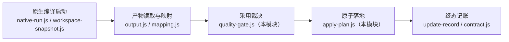
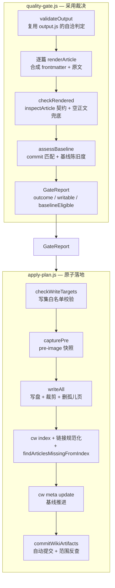
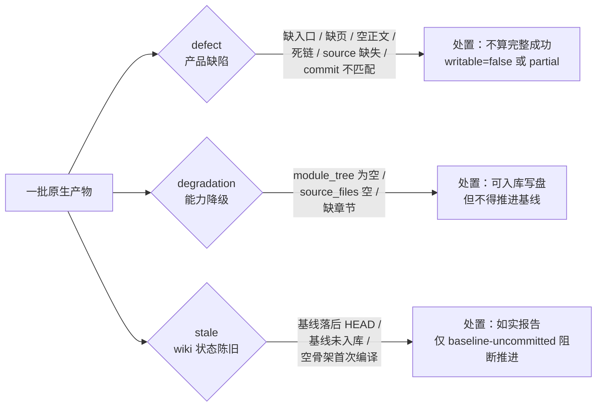
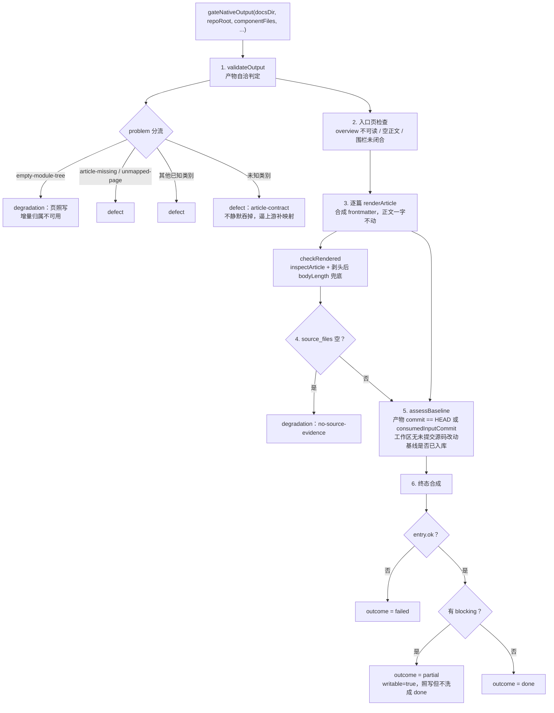
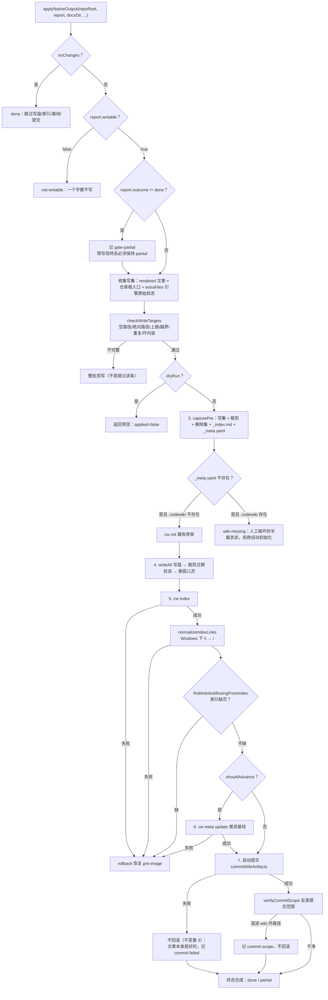
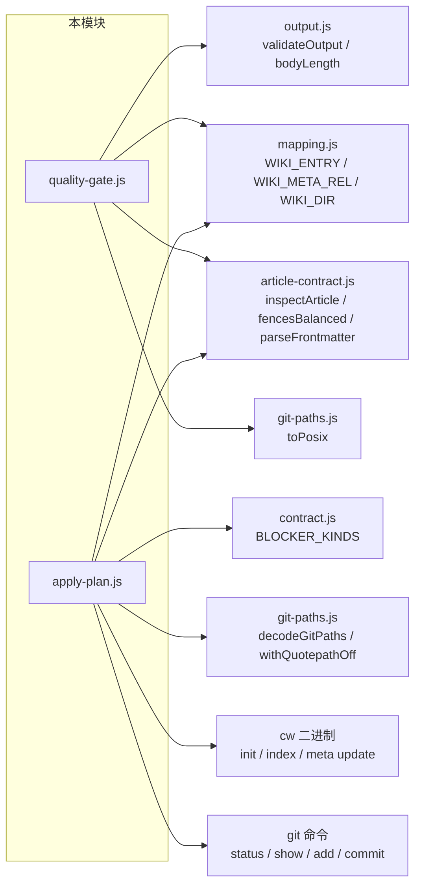

# 引擎原生产物采用门与落地层（engine_core_artifact_gate）

## 简介

本模块是原生编译通道（FSoft 引擎通道）的**最后两道闸门**：在引擎把 docs 树交回来之后、产物真正写进仓库之前，先做「能不能被 wiki 采用」的裁决（quality gate），再把裁决原子地落地成磁盘上的文章、索引、基线与自动提交（apply plan）。

它的存在由两次血泪教训定义：

- **0.14.0**：把「写成几篇」当成「成立」，于是「1 篇成功 + 19 篇失败也报 done」。
- **0.16.1**：把空 `source_files` 的页判成「成功」并推进基线，把归属不明的产物记成「已消化」。

本模块由两个文件组成，职责严格分离：

| 文件 | 阶段 | 职责 |
|------|------|------|
| `lib/engine/quality-gate.js` | 阶段 3 上半 | **采用裁决**：产物自洽 → 文章渲染 → 格式契约 → 基线可推进性，输出一份 `GateReport` |
| `lib/engine/apply-plan.js` | 阶段 3 下半 | **原子落地**：写盘 → `cw index` → 基线推进 → 自动提交，失败按 pre-image 回滚，输出一份 `ApplyResult` |

两个文件之间**只通过报告对象通信**，apply 不重复 gate 的判定，只认 `report.writable` 这一个结论。

## 在引擎中的位置

原生通道的完整管线横跨三个文档页：



- 上游的产物执行、工作区快照、状态文件管理见 [engine_core_compilation](engine_core_compilation.md)。
- 本模块产出的 `blockers` 与外部契约终态判定的对接见 [engine_core_contract](engine_core_contract.md)。
- 上游引擎入口与 LLM 桥接（`runEngine`、`startLlmBridge`）见 [engine_core_contract](engine_core_contract.md)。

## 架构总览



## 核心设计：三类问题必须分开

这是 `quality-gate.js` 存在的核心理由。0.14.0 的教训是「失败不报」；反过来把一切塞进一个 `blockers` 数组同样有害——引擎会被归咎于不是它的问题，或 wiki 的陈旧状态被当成产品缺陷。所以分类是**机读**的：



终态仍然严格：**只有三类皆空才是 `done`**。分类改变的是「谁来修、修什么」的定位，不是放宽闸门。

### 问题类别词表（稳定、可机读，新增只允许追加）

| 类别 | kind 枚举 |
|------|-----------|
| **defect**（`GATE_DEFECT_KINDS`） | `missing-docs-dir`、`missing-metadata`、`missing-module-tree`、`bad-json`、`entry-missing`、`empty-body`、`article-missing`、`unmapped-page`、`source-missing`、`dead-link`、`article-contract`、`commit-mismatch`、`uncommitted-input` |
| **degradation**（`GATE_DEGRADATION_KINDS`） | `empty-module-tree`、`no-source-evidence`、`missing-section`、`empty-section-optional` |
| **stale**（`GATE_STALE_KINDS`） | `baseline-behind-head`、`baseline-uncommitted`、`baseline-absent` |

## quality-gate.js 主流程：`gateNativeOutput`



### 关键导出函数

| 函数 | 作用 |
|------|------|
| `gateNativeOutput({docsDir, repoRoot, componentFiles, ...})` | 主入口，返回完整 `GateReport` |
| `renderArticle({article, body})` | 把映射出的一篇文章渲染成 wiki 完整文本：合成的 frontmatter + FSoft 原文 |
| `yamlScalar(value)` | YAML 标量安全序列化：只在确实不安全时才加双引号（`JSON.stringify` 就是正确转义） |
| `readCommittedBaseline({repoRoot, relPath})` | 读**已提交**的基线：`git show HEAD:.codewiki/_meta.yaml`，不是工作区文件 |
| `uncommittedSourceChanges({repoRoot})` | 工作区是否有非 wiki 的未提交改动（`.codewiki/` 与 `CodeWiki.md` 不算） |
| `assessBaseline({repoRoot, artifactCommit, baseline, ...})` | 判「这批产物的基线能不能被推进」；空骨架基线（`cw init` 刚建、`last_compiled_commit` 为 null）按 `baseline-absent` 记，不阻断首次编译 |
| `toContractBlockers(report)` | 把 gate 的 blockers 翻成 contract.js 的 `BLOCKER_KINDS`，供 update-record 使用 |
| `toQualityIssues(report)` | 把 gate 结论翻成 `qualityIssues`，喂给 `judgeOutcome`——两条判定路径不能一个严一个松 |

### 三条硬约束（renderArticle，都在测试里钉死）

1. **正文一字不动**：不删 H1、不改标题、不重写链接、不补章节。
2. **frontmatter 只填有证据的字段**：`source_files` 原样来自映射（空就是空），绝不按目录名猜。
3. **可回溯**：`fsoft_page` 记住正文来自 FSoft 原始树的哪个文件，「wiki 里这篇 ≠ 引擎产出那篇」永远可以逐字比对。

### 为什么基线必须从 `HEAD:` 读而不是读工作区

工作区的 `_meta.yaml` 随时可能是上一轮编译刚写、还没提交的内容（本仓库的自动提交是插件侧异步做的，中间存在「已写入、未提交」窗口）。把它当基线等于把一堆未提交的产物宣布成「已消化」，而 git 里根本没有它们的记录——下次编译的 base 会指向一个不存在的状态，变化要么重复消费要么永久失明。

## apply-plan.js 主流程：`applyNativeOutput`



### 三条硬不变量（本模块唯一的验收标准）

1. **写集封闭**：只允许写 `.codewiki/` 之下与仓库根 `CodeWiki.md`。绝对路径、盘符、`..` 上跳、白名单外路径一律**整批拒写**（不是跳过该条——写集不完整时部分写入等于制造一份没人在意的半成品）。
2. **索引/基线失败即回滚**：文章写盘之后 `cw index` 或 `cw meta update` 失败，磁盘必须回到应用前的样子。否则库里留下「文章在、索引没有」或「文章在、基线已推进」的结构，下次编译会在脏库上判「已消化」，而脏库永远不会自愈。
3. **提交失败不回滚**：自动提交失败时文章本身是好的、有用的（与索引/基线相反——那两步失败说明这批产物还没被库接受）。所以只记 `commit-failed` 阻塞并如实返回，绝不把有价值的文章删掉。

### 关键导出函数

| 函数 | 作用 |
|------|------|
| `applyNativeOutput({repoRoot, report, ...})` | 主入口：写盘 → index → 基线 → 自动提交，失败按不变量回滚 |
| `checkWriteTargets(items)` | 写集校验纯函数（不碰磁盘）：`empty-target` / `absolute-target` / `escaping-target` / `out-of-scope` / `duplicate-target` / `bad-content` |
| `checkDeleteTargets(rels)` | 删除集校验：与写集共用同一把 `checkTargetPath` 尺子，目录本身不许当删除目标 |
| `findOrphanPages({repoRoot, keepPages, modulesDir})` | 扫存量模块页，找 `source_files` 非空且全部已失效的孤儿页 |
| `verifyCommitScope(repoRoot, sha)` | `git show --name-only` 反查实际提交内容，把「只 add wiki 路径」的安全边界变成可断言的事实 |
| `commitWikiArtifacts(cwd, {jobId, writtenCount})` | 阶段 3 内置小提交器：安全边界逐条对齐 `autoCommitWiki`（只 add wiki 两路径 / 不 amend 不 push / 合并冲突与无 HEAD 一律拒绝） |
| `toApplyBlockers(problems)` | 落地问题 → 契约 `BLOCKER_KINDS` |
| `defaultRunCw(binary, cwd, args, timeoutMs)` | 默认 cw 通道：同步 `spawnSync`；阶段 4 由 `index.js` 注入自己的 `runCw` |

### 为什么必须「索引必须真的收录本次写的文章」

`cw index` 的退出码只表示「索引文件写成功了」，不表示「文章被收录」。vendor/codewiki 的实现是逐篇 `frontmatter::parse`，**解析失败就 continue**，最后照样写索引并返回 0。于是 frontmatter 写坏的文章会静默缺席，而落地器拿到 exit 0 会判 done——这就是「缺页静默成功」。`findArticlesMissingFromIndex` 按路径比对 `_index.md` 里的链接与写集，把这个静默失败变成显式的 `index-failed` 并整体回滚。

### 为什么要扫孤儿页

gate 只体检**本次产物**里的页。删除一个模块时 FSoft 可能回 `full_fallback` + `pages_removed: []`——它不告诉我们「哪篇该消失」，于是 `.codewiki/modules/` 里那篇 `source_files` 全部失效的页就永久留在库里，读者点进去看到的是描述已删代码的文档，没有任何一处报错。判据刻意保守：`source_files` 为空不是孤儿证据；只要还有一个文件存在就不是孤儿；frontmatter 缺失/坏掉的页不动（那可能是人工写的页）。

## 依赖关系



- `article-contract.js` 是文章格式判据的共用实现（frontmatter 唯一闭合 / 围栏 / 死链 / `source_files` 证据 / 类型与位置匹配），两个文件都复用它而不是重写。
- `contract.js` 的 `BLOCKER_KINDS` 是面板与终态判定共用的词表，gate 与 apply 各有一张 `TO_CONTRACT_KIND` 映射表一一对照，契约测试会枚举全表，写错的 kind 会让面板与终态判定同时失明。
- `apply-plan.js` **不 import index.js**：那里是插件主入口，加载它会连带拉起宿主服务与 webServer。`runCw` / `commit` / `normalizeIndexLinks` 全部由调用方注入，测试注入桩。

## 数据流：一次完整的编译落地

```mermaid
sequenceDiagram
    participant Caller["调用方<br/>index.js / 测试"]
    participant Gate["quality-gate.js"]
    participant Apply["apply-plan.js"]
    participant CW["cw 二进制"]
    participant Git["git"]

    Caller->>Gate: gateNativeOutput(docsDir, repoRoot)
    Gate->>Gate: 产物自洽 → 渲染 → 契约 → 基线
    Gate-->>Caller: GateReport { outcome, writable, baselineEligible, rendered, blockers }

    Caller->>Apply: applyNativeOutput(repoRoot, report, extraFiles, pruneRoots, deleteFiles)
    Apply->>Apply: checkWriteTargets 白名单校验
    Apply->>Apply: capturePre pre-image 快照
    Apply->>Apply: writeAll 写盘 + 裁剪 + 删孤儿页
    Apply->>CW: cw index
    CW-->>Apply: exit 0
    Apply->>Apply: findArticlesMissingFromIndex 比对索引
    alt 应推进基线
        Apply->>CW: cw meta update
        CW-->>Apply: exit 0（基线已推进）
    end
    Apply->>Git: git add + git commit（仅 wiki 路径）
    Git-->>Apply: sha
    Apply->>Git: git show --name-only 反查提交范围
    Git-->>Apply: files
    Apply-->>Caller: ApplyResult { applied, outcome, written, rolledBack, blockers }
```

## 与其他模块的关系

- 上游（产物执行与状态）：[engine_core_compilation](engine_core_compilation.md)——`native-run.js` 负责把工作区合成临时 commit、`workspace-snapshot.js` 负责快照、`manifest.js` 的 `doctor`/`writeLock` 负责清单与锁。本模块的 `consumedInputCommit` 参数正是对接「本轮合成的工作区快照 commit」：产物对它即为「对得上」，不再误报 `commit-mismatch`。
- 契约与终态记账：[engine_core_contract](engine_core_contract.md)——`contract.js` 的 `BLOCKER_KINDS`、`validateEngineResult`、`normalizeBlocker` 是本模块 `toContractBlockers` / `toApplyBlockers` 的出口词表；`client.js` 的 `runEngine` 是上游引擎入口。
- 引擎全貌：[engine_core](../engine_core.md) 描述本模块在整个引擎中的位置。
- 上层调用（接线处）：`index.js` 的 `tickCompose` / `tickCrosscut` / `tickReview` 等阶段函数会注入自己的 `runCw` 与 `autoCommitWiki`（分支合并式），替换本模块的默认实现——见 [core_entry](../core_entry.md)。
- 底层 wiki 解析：vendor/codewiki 的 `frontmatter.rs` 用 serde_yaml 解析 frontmatter，是本模块 `yamlScalar` 必须保证安全序列化的直接原因——见 [codewiki_vendor](../codewiki_vendor.md)。
