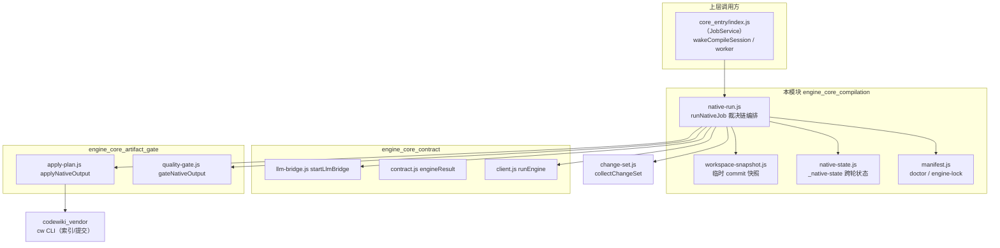
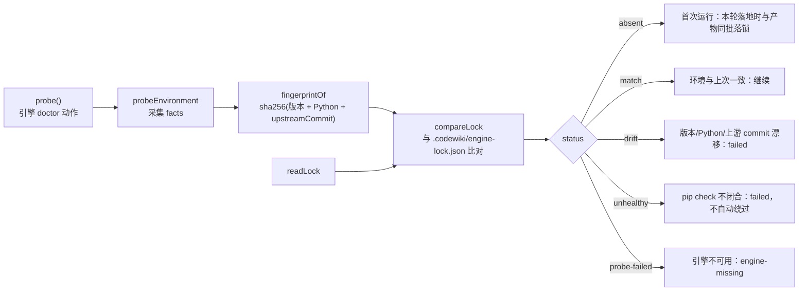
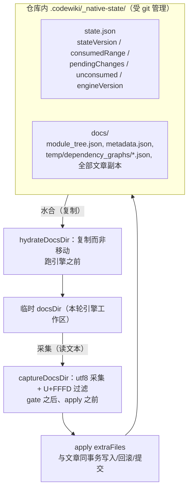
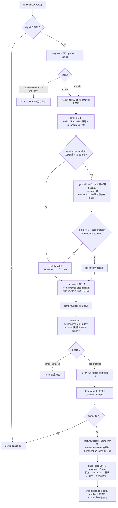
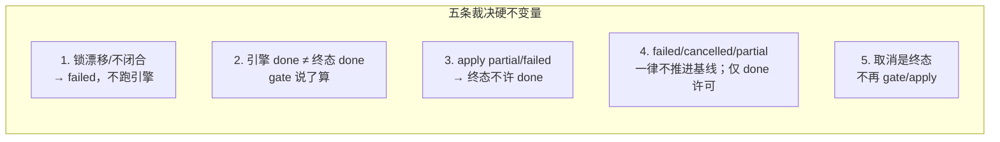

# 原生编译编排：环境锁定、受管状态与工作区快照

## 简介

`engine_core_compilation` 是原生引擎编译流水线的**裁决编排层**，位于 [engine_core 总览](../engine_core.md) 之下。它把一次完整编译固定成一条不可逆的直线裁决链——环境校验、增量决议、产物落地每一步的结论都不能被下一步洗白：

```text
env(doctor + engine-lock) → 增量决议(change-set + 受管状态) → 工作区快照
→ 水合 docs → 引擎(full|update) → 质量门 → 采集受管状态 → 落地器写盘
```

本模块由四个文件构成，分别承担四类基础能力：

| 文件 | 角色 | 核心导出 |
| --- | --- | --- |
| `lib/engine/native-run.js` | 编译裁决链主编排（阶段 4/5） | `runNativeJob`、`DEFAULT_ENGINE_TIMEOUT_MS`、`DEFAULT_UPDATE_OPTIONS` |
| `lib/engine/manifest.js` | 引擎环境清单与版本锁定 | `doctor`、`writeLock`、`buildLockBody`、`readLock`、`compareLock`、`UPSTREAM_COMMIT` |
| `lib/engine/native-state.js` | 跨轮受管状态（统一增量的持久化底座） | `stateDocFiles`、`isUpdateEligible`、`hydrateDocsDir`、`captureDocsDir`、`archiveDocsTree` |
| `lib/engine/workspace-snapshot.js` | 把未提交改动合成真实 commit 交给引擎 | `createWorkspaceSnapshot`、`snapshotExists`、`shortSha` |

## 模块定位与上下文



裁决链的下游两侧分别在兄弟模块中详述：协议、进程桥、结果契约见 [engine_core_contract](engine_core_contract.md)；质量门与落地器（写盘、索引、基线、自动提交）见 [engine_core_artifact_gate](engine_core_artifact_gate.md)。本页不再重复其内部实现，只描述本模块如何调用与约束它们。

## 架构：四个组成部分

### 1. `native-run.js` —— 编译裁决链编排

`runNativeJob` 是整个原生通道的主入口。它持有五条硬不变量（文件头注释明确列出）：

1. **锁不一致 / 依赖不闭合 → 直接 failed，不跑引擎**（跑出来的产物不可信）；
2. 引擎 done **不能**替代质量门：gate 说 partial，终态就是 partial；
3. 落地器说 partial/failed，终态不许是 done；
4. failed/cancelled 一律不推进基线；partial 也一律不推进——基线只由「本轮三类问题全空（outcome=done）」这一种许可决定，不再按「写了原始树就当可推进」拿产物数量猜基线许可；
5. 取消是终态：取消后不再 gate/apply，也不覆盖已写好的终态。

终态强弱由 `RANK = { cancelled: 0, failed: 1, partial: 2, done: 3 }` 的 `weakest()` 合成——引擎、质量门、落地器三方结局取最弱的一个，绝不允许被后续步骤提升。

关键常量：

- `DEFAULT_ENGINE_TIMEOUT_MS = 180 * 60 * 1000`（3 小时）：按真机实测 174 分钟编译耗时给出的上限，超时后由 client.js 的 partial 抢救路径兜底；
- `DEFAULT_UPDATE_OPTIONS = { rung: '3' }`：显式要求 FSoft 组件级增量（图 diff 决定重写范围），不留给引擎内部默认，避免上游语义静默漂移；
- `DEFAULT_ENGINE_ENTRY`：`lib/engine/python/entry.py` 的绝对路径（见 [engine_core_contract](engine_core_contract.md)）。

`runNativeJob` 还接收两个调用方透传的运行参数：`moduleConcurrency`（同层模块并行度，默认 1 = 上游严格串行）与 `resume`（断点续跑开关）。增量轮时两者都写进 `updateOptions.extra`：Python 侧 `fsoft_runtime.py` 据此做同层隔离并行与检查点续跑；`resume=true` 时水合以 `overwrite: false` 进行（不覆盖 docsDir 里已存在的断点页面），且「水合不到文件但 docsDir 已带 `module_tree.json`」不再退全量——断点目录本身就是有效的增量起点。

统一出口 `settle()` 保证所有分支（取消、环境失败、引擎崩溃、成功收尾）都经过 `engineResult()` 归一化——done 不许带 blockers、partial 必须带 blockers、failed 必须有 error，构造不合法即抛错（接线 bug 必须响）。

### 2. `manifest.js` —— 引擎环境指纹与锁定

FSoft 是**外部**引擎，版本与依赖不由本仓库控制。本模块只做三件事：指纹、比对、落盘；**不装依赖、不修环境、不联网**（那是 [setup-env.sh](../../../tools/fsoft-engine/setup-env.sh) 的职责）。



关键设计点：

- **`UPSTREAM_COMMIT` 是显式常量**（当前为 `03d0a294…`），而非从引擎自报的 `engine.commit` 提取——后者是**被编译仓库**的 HEAD（`_git_commit(repo_path)`），不是 FSoft 源码自己的 commit。两者必须分开记账；
- **指纹只吃决定产物内容的因素**：引擎版本 + Python 版本 + 上游源码 commit。`pip check` 的 ok **不进指纹**——它是「能不能跑」的闸门，不是「产物会是什么」的输入；
- **`buildLockBody` 与 `writeLock` 分离**：落锁正文先构造好，作为落地器写集（extraFiles）的一项与文章共享同一份 pre-image，同批回滚、同批提交。绝不能在 doctor 阶段直接写盘——那会让 `.codewiki/` 早于 `cw init` 存在，被落地器判成「人工破坏的半截库」而拒初始化。

### 3. `native-state.js` —— 跨轮受管状态

FSoft 的组件级增量（rung 3）要读上一轮留下的四样东西才能算「改了什么」：`module_tree.json`、依赖图、`metadata.json`、上一轮文章。而引擎的 docs 输出目录是每轮新建的临时目录——不持久化它们，第二轮 `_update_options()` 必然返回 None，每轮都在全量重编。

状态目录固定为 `.codewiki/_native-state/`：



为什么目录名必须以 `_` 开头：`cw index`（vendor/codewiki）递归 `.codewiki/` 时只跳过首段以 `_` 开头的路径。若状态放在 `temp/native-state/`，持久化的原始文章会被收成**第二份**索引条目。

核心函数与不变量：

| 函数 | 职责 | 失败语义 |
| --- | --- | --- |
| `stateDocFiles(stateDir)` | 列出受管硬依赖清单（审计用） | 纯函数 |
| `readState` | 反序列化 state.json，校验版本 | 坏了返回 `ok:false + reason` → 调用方退全量 |
| `isUpdateEligible` | 判增量资格：硬依赖齐全 + 图存在 + 引擎版本未变 + 基线一致 | 每个不可增量原因都写进 `fallbackReason`，绝不悄悄退全量 |
| `hydrateDocsDir` | 受管状态复制进独立 docsDir | 复制而非移动：一侧写坏不毁另一侧；`overwrite=false`（resume 断点续跑）时跳过已存在的页面 |
| `captureDocsDir` | 引擎 docsDir 采集为下一轮写集 | 非 utf8（U+FFFD）直接跳过，不写坏文件 |
| `archiveDocsTree` | 整棵原始树留档到**仓库外**临时目录 | 证据不是产物，失败只记 note |
| `graphFileName` | 依赖图文件名（`\p{L}\p{N}` 对齐 Python `c.isalnum`） | 中文仓库名的图不能误判缺失 |

### 4. `workspace-snapshot.js` —— 工作区临时 commit

FSoft 只从 `<old_commit>..<new_commit>` 取 diff，未提交改动不进 update_record。引擎读的是工作区文件（内容对），可 `metadata.commit_id` 只能写 HEAD（账指向错的状态）。于是本模块用独立 index 文件走 `read-tree → add -A → write-tree → commit-tree`，造一个 parent 指向 HEAD、**不写任何 ref** 的真实 commit：

- 用户的分支、HEAD、工作区、真实 index 一个字节不动；
- 得到的 sha 是 `.git/objects` 里可达的 commit，`metadata.generation_info.commit_id` 写它，下一轮增量拿它做 old_commit；
- 它不挂 ref，gc 后自然消失，**不能**当前移基线（这正是质量门对脏工作区仍判 partial 的理由）。

快照失败一律 `ok:false + error`：调用方退回「用 HEAD 记账」的旧行为并记 note——快照是对齐精度的改进，不是编译成立的前提。

## 编译裁决链数据流



**增量决议的三条判据**（都用可查事实，不猜）：

1. **变化是什么**：committed/staged/unstaged/untracked 四路 + 上轮未消费的携带（`mergeUnconsumed`）；
2. **能不能增量**：受管状态齐全（图/模块树/metadata/文章）、版本兼容、基线可达——任一不成立显式 full 并记 `incremental-fallback`；
3. **消费成立吗**：只有「引擎真报 `updateOutcome=incremental` 且 gate/apply 全 done」才推进基线；引擎自退全量（`full_fallback`）、检测失败（`detector_failure`）、产物被 gate 判 partial，一律不推进——下一轮 change-set 仍从旧基线算起，变化不会丢。

注意「变化集为空」**不是**跳过引擎的理由：FSoft 判断「有没有变」靠**图 diff**，不是 git 路径集合（重命名/跨文件重构能让路径集非空而图不变）。

## 关键数据结构

### 输出结果（`settle()` 归一化后的 EngineResult 附加字段）

```json
{
  "outcome": "done | partial | failed | cancelled",
  "updateOutcome": "incremental | no_change | full_fallback | detector_failure | null",
  "canAdvanceBaseline": "兼容字段：取落地事实 baselineAdvanced（cw meta update 真的成功）；老调用方只认这个名字",
  "baselineEligible": "质量门许可：仅 outcome=done 且受管状态完整",
  "baselineAdvanced": "落地事实：cw meta update 真的成功",
  "incremental": {
    "resolution": "full | update",
    "baseCommit": "cw 基线",
    "consumedCommit": "本轮产物对应的内容状态（快照 sha 或 HEAD）",
    "changes": [], "unconsumed": [], "fallbackReason": ""
  },
  "artifacts": {
    "docsDir": "本轮临时产物目录",
    "rawTree": "仓库外原始树留档（事实来源）",
    "rawTreeFiles": 0,
    "updateRecord": ""
  },
  "gate": { "outcome": "", "writable": true, "articles": [] },
  "apply": { "outcome": "", "applied": true, "rolledBack": false, "deleted": [], "pruned": [] },
  "engineLock": { "status": "absent|match|drift|unhealthy|probe-failed", "diffs": [] },
  "notes": []
}
```

### `.codewiki/engine-lock.json`（`buildLockBody`）

```json
{
  "manifestVersion": 1,
  "fingerprint": "sha256 前 16 位",
  "version": "codewiki 版本",
  "pythonVersion": "解释器版本",
  "upstreamCommit": "40 位十六进制源码锁",
  "engineRoot": "引擎源码根（审计）",
  "pipCheckOk": true,
  "recordedAt": "ISO 时间"
}
```

### `.codewiki/_native-state/state.json`（`buildStatePayload`）

记录「本轮开始时的已消费范围」与「本轮看见了哪些变化」，**不记录本轮结局**——基线是否推进的权威在 `.codewiki/_meta.yaml`，而 state.json 要在 apply 之前就随同一份 pre-image 落盘。本轮失败 → `_meta.yaml` 基线未前移 → 下一轮 change-set 仍从旧基线算起，未消化的变化自动重新出现，不丢。

## 与环境配置的关系

- 引擎环境的**搭建**（独立 venv + 冻结清单 `--no-deps` 安装 + `pip check` + import 冒烟）由 [`tools/fsoft-engine/setup-env.sh`](../../../tools/fsoft-engine/setup-env.sh) 完成——`doctor` 只负责**诊断**它产出的环境，绝不自动修；
- `package.json` 声明 `nativeEngine: true` 是 0.16.0 起的默认通道，Node 侧旧管线仅作兼容性保留（`nativeEngine: false`）；
- 插件设置项通过 `runNativeJob({ deps: { config } })` 注入：`cfg.engine`（引擎入口）、`cfg.engineRoot`、`cfg.upstreamCommit`、`cfg.batchProvider/batchModel/batchReasoningEffort`、`maxConcurrency` → `moduleConcurrency`（同层模块并行度，默认 1 = 上游严格串行）。

## 硬不变量速查（排障用）



两条易复发的历史缺陷（注释中明确点名）：

- **首次运行直接写 engine-lock.json** → `.codewiki/` 早于 `cw init` 存在 → 落地器判半截库整批失败并回滚。解法：锁进写集，由落地器与产物同事务提交；
- **超时砍轮但已写 28 篇时死守「partial 一律不动基线」** → 同一批变化永远重跑。曾临时解法：partial 只要 `rawTreeFiles > 0`（本轮确有产物落盘）即允许推进基线；但该例外把「没消化完」记成已消化，且与落地器「partial 不推基线」互相矛盾，已撤回——死循环的正确解法是让**首次编译**能走成 done（空骨架基线不算未入库基线，见 `assessBaseline` 的 `isEmptyBaseline` 分支）。
