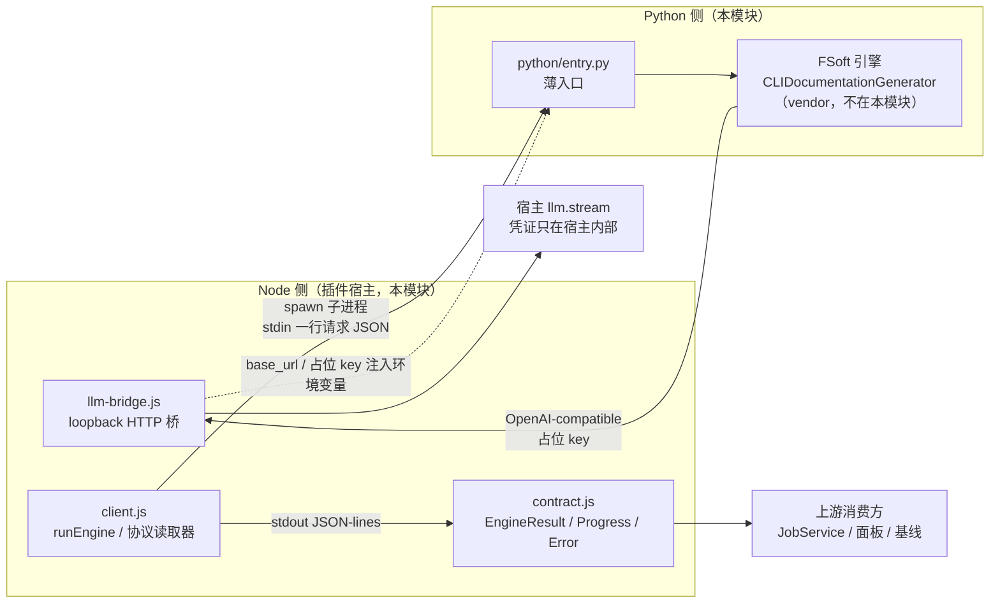
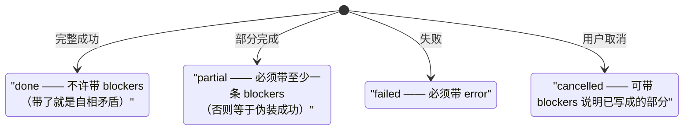
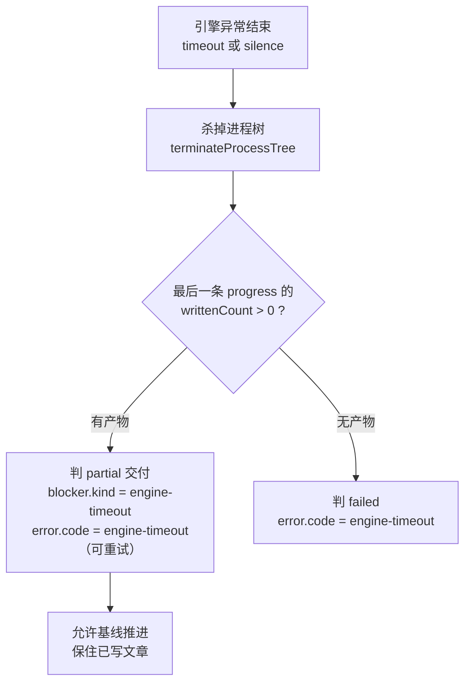
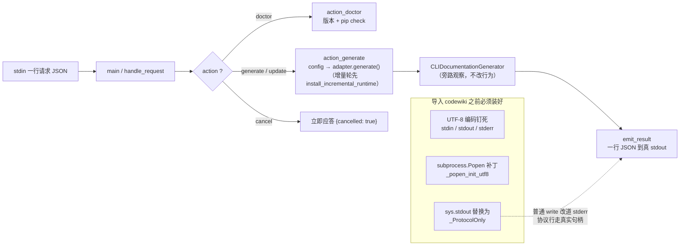
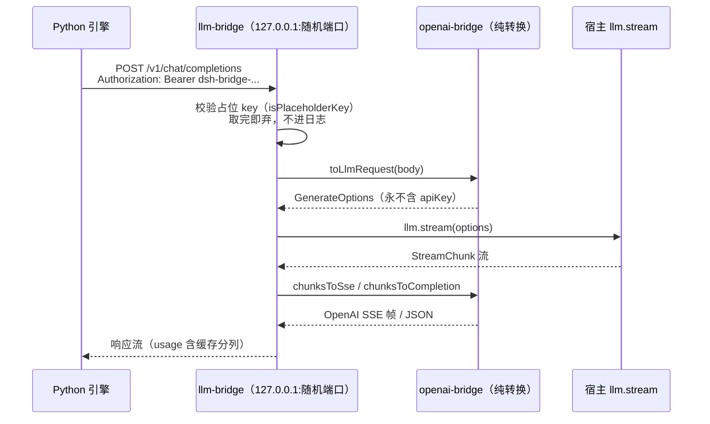
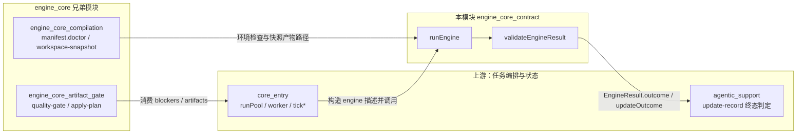

# engine_core_contract —— 跨进程契约、引擎客户端与模型通道桥

## 简介

`engine_core_contract` 是原生引擎通道里**唯一的跨语言边界**：它把 Node 侧（插件宿主）与 Python 侧（FSoft 原生引擎）之间的所有交互固定成三件事——一份版本化、可校验的**数据契约**（`lib/engine/contract.js`），一条受管子进程的 **JSON-lines 协议通道**（`lib/engine/python/entry.py` 与 `lib/engine/client.js`），以及一个**模型通道 loopback 桥**（`lib/engine/llm-bridge.js` 与 `lib/engine/openai-bridge.js`）。

契约存在的根本原因：迁移后 Node 不再自己计算依赖图、聚类或增量，一切结果都来自 Python 引擎的一次返回。这条边界一旦含糊，下游每个消费方（终态判定、面板展示、cw 基线推进、自动提交、降级提醒）就会各自猜测「引擎到底成功了没有」——而这正是 0.14.0 曾花一轮修复的缺陷类型（1 篇成功 + 19 篇失败也报 done）。因此本模块坚持两条设计原则：

1. **纯数据校验，不碰 I/O**：`contract.js` 是纯函数集合，可被 TDD 钉死；
2. **语义以消息为准，退出码只表达进程层**：哪怕退出码是 0，没有 `result` 消息就是协议破坏。

## 组成组件

| 文件 | 角色 | 关键导出 |
| --- | --- | --- |
| `lib/engine/contract.js` | 跨进程契约的 Node 侧定义与校验（`ENGINE_CONTRACT_VERSION = 2`） | `engineResult`、`engineProgress`、`engineError`、`validateEngineResult`、`describeEngineResult`、`normalizeBlocker`、`ENGINE_STAGES`、`BLOCKER_KINDS`、`ENGINE_ERROR_CODES` |
| `lib/engine/python/entry.py` | Python 侧薄入口：一行请求 JSON → 一次 FSoft 调用，进度/结果翻译成协议行 | `main`、`_ProtocolOnly`、`_popen_init_utf8`、`action_doctor`、`action_generate`、`handle_request` |
| `lib/engine/python/fsoft_runtime.py` | 增量轮的 Python 侧运行时适配（替换上游 Step 5 叶子写作） | `install_incremental_runtime`、`run_leaf_agents`、`run_leaf_order`、`write_checkpoint` |
| `lib/engine/client.js` | Node 侧进程 + 协议适配层（`ENGINE_PROTOCOL_VERSION = 1`） | `runEngine`、`createProtocolReader` |
| `lib/engine/openai-bridge.js` | OpenAI-compatible ↔ DSH LLM 的**纯转换**层（无 I/O、无密钥） | `isPlaceholderKey`、`toLlmRequest`、`chunksToCompletion`、`chunksToSse` |
| `lib/engine/llm-bridge.js` | 跑在 127.0.0.1 上的进程内 HTTP 桥，把引擎请求接到宿主 `llm.stream`；可选 `onRequestStart` 会话记录钩子 | `startLlmBridge` |

## 总体架构

## 契约核心：EngineResult 的四类终态与硬不变量

一次 `generate` / `update` 的结果由 `engineResult()` 构造，非法输入**抛错而不是静默归一**——契约破坏必须响。四个终态与配套约束构成语义硬不变量，由 `engineResult`（构造时）与 `validateEngineResult`（反序列化边界）双重保证：

契约还固定了三组跨进程共享的枚举，新增**只许追加、不许改名**（消费者按值分派）：

- `ENGINE_STAGES`（八段，顺序即推进顺序）：`env → graph → cluster → articles → validate → index → baseline → commit`。面板步骤条、`job.stage` 映射、取消检查点都按它对齐。
- `BLOCKER_KINDS`（阻塞原因类别）：如 `article-failed`、`quality-gate`、`engine-timeout`、`incremental-fallback` 等；`normalizeBlocker` 把未登记的 kind 归到 `engine-error`，detail 截断 2000 字符。
- `ENGINE_ERROR_CODES`（机读失败事实）：`code` 决定重试语义（仅 `engine-timeout` / `engine-model` / `engine-unknown` 可重试），`message` 只给人看；未登记 code 归为 `engine-unknown` 并在 `rawCode` 保留原文。

另一个关键字段是 `updateOutcome`（增量结局：`incremental` / `no_change` / `full_fallback` / `detector_failure`）。它是「基线能不能推进」的第二个证据源：即使质量门说产物完整，只要引擎自己报 `full_fallback`，这批变化就不算被消化——只有 `CONSUMING_UPDATE_OUTCOMES`（`incremental`、`no_change`）才算增量真正成立。

`describeEngineResult()` 负责把结果翻译成四态一眼可分的中文文案（`完成（写入 N 篇）` / `部分完成…` / `失败：…` / `已取消…`），与 `lib/update-record.js` 的 `describeOutcome` 同一口径。

## 协议通道：Node ↔ Python 的一次运行全过程

### 请求侧

`runEngine()`（`client.js`）以 `{command, args, env, cwd}` 描述 spawn 引擎进程，往 stdin 写一行平铺的请求 JSON（`{requestId, action, ...payload}`，action 限 `doctor` / `generate` / `update` / `cancel`），随后关 stdin——引擎读到 EOF 就开始干活。

### stdout 协议不变量

`createProtocolReader()` 是增量式 JSON-lines 读取器（纯逻辑、逐字节喂，可模拟管道任意切分）。六条协议不变量（由 `test-engine-client.mjs` 断言）：

1. stdout **只**是 JSON-lines；非 JSON 行记 `not-json` 违规，但不丢弃已收结果；
2. 每条消息必须带匹配的 `requestId`；不匹配记 `unknown-request`；
3. 没有 `result` 消息 = 协议破坏，即使退出码为 0 也判 `engine-protocol` 失败；
4. 退出码只表达进程层；语义以 `result` 为准（退出码 0 + 语义 failed 是失败；语义 done + 非 0 退出保留 done 并记 `nonzero-exit` 违规）；
5. 取消后到达的 result 记 `late-result` 并丢弃——取消是终态，不能被迟到的成功洗白；
6. 重复 result 先到的赢。

### 失败救援的统一口径：超时/卡死/崩溃 vs 已写产物

`runEngine` 并发竞速六个事件源（`exited` / `timeout` / `silence` / `abort` / `spawnError` / `resultGrace`），超时与静默两个分支使用同一条口径判 partial——这是打破「几十分钟成果白跑」死循环的关键：

`silence`（静默）检测是 0.16.9 真机事故后加入的：默认超时 180 分钟太长，僵死引擎会占满调度闸门。判据是「多久没收到任何协议帧」，默认 10 分钟（`DSH_CODEWIKI_ENGINE_SILENCE_MS` 可覆盖），必须显著大于 Python 侧 60 秒心跳间隔。Python 入口的心跳线程（`_heartbeat`）按 `_HEARTBEAT_SEC` 重发当前阶段与真实篇数，让 Node 能区分「慢」与「卡死」。

`resultGrace`（结果宽限）解决的是另一类事故：引擎把 `result(done)` 发出来之后卡在收尾（僵死线程、没关的 pipe、忘了 return 的事件循环），过去只有 `exited` 能收场，于是一轮已经确定成功的编译会被 10 分钟静默或 180 分钟超时改判成卡死/超时——产物早写完了却按 partial 交付、基线不推进、下一轮再跑一遍。现在协议读取器提供只读的 `hasResult`，`runEngine` 在收到 result 后给进程一个短暂的自行收场窗口（`resultGraceMs`，默认值见代码常量）；窗口到点还不退就杀掉进程树，按已收到的 result 收尾。被主动终止过的进程（结果宽限/静默/超时/取消）退出码是终止方式的产物，不再记 `nonzero-exit` 违规去污染已经明确的结果。

### Python 入口的守门职责

`entry.py` 本身**不是算法实现**——依赖图、聚类、文章写作全部由 FSoft 完成。它只做四件事，外加几条必须在 `import codewiki` **之前**装好的守卫：

- **`_ProtocolOnly`**：sys.stdout 替身。FSoft 大量使用 `print` / `click.secho` 往 stdout 写人类文案，而 click 会缓存 text stdout 包装器——「事后替换」拦不住已缓存的引用。所以普通 `write` / `flush` 全部改道 stderr，只有本入口经 `emit()` 写出的协议行走保存下来的真实 stdout 句柄。
- **`_popen_init_utf8`**：给 `subprocess.Popen.__init__` 打补丁——FSoft 内部的 `subprocess.run(..., text=True)` 在 Windows 上按 locale（gbk）解码，仓库路径含中文时 git 回的 UTF-8 字节会触发 `UnicodeDecodeError`。只补未显式指定 `encoding` 的 text 调用，二进制调用保持原样。
- **不读本机凭证库**：直接构造 config dict 交给 adapter，绕开 `ConfigManager`（它会读 `~/.codewiki/config.json` 与系统 keyring）。模型通道只从进程环境变量读 `CODEWIKI_BASE_URL` / `CODEWIKI_API_KEY` / `CODEWIKI_MAIN_MODEL`。
- **增量轮先装运行时适配**：`action_generate` 在 `is_update` 时、构造 `CLIDocumentationGenerator` 之前调 `fsoft_runtime.install_incremental_runtime()`，用源码锚点替换上游 `IncrementalUpdater._run` 的 Step 5（叶子写作），接入本层的同层隔离并行 / 冲突回退串行 / 检查点续跑实现（见 [engine_core](../engine_core.md) 的「增量轮的 Python 侧运行时适配」）；锚点不匹配直接抛错拒绝安装。
- **异常分类**：`_classify_exception` 按异常**类型**（不是消息文本）映射错误码；`_salvage` 在崩溃/模型失败时若已写出文章就降 partial 交付，避免「下一轮因没有持久化状态退回全量、再撞同一面墙」的循环。

## 模型通道桥：凭证边界

FSoft 只认 OpenAI-compatible 的 `base_url + api_key`，而插件既不保存也不传递真实密钥。`startLlmBridge()` 因此启动一个绑定 `127.0.0.1`、随机端口的进程内 HTTP 服务：

`onRequestStart` 是可选的会话记录钩子（面板「会话」视图靠它看「引擎把什么塞给了模型」）：原生通道的每个模型请求只经过这座桥，
不接这个钩子面板「会话」视图就永远是空列表。回调契约与 batch 通道一致
（`onDelta` / `onError` / `onDone`），由桥内部的 `callSession` 包装——回调自身抛错
只丢记录、绝不影响请求本身。记录内容同样受凭证边界约束：`onRequestStart`
只收到 `name`（`原生请求 · <model>`）、`model`、`provider` 与 `batchPrompt`
（messages 文本逐 role 拼接、超长截断），绝不携带 Authorization 请求头或占位 key。

安全上三层缺一不可：**loopback 绑定**阻断外网、**随机端口**让同机其它进程猜不到、**占位 key 校验**（`PLACEHOLDER_KEY_PATTERN = /^dsh-bridge-[a-z0-9-]+$/`）挡住误连与端口扫描。每次启动随机生成新 key，不复用、不落盘、不进日志；401 错误体也不回显收到的 key。

转换层（`openai-bridge.js`）全部是纯函数：OpenAI 消息 ↔ DSH `ContentBlock[]`（assistant 的 `tool_calls` 保持原始 JSON 字符串，tool 消息按 `toolCallId` 对链），chunk 流折叠（`foldChunks`）保证流式与非流式两条路径行为同源——只产出带 name 的工具调用，`reasoning-delta` 不进正文，usage 按「`prompt_tokens = 净输入 + 缓存读 + 缓存写`」映射。

## 上下游关系

- **上游**：[core_entry](../core_entry.md) 的 `worker` / `runPool` 通过 `runEngine` 发起每次编译，用 `describeEngineResult` 驱动面板与 job 终态；[agentic_support](../agentic_support.md) 的 `loadUpdateRecord` / `isTerminalStage` 与契约的四终态口径对齐。
- **兄弟模块**：[engine_core_compilation](engine_core_compilation.md) 负责 `doctor` 环境检查、venv 锁定与 workspace 快照（产物路径填进 `EngineResult.artifacts`）；[engine_core_artifact_gate](engine_core_artifact_gate.md) 消费 blockers 做质量门判定与产物落盘映射。契约本身不读 `.codewiki`、不碰文件、不起进程，只给两边提供同一个语义事实来源。
- **整体定位**：engine_core 家族的总览见 [engine_core](../engine_core.md)；宿主侧配置（插件声明 `nativeEngine` 默认通道、Node 版本要求）见 [package_manifest](../Build___Dependency_Configuration_Layer/package_manifest.md)。

## 关键常量速查

| 常量 | 值 | 说明 |
| --- | --- | --- |
| `ENGINE_CONTRACT_VERSION` | `2` | 结果契约版本；Python 侧 `CONTRACT_VERSION` 必须同步（单一常量抽取，避免 5 处字面量漏改） |
| `ENGINE_PROTOCOL_VERSION` | `1` | 协议行版本，独立于结果契约版本 |
| `DEFAULT_SILENCE_MS` | 10 分钟 | 无任何协议帧即判卡死（须远大于 60 秒心跳） |
| `_HEARTBEAT_SEC` | 60 秒 | Python 侧心跳补帧间隔 |
| `_WRITTEN_RECOUNT_SEC` | 2.0 秒 | 已写篇数重新清点的节流间隔（阶段切换/完成时强制重算） |
| `DEFAULT_MAX_LINE_BYTES` | 4 MiB | 单行上限，防引擎失控吐超长行吃内存 |
| `startLlmBridge` 默认超时 | 10 分钟 | 单次模型调用超时 |
