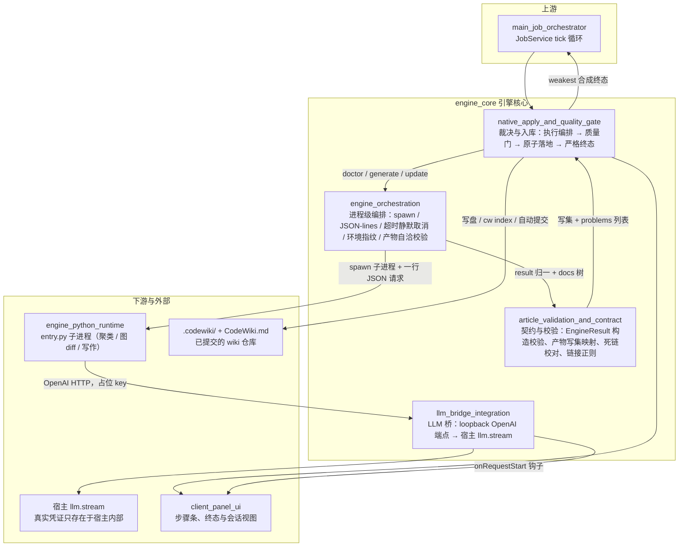
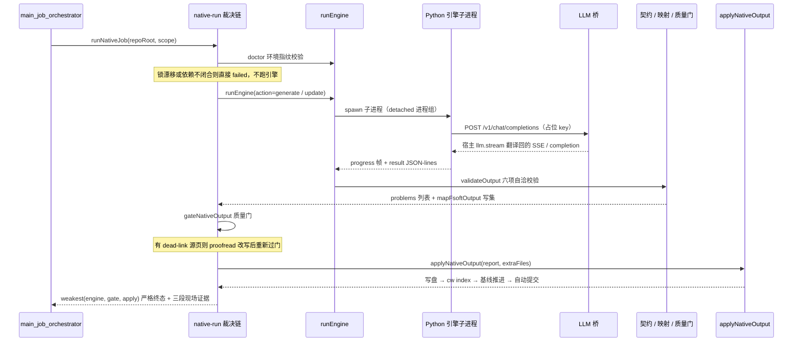

# 引擎核心（engine_core）

## 模块定位

`engine_core` 是 CodeWiki **原生编译通道**（`nativeEngine: true`，自 0.16.0 起为默认通道）在 Node 侧的引擎核心，位于 `engine_runtime_and_codewiki_kernel` 之下。它本身**不实现聚类、图 diff、文章写作等算法**——这些全部由 FSoft Python 引擎作为受管子进程完成；`engine_core` 负责的是跨语言边界上的四件大事：

1. **起管杀引擎**：以受管子进程方式拉起 Python 引擎，用 JSON-lines 协议收发请求，做超时 / 静默卡死 / 用户取消 / 进程树整树终止；
2. **立契约**：把引擎消息归一为版本化的 `EngineResult` / `EngineProgress` / `EngineError`，并把 docs 树翻译成 `.codewiki/` 写集；
3. **通模型**：在 loopback 上起 OpenAI 兼容桥，用宿主凭证调真实 provider，插件自身不保存也不传递密钥；
4. **裁决与入库**：把引擎产出经过「执行编排 → 质量门 → 原子落地」三段流水线，合成严格终态（`cancelled < failed < partial < done`），任何一环的结论都不许洗白下一步。

整个子系统的历史动机来自 0.14.0 缺陷（「引擎说 done 就 done、产物没入库也报完成」）与真机事故（静默卡死、迟到成功洗白取消、密钥落盘风险），因此核心验收标准是：**终态由整条裁决链的最弱环节决定，所有事实带证据进入终态**。

## 架构总览

## 一次编译的数据流

## 核心组件文档

| 子模块 | 职责 | 文档 |
| --- | --- | --- |
| 引擎编排 | Node ↔ Python 唯一跨语言边界：起 / 管 / 杀子进程、JSON-lines 协议六条不变量、环境指纹锁定（`engine-lock.json`）、产物自洽校验（11 种 problem kind） | [engine_orchestration](engine-orchestration.md) |
| 文章校验与契约 | 跨进程结果契约（四态终态硬不变量、blocker / error / stage 枚举）、FSoft 产物 → `.codewiki/` 写集映射（四条迁移安全硬规则）、单轮 LLM 死链校对、链接扫描唯一正则源 | [article_validation_and_contract](article-validation-and-contract.md) |
| LLM 桥接集成 | 进程内 loopback OpenAI 兼容端点：占位 key + 随机端口 + `127.0.0.1` 绑定三层防护，把引擎请求翻译成宿主 `llm.stream`，流式逐帧 SSE 回传；凭证绝不落盘、不进日志 | [llm_bridge_integration](llm-bridge-integration.md) |
| 原生产物落地与质量门 | 原生通道中段裁决与入库子系统：`runNativeJob` 直线裁决链、`gateNativeOutput` 唯一采用门（defect / degradation / stale 三分）、`applyNativeOutput` 原子落地与 pre-image 回滚 | [native_apply_and_quality_gate](native-apply-and-quality-gate.md) |

## 关键设计原则

- **最弱环终态**：引擎、质量门、落地器三段结论取最弱值；`done` 不许带 blockers，`partial` 必须带 blockers，终态合法性由统一出口保证。
- **契约破坏必须响**：构造期非法输入抛错，反序列化期返回逐条 errors；取消是终态，迟到的 `result` 记 `late-result` 丢弃，绝不洗白。
- **边界刻意窄**：进程编排层不做写作、不连模型、不修环境；模型通道由 LLM 桥单独承担，且桥自身不持有任何 provider 配置。
- **证据宁缺勿造**：`source_files`、归属、基线推进都只信可机读证据；没证据就空数组 + warning，绝不臆造。
- **修正文不改判据**：proofread 只修模型幻觉造成的死链，改写后必须重新过质量门；门的标准绝不因校对放松。