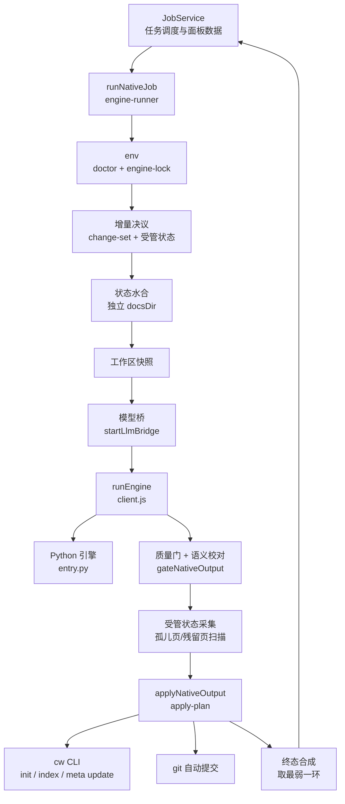
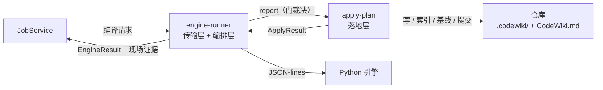
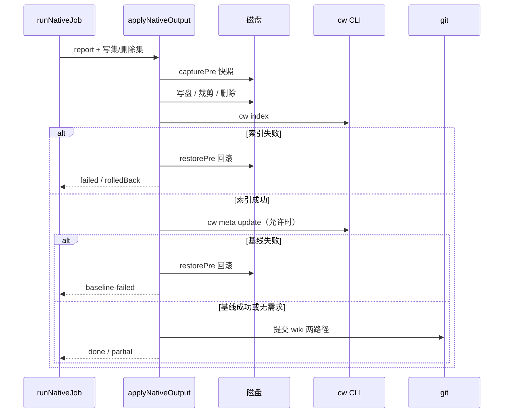

# engine-orchestration 模块概览

`engine-orchestration` 是原生（FSoft）CodeWiki 编译通道的**执行与裁决层**。它不负责文章生成算法，也不定义跨层契约；它负责把一次编译请求从“调用方说开始”推进到“可机读的终态结论”，并把质量门允许入库的产物真正落到仓库中。其核心问题是：**每一步的结论都不能被下一步洗白**。

模块由两个子模块组成：

- **engine-runner**：执行层。`client.js` 是 Node ↔ Python 的唯一跨语言边界；`native-run.js` 负责环境检查、增量决议、引擎调用、质量门、落地器调用与终态合成。
- **apply-plan**：落地层。它是唯一允许修改 `.codewiki/` 与 `CodeWiki.md` 的模块，负责写盘、索引、基线推进、自动提交以及失败回滚。

`engine-runner` 自身不写 `.codewiki/`；所有写、删、裁剪、索引、基线、提交都交给 `apply-plan`，从而共享同一份 pre-image 与回滚语义。

---

## 1. 架构

### 1.1 在编译链中的位置

`runNativeJob` 把一次编译固定成一条直线：环境不成立时不跑引擎；引擎 `cancelled` / `failed` 时不进质量门与落地器；质量门、落地器任一环节降级，终态都不能是 `done`。终态按 `cancelled < failed < partial < done` 取最弱者，并叠加“`done` 不许带 blockers”“`partial` 必须带 blockers”“`failed` 必须带 error”等收口规则。

### 1.2 模块边界与数据契约

三条清晰边界：

1. **进程边界**：只有 `client.js` 会 `spawn`，只有它认识 stdout 的 JSON-lines 格式；`native-run.js` 通过注入的 `runEngineImpl` 调用，测试可整体替换成假引擎。
2. **语义边界**：跨层数据必须是 `contract.js` 的 `EngineResult` / `EngineProgress` / `EngineError`，非法构造会抛错。
3. **落盘边界**：`native-run.js` 不直接写仓库；写盘、删除、裁剪、索引、基线、提交统一由 `apply-plan` 完成，以保证事务与回滚语义一致。

### 1.3 落地事务

落地层有三条硬不变量：

- **写集封闭**：写集校验不通过时整批拒写，而不是逐条跳过坏路径。
- **索引 / 基线失败即回滚**：恢复 pre-image，返回 `applied=false`、`rolledBack=true`，避免留下“文章在、索引没有”或“文章在、基线已推进”的脏库。
- **提交失败不回滚**：提交失败只记 `commit-failed` 阻塞，产物保留；因为文章本身是对的，删除只是二次损失。

---

## 2. 核心机制

| 机制 | 关键结论 |
|------|----------|
| 进程协议 | 一行 JSON 请求，回一组 JSON-lines；`result` 是唯一权威语义结论，没有 `result` 即协议破坏，即使退出码为 0 也判失败。 |
| 兜底竞速 | `runEngine` 同时等待退出、超时、静默、取消、spawn 错误、结果宽限；静默检测兜住“进程还在但已卡死”，结果宽限避免“语义已成功却被收尾卡死改判”。 |
| 增量决议 | `scope` / `kind` 只是意图；是否全量由变化集、受管状态完整性、引擎版本、cw 基线可达性共同决定，不成立时显式回退 full。 |
| 无变化轮 | `idle` 轮不重写状态、不裁剪、不推进基线、不提交；但 `delete-only` 与 `normalize` 是“无变化仍需动手”的例外，不能无条件短路。 |
| 落地轮次 | `normal` / `normalize` / `delete-only` / `idle` 四种互斥状态；`normalize` 只重写与当前渲染规则不一致的落地页，不推进基线。 |
| 终态合成 | 引擎、质量门、落地器三者取最弱；`done` 不许带 blockers，`partial` 必须带 blockers，`failed` 必须带 error。 |
| 基线事实 | `baselineEligible`（门许可）、`baselineAdvanced`（落地事实）、`canAdvanceBaseline`（兼容别名）分开记录，不互相冒充。 |

---

## 3. 核心组件文档

| 组件 | 覆盖内容 | 文档 |
|------|----------|------|
| `engine-runner` | 原生引擎执行与裁决编排总览：传输层、编排层、依赖注入面与结果对象 | [engine-runner](engine-runner.md) |
| `engine-runner_process-protocol` | `createProtocolReader` 的增量 JSON-lines 解析、协议不变量、违规分类，以及 `runEngine` 的超时 / 静默 / 取消 / 结果宽限 / 崩溃收尾 | [engine-runner_process-protocol](engine-runner-process-protocol.md) |
| `engine-runner_native-pipeline` | `runNativeJob` 的完整裁决链、增量决议、状态水合与采集、无变化轮、终态“取最弱”合成 | [engine-runner_native-pipeline](engine-runner-native-pipeline.md) |
| `apply-plan` | 写集封闭校验、pre-image 回滚、索引校验、存量文章体检、孤儿页/残留页清理、受管状态裁剪、自动提交与提交范围反查 | [apply-plan](apply-plan.md) |

---

## 4. 相关模块

- 契约、质量门、死链校对、wiki 链接判定：[engine-contract-quality](engine-contract-quality.md)
- 受管状态、模块映射、工作区快照、引擎锁：[engine-state-manifest](engine-state-manifest.md)
- 模型桥、占位 key、TechDocs 导出：[engine-integrations](engine-integrations.md)
- 进程树终止与输出工具：[engine-runtime-utils](engine-runtime-utils.md)
- Python 引擎侧（`entry.py`、并行运行时、stage_map）：[Execution_Runtime___Vendored_Engine](execution-runtime-vendored-engine.md)
- 任务调度、进度落账、面板数据源：[Job_Orchestration___State_Management](job-orchestration-state-management.md)
- 面板进度消费：[ui-client](ui-client.md)
- 上层模块概览：[engine-core](engine-core.md) / [Documentation_Generation_Engine](documentation-generation-engine.md)