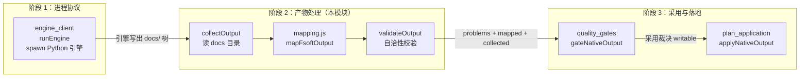
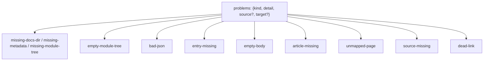
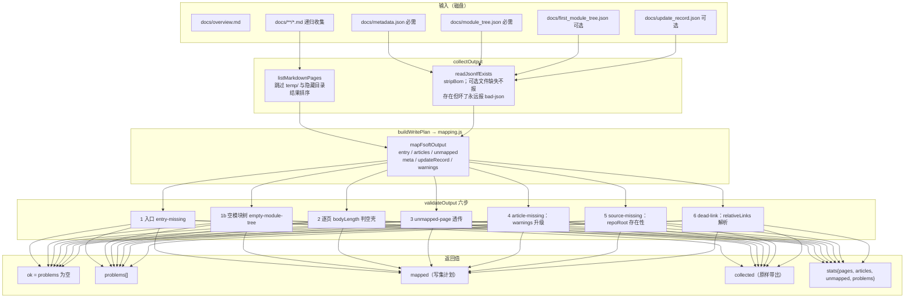
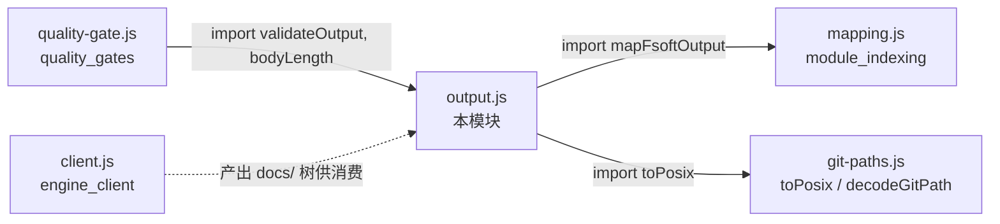
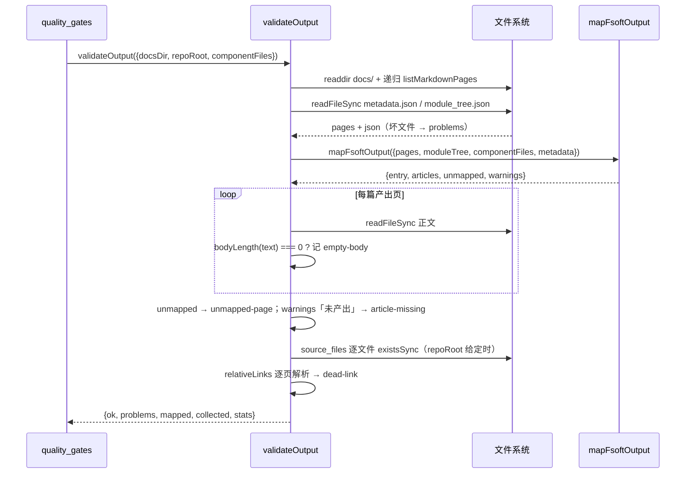

# 引擎产物处理（engine_output_processing）

## 简介

`engine_output_processing` 是 [Code_Engine_Processing_Pipeline](../../Code_Engine_Processing_Pipeline.md) 流水线中的**阶段 2**，负责把原生产物（Python 引擎在 `docs/` 目录下产出的一棵 markdown 树 + 四个 JSON）解析为结构化事实、交给映射层生成写集计划、并对「产物自身是否自洽」给出可机读的裁决。它对应实现文件 `lib/engine/output.js`。

这一层的刻意边界非常窄——文件头注释明确写死了三件能做的事和三不做的事：

- **读**：把 `docs/` 目录读成结构化事实（页清单 + 四个 JSON），坏文件变成 `problem` 而不是抛异常；
- **映射**：交给 `mapping.js`（阶段 0 已冻结的四条硬规则），这里不重复实现任何规则；
- **校验**：把「能不能算成功」判成可机读的 `problems` 列表。

它**绝不**在这里重新聚类、做图 diff、改写文章正文（FSoft 已经算完了）；不臆造 `source_files`；也不因为「产物看起来差不多」就把 problem 降级成 warning——缺页就是缺页，上层据此判 `partial`，静默吞掉会让 wiki 少一篇而没人知道。

## 在流水线中的位置

与阶段 3 的分界同样被写进代码注释：本模块只判「**产物自身是否自洽**」（页在不在、正文空不空、链接指向的东西在不在计划内）；frontmatter、锚点、写集冲突这类**目标格式**的闸门属于阶段 3 的 [quality_gates](quality_gates.md)。

## 核心组件

### 导出 API（`lib/engine/output.js`）

| 函数 / 常量 | 职责 |
| --- | --- |
| `OUTPUT_PROBLEM_KINDS` | 稳定的问题类别冻结表（见下表），上层按 `kind` 机读分派，不允许靠 message 文本匹配 |
| `collectOutput({ docsDir })` | 只读收集：返回 `{ docsDir, exists, pages, json, problems }`；**只读、不抛**，坏输入全部变成 problems |
| `buildWritePlan({ docsDir, componentFiles, overviewName })` | 读 docs → 调 `mapFsoftOutput`，返回 `{ collected, mapped }` |
| `validateOutput({ docsDir, repoRoot, componentFiles, overviewName })` | 自洽校验总入口：返回 `{ ok, problems, mapped, collected, stats }`，**不抛、不修任何东西** |
| `bodyLength(text)` | 去掉 BOM、标题行与全部空白后剩余的正文字符数，用来判「这页其实只有个标题」 |
| `relativeLinks(text)` | 提取正文里的相对 markdown 链接目标（跳过锚点、`http:`/`mailto:`/`data:` 外链、图片 data URI） |

### 问题类别表（`OUTPUT_PROBLEM_KINDS`）

| 类别 | 含义 | 处置语义 |
| --- | --- | --- |
| `missing-docs-dir` | 引擎没产出 `docs/` 目录（或未提供 `docsDir`） | 整批不可用 |
| `missing-metadata` | 缺 `metadata.json`，无法确定 commit / layout | 缺陷 |
| `missing-module-tree` | 缺 `module_tree.json`，无法确定归属与 `source_files` | 缺陷 |
| `empty-module-tree` | `module_tree.json` 是 `{}`：whole-repository 模式的正常产物，但归属证据整体缺失 | 降级（页面照写，增量归属不可用） |
| `bad-json` | JSON 存在但不可解析；**存在但坏了永远要报**，不能因为「文件可选」就吞掉 | 缺陷 |
| `entry-missing` | 没有 `overview.md`，即没有 `CodeWiki.md` 入口 | 整批不可入库 |
| `empty-body` | 页面除标题外没有正文（`bodyLength === 0`），写进 wiki 就是空壳 | 缺陷 |
| `article-missing` | 模块树里有模块、但引擎没产出对应页（mapping 的 warning「未产出」在此升级为 problem） | 缺陷 |
| `unmapped-page` | 页在 docs 里、但映射不到 wiki 的任何位置（由 mapping.js 给出可机读原因） | 缺陷 |
| `source-missing` | `source_files` 指向的文件在仓库里不存在（仅在传入 `repoRoot` 时检查） | 缺陷 |
| `dead-link` | 正文相对链接指向计划外的 `.md` 页；不查 http 外链（网络不是本层责任） | 缺陷 |

> 设计要点：在 `validateOutput` 里 `push()` 一个未登记的 `kind` 会直接 `throw`——契约测试枚举全表，写错的 kind 会让面板与终态判定同时失明。

## 数据流

### 关键实现细节

1. **递归收集页**：`listMarkdownPages` 递归扫描 `docs/` 下所有 `.md`（POSIX 相对路径、已排序）。hierarchical 布局把子模块页放在子目录里（`doc_layout.py:module_doc_relpath` 用 `posixpath.join(*path[:-1], name.md)`），只扫根目录会漏掉整棵子树。`temp/`（依赖图、引用索引、artifact 索引）与 `.` 开头的隐藏目录被明确跳过。

2. **可选文件的缺/坏二分**：`readJsonIfExists` 的 `optional` 参数只决定「缺失是否报 problem」；**文件存在但 JSON 不可解析永远报 `bad-json`**——引擎写坏了东西，不能因为「文件可选」就吞掉。

3. **`empty-module-tree` 的微妙定性**：whole-repository 模式下 `module_tree.json` 本来就是 `{}`，而 agent 仍然写了自己的页。这时页面是真产物、必须进写集（mapping 给 `attribution=unattributed`），但归属证据整体缺失——所以报 problem 让上层看见，而不是判整批失败。

4. **死链检查只查 docs 内**：`relativeLinks` 取出目标后用页面所在目录解析；以 `../` 开头（链接到仓库源文件如 `../src/x.py`）的交给阶段 3 的 source 校验，本层只查目标既不在计划页集合 `plannedPages`、也不在本次产出里的 `.md` 链接。

5. **`collected` 原样带出**：返回值保留 `collected`，是为了让阶段 3 的质量门直接读 `metadata.generation_info.commit_id` 判「产物对应哪个 commit」，不必再读一遍 docs 目录——两次读之间目录可能被改，判据就漂移了。

## 依赖关系

- **`./mapping.js`** —— 唯一的映射依赖：页 → wiki 路径、slug 规范化、`source_files` 证据规则、`unmapped` 原因。详见 [module_indexing](module_indexing.md)。
- **`../git-paths.js`** —— POSIX 路径规范化（Windows 路径、quotepath 问题）。
- **`quality-gate.js`（阶段 3）** —— 通过 `import { validateOutput, bodyLength } from './output.js'` 复用本层全部判据，自己不重写任何一条判定；它额外叠加的是「目标格式契约」（frontmatter / 围栏 / `inspectArticle`）与「基线可推进性」（commit 是否 HEAD、基线是否入库）。详见 [quality_gates](quality_gates.md)。

## 典型流程示例

## 安全边界与不变量

以下不变量在代码注释与测试中钉死，修改本模块前必须逐条核对：

1. **只读、不抛、不修**：`collectOutput` / `validateOutput` 对坏输入只产出 `problems`，绝不抛异常、绝不改写 docs 目录任何文件。
2. **不重新实现映射规则**：归属、slug、`source_files` 一律由 `mapping.js` 裁决；本层只消费其 `articles` / `unmapped` / `warnings`。
3. **缺失不降级**：页缺失、正文空、映射不上都必须是 `problem`（进而可能让上层判 `partial`），不允许凭「差不多」降级为 warning。
4. **问题类别封闭**：`OUTPUT_PROBLEM_KINDS` 是冻结表，新增只允许追加；未登记的 kind 会让 `validateOutput` 的 `push` 直接抛错。
5. **只读一遍**：`collected` 原样返回，阶段 3 复用同一份事实，避免「一次读」变「两次读」导致判据漂移。

## 相关模块

- [module_indexing](module_indexing.md) —— `mapFsoftOutput` / `indexModuleTree` 与四条映射硬规则。
- [quality_gates](quality_gates.md) —— 阶段 3 采用门：复用 `validateOutput`，叠加格式契约与基线裁决。
- [plan_application](plan_application.md) —— 阶段 3 落地器：把 `mapped` 写进 `.codewiki/` 与 `CodeWiki.md`。
- [engine_client](engine_client.md) —— 阶段 1：驱动 Python 引擎产出本模块消费的 `docs/` 树。
- [article_validation](../article_validation.md) —— `hasBlockingIssue` / `issueSummary` 与 `article-contract.js` 的格式判据（阶段 3 复用）。
