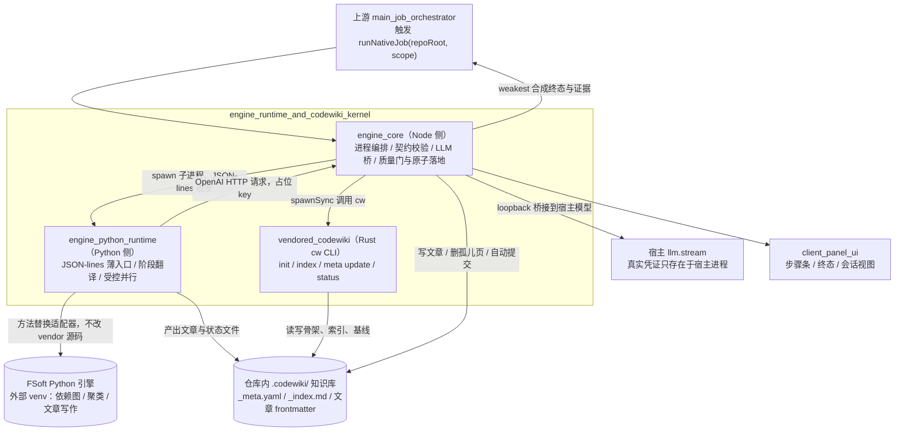
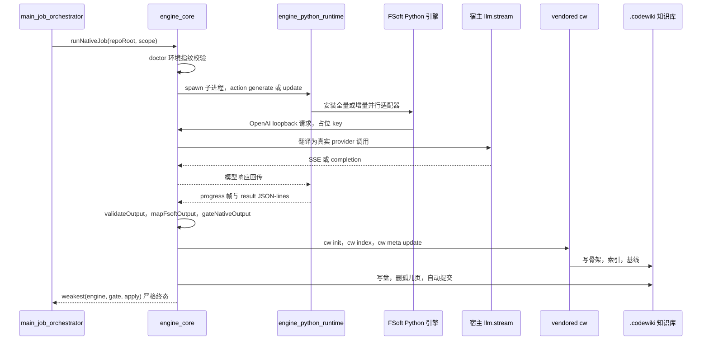

# 引擎运行时与 CodeWiki 内核（engine_runtime_and_codewiki_kernel）

## 模块定位

`engine_runtime_and_codewiki_kernel` 是 CodeWiki **原生编译通道**的运行时内核，位于任务编排层与真实算法引擎、wiki 仓库之间。它本身不实现依赖图构建、模块聚类、图 diff 或文章写作算法，而是负责把这些能力安全地串成一次可裁决、可落库、可观测的编译事务。

该模块由三个直接子模块组成：

- **[engine_core](engine-core.md)**：Node 侧引擎核心。负责拉起并受管 Python 引擎、归一化跨语言消息、提供 loopback LLM 桥、执行「执行编排 → 质量门 → 原子落地」裁决链。
- **[engine_python_runtime](engine-python-runtime.md)**：Python 薄运行时层。围绕 FSoft Python 引擎做 JSON-lines 协议转换、阶段翻译、受控并行与崩溃自救。
- **[vendored_codewiki](vendored-codewiki.md)**：随仓库 vendored 的 Rust `cw` CLI。负责 `.codewiki/` 骨架、索引重建、基线推进、过期检测与 agent 技能安装。

核心验收标准是：**终态由引擎、质量门、落地器三段裁决链的最弱环节决定，所有事实必须带证据进入终态，凭证绝不落盘或进日志。**

## 架构总览

## 一次编译的数据流

## 核心组件文档

| 组件 | 核心职责 | 文档 |
| --- | --- | --- |
| `engine_core` | Node ↔ Python 跨语言边界、进程受管、版本化契约、LLM loopback 桥、质量门与原子落地 | [engine_core](engine-core.md) |
| `engine_python_runtime` | FSoft Python 引擎薄适配层：协议转换、五段进度到八段契约映射、全量/增量并行、stdout 守卫与崩溃自救 | [engine_python_runtime](engine-python-runtime.md) |
| `vendored_codewiki` | Rust `cw` CLI：`.codewiki/` 生命周期管理、索引重建、基线推进、过期文章判定、agent 技能安装 | [vendored_codewiki](vendored-codewiki.md) |

`engine_core` 内部进一步划分为四个职责域，详见其文档：

- **引擎编排**：起管子进程、JSON-lines 协议不变量、环境指纹锁定、产物自洽校验。
- **文章校验与契约**：`EngineResult` 构造校验、FSoft 产物到 `.codewiki/` 写集映射、死链校对。
- **LLM 桥接集成**：loopback OpenAI 兼容端点，把引擎请求翻译为宿主 `llm.stream`。
- **原生产物落地与质量门**：`runNativeJob` 裁决链、`gateNativeOutput` 唯一采用门、`applyNativeOutput` 原子落地与 pre-image 回滚。

## 关键设计原则

- **最弱环终态**：`cancelled < failed < partial < done`，引擎、质量门、落地器三段结论取最弱值；迟到的成功结果只记证据，绝不洗白取消或失败。
- **边界刻意窄**：Python 运行时不读本机凭证库，Node 桥不持有 provider 配置，`cw` 只负责知识库记账而不负责编译算法。
- **索引即正确性判据**：文章写盘后必须经 `cw index` 收录；若索引与写集不一致，落地器整体回滚。
- **基线即记账**：`cw meta update` 只在正常轮且裁决允许时推进；失败会回滚已写文章，避免「文章比基线新」导致下一轮重复消费。
- **崩溃自救**：Python 运行时在模型失败或引擎崩溃时，若已写出文章则降为 `partial` 交付；一篇都没写出才判 `failed`。