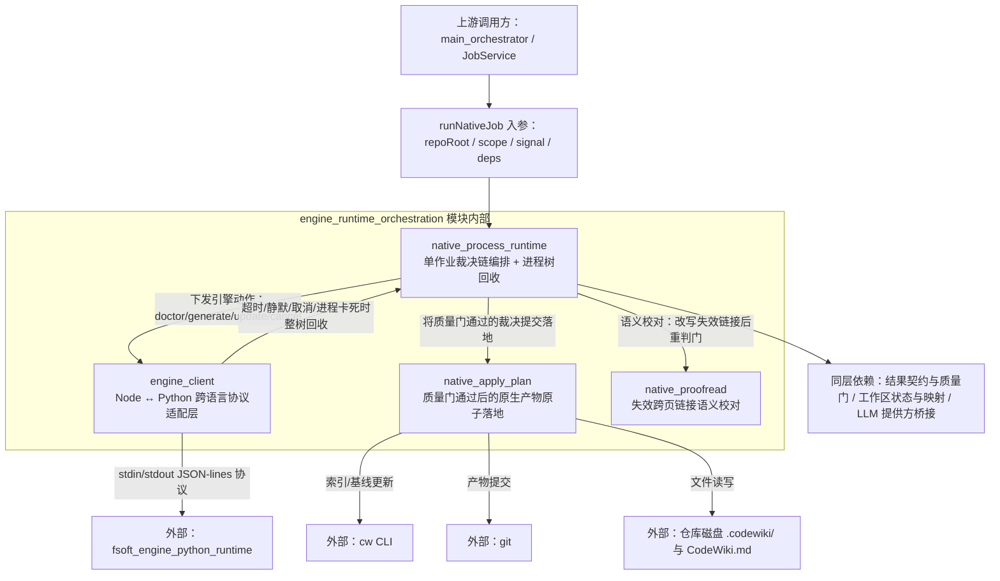

# engine_runtime_orchestration：原生引擎运行时编排层概述

## 模块定位与核心目的
本模块是 `fsoft_engine_js_core` 下负责原生编译通道运行时编排的核心子层，自 0.16.0 起成为默认编译通道的执行主体。它的核心存在目的，是把原本散落在上层 JobService 中的编译执行细节收敛为独立、可单测的纯编排层，从根本上修复 0.14.0 版本暴露的「引擎说完成就算完成、产物未入库也报成功」的缺陷——保证从环境校验、增量决议、引擎执行、质量门检到最终产物提交的全链路中，任何一步的失败都不会被后续步骤洗白，最终交付的终态永远由全链路最弱的一环决定。

模块统一承担三类核心职责：
1.  固定单条原生编译作业的线性裁决链，避免上层调度逻辑（JobService 4800+ 行）被编译实现细节污染；
2.  可靠管理跨语言的 Python 引擎子进程，覆盖超时、静默、崩溃、取消等所有异常路径的结构化回收与失败上报；
3.  把通过质量门校验的产物原子落地到仓库，保证索引、基线、提交与文章写盘同事务，不留下半完成的脏仓库状态。

## 模块整体架构
模块内部分层与上下游、外部系统的交互关系如下图所示：

全模块统一遵循「终态不被洗白」的设计原则：锁不一致直接拒跑引擎、引擎 done 不能替代质量门判断、落地失败终态不许报成功、未完整消化的变更一律不推进基线、取消是不可被迟到结果覆盖的终态。这些不变量从模块拆分之初就写入各组件的文件头注释，作为所有实现与测试的验收标准。

## 核心组件索引
模块由四个可独立测试的核心组件构成，各组件的详细设计、不变量与执行流程见对应文档：
- **[native_process_runtime](native-process-runtime.md)**：模块的顶层编排器，固定一次原生编译作业从环境校验、增量变更决议、模型桥启动、引擎执行、质量门体检、语义校对（对模型编造的失效跨页链接先改正文、再重新判门）、受管状态采集、孤儿页清理到最终落地的完整线性裁决链；同时实现跨平台的进程树终止逻辑（Windows `taskkill /T`、POSIX 进程组信号回收），保证取消、超时场景下孙进程不会残留继续消耗资源。所有执行依赖均通过依赖注入传入，测试可替换假实现覆盖全链路裁决逻辑。
- **[engine_client](engine-client.md)**：模块内唯一的 Node-Python 跨语言边界层，不实现任何编译算法，仅负责启动受管 Python 引擎子进程、读写 JSON-lines 协议帧、将超时、静默卡死、进程崩溃、协议破坏、外部取消等所有异常路径归一为结构化失败结果；内置 10 分钟静默检测、result 到达后 2 秒宽限机制，避免长时间无输出的僵死引擎锁死调度闸门、已完成的编译结果被超时误判为失败。
- **[native_apply_plan](native-apply-plan.md)**：质量门裁决后的产物落地执行层，严格按「写盘 → cw 索引构建 → cw 基线更新 → git 自动提交」的四步事务执行；内置 pre-image 快照回滚语义，严格限制写集范围仅允许写入 `.codewiki/` 子树与仓库根 `CodeWiki.md`，保证索引/基线失败时仓库回到落地前状态、提交失败时已写文章不被误删，彻底消灭「写成功几篇就算全部完成」的假交付。无变化轮整体短路，但有两类例外：「有残留孤儿页待删」（deleteOnly：不写文章、不推进基线，仍照常删残骸并重跑索引与提交）与「库里有落地页与当前渲染规则不一致」（normalizeOnly：照常重写这些页并随索引同事务提交，但不推进基线）。
- **[native_proofread](native-proofread.md)**：质量门检出失效跨页链接后的语义校对执行层，以仓库真实存在的页面清单为唯一判据，调用模型逐篇改写指向不存在页面的链接——能对应到真实页的改为清单内相对路径、对应不上的降级为纯文字；改写硬约束是只动链接不动叙述，frontmatter 缺失或改写后失效链接不减的页面一律保留原文并如实上报，绝不以「校对成功」洗白残留问题。