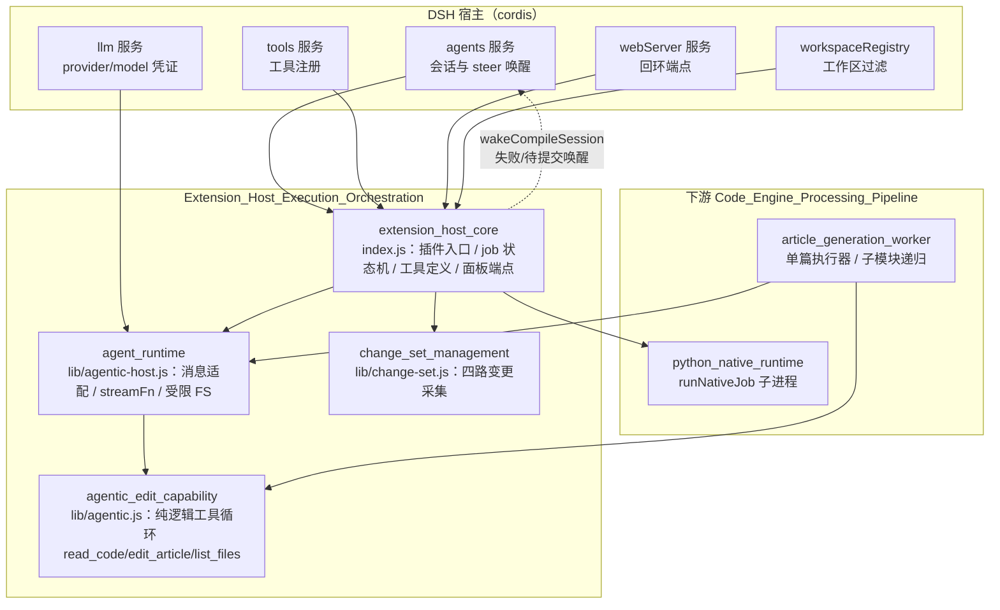
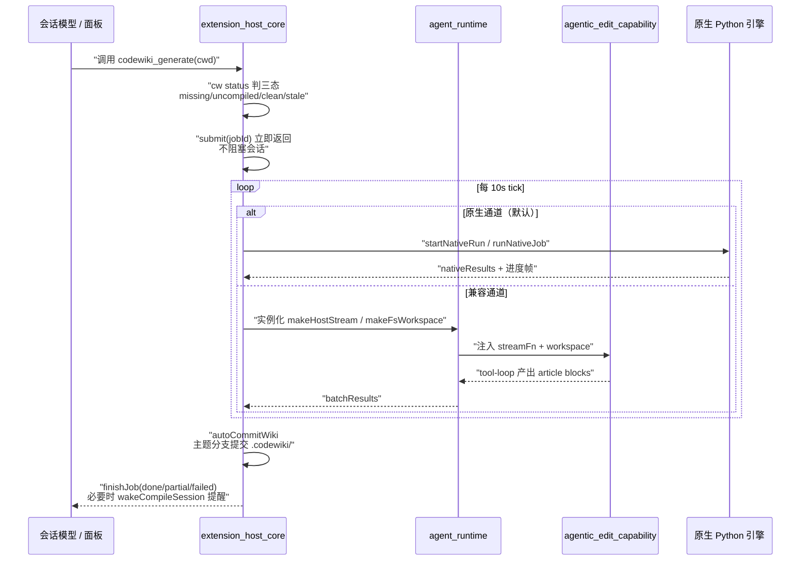

# 扩展宿主执行编排（Extension_Host_Execution_Orchestration）

## 模块概述

`Extension_Host_Execution_Orchestration` 是 dsh-codewiki VSCode 扩展在宿主侧的执行编排模块，负责把 CodeWiki Rust CLI（`cw`）与代码编译流水线接入 DeepSeek Harness（DSH）的 cordis 宿主环境。它的核心职责包括：

- **插件入口与工具注册**：通过 `apply(ctx, config)` 把四个工具（`cw`、`codewiki_generate`、`codewiki_update`、`codewiki_progress`）注册到 DSH 工具服务；
- **常驻 job 状态机**：以 10s 节拍驱动编译任务的阶段推进（articles → crosscut → review → index → commit），并与原生 Python 引擎通道对接；
- **回环 HTTP 面板端点**：为侧边栏前端提供 `/api/codewiki/jobs`、`/repos`、`/sessions`、`/logs`、`/models`、`/control` 等只读/控制接口；
- **agentic 写作能力**：实现「模型边读代码边编辑文章」的纯逻辑工具循环，并通过宿主适配层接入真实 LLM 流与文件系统；
- **变更集采集**：在兼容通道下收集基线..HEAD 与工作区的四路变更，支撑增量编译决议。

该模块处于两条执行通道的上游：默认走原生 Python 引擎通道（详见 [Code_Engine_Processing_Pipeline](Code_Engine_Processing_Pipeline/code_engine_module.md)），当 `nativeEngine=false` 时回退到内置 Node 流水线（articles → crosscut → review → index → commit）。

## 架构总览

**模块分层说明：**

| 层级 | 组件 | 职责 |
| --- | --- | --- |
| 编排层 | [extension_host_core](Extension_Host_Execution_Orchestration/extension_host_core.md) | 插件入口、job 状态机、工具注册、HTTP 面板、自动提交与会话唤醒 |
| 适配层 | [agent_runtime](Extension_Host_Execution_Orchestration/agent_runtime.md) | 把纯逻辑工具循环的裸消息转换为宿主 `RequestMessage`，提供 `llm.stream` 适配与路径沙箱 |
| 能力层 | [agentic_edit_capability](Extension_Host_Execution_Orchestration/agentic_edit_capability.md) | 与具体 LLM/文件系统解耦的工具循环：`read_code`、`list_files`、`edit_article`、`generate_sub_module` |
| 采集层 | `change_set_management` | 基线..HEAD + 工作区四路变更采集，供兼容通道做增量归属判定 |

## 核心数据流：从提交到编译完成

## 关键设计要点

1. **提交制而非同步编译**：工具调用只做判态与提交，编译全程在插件后台推进；会话模型不等待、不轮询、不直接跑 git。
2. **双通道并存、互不回退**：原生通道环境不闭合时以 `engine-deps` 明确失败，绝不悄悄降级 Node 通道冒充成功；通道一旦锁定跟随 job 走。
3. **多实例安全**：tick 锁、脏 job 合并、心跳超时接管、跨实例取消拾取，确保插件重载或宿主重启不会双提交、不会丢现场。
4. **纯逻辑与宿主解耦**：`agentic_edit_capability` 零外部运行时依赖，通过注入 `streamFn` 与 workspace 接入；`agent_runtime` 独占宿主 SDK 的消息形态与流式协议细节。

## 核心组件文档

- [extension_host_core](Extension_Host_Execution_Orchestration/extension_host_core.md) — 宿主侧编译执行编排核心：插件入口、job 状态机、四个工具、回环 HTTP 端点、自动提交与唤醒。
- [agent_runtime](Extension_Host_Execution_Orchestration/agent_runtime.md) — Agent 运行时适配层：`toRequestMessages` 消息身份缓存、`makeHostStream` 流式收敛、`makeFsWorkspace` 路径沙箱。
- [agentic_edit_capability](Extension_Host_Execution_Orchestration/agentic_edit_capability.md) — Agentic 写作工具循环：`runAgenticArticle`、`read_code`/`list_files`/`edit_article`/`generate_sub_module` 四工具、坏 JSON 三级兜底与路径越界防护。

## 关联模块

- [vscode_extension_client](vscode_extension_client.md) — 侧边栏面板前端，通过 `/api/codewiki/*` 端点读取 job 与仓库状态。
- [Code_Engine_Processing_Pipeline](Code_Engine_Processing_Pipeline/code_engine_module.md) — 下游原生 Python 引擎、引擎客户端、计划应用与质量闸门。
- [State___Observability_Management](State___Observability_Management/job_state_storage.md) — job 状态持久化、日志管理与更新状态追踪。