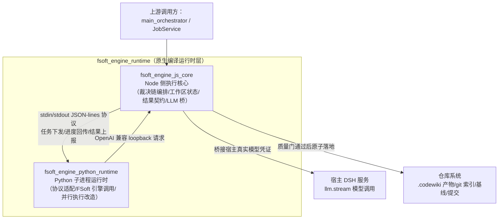

# fsoft_engine_runtime 模块概述

## 模块定位与核心目的
`fsoft_engine_runtime` 是 dsh-codewiki 插件自 v0.16.0 起启用的默认原生编译通道执行层，是一套跨语言（Node.js + Python）的独立执行模块。它将原本散落在上层 JobService 中的编译执行细节完全收敛到本层，彻底取代了此前 Node 进程内自行实现依赖图解析、代码聚类、文章写作、增量 diff 计算的旧实现，将上述核心算法统一委托给独立虚拟环境中安装的 FSoft 上游编译引擎。

模块的核心设计目标是从根本上修复历史版本暴露的「引擎声称完成即判定成功、产物未入库仍报通过、部分失败被洗白为完整成功」等假交付缺陷，通过固定的线性裁决链覆盖从环境校验、引擎执行、质量门检到产物原子提交的全流程，确保任何一个环节的失败都不会被后续步骤掩盖，最终交付的编译终态始终由全链路的最薄弱环节决定。模块严格遵循凭证安全隔离约束：插件全程不向 Python 子进程传递任何原始 API 密钥，所有模型调用均通过进程内 loopback 桥完成转发。

## 模块整体架构
模块采用两层分离的跨语言执行架构，两层之间通过严格的 JSON-lines 管道协议交互，互不直接访问对方的内部状态与权限，整体结构与上下游交互关系如下图所示：

两层的职责边界严格正交：
1.  **Node 侧执行核心**：承担所有需要访问插件宿主环境的职责，包括固定单条编译作业的线性裁决逻辑、Python 子进程全生命周期管理（覆盖超时、静默挂起、崩溃、用户取消等异常场景的结构化回收）、跨轮编译的工作区状态维护、硬结果契约与质量门校验、模型凭证安全隔离桥、以及通过质量门后的产物原子落地（写盘、索引更新、基线推进、git 提交与失败回滚）。
2.  **Python 子进程运行时**：运行在隔离的独立虚拟环境中，仅承担纯编译逻辑职责，包括将 Node 侧下发的 JSON 协议请求翻译为 FSoft 引擎调用、将上游严格串行的引擎执行逻辑热替换为带断点续跑的拓扑并行模型、将引擎的五段执行进度映射为统一的八段引擎契约、以及引擎崩溃时的部分产物降级交付。该层无宿主仓库写权限、无模型凭证访问权、无插件内部状态访问权。

模块全层贯穿统一的核心设计红线——**编译终态不被洗白**：环境锁不一致直接拒绝启动引擎、引擎返回完成信号不能替代质量门判断、产物落地失败绝不许上报成功、未完整消化的变更一律不推进基线、用户取消是不可被迟到结果覆盖的终态。

## 核心组件文档
模块由两个垂直分层的核心组件构成，各组件的详细设计、执行流程与不变量定义可参考对应文档：
- [fsoft_engine_js_core](fsoft-engine-js-core.md)：原生引擎通道的 Node 侧执行主干，负责跨语言裁决链编排、Python 子进程管理、工作区状态完整性维护、结果契约与质量门校验、LLM 凭证隔离桥实现，是模块与插件宿主环境交互的唯一入口。
- [fsoft_engine_python_runtime](fsoft-engine-python-runtime.md)：隔离的 Python 子进程运行时层，负责 Node 侧与上游 FSoft 编译引擎之间的协议翻译、串行执行逻辑的并行化改造、引擎异常的结构化分类，是模块实际执行代码编译与文章生成的核心载体。