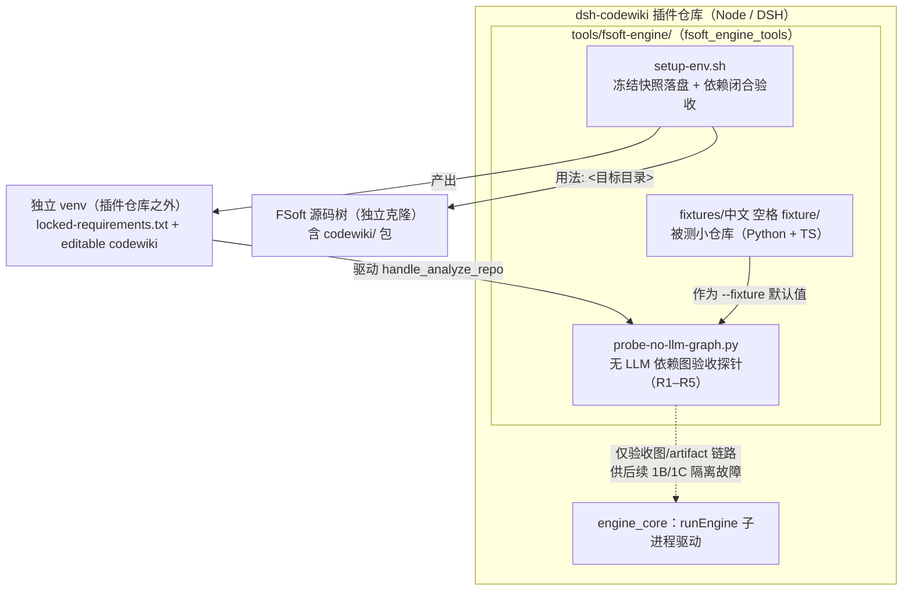
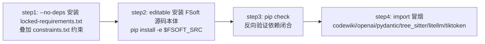
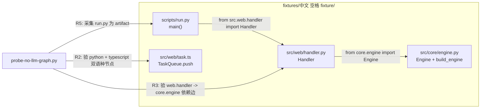

# FSoft 原生引擎工具链（fsoft_engine_tools）

> 所属层级：[生态工具与验证层](../Ecosystem_Tooling___Validation_Layer.md)
> 定位：为「原生引擎通道」（`nativeEngine: true`，由 Node 侧驱动上游 FSoft-AI4Code/CodeWiki Python 引擎）提供**环境搭建**与**无模型验收**的配套工具集。

## 1. 背景与目的

自 0.16.0 起，dsh-codewiki 的默认通道切换为**原生引擎**：DSH 插件把 FSoft 的 Python 引擎以子进程方式驱动（见 [engine_core](../engine_core.md) 的 `client.js::runEngine` 与 `python/entry.py::main`），要求本机存在一个**依赖闭合**的 Python 3.10+ venv。

原生引擎依赖的 Python 生态（`openai` / `pydantic-ai-slim` / `pydantic` 等）版本约束互相打架，正常的 `pip install -r freeze.txt` 必然 `ResolutionImpossible`。同时，迁移过程需要把「**模型链路故障**」与「**图/artifact 链路故障**」分开定位。

本模块（`tools/fsoft-engine/`）正是为解决这两件事而生：

1. **环境搭建脚本** `setup-env.sh`：在插件仓库**之外**按「已解析完成的冻结快照」落出一个可信 venv；
2. **阶段 1A 验收探针** `probe-no-llm-graph.py`：在**不依赖任何 LLM/凭证**的前提下，验证 FSoft 的 `handle_analyze_repo`（tree-sitter 静态分析链路）能在「中文 + 空格」路径上跑出正确的依赖图、workspace 产物与 artifact 节点；
3. **验收 fixture** `fixtures/中文 空格 fixture/`：探针默认使用的被测小仓库，刻意制造中文目录名与空格路径，用于压测非 ASCII 路径下的分析正确性。

## 2. 架构总览



**关键设计取向**：

- **环境与插件解耦**：venv 建在插件仓库之外，不进 git，也不碰 DSH 进程自身的 Python（见 `setup-env.sh` 头部注释）。
- **不做「找解释器」启发式**：`cordis.patch.yml` 注释明确说明 `nativeEnginePython` 留空时只依次回退环境变量 `DSH_CODEWIKI_PYTHON` 与 `python`——猜错会把「环境不闭合」伪装成「引擎坏了」，所以本工具链负责把环境做**可信**。
- **先无模型后有模型**：探针只跑 tree-sitter 静态分析，刻意把「图链路」与「模型链路」解耦，是整条迁移中唯一完全无模型的一环。

## 3. 组件清单与职责

| 组件 | 文件 | 职责 |
| --- | --- | --- |
| 环境搭建脚本 | `tools/fsoft-engine/setup-env.sh::setup-env.sh` | 按冻结快照 `--no-deps` 安装 → editable 装 `codewiki` 本体 → `pip check` 依赖闭合 → import 冒烟四步验收 |
| 无 LLM 图探针 | `tools/fsoft-engine/probe-no-llm-graph.py::main` | 对 fixture 跑 `handle_analyze_repo`，产出 JSON 结果 + R1–R5 判据，退出码表达通过/失败 |
| fixture 入口脚本 | `fixtures/中文 空格 fixture/scripts/run.py::main` | artifact 类节点：验证脚本类文件能被采集为 artifact 节点 |
| fixture 核心引擎 | `fixtures/中文 空格 fixture/src/core/engine.py::Engine` | 被 web 层依赖的 Python 模块：提供 `Engine.run` 与 `build_engine` 工厂 |
| fixture Web 层 | `fixtures/中文 空格 fixture/src/web/handler.py::Handler` | 依赖 `core.engine` 的薄壳：验证 `core.engine -> web.handler` 依赖边被建出 |
| fixture TS 队列 | `fixtures/中文 空格 fixture/src/web/task.ts::TaskQueue` / `TaskQueue.push` | TypeScript 文件：验证 TS 分析器在中文/空格路径下也能产出节点 |

## 4. 环境搭建：setup-env.sh

```bash
bash tools/fsoft-engine/setup-env.sh <目标目录> <FSoft 源码根> [python 可执行文件]
# 例：bash tools/fsoft-engine/setup-env.sh ../.probe-fsoft/venv ../.probe-fsoft/src
```

四步流水线（任何一步非零立刻退出，`set -euo pipefail`）：



- **为什么 `--no-deps`**：冻结清单本身是「已解析完成的完整环境快照」，再走 pip 正常解析必然触发 `ResolutionImpossible`（`pydantic-ai-slim` 本体与 extras 元包版本冲突）。
- **为什么还要 step2**：`pip freeze` 里不出现 editable 的 `codewiki` 自己，必须显式装一次源码。
- **跨平台**：自动识别 `$TARGET/bin/python`（POSIX）与 `$TARGET/Scripts/python.exe`（Windows）。

> 该脚本与 [Build___Dependency_Configuration_Layer](../Build___Dependency_Configuration_Layer.md) 中描述的 `nativeEnginePython` 配置项配合：venv 建完后，把解释器绝对路径填入该配置项即可启用原生引擎通道。

## 5. 验收探针：probe-no-llm-graph.py

```bash
python tools/fsoft-engine/probe-no-llm-graph.py \
    --fsoft-src <FSoft 仓库根，含 codewiki/ 包> \
    --fixture <被测小仓库>            # 默认 tools/fsoft-engine/fixtures/中文 空格 fixture
    --out <工作目录>                  # 默认 tools/fsoft-engine/out-1a
```

探针从 `--fsoft-src` 导入 `codewiki.mcp.tools.analysis.handle_analyze_repo` 与 `codewiki.src.be.dependency_analyzer.DependencyGraphBuilder`，对 fixture 仓库跑静态分析，然后核对五条判据：

| 判据 | 含义 |
| --- | --- |
| R1 `analyze_returned` | `handle_analyze_repo` 返回非 error JSON，含 `session_id` / `files` |
| R2 `nodes_and_languages` | 组件数 > 0、叶子节点数 > 0，语言集合同时含 python 与 typescript |
| R3 `dependency_edge` | 依赖图中存在 `core.engine -> web.handler` 方向的边（web 依赖 core） |
| R4 `workspace_files` | workspace 产出 `component_index.json` / `leaf_nodes.json` / `summary.json` 真实存在且可解析 |
| R5 `artifact_node` | `scripts/run.py` 作为 artifact 节点被采集 |

**退出码约定**：`0` = 全部判据通过；`2` = 判据未过（结果 JSON 已打到 stdout）；`3` = 运行异常（含 traceback）。R1 失败时会额外回显 `payload_head` 便于定位上游契约变化。

**为什么探针独立于插件**：探针只验收 FSoft 引擎侧能力，不实例化 DSH 插件、不读插件配置，因此可以在任意 FSoft 源码树 / fixture 上重跑，作为 1B（模型链路）、1C（端到端）阶段的故障隔离基线。

## 6. fixture：中文 空格 fixture

fixture 目录名**刻意包含中文与空格**，用于覆盖非 ASCII 路径下的路径处理 / 采集正确性。其结构与探针判据的对应关系：



- `scripts/run.py` 是「脚本类 artifact」样本，命中 R5；
- `web/handler.py` 顶部用 `sys.path.insert` 自行把 `src/` 加入路径再 `from core.engine import ...`，命中 R3 依赖边；
- `web/task.ts` 提供 TypeScript 导出（`TaskInput` 接口、`normalize`、`TaskQueue`），命中 R2 的「语言集合含 typescript」。

## 7. 与其它模块的关系

- **[engine_core](../engine_core.md)**：本模块产出的 venv 与跑通的图链路，最终由 `engine_core` 的 `runEngine` / `python/entry.py` 以子进程方式消费；`native-state.js::stateDocFiles` 产出的 `component_index.json` / `leaf_nodes.json` / `summary.json` 即探针 R4 校验的同类文件。
- **[agentic_support](../agentic_support.md)** 与 **[core_entry](../core_entry.md)**：依赖图产物是 agentic 写作与 `tickArticles` / `tickCrosscut` 等编译流水线的输入；图链路不通过则上层无从谈起——这正是 1A 探针先行的原因。
- **[Ecosystem_Tooling___Validation_Layer / test_fixtures](test_fixtures.md)**：同属验证层，`gen-graphdiff-golden.py` 负责 graph-diff 黄金样本生成，本模块负责环境与图链路冒烟，二者互补。
- **[Build___Dependency_Configuration_Layer](../Build___Dependency_Configuration_Layer.md)**：`nativeEnginePython` / `nativeEngineEntry` / `nativeEngineTimeoutMs` 配置项决定插件侧如何找到并调用本模块搭建的 venv。
