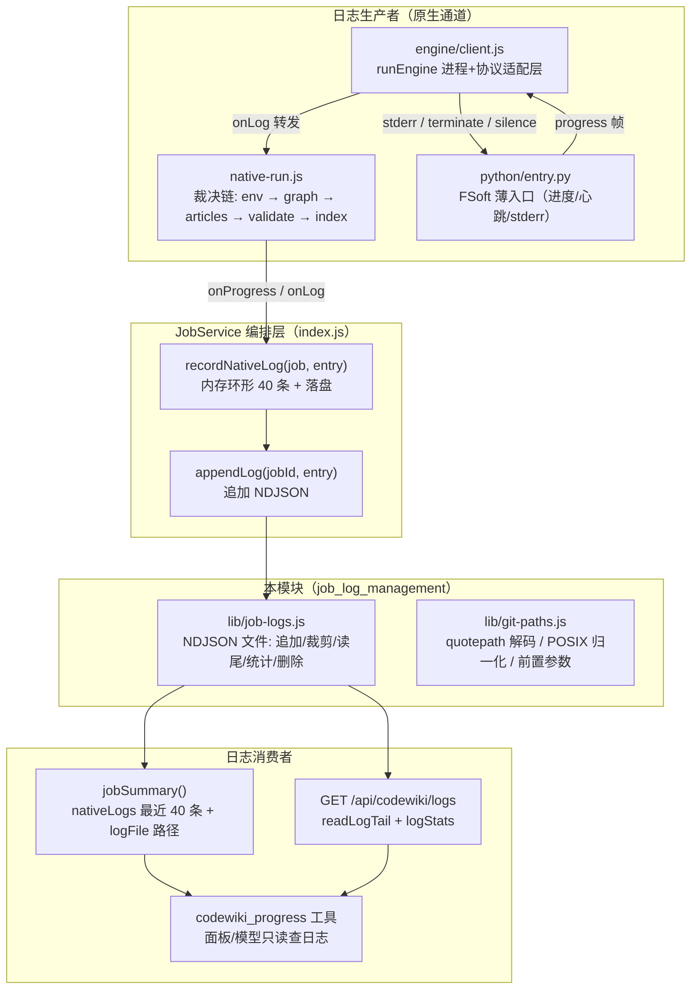
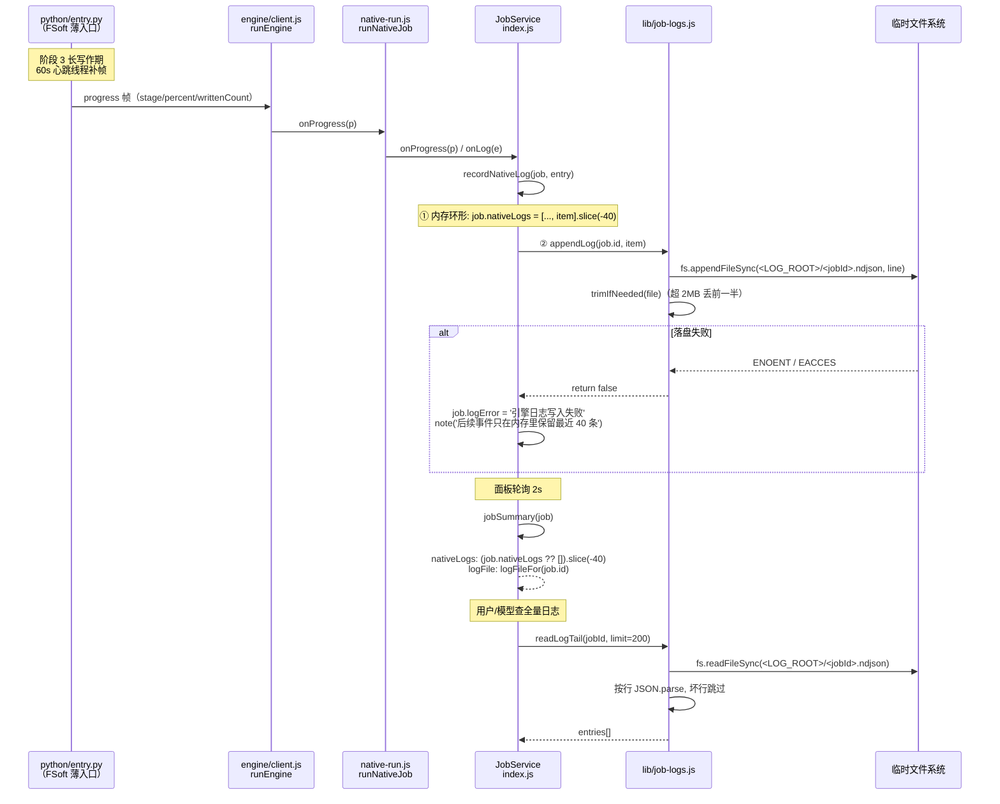
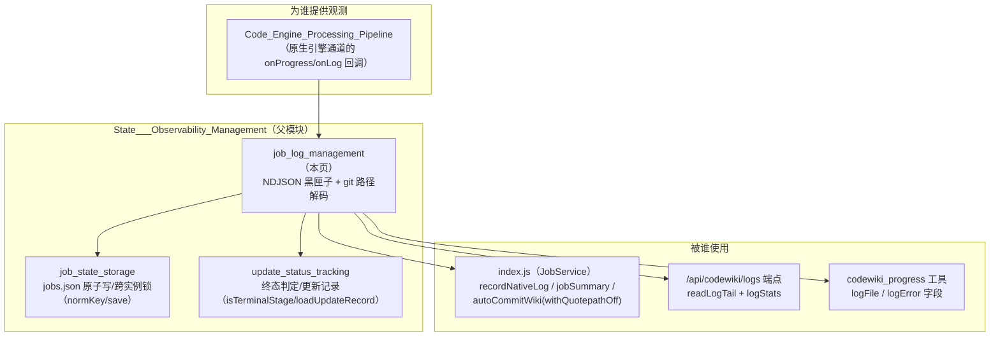
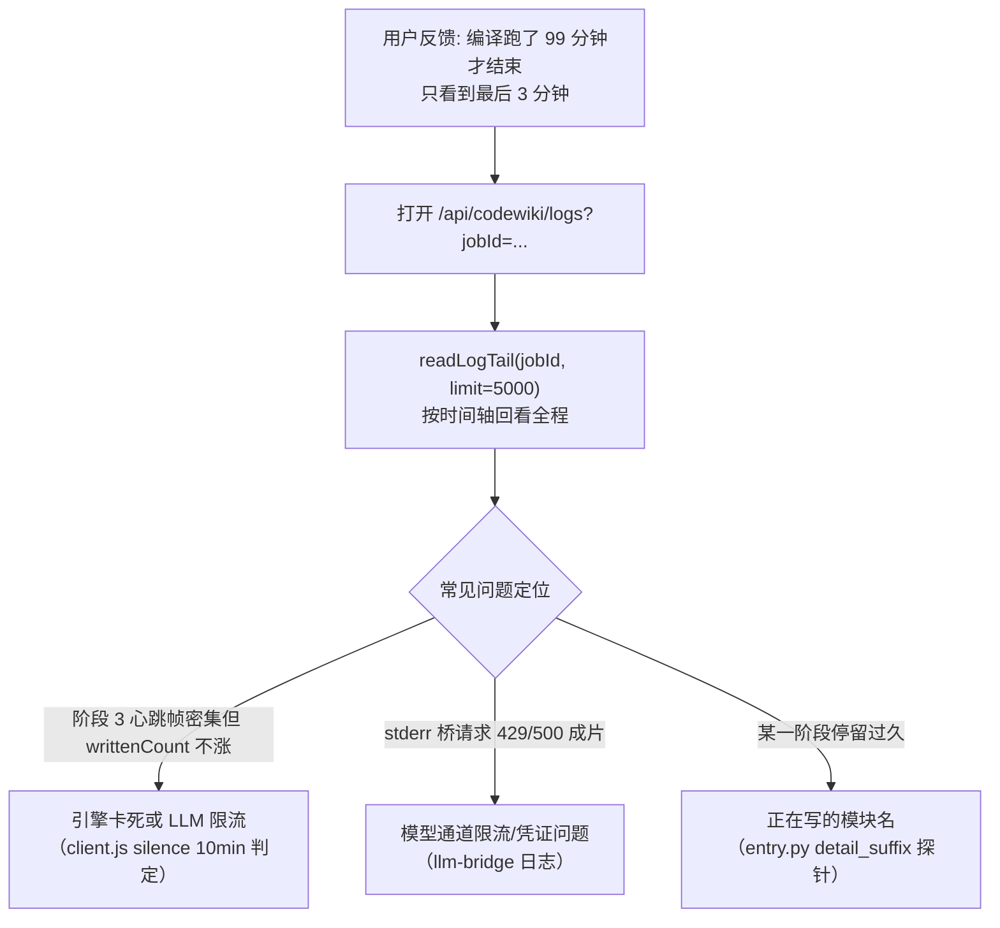

# 任务日志管理（job_log_management）

## 简介

本模块承担 `dsh-codewiki` 插件的**观测层**职责，由两个文件组成：

- `lib/job-logs.js`：原生引擎事件的 **NDJSON 黑匣子**——一个任务一个日志文件，追加落盘、尾部读取、体量裁剪、终态清理。
- `lib/git-paths.js`：git 路径的**归一化与解码工具集**——把 git 的八进制转义输出（`core.quotepath`）与 Windows 反斜杠两种路径落差铲平，让白名单、路径比较、自动提交都使用同一套「真实路径」语义。

它解决的核心缺陷是：引擎日志此前只留在 `job.nativeLogs` 的内存环形缓冲（最近 40 条），不序列化、不进 `jobSummary`。真机上一次 99 分钟的编译结束后，能查到的日志只剩最后 3 分钟（桥请求），前面 96 分钟引擎在干什么完全无从追查；宿主重启或任务被 `MAX_JOBS_KEPT` 截断时更是全部消失。本模块让日志**在进程死掉之后还活着**，成为事后解释「为什么慢、为什么 partial」的唯一依据。

---

## 架构总览



---

## 核心组件

### 1. `lib/job-logs.js`：引擎事件日志（NDJSON，一任务一文件）

| 函数 | 职责 | 关键设计 |
|------|------|----------|
| `logFileOf(jobId)` | 由任务 id 推导日志文件路径 | jobId 做字符白名单清洗（`[^\w.-]` → `_`），文件名落在 `LOG_ROOT` 下 |
| `appendLog(jobId, entry)` | 追加一条事件 | **写失败返回 `false` 而不抛错**——日志是观测，不能因为它把编译打断；但调用方要把失败如实报进 `job.logError`，不许静默 |
| `trimIfNeeded(file)` | 体量守护 | 超过 `MAX_LOG_BYTES`（默认 2MB，下限 64KB）时丢掉前一半行，保留最近现场 |
| `readLogTail(jobId, limit)` | 读回最近 N 条 | limit 夹在 `[1, 5000]`，默认 200；**坏行跳过**——文件被外部改动或不完整写入时，能读多少给多少比抛错更有用 |
| `logStats(jobId)` | 返回文件大小与更新时间 | 不存在时返回 `{ bytes: 0, updatedAt: null }`，不抛错 |
| `removeLog(jobId)` | 删除日志文件 | `force: true`；删不掉就留着，不影响任何判定 |

#### 存储布局

```
LOG_ROOT = process.env.DSH_CODEWIKI_LOG_DIR
        || path.join(os.tmpdir(), 'dsh-codewiki-logs')

<LOG_ROOT>/
  ├── job-<base36>-0.ndjson     ← 每个 jobId 一个文件
  ├── job-<base36>-1.ndjson
  └── ...
```

**为什么放仓库外**：`.codewiki/` 里多一个日志文件就会变成「提交之后产生的未跟踪文件」，每轮都脏工作区——与原生更新记录同源理由。

#### 日志条目结构（序列化固定形状）

```json
{
  "jobId": "job-mvu2lmd1-a",
  "at": "2026-01-15T08:30:00.000Z",
  "phase": "engine",
  "kind": "progress",
  "detail": "articles 54% — 正在写 lib/engine/client.js",
  "written": 12,
  "total": 28
}
```

字段固定（`at` / `jobId` / `phase` / `kind`），避免同一个文件里出现多种形状后无人能解析。

#### 配置项

| 环境变量 | 默认值 | 含义 |
|----------|--------|------|
| `DSH_CODEWIKI_LOG_DIR` | `<tmpdir>/dsh-codewiki-logs` | 日志根目录 |
| `DSH_CODEWIKI_LOG_MAX_BYTES` | `2 * 1024 * 1024`（下限 64KB） | 单任务日志上限，超过丢前一半 |

---

### 2. `lib/git-paths.js`：git 路径落差的唯一铲平层

git 的路径输出与「同一件事」有两层落差，本模块只负责把它铲平：

```mermaid
flowchart LR
    subgraph Two["git 路径的两层落差"]
        A["落差一: core.quotepath（默认 true）<br/>非 ASCII 路径被写成<br/>\"a/\\344\\270\\255.md\"<br/>八进制字节转义 + 双引号包裹"]
        B["落差二: 转义按字节做<br/>一个中文字符 = 3 个 \\NNN<br/>必须拼成 Buffer 再按 UTF-8 解码"]
    end

    A --> C["解: GIT_QUOTEPATH_OFF 前置参数<br/>让新发起的 git 调用不再转义（首选）"]
    B --> D["解: decodeGitPath 逐字节解码<br/>兜住已转义的输入（旧记录/外部清单）"]
```

| 组件 | 类型 | 职责 |
|------|------|------|
| `GIT_QUOTEPATH_OFF` | 常量 `['-c', 'core.quotepath=false']` | 必须紧跟 `git` 之后、子命令之前的前置参数 |
| `withQuotepathOff(args)` | 函数 | 给一份 git 参数表前置 quotepath 关闭（已是关闭状态则不重复加） |
| `toPosix(p)` | 函数 | **路径归一到 POSIX 分隔符的唯一实现**——只换分隔符，不 trim、不去 `./`、不做 `path.posix.normalize`（那会改变 `.`/`..` 语义） |
| `decodeGitPath(p)` | 函数 | 解开 git 的路径转义。非「双引号包裹的转义串」原样返回（**幂等**）；解不开的一律保守原样返回——宁可让上层看见一个陌生字面量，也不要吐出半个路径 |
| `decodeGitPaths(list)` | 函数 | 一份路径清单的整体解码（保持顺序、丢弃空行） |

#### 为什么两件都要（前置参数 + 解码）

- 只加参数：挡不住**已经写进历史记录**的清单（旧 job、外部传入的路径列表）。
- 只解码：每次都要多绕一层，且 `--name-status` 的 `R100` 行按 tab 切分时引号包裹的路径仍可能带内嵌转义。

---

## 数据流：一条引擎事件如何变成可查日志



### 事件分类（`recordNativeLog` 的来源）

| 来源 | `kind` | `phase` | 去重策略 |
|------|--------|---------|----------|
| `onProgress` 进度帧 | `progress` | `engine` | 按 `stage\|percent\|writtenCount` 签名去重（引擎每秒可能发好几帧） |
| `onLog` 桥请求 | 桥自定 | `bridge` | 逐条 |
| `onLog` stderr 尾部 | `stderr` | `engine` | 逐条 |
| `onLog` doctor 探测 | 自定 | `doctor` | 逐条 |

---

## 与周边模块的关系



### 引用链接

- 父模块总览：[State___Observability_Management](state-observability-management.md)
- 兄弟模块（任务状态持久化）：[job_state_storage](job-state-storage.md)
- 兄弟模块（终态与更新记录）：[update_status_tracking](update-status-tracking.md)
- 上游引擎通道（日志的主要生产者）：[Code_Engine_Processing_Pipeline](code-engine-processing-pipeline.md)
- 引擎客户端（协议适配）：[engine_client](engine-client.md)
- Python 原生运行时（进度帧/心跳/stderr 来源）：[python_native_runtime](python-native-runtime.md)

---

## 关键不变量与设计决策

### 日志落盘（`lib/job-logs.js`）

1. **日志是观测，不是执行**：`appendLog` 写失败返回 `false` 而不抛错——绝不因为日志系统把编译打断。
2. **失败不许静默**：返回 `false` 后调用方（`recordNativeLog`）必须把失败写进 `job.logError` 并记一条 `note`，让面板和 `codewiki_progress` 都能看到「日志只剩内存」。
3. **仓库外落点**：与原生更新记录同源——`.codewiki/` 里多一个日志文件就会变成「提交之后的未跟踪文件」，每轮都脏工作区。
4. **体量守护**：一次 28 篇文章的编译约产生数百到数千条事件（桥请求 + stderr + 阶段切换），2MB 足够覆盖，同时不让临时目录失控；超过就丢前一半，保留最近现场。
5. **坏行容错**：`readLogTail` 跳过坏行——日志文件被外部改动或不完整写入时，能读多少给多少。

### git 路径（`lib/git-paths.js`）

1. **归一语义唯一实现**：`toPosix` 曾在 `apply-plan` / `manifest` / `mapping` / `native-state` / `output` / `quality-gate` 六个模块里各抄一份 `String(p ?? '').replace(/\\/g, '/')`，任一处漏改都会让同一条路径在两份报告里判不等。收口到本模块。
2. **只换分隔符**：不 trim、不去 `./`、不做 `path.posix.normalize`——「上跳」（`../`）是安全判据，必须由调用方显式判定后再动。
3. **解码保守**：不认识的转义保留反斜杠本体，不猜——宁可让上层看见一个陌生字面量，也不要吐出半个路径。
4. **前置与解码双保险**：`GIT_QUOTEPATH_OFF` 让新发起的 git 调用不再转义（首选，省一次解码）；`decodeGitPath` 兜住已转义的输入（旧记录、外部清单、调用方自己的 git 调用没带参数），幂等。

---

## 配置覆盖（测试与调试）

| 环境变量 | 默认 | 用途 |
|----------|------|------|
| `DSH_CODEWIKI_LOG_DIR` | `<tmpdir>/dsh-codewiki-logs` | 日志根目录隔离（测试套件指向独立路径） |
| `DSH_CODEWIKI_LOG_MAX_BYTES` | `2MB`（下限 64KB） | 单任务日志上限 |
| `DSH_CODEWIKI_JOBS_FILE` | `<tmpdir>/dsh-codewiki-jobs.json` | 任务文件隔离（与日志测试同套件配合） |

---

## 典型排障路径



---

## 总结

本模块是 `dsh-codewiki` 的**观测底座**：

- `job-logs.js` 把引擎事件从「内存 40 条环形」升级为「进程死后仍可查的 NDJSON 黑匣子」，让长编译的慢与 partial 可事后复盘；
- `git-paths.js` 把 git 路径的非 ASCII 转义与 Windows 分隔符两层落差收口到唯一实现，让白名单、路径比较、自动提交不再各抄一份归一逻辑；
- 两者都严守「**观测不打断执行**」——写失败返回 `false`、解码保守原样返回，宁可让上层看见陌生字面量，也不让观测系统本身成为故障源。
