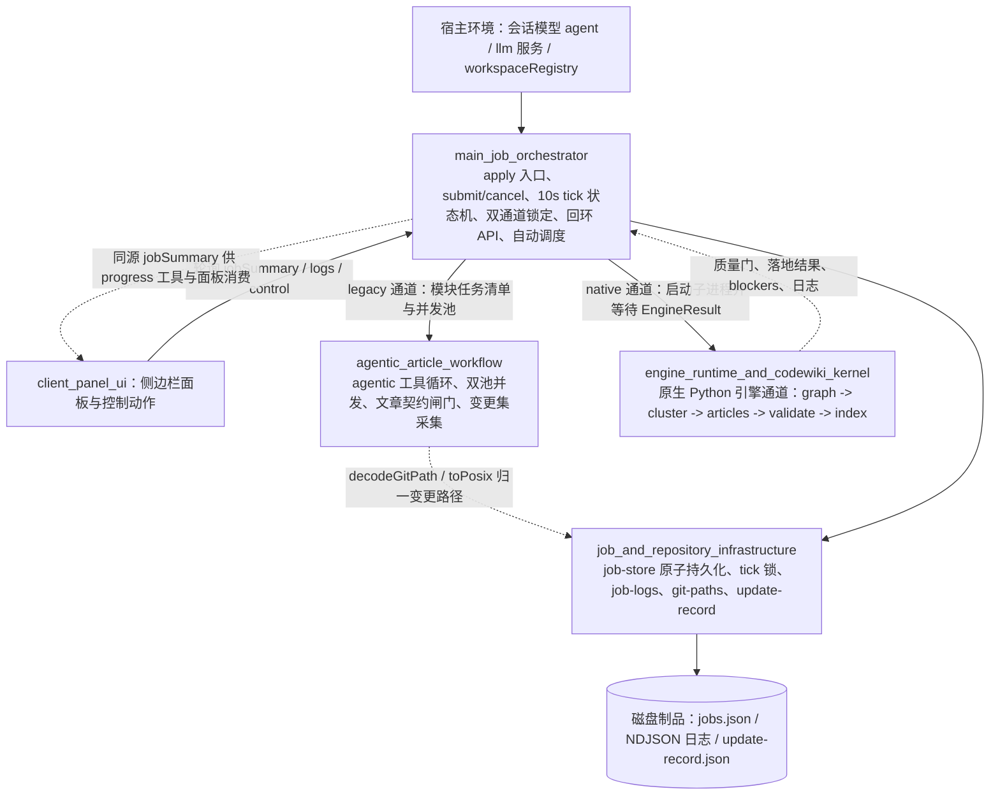

# 作业编排与 Agentic 文章流水线（job_orchestration_and_agentic_article_pipeline）

## 模块用途

本模块是 CodeWiki 全仓 wiki 编译的**作业控制与文章产出层**。它把原本同步、长耗时的 wiki 编译过程改造成「提交即返回、后台推进、可观测、可取消、可跨实例接管」的作业系统：

- 对会话模型暴露 `cw`、`codewiki_generate`、`codewiki_update`、`codewiki_progress`、`codewiki_note`（手工维护经验教训/设计决策页）等工具；
- 对侧边栏面板提供回环 HTTP API，用于任务列表、仓库总览、会话记录、引擎日志与控制动作；
- 以 10 秒一拍的 tick 状态机推进每个编译作业；
- 在首个 tick 锁定编译通道：默认走原生 Python 引擎通道，兼容时走 Node 内的 agentic 文章写作通道；
- 负责作业持久化、跨实例接管、取消、自动提交产物、增量调度与终态唤醒；
- 把编译结果裁决为 `done` / `partial` / `failed` / `cancelled`，并决定是否允许推进编译基线。

本模块本身不重复实现原生引擎的九段流水线，而是把重活委托给外部 `engine_runtime_and_codewiki_kernel`；同时通过 `agentic_article_workflow` 提供可离线测试、可精确编辑、可并发派发的 Node 侧写作通道。

## 架构总览

核心分层关系：

1. **编排层**：`main_job_orchestrator` 是作业总线，决定何时、由哪条通道、用什么模型推进哪一篇文章。
2. **写作执行层**：`agentic_article_workflow` 是 legacy/Node 通道的核心，提供可反复读代码、精确编辑文章、派发子模块的工作台。
3. **持久化与裁决层**：`job_and_repository_infrastructure` 提供原子读写、跨进程锁、孤儿接管、引擎事件日志、Git 路径归一与终态判定。
4. **外部通道**：原生引擎通道由 `engine_runtime_and_codewiki_kernel` 实现，本模块只组装环境、启动子进程、收割结果，不干涉引擎内部流水线。

## 核心组件文档

| 组件 | 职责 | 详细文档 |
| --- | --- --- |
| 主作业编排器 | 插件 `apply` 入口、工具注册、回环 API、作业提交、取消、tick 状态机、双通道锁定、项目闸门、自动调度、终态唤醒 | [main_job_orchestrator.md](main-job-orchestrator.md) |
| Agentic 文章写作工作流 | `runAgenticArticles` 双池并发、`runAgenticArticle` 工具循环、`read_code` / `edit_article` / `generate_sub_module`、文章契约闸门、变更集采集 | [agentic_article_workflow.md](agentic-article-workflow.md) |
| 作业与仓库基础设施 | `createJobsStore` 原子读写与 tick 锁、`planForeignJob` 跨实例接管、`planNativeReplay` 重放裁决、NDJSON 引擎日志、Git quotepath 解码、`judgeOutcome` 终态与基线裁决 | [job_and_repository_infrastructure.md](job-and-repository-infrastructure.md) |

## 关键运行约定

- **提交制**：工具调用立即返回 `jobId` 与当前阶段，长编译由后台服务消化，不要求会话模型轮询。
- **通道互斥**：作业一旦在首个 tick 被锁定为 `channel='native'`，后续全程走原生通道，不再回落到 legacy 阶段 handler。
- **凭证不落地**：模型请求经宿主 `llm` 服务按 provider 解析；原生子进程只接收桥生成的占位 key。
- **失败显式**：作业存储读取损坏、不可读或函数值/凭证命中闸门时按 fail-closed 处理，不假装「没有活动任务」。
- **终态语义**：只有 `done` 允许推进编译基线；`partial`、`failed`、`cancelled` 都不允许前移基线。
- **可观测同源**：`codewiki_progress` 与侧边栏面板消费同一份 `jobSummary`，另可通过引擎 NDJSON 日志与 `update-record.json` 复盘慢任务、失败文章与未归属变更。