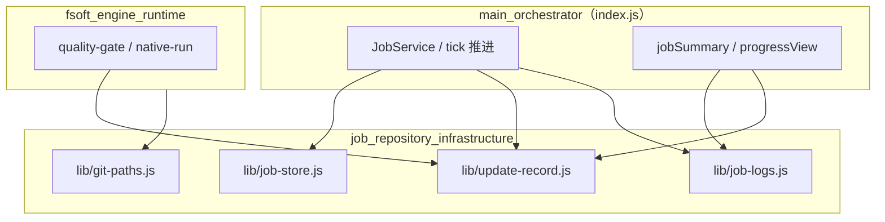
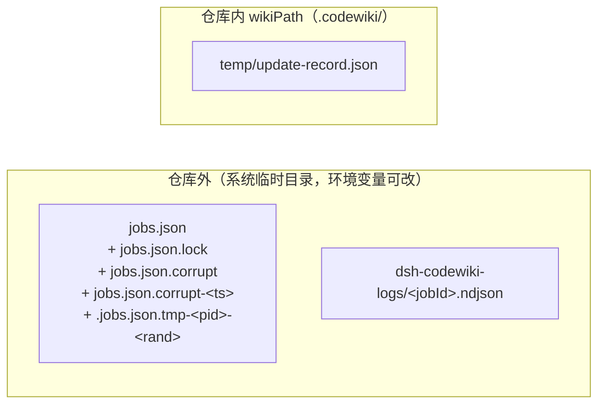
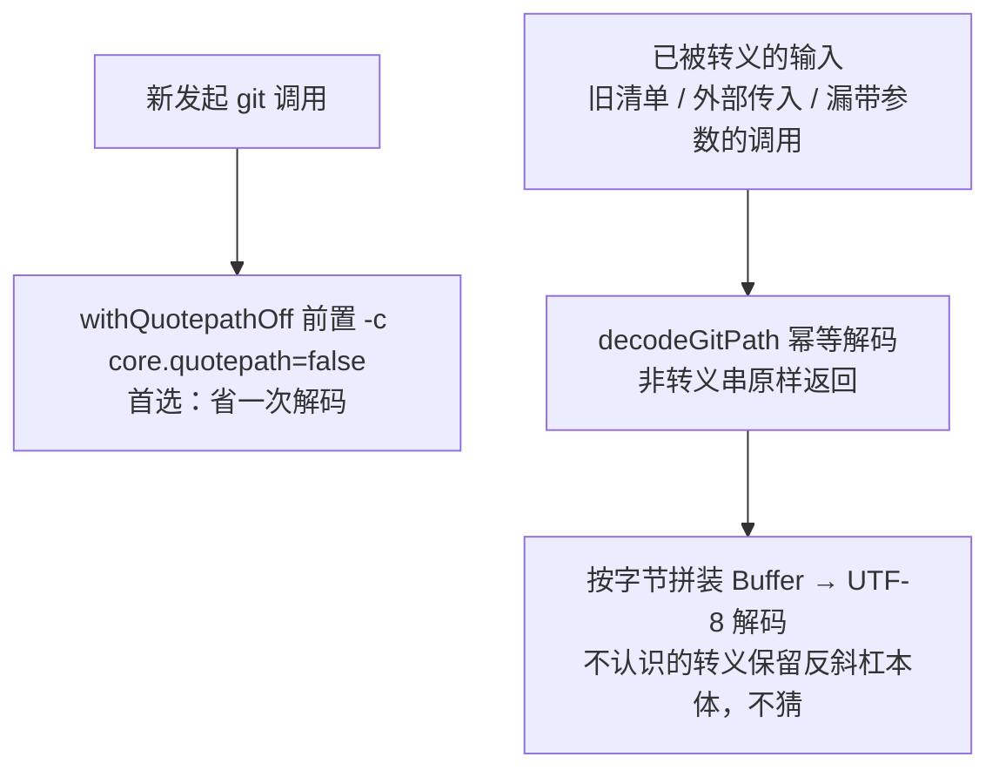
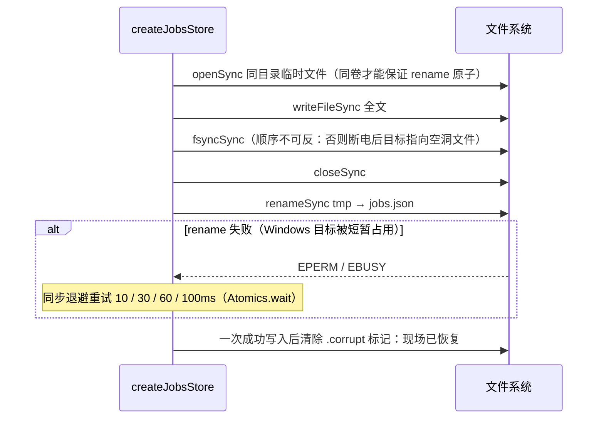
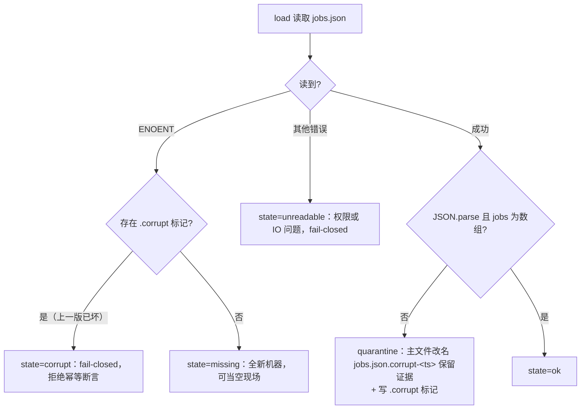
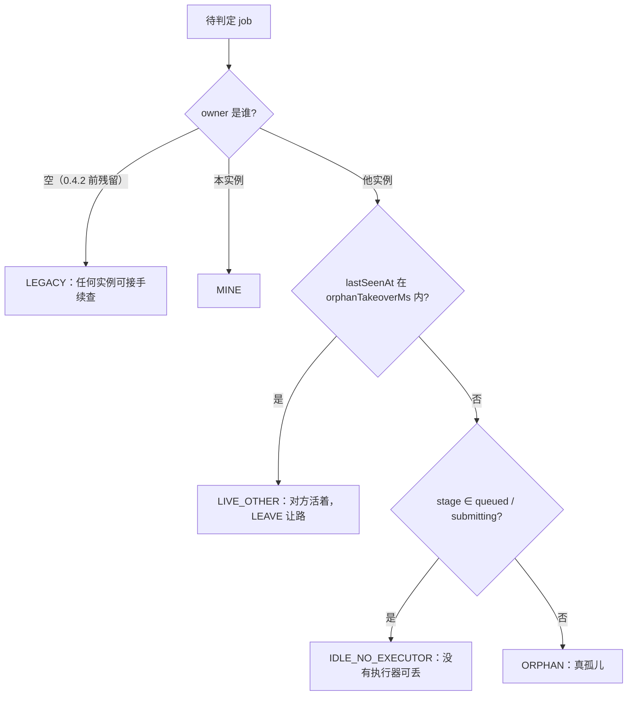
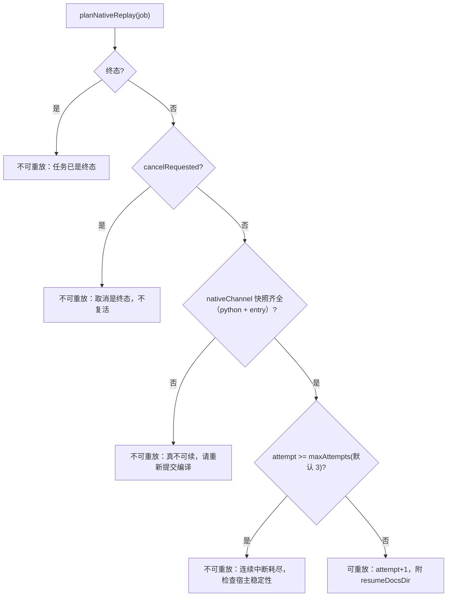
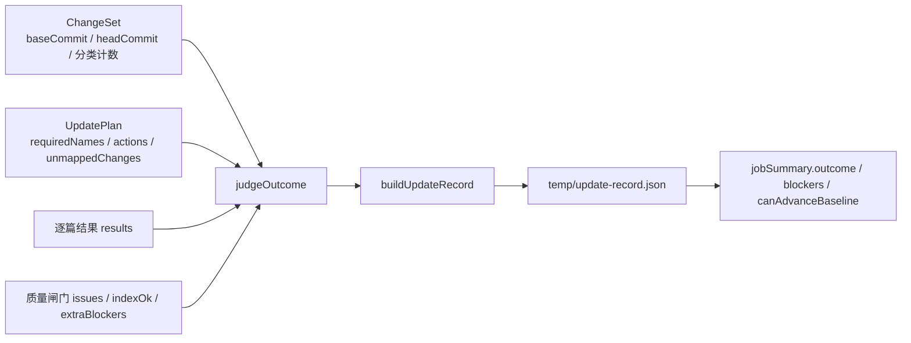

# 作业仓储基础设施（job_repository_infrastructure）

## 简介

本模块是整个编译作业系统的**持久化与观测底座**，属于 [platform_infrastructure_and_developer_tooling](platform-infrastructure-and-developer-tooling.md) 的子模块。它把四件「与业务推进无关、但任何一条语义错了都会造成跨进程重复执行或现场丢失」的基础设施职责从编排层（[main_orchestrator](main-orchestrator.md) 的 `tick` 逻辑）中剥离出来，做成可独立测试的纯函数 / 小类：

1. **git 路径归一**（`lib/git-paths.js`）——铲平 git 输出与字面路径比较之间的两层落差（`core.quotepath` 八进制转义、Windows 反斜杠）。
2. **作业状态仓储**（`lib/job-store.js`）——`jobs.json` 的原子读写、损坏隔离、跨进程 tick 锁、多实例现场合并、所有权判定、原生通道快照重放裁决。
3. **引擎事件日志**（`lib/job-logs.js`）——每个任务一份 NDJSON 落盘日志，保证「进程死掉之后日志还活着」。
4. **编译结果更新记录**（`lib/update-record.js`）——把一次编译的 ChangeSet、UpdatePlan、逐篇结果收成版本化 JSON，判定 `done / partial / failed` 终态并回答「能不能推进编译基线」。

设计动机：作业状态是**跨进程**现场（同一台机器两个宿主窗口各跑一个 JobService，共享一份 `jobs.json`），任何「读不出来就当没有任务」的静默处理都会导致同一仓库被重复提交、两个引擎同时往同一仓库写。因此本模块的所有失败路径都是**显式**的：`ok / missing / corrupt / unreadable` 四态必须由调用方区分，幂等判定只在 `ok | missing` 上成立（fail-closed）。

## 模块组成

| 文件 | 核心导出 | 职责 |
| --- | --- | --- |
| `lib/git-paths.js` | `decodeGitPath`、`toPosix`、`withQuotepathOff`、`GIT_QUOTEPATH_OFF`、`decodeGitPaths` | git 路径转义解码 + POSIX 分隔符归一（全局唯一实现） |
| `lib/job-store.js` | `createJobsStore`、`normKey`、`save`、`load` / `loadForIdempotency`、`acquireTickLock` / `releaseTickLock`、`classifyOwnership`、`planForeignJob`、`planNativeReplay`、`snapshotNativeRun`、`mergeJobLists`、`heartbeat`、`findActiveJob` | 磁盘原子层 + 现场合并 + 所有权 + 原生通道重放 |
| `lib/job-logs.js` | `appendLog`、`readLogTail`、`removeLog`、`logFileOf`、`logStats` | NDJSON 引擎事件日志落盘与读回 |
| `lib/update-record.js` | `judgeOutcome`、`buildUpdateRecord`、`saveUpdateRecord`、`loadUpdateRecord`、`describeOutcome`、`isTerminalStage` | 编译结果版本化记录与终态判定 |

## 架构总览

- **`job-store.js`** 是编排层的持久化后端：`createJobsStore({ file })` 由宿主在启动时装配，`tick` 推进时通过 `acquireTickLock` 保证同一时刻只有一个实例在改写现场。
- **`update-record.js`** 同时被引擎侧使用：`judgeOutcome` 输出的 `canAdvanceBaseline` 是「基线能否前移」的唯一判据，与 [fsoft_engine_runtime](fsoft-engine-runtime.md) 的质量闸门语义衔接。
- **`git-paths.js`** 的 `toPosix` 是全局唯一的分隔符归一实现（此前在 apply-plan / manifest / mapping / native-state / output / quality-gate 六个模块各抄一份，现已全部收口）。
- **`job-logs.js`** 的产物经 `jobSummary.logFile` / `nativeLogs` 暴露给面板与 `/api/codewiki/logs` 端点。

## 磁盘布局

为什么日志与 `jobs.json` 放在仓库外：`.codewiki/` 里多一个运行期文件就会变成「提交之后产生的未跟踪文件」，每轮都脏工作区。`update-record.json` 例外——它本来就是 wiki 的一部分，落在 `temp/` 下随仓库走，事后可复盘。

## 核心机制

### 1. git 路径归一（git-paths.js）

git 的路径输出与「同一件事」有两层落差，本模块负责把两层都铲平，且两边能独立成立：

- **落差一：`core.quotepath`（默认 true）**。非 ASCII 路径在 `--name-only` / `--name-status` 输出里被写成 `"a/\344\270\255.md"`（八进制字节转义 + 双引号包裹），任何按字面量比较路径的白名单代码都会当场失配。
- **落差二：转义按字节做**。「解开转义」必须把字节重新拼成 Buffer 再按 UTF-8 解码——一个中文字符是三个 `\NNN`。

应对策略是双保险：

`toPosix` 只换分隔符（`\` → `/`），**不** trim、不去 `./`、不做 `path.posix.normalize`——「上跳」是安全判据，必须由调用方显式判定后再动。

### 2. 作业状态仓储（job-store.js）

#### 硬不变量

| # | 不变量 | 违反后果（真实事故） |
| --- | --- | --- |
| A | `jobs.json` 永远只由「同目录临时文件 + fsync + rename」整体替换 | 旧实现直接覆盖写，写一半崩溃得到截断 JSON，`loadJobs` 的 catch 把它读成「没有任务」→ 同仓库重复提交、双引擎并发写 |
| B | 读不出来时不允许当成「没有活动任务」：必须区分 `ok / missing / corrupt / unreadable` | 幂等判定只在 `ok | missing` 成立，其余 fail-closed |
| C | 敏感凭证与函数值不得进 `jobs.json` | `JSON.stringify` 对函数**静默丢弃**，于是序列化器主动检测函数值（抛 `job-serialize-function`）与疑似凭证字段（`SECRET_KEY_RE` 命中即拒写 `job-secret-field`），让新宿主按当前配置重建执行器 |
| D | 取消是终态 | 任何重放裁决都先看 `cancelRequested`，绝不复活血 |

#### 原子写与损坏隔离流程

读取侧的四态判定与隔离：

为什么改名还要留标记：损坏文件被改名后原路径就空了，后来者只会看到 ENOENT；若把 ENOENT 一律当 missing，隔离的那一刻起幂等判定就 fail-open。标记必须活到一次成功写入为止。

#### 跨进程 tick 锁

- 锁文件 `jobs.json.lock`，内容为 `pid|instanceTag|时间戳`。
- 用 `flag: 'wx'` 创建，`EEXIST` 时按文件系统 mtime 判活（`staleMs` 默认 60s）；**存活判定只用真实时钟**——拿调用方合成的 now 去减 mtime 就是两个时钟混用，负年龄会被读成「活的」，崩溃锁永远等不到接管。
- 释放时校验 token 归属：绝不会删掉「已超时被别的实例接管」的锁（旧实现无条件 unlink，两个实例交错时会把对方的锁删掉，两边同时推进同一 job）。

#### 所有权判定与外来任务处置

`lastSeenAt` 取 `heartbeatAt / updatedAt / createdAt` 的最大值——`mergeFromDisk` 会用磁盘版本整体替换内存版本，两组时间戳可能不同步。心跳按 `HEARTBEAT_MS = 30s` 节流（`jobs.json` 是整文件重写，每 tick 写一遍没必要）。

外来任务（非 MINE / LIVE_OTHER）的处置由 `planForeignJob` 裁决：

| 情形 | action | 理由 |
| --- | --- | --- |
| `submitting` 停更 | `VOID` | 提交未完成（还没过凭证校验），没有可续状态，任何来源都作废 |
| `queued` 且 `auto === true` | `VOID` | 自动调度遗留的排队项，下一轮扫描会重新提交；作废后同仓幂等记录释放 |
| 其余（如手动提交的排队项） | `ADOPT` | `adoptOrphan` 接管，按 FIFO 继续排队 |

「没有执行器可丢」的阶段单列 `NO_EXECUTOR_STAGES = [queued, submitting]`：旧实现把这类 job 也按孤儿接管，会把一条正常排队任务写成「原实例停更 X 分钟，本实例接管推进」，并在原生通道上直接判失败。

#### 原生通道快照与重放裁决

`planNativeReplay` 回答「宿主重启后该不该重跑这一轮原生编译」。旧行为是「`nativeStarted === true` 且内存无执行器 → 直接 failed」，把「执行器丢了」误当成「这轮编译不可续」——而原生通道的全部输入本来就在 job 上，重启后完全可重放：

`resumeDocsDir`：宿主强杀不会执行 `startNativeRun` 的 finally，临时目录里保留的是引擎已提交的叶子终态；重放时只补水缺失状态，不覆盖它。

`nativeChannel` 快照（`snapshotNativeRun`）只收「下次还能原样再下发的执行配置」（仓库 / scope / kind / 语言 / 并发度 / 引擎入口 / 超时），**明确不收** llm 服务、bridge（随机端口 + 占位 key）、回调、任何 provider 凭证——持久化它们只会留下过期指针或泄密面。

#### 同仓幂等与会话归属

- `findActiveJob(jobs, cwd)`：同仓只需一个活动任务，返回**最新**那条（历史遗留可能让同一仓库挂多条活动记录）。
- `reassignSession`：同一仓库被另一个会话再次提交时，完成唤醒必须发到新会话；旧会话可能早已关闭。归属历史 `sessionOwnerHistory` 保留最近 10 条，面板能解释唤醒去了谁。
- `mergeJobLists({ mine, disk, dirtyIds })`：disk 覆盖内存的条件只有两条——本实例没改过它（不在 `dirtyIds`），且磁盘版本 `updatedAt` 更新。否则慢 tick 会用过期快照把对方的 note / batchRef 洗掉。

### 3. 引擎事件日志（job-logs.js）

引擎日志此前只留在 `job.nativeLogs` 的最近 20 条里——纯内存、不序列化。真机上一次 99 分钟的编译结束后只能查到最后 3 分钟，前面 96 分钟引擎在干什么无从追查；宿主重启或任务被截断（`MAX_JOBS_KEPT`）时全部消失。本模块让日志在进程死掉之后还活着：

- **格式**：NDJSON，一个任务一个文件 `<LOG_ROOT>/<jobId>.ndjson`。字段固定（`at / jobId / phase / kind` 展开），避免同一文件多种形状无人能解析。
- **写**：`appendLog` 写失败返回 `false` 而不抛——日志是观测，不能因为它把编译打断；但调用方要能把失败如实报出去（`job.logError`），不许静默。
- **容量**：单文件上限 `MAX_LOG_BYTES`（默认 2MB），超过就丢弃前一半、保留最近现场。截断失败的后果只是文件继续变大，不值得打断编译。
- **读**：`readLogTail(jobId, limit)` 返回最近 N 条（钳制在 1–5000，默认 200）；坏行跳过——日志被外部改动或不完整写入时，能读多少给多少比抛错更有用。
- **删**：`removeLog` 强制删除（`force: true`），删不掉就留着，不影响任何判定。

### 4. 编译结果更新记录（update-record.js）

背景缺陷（审计确认）：编译结束只留 `writtenCount / failedCount` 两个数字，于是「为什么这篇没重写」「哪几个变更没人管」事后无法复盘。本模块把 ChangeSet + UpdatePlan + 逐篇结果收成版本化记录（`UPDATE_RECORD_VERSION = 1`，相对路径 `temp/update-record.json`）：

**终态语义**：

| outcome | 含义 | canAdvanceBaseline |
| --- | --- | --- |
| `done` | 完整成功：计划内必需文章全部写好、变更全部有归属、质量闸门全过 | 是 |
| `partial` | 部分完成：已成功的文章可入库，但「全部已消化」不成立 | 否 |
| `failed` | 没有可交付成果（0 篇成功，或硬性前置缺失） | 否 |
| `cancelled` | 任务被取消 | 否 |

**blockers 的六类降级来源**（每一类都会 push 至少一条）：`missing-article`（计划内缺页，区分「计划要求写但没写」与「必需文章没产出」）、`article-failed`（逐篇失败）、`unmapped-changes`（源码变更没有任何文章归属——非源码文件 README/CodeWiki.md/CHANGELOG 不算，否则正常增量永远落 partial）、`missing-sources`（文章缺 `source_files`）、`quality`、`index`（索引重建或入口校验未过）、外加调用方补充的 `extra`。

> 注意：实测探针（2026-10-30）确认 `partial` 分支**当前不可达**——六类来源每个都 push blocker，所以 `canAdvanceBaseline` 与旧的 `outcome === 'done'` 行为完全一致。之所以把判据写成显式形式 `done || (partial && writtenCount > 0 && blockers.length === 0)`，是因为兼容通道（tickIndex）与 native-run / quality-gate 通道的语义不同：前者一旦放宽就会把未消化的变化记成已消化，wiki 会静默落后于代码。将来若放宽 blocker 规则，partial 分支会自动按「有成果且无缺陷才推进」生效。

## 环境变量与关键常量

| 名称 | 位置 | 默认值 | 作用 |
| --- | --- | --- | --- |
| `DSH_CODEWIKI_LOG_DIR` | `job-logs.js` | `<os.tmpdir()>/dsh-codewiki-logs` | NDJSON 日志根目录 |
| `DSH_CODEWIKI_LOG_MAX_BYTES` | `job-logs.js` | `2 * 1024 * 1024`（下限 64KB） | 单任务日志上限，超限丢弃前一半 |
| `GIT_QUOTEPATH_OFF` | `git-paths.js` | `['-c', 'core.quotepath=false']` | 前置到任意 git 调用参数表（须紧跟 `git` 之后、子命令之前） |
| `JOBS_SCHEMA` | `job-store.js` | `2` | jobs.json 的 schema 版本 |
| `NATIVE_SNAPSHOT_VERSION` / `NATIVE_MAX_ATTEMPTS_DEFAULT` | `job-store.js` | `1` / `3` | 原生通道快照版本 / 重放尝试上限 |
| `HEARTBEAT_MS` | `job-store.js` | `30000` | 心跳节流间隔 |
| `UPDATE_RECORD_VERSION` / `UPDATE_RECORD_REL` | `update-record.js` | `1` / `temp/update-record.json` | 结果记录版本与相对路径 |

运行时要求 Node ≥ 20（见仓库根 `package.json` 的 `engines` 字段；本模块全部使用 ESM `node:fs` / `node:os` / `node:crypto` / `SharedArrayBuffer + Atomics.wait`）。

## 相关模块

- [main_orchestrator](main-orchestrator.md)——本模块的主要消费方：`JobService` 装配 `createJobsStore`、`tick` 使用锁与所有权判定、`jobSummary` 把 `outcome / blockers / logFile` 透传给面板。
- [fsoft_engine_runtime](fsoft-engine-runtime.md)——`quality-gate` / `native-run` 使用 `canAdvanceBaseline` 的语义；引擎各模块统一通过 `git-paths.js` 做路径归一。
- [browser_ui_panel](browser-ui-panel.md)——面板消费 `readLogTail` 与 `describeOutcome` 文案展示编译终态。
