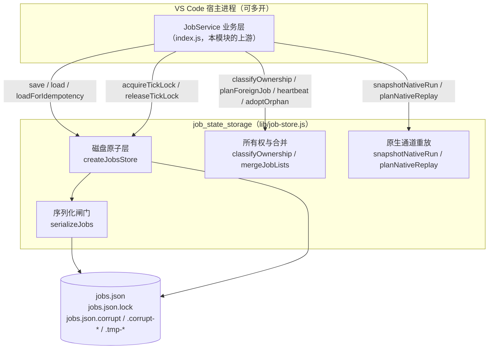
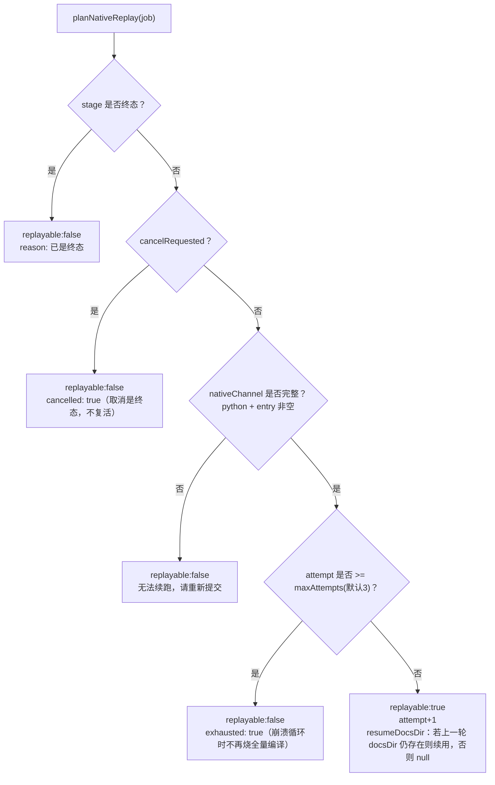
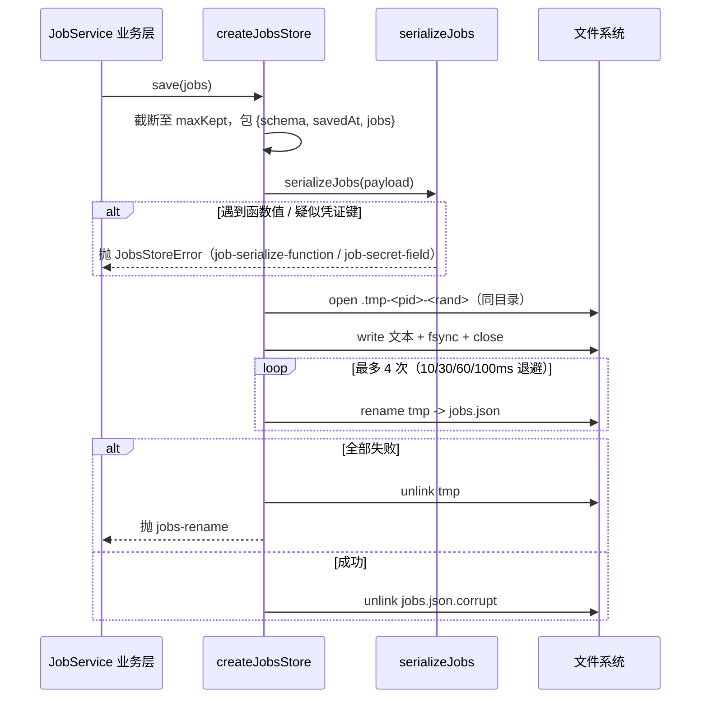
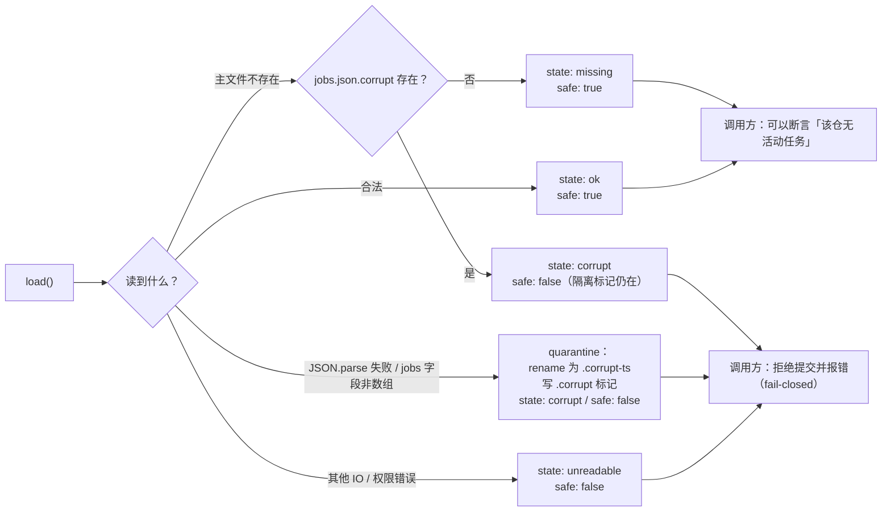
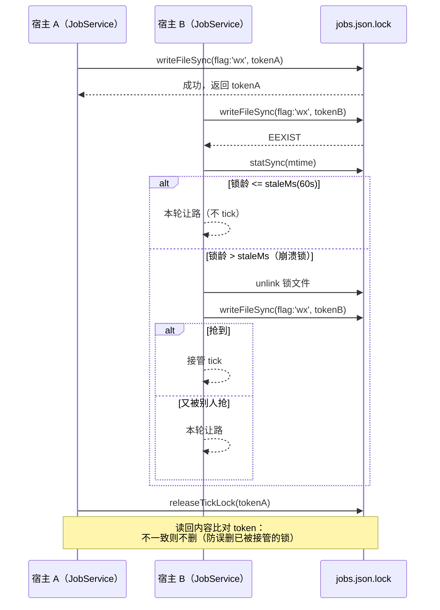

# job_state_storage（作业状态持久化存储）

## 简介

`job_state_storage` 是 [State___Observability_Management](state-observability-management.md) 下负责「作业现场持久化」的核心模块，源码位于 `lib/job-store.js`。它把 JobService 原本与 tick 业务推进缠绕在一起的持久化逻辑独立抽离为可单测的纯函数 / 小类层，解决三个关键问题：

1. **磁盘层**：对 `jobs.json` 做原子读写、损坏检测、跨进程 tick 锁，所有读写失败显式抛错，绝不静默吞掉。
2. **现场合并**：多宿主实例的 job 列表合并、同仓幂等查找、所有权 / 心跳判定。
3. **原生通道重放**：可序列化的执行配置快照，以及「宿主重启后该重跑还是该失败」的裁决。

它是整个系统里**跨进程共享作业现场**的唯一权威入口：同一台机器上两个 VS Code 宿主窗口各自运行一个 JobService，但共享同一份 `jobs.json`。模块维护着四条硬不变量（A：原子替换；B：读不出来时不允许当「没有任务」；C：敏感凭证与函数值绝不出库；D：取消是终态，绝不复活），这些不变量直接决定了系统是否会重复提交同一仓库、是否会泄露凭证。

> 兄弟模块：作业运行日志的删除清理见 [job_log_management](job-log-management.md)；作业整体阶段状态的判定与外部 update-record 文件读取见 [update_status_tracking](update-status-tracking.md)。

## 在系统中的位置



## 核心组件

### 路径身份：`normKey`

```javascript
normKey(p)
```

把任意路径字符串归一化为「仓库身份 key」：去掉结尾分隔符、规范化，且仅在 win32 平台折叠大小写。它是「同一仓库只允许一个活动任务」这条幂等规则的比对基准。注释中特意说明：本模块自带一份该函数，是为了避免反向依赖 `index.js` 里的同名实现。

### 异常类型：`JobsStoreError`

所有磁盘层失败的统一异常，携带 `code`（如 `jobs-store-no-file` / `job-serialize-function` / `job-secret-field` / `jobs-write` / `jobs-rename` / `jobs-lock`）、`path`、`detail` 三个字段，让调用方能区分「写失败」「替换失败」「序列化被拒」这几类完全不同的故障并做出不同决策。

### 序列化闸门：`serializeJobs`

`JSON.stringify` 的自定义 replacer，拒绝两类值：

- **函数值**：直接抛 `job-serialize-function`。这是为了堵住一个真实的静默故障——`JSON.stringify` 会**静默丢弃**函数，`llm` 这类执行期依赖会悄悄消失，留下一份「看起来正常但缺字段」的快照。现在的策略是让新宿主按当前配置重建执行器，而不是读取残缺快照。
- **疑似凭证字段**：键名命中 `api[-_]?key|secret|passw|authorization|private[-_]?key|(^|[-_])token$`（大小写不敏感）即抛 `job-secret-field`。刻意放宽为「键名包含」匹配，是因为真实事故中的键名是 `CODEWIKI_API_KEY` 这类环境变量名，而非干净的 `apiKey`。

### 磁盘层工厂：`createJobsStore({ file, maxKept = 30, instanceTag = 'svc' })`

返回一个 store 对象，暴露：`load`、`loadForIdempotency`、`save`、`writeAtomic`、`acquireTickLock`、`releaseTickLock`。其配套文件三件套为：

| 文件 | 作用 |
| --- | --- |
| `file`（通常 `jobs.json`） | 主现场文件 |
| `file + .lock` | 跨进程 tick 锁，内容为 `pid|instanceTag|epoch` token |
| `file + .corrupt` | 损坏标记：上次主文件被隔离的事实记录 |
| `file + .corrupt-<ts>` | 被隔离的损坏文件本体（保留证据供人排查） |
| `file + .tmp-<pid>-<rand>` | 原子写用的临时文件（与目标同卷） |

#### `load()` 的四态返回

读取不做「坏即空」的简化，而是返回 `{ jobs, state, error?, quarantinedAt? }`，`state` 取值：

- `ok`：成功读到合法现场。
- `missing`：主文件不存在，且 `.corrupt` 标记不存在——可以当全新机器。
- `corrupt`：主文件不是合法 JSON（或 `jobs` 字段不是数组）——已把坏文件改名为 `.corrupt-<ts>` 并写入 `.corrupt` 标记。
- `unreadable`：权限 / I/O 错误，无法读取。

#### `loadForIdempotency()`

在 `load` 之上附加 `safe: true/false` 字段。**只有 `ok` 或 `missing` 时 `safe` 为真**；`corrupt` / `unreadable` 一律 `safe: false`，因为此时「该仓库没有活动任务」这个断言在事实上无法成立。注释明确指出：把坏文件当空，就是旧实现里同一仓库被两个引擎重复执行、同时往同一仓库写的直接原因。

#### `save(jobs)`

将任务列表截断到最近 `maxKept` 条，套上 `{ schema: JOBS_SCHEMA(=2), savedAt, jobs }` 结构，经 `serializeJobs` 序列化后走 `writeAtomic` 落盘。

#### `writeAtomic(text)`

严格的「临时文件 → open/write → fsync → close → rename」流水线：

1. 临时文件必须与目标**同目录同卷**（否则 rename 会退化为复制，失去原子性）。
2. 先写、再 `fsync`、最后 `rename`。顺序颠倒会让断电后目标指向一个长度已知但内容空洞的文件。
3. `rename` 在 Windows 上可能因目标被另一个实例短暂占用而 EPERM/EBUSY，按 `[10, 30, 60, 100]ms` 退避重试 4 次，仍失败则清理临时文件并抛 `jobs-rename`。
4. rename 成功后**立刻清除 `.corrupt` 标记**：一次成功写入即证明现场已恢复正常，幂等判定不必再 fail-closed。

#### `acquireTickLock({ staleMs = 60000 })` / `releaseTickLock(token)`

跨进程的 tick 推进锁。与旧实现的两点关键区别：

- 锁内容带 `instanceTag`，释放时校验归属——绝不会删掉「已经超时被别的实例接管」的锁。
- 存活判定只用文件系统 `mtime` 的真实时钟，不接受调用方合成的 `now`（否则负年龄会被误读为「活的」，崩溃锁永远等不到接管）。
- 超时（默认 60s）后强删并重抢一次；抢不到说明别的实例已接手，本轮直接让路。

### 状态判定常量与工具

| 导出 | 含义 |
| --- | --- |
| `TERMINAL_STAGES = ['done', 'partial', 'failed', 'cancelled']` | 终态阶段集合 |
| `NO_EXECUTOR_STAGES = ['queued', 'submitting']` | 不持有任何在飞执行器的阶段；超时只意味着「没人替它推进」，绝不等于「执行器丢失」 |
| `isTerminalStage(stage)` | 是否终态 |
| `OWNERSHIP = { MINE, LEGACY, LIVE_OTHER, IDLE_NO_EXECUTOR, ORPHAN }` | 五种所有权分类 |
| `FOREIGN_ACTION = { LEAVE, ADOPT, VOID }` | 遇到「别的实例拥有的非终态任务」时的三种处置 |
| `HEARTBEAT_MS = 30000` | 运行心跳节流周期 |

### 所有权与心跳

- **`lastSeenAt(job)`**：取 `heartbeatAt / updatedAt / createdAt` 三者中**最大**的那个可解析时间戳（不是「第一个存在的」），因为磁盘版本可能整体覆盖内存版本，两组时间戳可能不同步。
- **`classifyOwnership(job, { instanceId, now, orphanTakeoverMs })`**：无 owner → `LEGACY`（0.4.2 之前的残留，任何实例都可接手）；owner 是自己 → `MINE`；心跳在 `orphanTakeoverMs` 内 → `LIVE_OTHER`；超过阈值时，按是否处于 `NO_EXECUTOR_STAGES` 区分为 `IDLE_NO_EXECUTOR` 与 `ORPHAN`。时间戳损坏（手工编辑）时按 `LEGACY` 处理。
- **`heartbeat(job, { instanceId, everyMs })`**：仅当 `owner === instanceId` 且距上次心跳超过 `everyMs` 才同时刷新 `heartbeatAt` 与 `updatedAt`——`jobs.json` 是整文件重写，每 tick 写一遍没有必要。
- **`adoptOrphan(job, { instanceId })`**：把孤儿任务的 `owner` 改成自己，同时记录 `ownerAdoptedAt`，并刷新心跳。

### `planForeignJob(job, { instanceId, now, orphanTakeoverMs })`

tick 碰到「别的实例拥有的非终态任务」时的统一裁决：

```mermaid
flowchart TD
    A["遇到非本实例 job"] --> B{"classifyOwnership"}
    B -->|"MINE"| L["LEAVE（正常 tick）"]
    B -->|"LIVE_OTHER"| L
    B -->|"LEGACY"| D{"stage?"}
    B -->|"ORPHAN"| D
    B -->|"IDLE_NO_EXECUTOR"| D
    D -->|"submitting"| V["VOID：<br/>提交未完成，没有可续状态"]
    D -->|"queued 且 auto=true"| V2["VOID：<br/>自动调度遗留排队项，下一轮扫描会重新提交"]
    D -->|"queued（手动）/ 其他"| AD["ADOPT：<br/>按 FIFO 继续排队 / 接管推进"]
```



这个裁决修复了旧实现的两个真实故障：

1. 旧实现把 `queued` / `submitting` 的 job 也按「执行器孤儿」接管，会把一条正常排队任务写成「原实例停更 X 分钟，本实例接管推进」，并在原生通道上直接判失败。
2. 旧实现对别的实例的排队项直接 `continue`，导致宿主重启前提交的排队项**永久卡在 `queued`**——既占着闸门窗口，又让同仓幂等一直返回它，用户连重新提交都做不到。现在按来源分「自动调度 → 作废」「手动 → 接管」。

### 同仓幂等：`findActiveJob(jobs, cwd, { keyOf = normKey })`

遍历所有非终态 job，按 `normKey(j.cwd)` 比对，返回**最新**那条活动任务。取最新而非最早，是因为历史遗留可能让同一仓库挂着多条活动记录，该恢复的是最近那次提交。

### 会话归属转移：`reassignSession(job, sessionId)`

同一仓库被另一个会话再次提交时，完成唤醒必须发到**新的**会话（旧会话可能早已关闭）。本函数把旧 `sessionId` 推入 `sessionOwnerHistory`（最多保留 10 条，含 `from / to / at`），让面板能解释「唤醒到底去了哪个会话」。

### 内存与磁盘现场合并：`mergeJobLists({ mine, disk, dirtyIds })`

`disk` 覆盖内存版本的条件**只有两条**：本实例没改过它（不在 `dirtyIds` 中），且磁盘版本的 `updatedAt` 更新。否则慢 tick 会用过期快照把对方的 `note / batchRef` 洗掉。合并结果按 `createdAt` 升序排列。

### 原生通道快照：`snapshotNativeRun(job, { channel, attempt, docsDir, ... })`

只收「下次还能原样再下发的执行配置」：仓库 scope、kind、语言、模块并发度、Python 引擎入口与超时、可选的 `docsDir` / `rawTreeRoot`。**明确不收** `llm` 服务、bridge 实例（随机端口 + 占位 key）、`onProgress / onLog` 回调、任何 provider 凭证——它们属于「当前宿主」，重启后必须由新宿主重建，持久化只会留下过期指针或泄密面。结构带 `version: NATIVE_SNAPSHOT_VERSION(=1)`。

### 重放裁决：`planNativeReplay(job, { maxAttempts = 3, exists })`

宿主重启后该不该重跑这一轮原生编译。三条刹车依次评估：



设计动机：旧行为在「`nativeStarted === true` 且内存里没有执行器」时直接标 `failed`，把「执行器丢了」误判为「这轮编译不可续」。但原生通道的全部输入本来就在 job 上，重启后完全可重放——代价是重跑一次编译，收益是用户不必手工重新提交；而 `failed` 是纯损失（一个跑了一半的仓库被标成没有成果）。`resumeDocsDir` 逻辑则利用了宿主强杀不会执行 `finally` 这一事实：临时目录里保留的是引擎已提交的叶子终态，重放时只补缺，不覆盖。

> 相关：引擎侧如何消费 `resumeDocsDir` 与原生状态目录，见 [native_state_management](native-state-management.md)（`stateDocFiles`）；工作区基线快照见 [workspace_snapshots](workspace-snapshots.md)。

## 关键流程时序

### 一次原子保存（含损坏隔离）



### 幂等提交前的读取闸门



### 多实例 tick 推进时的跨进程锁



## 数据结构速览

`jobs.json`（schema = 2）顶层：

```jsonc
{
  "schema": 2,
  "savedAt": "2024-…",
  "jobs": [
    {
      "id": "…",
      "owner": "instance-…",
      "ownerAdoptedAt": "…（被接管时才有）",
      "sessionId": "…",
      "sessionOwnerHistory": [{ "from": "…", "to": "…", "at": "…" }],
      "cwd": "/repo/path",
      "stage": "queued | submitting | running | done | partial | failed | cancelled",
      "auto": true,
      "scope": "full | …",
      "kind": "…",
      "language": "…",
      "cancelRequested": false,
      "heartbeatAt": "…",
      "updatedAt": "…",
      "createdAt": "…",
      "nativeChannel": { "python": "…", "entry": "…", "timeoutMs": null, "scope": "full" },
      "nativeSnapshot": { "version": 1, "attempt": 1, "docsDir": "/tmp/…", "capturedAt": "…" }
    }
  ]
}
```

> 注意：任何形如 `apiKey` / `secret` / `authorization` / `token` 的字段一旦出现在对象里，`serializeJobs` 会直接拒写并抛 `job-secret-field`；任何函数值（如 `llm`、`onProgress`）会抛 `job-serialize-function`。

## 设计取舍速查

| 议题 | 旧行为（出问题的实现） | 本模块的裁决 |
| --- | --- | --- |
| 写盘 | `writeFileSync` 直接覆盖，写一半崩溃得到截断 JSON | 临时文件 + fsync + rename，Windows 退避重试 |
| 读坏文件 | `catch` 后静默当「没有任务」→ 同仓被重复提交 | 四态返回 + `loadForIdempotency` 的 `safe` 闸门，corrupt/unreadable 一律 fail-closed |
| 损坏文件 | 直接删掉 | rename 保留证据 + 写 `.corrupt` 标记，直到下一次成功写入 |
| tick 锁 | 无条件 `unlink` 释放，混用合成时钟 | token 校验归属 + 只用文件系统 mtime |
| 排队项遇外实例 | 直接 `continue`，永久卡死 | `planForeignJob`：自动调度作废 / 手动接管 / submitting 作废 |
| 重启后原生通道 | 无执行器 → 直接 `failed` | 按 `nativeChannel` 快照重跑，attempt 上限 3 次防崩溃循环 |
| 序列化 | 函数值被 JSON 静默丢弃 | replacer 显式抛错；凭证键名直接拒写 |

## 与其他模块的关系

- **上游**：JobService（`index.js`）是本模块的唯一调用方，负责把这些纯函数 / store 对象编织进 tick、提交、取消、进度推进的业务循环中；宿主侧的整体编排见 [Extension_Host_Execution_Orchestration](extension-host-execution-orchestration.md)（尤其 [extension_host_core](extension-host-core.md)）。
- **同层兄弟**：
  - [job_log_management](job-log-management.md)：作业运行日志的删除清理（`removeLog`）与 git 路径解码（`decodeGitPath`）。
  - [update_status_tracking](update-status-tracking.md)：从外部 update-record JSON 文件（`loadUpdateRecord`）与 stage 终态判定（`isTerminalStage`）读取作业的对外可见状态。
- **下游消费**：
  - [native_state_management](native-state-management.md)：`planNativeReplay` 给出的 `resumeDocsDir` 如何映射到引擎状态目录（`stateDocFiles`）。
  - [workspace_snapshots](workspace-snapshots.md)：重跑前的工作区基线快照（`createWorkspaceSnapshot`）。
