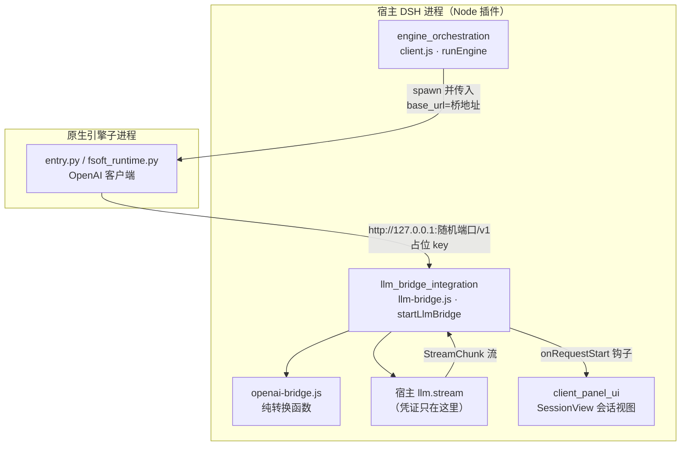
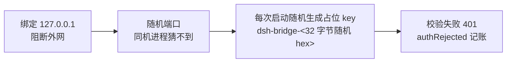
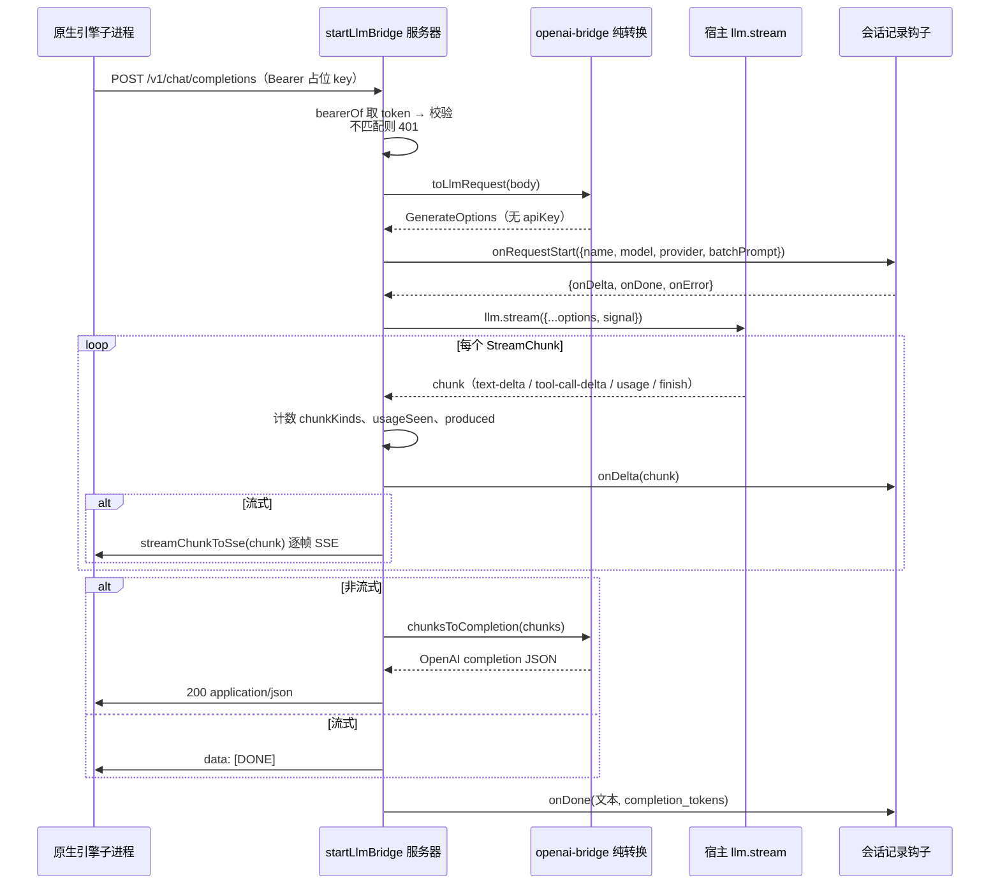
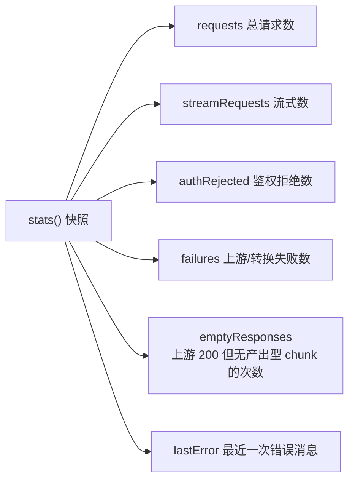
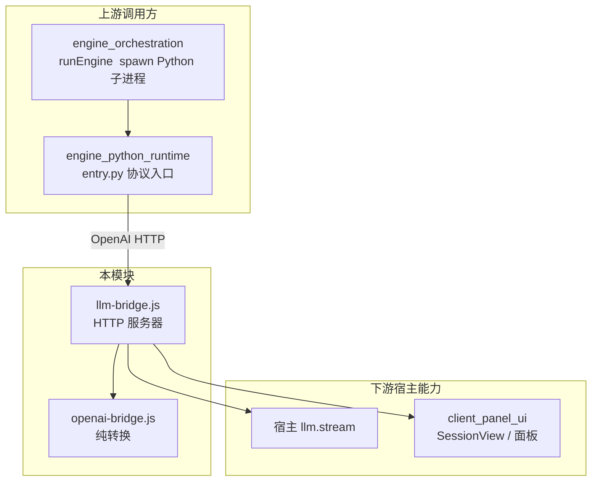

# LLM 桥接集成（llm_bridge_integration）

## 简介

`llm_bridge_integration` 是引擎核心（[engine_core](engine-core.md)）下的一个子模块，负责把原生 FSoft Python 引擎发出的 OpenAI-compatible HTTP 请求，翻译为宿主 DeepSeek Harness（DSH）的 `llm.stream(GenerateOptions)` 调用，并把模型 chunk 流翻译回 OpenAI 响应。

它存在的根本原因是一条硬约束：**插件既不保存也不传递真实密钥**。FSoft 引擎只会认 OpenAI 风格的 `base_url` + `api_key`，而真实凭证只允许存在于宿主 provider 内部。因此桥在进程内起一个绑定 `127.0.0.1` 的随机端口 HTTP 端点，引擎拿一个桥自造的占位 key 打过来，桥用宿主自己的凭证去调真实 provider。

模块由两个文件组成：

| 文件 | 职责 |
| --- | --- |
| `lib/engine/openai-bridge.js` | **纯转换层**：OpenAI 请求体 ↔ DSH GenerateOptions / StreamChunk，无 I/O、无网络、无密钥。导出 `isPlaceholderKey`、`toLlmRequest`、`chunksToCompletion`、`streamChunkToSse` 等。 |
| `lib/engine/llm-bridge.js` | **HTTP 服务器层**：`startLlmBridge` 起 loopback 服务，做鉴权、请求体解析、超时/断连控制、日志与会话记录钩子。 |

## 架构定位

## 安全边界（最重要的设计）

桥等于「用宿主凭证换任意模型调用」的开关，因此三层防护缺一不可：

关键规则：

- 桥**不读**任何凭证文件、**不接收**真实 `api_key`、**不转发** `Authorization` 头。
- `toLlmRequest` 的返回值里永远没有 `apiKey` 字段。
- 访问日志只记 `method/path/status/ms/chunk 计数/usage`，**绝不**记 Authorization；错误体也不回显收到的 key（避免把用户误配的真实 key 写进日志）。
- 占位 key 不复用、不落盘、不进日志；由 `PLACEHOLDER_KEY_PATTERN = /^dsh-bridge-[a-z0-9-]+$/` 与逐次启动的随机串双重校验。

## 协议面

只实现引擎真正用到的路由，不假装是完整 OpenAI：

| 路由 | 方法 | 用途 |
| --- | --- | --- |
| `/healthz` | GET | 桥自身存活探针（不含任何模型信息） |
| `/v1/models` | GET | 引擎/探针的连通性检查，返回 `{id: model, owned_by: provider}` |
| `/v1/chat/completions` | POST | 非流式（`stream` 缺省/false）与流式（`stream: true`）补全 |

请求体上限 32 MB（`MAX_BODY_BYTES`，超限 413），单次模型调用超时默认 10 分钟（`DEFAULT_TIMEOUT_MS`）。

## 请求生命周期（时序图）

### 关键实现细节

1. **客户端断连 → 中止上游**：`res.on('close')` 触发 `AbortController.abort()`，省 token 并让引擎的取消语义真正生效；超时也走同一 `ac.abort()`。
2. **流式逐帧绝不补 `finish_reason`**：`streamChunkToSse` 对每个中间 chunk 直接转发；若误用整条流折叠语义（`chunksToCompletion`），会让引擎把每个 reasoning/tool-call 分片当成一轮结束，最终报 pydantic-ai 的 "Please return text or call a tool" 并重试到上限。
3. **assistant 历史消息必须带 `source.kind='model'`**：宿主 `LlmRuntime.forAdapter()` 会无条件读 `message.source.replayState`；桥没有 replay 能力，只填 `{kind:'model', provider, model}`，不伪造 `replayState`。
4. **tool arguments 保持原始 JSON 字符串**：DSH 的 `ToolCallBlock.arguments` 就是 raw string，提前 parse 会破坏增量拼接；tool 消息的 `toolCallId` 必须对上，否则工具循环断链。
5. **reasoning-delta 不进正文**：思考内容不该出现在文章正文里，也不映射成任何 SSE 帧。
6. **usage 字段名映射**：DSH 的 `inputTokens` 是不含缓存的净输入，OpenAI 的 `prompt_tokens` 含缓存，故 `prompt_tokens = inputTokens + cacheRead + cacheWrite`，缓存单列 `prompt_tokens_details.cached_tokens`。

## 状态与可观测性

`startLlmBridge` 返回 `{url, placeholderKey, port, stats(), close()}`：

`emptyResponses` 是「引擎说这页无需改动、实际一篇文章没写」的唯一可量化源头；`chunkKinds` 只记类型名与条数（正文一律不落日志，可能含源码与文章内容），用于区分「模型真返回空」与「桥丢包」。

## 会话记录钩子

`onRequestStart(task)` 面板钩子把每次 chat 请求暴露给客户端会话视图（见 [client_panel_ui](client-panel-ui.md) 的 `SessionView`）：

- `task` 只含 `name`（`原生请求 · <model>`）、`model`、`provider`、`batchPrompt`（OpenAI messages 拼成的可读文本，超过 200k 字符截断并标注原长）。
- **绝不含** Authorization 与占位 key。
- 所有会话回调都被 `callSession` 沙箱包裹：面板记账失败绝不影响正在跑的模型请求；`onLog` 同理。

## 依赖关系

- **上游**：引擎编排（[engine_orchestration](engine-orchestration.md)）通过 `runEngine` 拉起 Python 引擎子进程，子进程的 OpenAI 客户端把 `base_url` 指向桥地址；Python 侧入口见 [engine_python_runtime](engine-python-runtime.md)。
- **下游**：桥只依赖宿主注入的 `llm.stream` 与会话/日志回调，自身不持有任何 provider 配置。
- **配置来源**：`provider` / `model` / `reasoningEffort` 由插件 Config 的 `batchProvider` / `batchModel` / `batchReasoningEffort` 注入（见 `cordis.patch.yml`，默认 `volces-ark` + `glm-5.3-flash`）。

## 错误翻译口径

上游异常统一包装成 OpenAI 风格错误体（`{error: {message, type, code}}`），引擎按 status + `error.message` 记账：

| 场景 | HTTP 状态 | type |
| --- | --- | --- |
| 占位 key 不匹配 | 401 | `invalid_request_error` / `invalid_api_key` |
| 请求体非合法 JSON 或转换失败 | 400 | `invalid_request_error` |
| 不支持的路由 | 404 | `invalid_request_error` |
| 上游 `llm.stream` 抛错（流未开始） | 502 | `upstream_error` |
| 上游 `llm.stream` 抛错（流已开始） | 200 + SSE `error` 事件 + `[DONE]` | `upstream_error` |
| 桥内部未捕获异常 | 500 | `bridge_error` |

## 相关模块

- [engine_core](engine-core.md) — 本模块的父模块（引擎核心）。
- [engine_orchestration](engine-orchestration.md) — `runEngine` 负责 spawn 引擎子进程并传入桥地址。
- [engine_python_runtime](engine-python-runtime.md) — Python 侧协议入口，是桥的 HTTP 客户端。
- [client_panel_ui](client-panel-ui.md) — `onRequestStart` 钩子的消费方（会话视图）。
